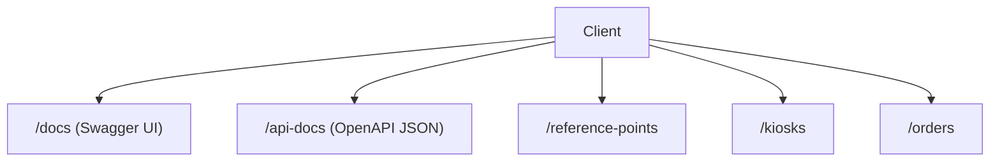
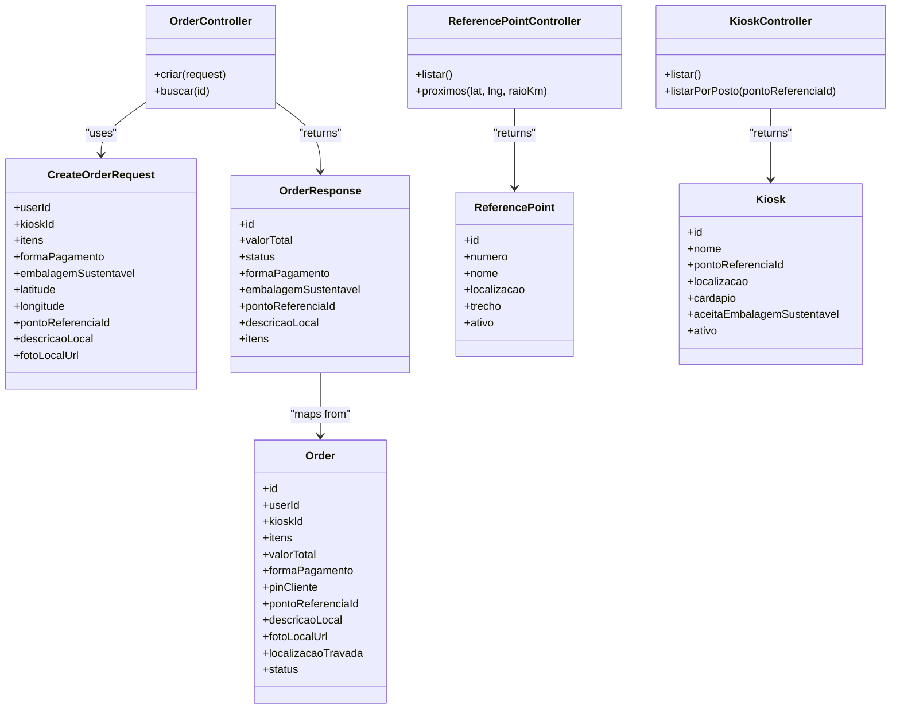
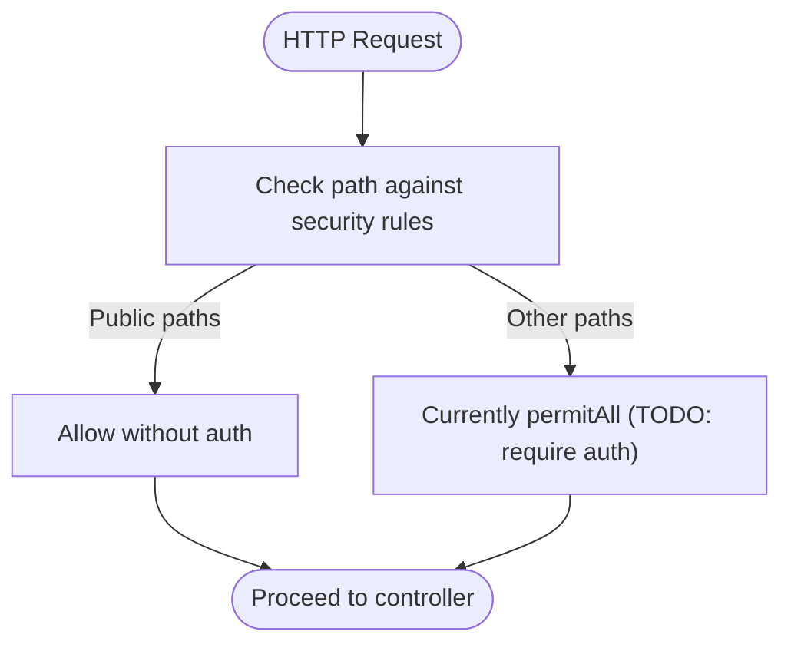
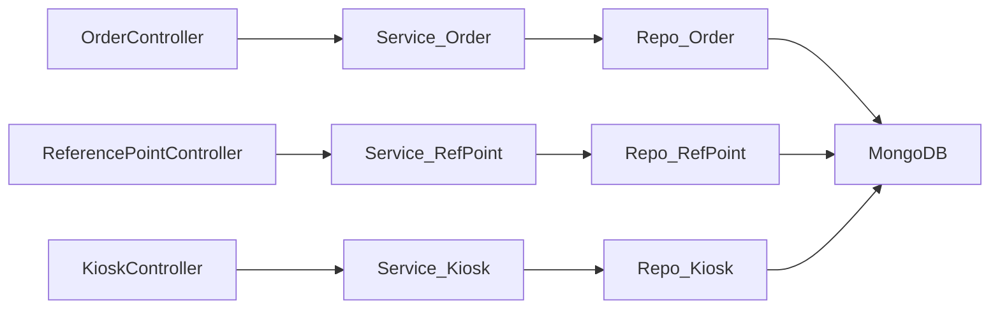
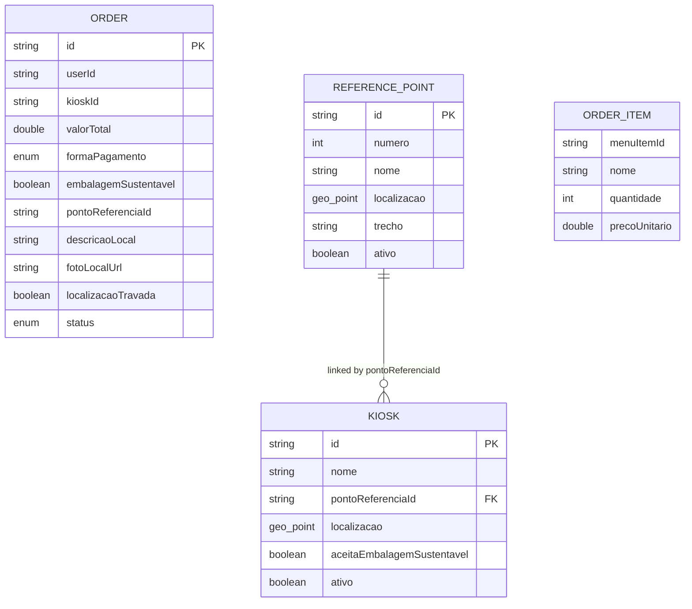

# API Reference

<cite>
**Referenced Files in This Document**
- [OrderController.java](file://backend/src/main/java/com/penaareia/controller/OrderController.java)
- [ReferencePointController.java](file://backend/src/main/java/com/penaareia/controller/ReferencePointController.java)
- [KioskController.java](file://backend/src/main/java/com/penaareia/controller/KioskController.java)
- [SecurityConfig.java](file://backend/src/main/java/com/penaareia/config/SecurityConfig.java)
- [GlobalExceptionHandler.java](file://backend/src/main/java/com/penaareia/config/GlobalExceptionHandler.java)
- [CreateOrderRequest.java](file://backend/src/main/java/com/penaareia/dto/CreateOrderRequest.java)
- [OrderResponse.java](file://backend/src/main/java/com/penaareia/dto\OrderResponse.java)
- [Order.java](file://backend/src/main/java/com/penaareia/model/Order.java)
- [ReferencePoint.java](file://backend/src/main/java/com/penaareia/model/ReferencePoint.java)
- [Kiosk.java](file://backend/src/main/java/com/penaareia/model/Kiosk.java)
- [application.yml](file://backend/src/main/resources/application.yml)
- [pom.xml](file://backend/pom.xml)
</cite>

## Table of Contents
1. [Introduction](#introduction)
2. [Project Structure](#project-structure)
3. [Core Components](#core-components)
4. [Architecture Overview](#architecture-overview)
5. [Detailed Component Analysis](#detailed-component-analysis)
6. [Dependency Analysis](#dependency-analysis)
7. [Performance Considerations](#performance-considerations)
8. [Troubleshooting Guide](#troubleshooting-guide)
9. [Conclusion](#conclusion)
10. [Appendices](#appendices)

## Introduction
This document provides comprehensive API documentation for the Pé na Areia backend REST endpoints exposed by the Order, Reference Point, and Kiosk controllers. It covers HTTP methods, URL patterns, request/response schemas, validation rules, authentication behavior, error formats, and usage examples. It also documents the Swagger/OpenAPI interface available at /docs and provides best practices for consuming the API.

## Project Structure
The backend is a Spring Boot application exposing REST controllers under:
- Orders: /orders
- Reference Points: /reference-points
- Kiosks: /kiosks

Swagger UI is configured at /docs and OpenAPI JSON at /api-docs. Security is currently permissive for public catalog endpoints and docs; JWT-based protection is planned.

**Diagram sources**
- [application.yml:22-26](file://backend/src/main/resources/application.yml#L22-L26)
- [SecurityConfig.java:32-36](file://backend/src/main/java/com/penaareia/config/SecurityConfig.java#L32-L36)

**Section sources**
- [application.yml:1-31](file://backend/src/main/resources/application.yml#L1-L31)
- [SecurityConfig.java:1-41](file://backend/src/main/java/com/penaareia/config/SecurityConfig.java#L1-L41)

## Core Components
- OrderController: Creates orders with location pin and retrieves orders by ID.
- ReferencePointController: Lists active reference points and suggests nearby points based on coordinates and radius.
- KioskController: Lists active kiosks and filters kiosks by reference point ID.
- DTOs and Models: Define request payloads and response structures for orders and domain entities.
- SecurityConfig: Configures public access for catalog endpoints and docs; JWT integration is pending.
- GlobalExceptionHandler: Standardizes error responses for validation and not-found cases.

**Section sources**
- [OrderController.java:15-35](file://backend/src/main/java/com/penaareia/controller/OrderController.java#L15-L35)
- [ReferencePointController.java:12-34](file://backend/src/main/java/com/penaareia/controller/ReferencePointController.java#L12-L34)
- [KioskController.java:12-31](file://backend/src/main/java/com/penaareia/controller/KioskController.java#L12-L31)
- [CreateOrderRequest.java:12-53](file://backend/src/main/java/com/penaareia/dto/CreateOrderRequest.java#L12-L53)
- [OrderResponse.java:12-38](file://backend/src/main/java/com/penaareia/dto\OrderResponse.java#L12-L38)
- [Order.java:15-70](file://backend/src/main/java/com/penaareia/model/Order.java#L15-L70)
- [ReferencePoint.java:16-38](file://backend/src/main/java/com/penaareia/model/ReferencePoint.java#L16-L38)
- [Kiosk.java:14-47](file://backend/src/main/java/com/penaareia/model/Kiosk.java#L14-L47)
- [SecurityConfig.java:27-40](file://backend/src/main/java/com/penaareia/config/SecurityConfig.java#L27-L40)
- [GlobalExceptionHandler.java:15-40](file://backend/src/main/java/com/penaareia/config/GlobalExceptionHandler.java#L15-L40)

## Architecture Overview
The API follows a layered architecture:
- Controllers expose REST endpoints and delegate to services.
- Services encapsulate business logic and data access.
- Models represent MongoDB entities.
- DTOs define API contracts for requests and responses.
- Security configuration controls endpoint authorization.
- Exception handler centralizes error formatting.

**Diagram sources**
- [OrderController.java:15-35](file://backend/src/main/java/com/penaareia/controller/OrderController.java#L15-L35)
- [ReferencePointController.java:12-34](file://backend/src/main/java/com/penaareia/controller/ReferencePointController.java#L12-L34)
- [KioskController.java:12-31](file://backend/src/main/java/com/penaareia/controller/KioskController.java#L12-L31)
- [CreateOrderRequest.java:12-53](file://backend/src/main/java/com/penaareia/dto/CreateOrderRequest.java#L12-L53)
- [OrderResponse.java:12-38](file://backend/src/main/java/com/penaareia/dto\OrderResponse.java#L12-L38)
- [Order.java:15-70](file://backend/src/main/java/com/penaareia/model/Order.java#L15-L70)
- [ReferencePoint.java:16-38](file://backend/src/main/java/com/penaareia/model/ReferencePoint.java#L16-L38)
- [Kiosk.java:14-47](file://backend/src/main/java/com/penaareia/model/Kiosk.java#L14-L47)

## Detailed Component Analysis

### Authentication and Authorization
- Public endpoints:
  - /docs/**, /api-docs/**, /swagger-ui/**
  - /auth/**
  - /reference-points/**
  - /kiosks/**
- Current state: all other requests are permitted until JWT filter is integrated.
- CSRF is disabled; session policy is stateless.
- Planned: restrict order mutation endpoints to authenticated users via JWT.

**Diagram sources**
- [SecurityConfig.java:27-40](file://backend/src/main/java/com/penaareia/config/SecurityConfig.java#L27-L40)

**Section sources**
- [SecurityConfig.java:11-40](file://backend/src/main/java/com/penaareia/config/SecurityConfig.java#L11-L40)
- [application.yml:17-20](file://backend/src/main/resources/application.yml#L17-L20)

### Swagger/OpenAPI Interface
- Swagger UI: /docs
- OpenAPI JSON: /api-docs
- Enabled via springdoc dependency and configuration.

Usage example:
- Open Swagger UI: curl http://localhost:8080/docs
- Fetch OpenAPI spec: curl http://localhost:8080/api-docs

**Section sources**
- [application.yml:22-26](file://backend/src/main/resources/application.yml#L22-L26)
- [pom.xml:66-71](file://backend/pom.xml#L66-L71)

### Orders API

#### POST /orders
Creates an order with location pin, items, and payment method.

- Method: POST
- Path: /orders
- Content-Type: application/json
- Authentication: Currently allowed (planned to require JWT)
- Validation: Uses Jakarta Bean Validation annotations on CreateOrderRequest.

Request schema (CreateOrderRequest):
- userId: string, required
- kioskId: string, required
- itens: array of ItemRequest, required (at least one item)
  - menuItemId: string, required
  - quantidade: integer, required
- formaPagamento: enum PaymentMethod, required
- embalagemSustentavel: boolean, optional
- latitude: number, required
- longitude: number, required
- pontoReferenciaId: string, required
- descricaoLocal: string, required
- fotoLocalUrl: string, optional

Response schema (OrderResponse):
- id: string
- valorTotal: number
- status: enum OrderStatus
- formaPagamento: enum PaymentMethod
- embalagemSustentavel: boolean
- pontoReferenciaId: string
- descricaoLocal: string
- itens: array of Order.OrderItem
  - menuItemId: string
  - nome: string
  - quantidade: integer
  - precoUnitario: number

Example request (curl):
curl -X POST http://localhost:8080/orders \
  -H "Content-Type: application/json" \
  -d '{
    "userId": "user-1",
    "kioskId": "kiosk-1",
    "itens": [
      {"menuItemId": "item-1", "quantidade": 2}
    ],
    "formaPagamento": "CREDIT_CARD",
    "embalagemSustentavel": true,
    "latitude": -22.9068,
    "longitude": -43.1729,
    "pontoReferenciaId": "rp-1",
    "descricaoLocal": "Guarda-sol azul perto do quiosque"
  }'

Example response (HTTP 201 Created):
{
  "id": "order-id",
  "valorTotal": 120.5,
  "status": "CRIADO",
  "formaPagamento": "CREDIT_CARD",
  "embalagemSustentavel": true,
  "pontoReferenciaId": "rp-1",
  "descricaoLocal": "Guarda-sol azul perto do quiosque",
  "itens": [
    {"menuItemId": "item-1", "nome": "Pizza", "quantidade": 2, "precoUnitario": 60.25}
  ]
}

Validation errors (HTTP 400 Bad Request):
- Fields missing or invalid return a structured error body with timestamp, mensagem, and campos map.

Error example:
{
  "timestamp": "2024-01-01T12:00:00Z",
  "mensagem": "Dados invalidos",
  "campos": {
    "latitude": "Latitude do pin e obrigatoria",
    "itens": "O pedido precisa ter ao menos um item"
  }
}

Not found (HTTP 404 Not Found):
- If order lookup fails, returns a generic not found body with timestamp and mensagem.

**Section sources**
- [OrderController.java:23-34](file://backend/src/main/java/com/penaareia/controller/OrderController.java#L23-L34)
- [CreateOrderRequest.java:15-43](file://backend/src/main/java/com/penaareia/dto/CreateOrderRequest.java#L15-L43)
- [OrderResponse.java:15-37](file://backend/src/main/java/com/penaareia/dto\OrderResponse.java#L15-L37)
- [Order.java:18-58](file://backend/src/main/java/com/penaareia/model/Order.java#L18-L58)
- [GlobalExceptionHandler.java:23-32](file://backend/src/main/java/com/penaareia/config/GlobalExceptionHandler.java#L23-L32)

#### GET /orders/{id}
Retrieves an order by its ID.

- Method: GET
- Path: /orders/{id}
- Path parameter:
  - id: string, required
- Authentication: Currently allowed (planned to require JWT)
- Response: OrderResponse

Example request (curl):
curl http://localhost:8080/orders/order-id

Example response (HTTP 200 OK):
{
  "id": "order-id",
  "valorTotal": 120.5,
  "status": "CRIADO",
  "formaPagamento": "CREDIT_CARD",
  "embalagemSustentavel": true,
  "pontoReferenciaId": "rp-1",
  "descricaoLocal": "Guarda-sol azul perto do quiosque",
  "itens": [
    {"menuItemId": "item-1", "nome": "Pizza", "quantidade": 2, "precoUnitario": 60.25}
  ]
}

**Section sources**
- [OrderController.java:30-34](file://backend/src/main/java/com/penaareia/controller/OrderController.java#L30-L34)
- [OrderResponse.java:15-37](file://backend/src/main/java/com/penaareia/dto\OrderResponse.java#L15-L37)

### Reference Points API

#### GET /reference-points
Lists all active reference points.

- Method: GET
- Path: /reference-points
- Authentication: Public
- Response: Array of ReferencePoint

Example request (curl):
curl http://localhost:8080/reference-points

Example response (HTTP 200 OK):
[
  {
    "id": "rp-1",
    "numero": 6,
    "nome": "Posto 6",
    "localizacao": {"type":"Point","coordinates":[-43.1729,-22.9068]},
    "trecho": "Gonzaga",
    "ativo": true
  }
]

**Section sources**
- [ReferencePointController.java:20-24](file://backend/src/main/java/com/penaareia/controller/ReferencePointController.java#L20-L24)
- [ReferencePoint.java:19-38](file://backend/src/main/java/com/penaareia/model/ReferencePoint.java#L19-L38)

#### GET /reference-points/nearby
Suggests reference points near a given coordinate within a radius.

- Method: GET
- Path: /reference-points/nearby
- Query parameters:
  - lat: number, required
  - lng: number, required
  - raioKm: number, optional, default 1.5
- Authentication: Public
- Response: Array of ReferencePoint

Example request (curl):
curl "http://localhost:8080/reference-points/nearby?lat=-22.9068&lng=-43.1729&raioKm=2"

Example response (HTTP 200 OK):
[
  {
    "id": "rp-1",
    "numero": 6,
    "nome": "Posto 6",
    "localizacao": {"type":"Point","coordinates":[-43.1729,-22.9068]},
    "trecho": "Gonzaga",
    "ativo": true
  }
]

**Section sources**
- [ReferencePointController.java:26-33](file://backend/src/main/java/com/penaareia/controller/ReferencePointController.java#L26-L33)
- [ReferencePoint.java:19-38](file://backend/src/main/java/com/penaareia/model/ReferencePoint.java#L19-L38)

### Kiosks API

#### GET /kiosks
Lists all active kiosks/restaurants.

- Method: GET
- Path: /kiosks
- Authentication: Public
- Response: Array of Kiosk

Example request (curl):
curl http://localhost:8080/kiosks

Example response (HTTP 200 OK):
[
  {
    "id": "kiosk-1",
    "nome": "Quiosque do Ze",
    "pontoReferenciaId": "rp-1",
    "localizacao": {"type":"Point","coordinates":[-43.1729,-22.9068]},
    "cardapio": [
      {"id": "item-1", "nome": "Pizza", "descricao": "Mussarella", "preco": 60.25, "disponivel": true}
    ],
    "aceitaEmbalagemSustentavel": true,
    "ativo": true
  }
]

**Section sources**
- [KioskController.java:20-24](file://backend/src/main/java/com/penaareia/controller/KioskController.java#L20-L24)
- [Kiosk.java:17-47](file://backend/src/main/java/com/penaareia/model/Kiosk.java#L17-L47)

#### GET /kiosks/by-reference-point/{pontoReferenciaId}
Lists kiosks linked to a specific reference point.

- Method: GET
- Path: /kiosks/by-reference-point/{pontoReferenciaId}
- Path parameter:
  - pontoReferenciaId: string, required
- Authentication: Public
- Response: Array of Kiosk

Example request (curl):
curl http://localhost:8080/kiosks/by-reference-point/rp-1

Example response (HTTP 200 OK):
[
  {
    "id": "kiosk-1",
    "nome": "Quiosque do Ze",
    "pontoReferenciaId": "rp-1",
    "localizacao": {"type":"Point","coordinates":[-43.1729,-22.9068]},
    "cardapio": [
      {"id": "item-1", "nome": "Pizza", "descricao": "Mussarella", "preco": 60.25, "disponivel": true}
    ],
    "aceitaEmbalagemSustentavel": true,
    "ativo": true
  }
]

**Section sources**
- [KioskController.java:26-30](file://backend/src/main/java/com/penaareia/controller/KioskController.java#L26-L30)
- [Kiosk.java:17-47](file://backend/src/main/java/com/penaareia/model/Kiosk.java#L17-L47)

## Dependency Analysis
- Controllers depend on services (not shown here) which interact with repositories and MongoDB.
- DTOs decouple API contracts from internal models.
- Security configuration currently permits all requests except explicitly restricted ones; JWT integration is planned.
- Swagger UI and OpenAPI are enabled via springdoc dependencies and configuration.

**Diagram sources**
- [OrderController.java:15-35](file://backend/src/main/java/com/penaareia/controller/OrderController.java#L15-L35)
- [ReferencePointController.java:12-34](file://backend/src/main/java/com/penaareia/controller/ReferencePointController.java#L12-L34)
- [KioskController.java:12-31](file://backend/src/main/java/com/penaareia/controller/KioskController.java#L12-L31)

**Section sources**
- [application.yml:8-15](file://backend/src/main/resources/application.yml#L8-L15)
- [pom.xml:43-71](file://backend/pom.xml#L43-L71)

## Performance Considerations
- Geo-indexed fields:
  - ReferencePoint.localizacao
  - Kiosk.localizacao
  - Order.pinCliente
  These enable efficient spatial queries for nearby searches.
- Default radius for nearby search is 1.5 km; adjust as needed for performance and accuracy.
- Avoid returning large datasets without pagination; consider adding limit/offset parameters in future versions.
- Keep payload sizes reasonable; use selective fields when possible.

[No sources needed since this section provides general guidance]

## Troubleshooting Guide
Common error responses:
- Validation errors (HTTP 400):
  - Body includes timestamp, mensagem, and campos mapping field names to messages.
- Not found (HTTP 404):
  - Body includes timestamp and mensagem describing the missing resource.

Example validation error:
{
  "timestamp": "2024-01-01T12:00:00Z",
  "mensagem": "Dados invalidos",
  "campos": {
    "latitude": "Latitude do pin e obrigatoria",
    "itens": "O pedido precisa ter ao menos um item"
  }
}

Example not found error:
{
  "timestamp": "2024-01-01T12:00:00Z",
  "mensagem": "Resource not found"
}

**Section sources**
- [GlobalExceptionHandler.java:18-32](file://backend/src/main/java/com/penaareia/config/GlobalExceptionHandler.java#L18-L32)

## Conclusion
The Pé na Areia API exposes clear endpoints for managing orders, reference points, and kiosks. The current security posture allows public access to catalog endpoints and docs while planning JWT-based protection for sensitive operations. Use the provided schemas and examples to integrate clients efficiently. Validate inputs carefully and handle standardized error responses.

[No sources needed since this section summarizes without analyzing specific files]

## Appendices

### Data Models Summary

**Diagram sources**
- [Order.java:18-58](file://backend/src/main/java/com/penaareia/model/Order.java#L18-L58)
- [ReferencePoint.java:19-38](file://backend/src/main/java/com/penaareia/model/ReferencePoint.java#L19-L38)
- [Kiosk.java:17-47](file://backend/src/main/java/com/penaareia/model/Kiosk.java#L17-L47)

### Versioning Strategy and Best Practices
- Base URLs:
  - Orders: /orders
  - Reference Points: /reference-points
  - Kiosks: /kiosks
- No explicit version prefix is present; plan to introduce /v1/ prefix when evolving the API.
- Backward compatibility:
  - Add new fields as optional where possible.
  - Deprecate fields gradually with documented warnings.
- Rate limiting:
  - Not implemented; consider adding middleware or gateway-level rate limits for production.
- Security headers:
  - Ensure HTTPS in production; add HSTS, CSP, and X-Frame-Options at the reverse proxy level.
- Token management:
  - Plan JWT issuance via /auth endpoints; store tokens securely in clients and include Authorization header for protected calls.

[No sources needed since this section provides general guidance]