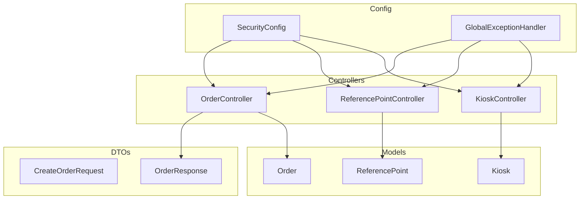
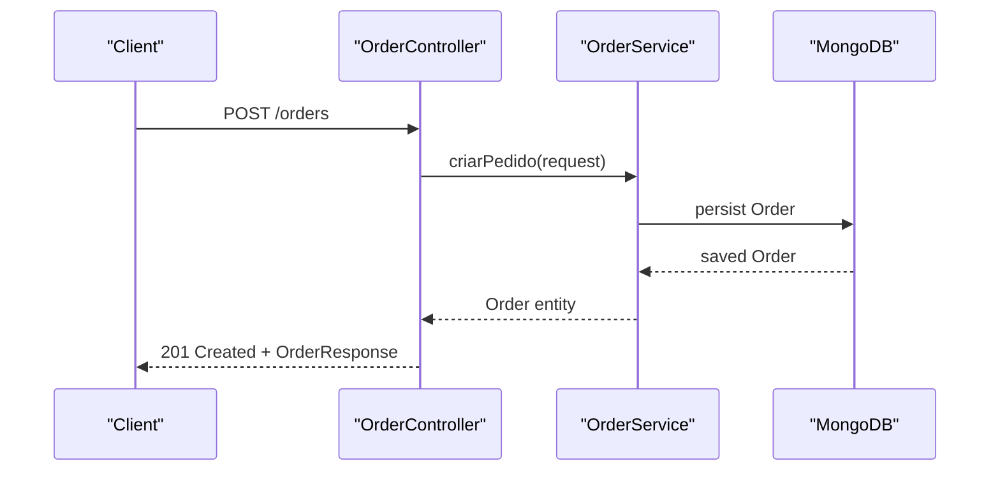
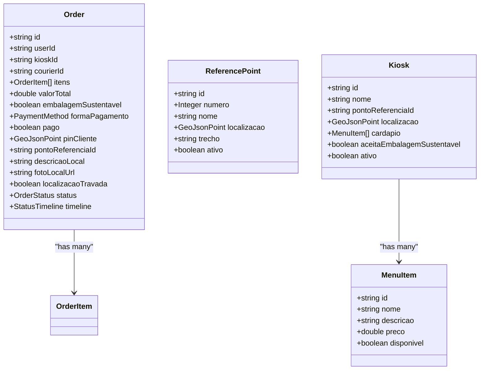
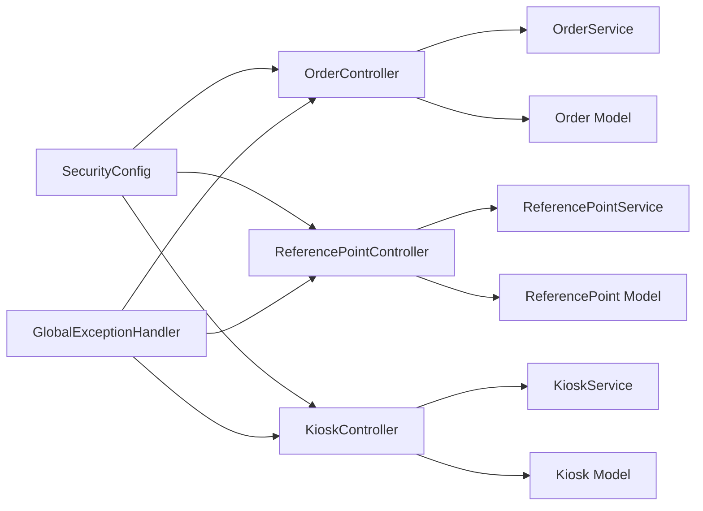

# API Endpoints Reference

<cite>
**Referenced Files in This Document**   
- [OrderController.java](file://backend/src/main/java/com/penaareia/controller/OrderController.java)
- [ReferencePointController.java](file://backend/src/main/java/com/penaareia/controller/ReferencePointController.java)
- [KioskController.java](file://backend/src/main/java/com/penaareia/controller/KioskController.java)
- [CreateOrderRequest.java](file://backend/src/main/java/com/penaareia/dto/CreateOrderRequest.java)
- [OrderResponse.java](file://backend/src/main/java/com/penaareia/dto/OrderResponse.java)
- [SecurityConfig.java](file://backend/src/main/java/com/penaareia/config/SecurityConfig.java)
- [GlobalExceptionHandler.java](file://backend/src/main/java/com/penaareia/config/GlobalExceptionHandler.java)
- [ResourceNotFoundException.java](file://backend/src/main/java/com/penaareia/service/ResourceNotFoundException.java)
- [Order.java](file://backend/src/main/java/com/penaareia/model/Order.java)
- [ReferencePoint.java](file://backend/src/main/java/com/penaareia/model/ReferencePoint.java)
- [Kiosk.java](file://backend/src/main/java/com/penaareia/model/Kiosk.java)
</cite>

## Table of Contents
1. [Introduction](#introduction)
2. [Project Structure](#project-structure)
3. [Core Components](#core-components)
4. [Architecture Overview](#architecture-overview)
5. [Detailed Component Analysis](#detailed-component-analysis)
6. [Dependency Analysis](#dependency-analysis)
7. [Performance Considerations](#performance-considerations)
8. [Troubleshooting Guide](#troubleshooting-guide)
9. [Conclusion](#conclusion)

## Introduction
This document provides comprehensive API documentation for the Pé na Areia backend REST endpoints exposed by the Order, Reference Point, and Kiosk controllers. It covers HTTP methods, URL patterns, request/response schemas, validation rules, authentication requirements, Swagger/OpenAPI annotations, DTO usage, common integration patterns, and troubleshooting guidance.

## Project Structure
The backend is a Spring Boot application organized by layers:
- Controllers expose REST endpoints under /orders, /reference-points, and /kiosks.
- DTOs define request and response contracts.
- Models represent domain entities persisted to MongoDB.
- Security configuration defines public endpoints and future JWT integration points.
- Global exception handling standardizes error responses.

**Diagram sources**
- [OrderController.java:15-35](file://backend/src/main/java/com/penaareia/controller/OrderController.java#L15-L35)
- [ReferencePointController.java:12-33](file://backend/src/main/java/com/penaareia/controller/ReferencePointController.java#L12-L33)
- [KioskController.java:12-30](file://backend/src/main/java/com/penaareia/controller/KioskController.java#L12-L30)
- [CreateOrderRequest.java:12-52](file://backend/src/main/java/com/penaareia/dto/CreateOrderRequest.java#L12-L52)
- [OrderResponse.java:12-37](file://backend/src/main/java/com/penaareia/dto/OrderResponse.java#L12-L37)
- [Order.java:15-70](file://backend/src/main/java/com/penaareia/model/Order.java#L15-L70)
- [ReferencePoint.java:16-38](file://backend/src/main/java/com/penaareia/model/ReferencePoint.java#L16-L38)
- [Kiosk.java:14-47](file://backend/src/main/java/com/penaareia/model/Kiosk.java#L14-L47)
- [SecurityConfig.java:19-40](file://backend/src/main/java/com/penaareia/config/SecurityConfig.java#L19-L40)
- [GlobalExceptionHandler.java:15-39](file://backend/src/main/java/com/penaareia/config/GlobalExceptionHandler.java#L15-L39)

**Section sources**
- [OrderController.java:15-35](file://backend/src/main/java/com/penaareia/controller/OrderController.java#L15-L35)
- [ReferencePointController.java:12-33](file://backend/src/main/java/com/penaareia/controller/ReferencePointController.java#L12-L33)
- [KioskController.java:12-30](file://backend/src/main/java/com/penaareia/controller/KioskController.java#L12-L30)
- [SecurityConfig.java:19-40](file://backend/src/main/java/com/penaareia/config/SecurityConfig.java#L19-L40)

## Core Components
- Order Controller: Creates orders with location pin and items; retrieves an order by ID.
- Reference Point Controller: Lists active reference points; suggests nearby points based on coordinates and radius.
- Kiosk Controller: Lists active kiosks; lists kiosks linked to a specific reference point.
- DTOs: CreateOrderRequest (input), OrderResponse (output).
- Models: Order, ReferencePoint, Kiosk.
- Security: Public access for catalog endpoints; placeholder for JWT auth.
- Error Handling: Standardized error responses for not found and validation errors.

**Section sources**
- [OrderController.java:15-35](file://backend/src/main/java/com/penaareia/controller/OrderController.java#L15-L35)
- [ReferencePointController.java:12-33](file://backend/src/main/java/com/penaareia/controller/ReferencePointController.java#L12-L33)
- [KioskController.java:12-30](file://backend/src/main/java/com/penaareia/controller/KioskController.java#L12-L30)
- [CreateOrderRequest.java:12-52](file://backend/src/main/java/com/penaareia/dto/CreateOrderRequest.java#L12-L52)
- [OrderResponse.java:12-37](file://backend/src/main/java/com/penaareia/dto/OrderResponse.java#L12-L37)
- [SecurityConfig.java:19-40](file://backend/src/main/java/com/penaareia/config/SecurityConfig.java#L19-L40)
- [GlobalExceptionHandler.java:15-39](file://backend/src/main/java/com/penaareia/config/GlobalExceptionHandler.java#L15-L39)

## Architecture Overview
The API follows a layered architecture:
- Controllers handle HTTP requests and map them to service calls.
- Services encapsulate business logic and data access.
- Models represent persistent entities.
- DTOs decouple external contracts from internal models.
- Security config controls endpoint authorization.
- Global exception handler centralizes error formatting.

**Diagram sources**
- [OrderController.java:23-28](file://backend/src/main/java/com/penaareia/controller/OrderController.java#L23-L28)
- [Order.java:15-70](file://backend/src/main/java/com/penaareia/model/Order.java#L15-L70)

## Detailed Component Analysis

### Authentication and Authorization
- Public endpoints:
  - GET /reference-points
  - GET /reference-points/nearby
  - GET /kiosks
  - GET /kiosks/by-reference-point/{pontoReferenciaId}
  - Docs endpoints: /docs/**, /api-docs/**, /swagger-ui/**
  - Auth endpoints: /auth/**
- All other endpoints are currently permitted but intended to be secured with JWT in the future.

Notes:
- CSRF is disabled.
- Session management is stateless.
- TODO indicates future restriction of order mutation endpoints to authenticated users.

**Section sources**
- [SecurityConfig.java:19-40](file://backend/src/main/java/com/penaareia/config/SecurityConfig.java#L19-L40)

### Swagger/OpenAPI Annotations
- Controllers use @Tag to group operations and @Operation to describe each endpoint.
- Example tags:
  - Orders: “Pedidos”
  - Reference Points: “Pontos de referencia”
  - Kiosks: “Quiosques”

These annotations enable OpenAPI documentation generation via standard tooling.

**Section sources**
- [OrderController.java:15-33](file://backend/src/main/java/com/penaareia/controller/OrderController.java#L15-L33)
- [ReferencePointController.java:12-32](file://backend/src/main/java/com/penaareia/controller/ReferencePointController.java#L12-L32)
- [KioskController.java:12-29](file://backend/src/main/java/com/penaareia/controller/KioskController.java#L12-L29)

### Data Transfer Objects (DTO Pattern)
- CreateOrderRequest: Input contract for creating an order, including user/kiosk identifiers, item list, payment method, sustainability flag, location pin coordinates, nearest reference point ID, local description, and optional photo URL.
- OrderResponse: Output contract representing core order fields returned to clients.

Validation rules are defined using Jakarta Validation annotations on CreateOrderRequest.

**Section sources**
- [CreateOrderRequest.java:12-52](file://backend/src/main/java/com/penaareia/dto/CreateOrderRequest.java#L12-L52)
- [OrderResponse.java:12-37](file://backend/src/main/java/com/penaareia/dto/OrderResponse.java#L12-L37)

### Domain Models
- Order: Contains order metadata, items, total value, payment method, location pin (GeoJSON), reference point ID, description, optional photo URL, location lock flag, status, and timeline.
- ReferencePoint: Official beachfront reference posts with number, name, GeoJSON location, section, and active flag.
- Kiosk: Partner kiosks/restaurants with name, associated reference point, GeoJSON location, menu items, sustainability acceptance, and active flag.

**Diagram sources**
- [Order.java:15-70](file://backend/src/main/java/com/penaareia/model/Order.java#L15-L70)
- [ReferencePoint.java:16-38](file://backend/src/main/java/com/penaareia/model/ReferencePoint.java#L16-L38)
- [Kiosk.java:14-47](file://backend/src/main/java/com/penaareia/model/Kiosk.java#L14-L47)

## Detailed Endpoint Specifications

### Orders API

#### Create Order
- Method: POST
- URL: /orders
- Authentication: Currently permitted; intended to require authentication in the future.
- Request Body: CreateOrderRequest
- Response: 201 Created with OrderResponse
- Validation:
  - userId: required
  - kioskId: required
  - itens: non-empty list of ItemRequest
  - formaPagamento: required
  - embalagemSustentavel: boolean
  - latitude: required
  - longitude: required
  - pontoReferenciaId: required
  - descricaoLocal: required
  - fotoLocalUrl: optional

Example request payload structure:
{
  "userId": "user-123",
  "kioskId": "kiosk-456",
  "itens": [
    {
      "menuItemId": "item-001",
      "quantidade": 2
    }
  ],
  "formaPagamento": "CREDIT_CARD",
  "embalagemSustentavel": true,
  "latitude": -23.5505,
  "longitude": -46.6333,
  "pontoReferenciaId": "rp-10",
  "descricaoLocal": "Guarda-sol azul perto do quiosque",
  "fotoLocalUrl": "https://storage.example.com/photo.jpg"
}

Example response structure:
{
  "id": "order-789",
  "valorTotal": 85.0,
  "status": "CRIADO",
  "formaPagamento": "CREDIT_CARD",
  "embalagemSustentavel": true,
  "pontoReferenciaId": "rp-10",
  "descricaoLocal": "Guarda-sol azul perto do quiosque",
  "itens": [
    {
      "menuItemId": "item-001",
      "nome": "Hambúrguer",
      "quantidade": 2,
      "precoUnitario": 42.5
    }
  ]
}

Error responses:
- 400 Bad Request: Validation errors with field-level messages.
- 500 Internal Server Error: Unexpected server-side failures.

**Section sources**
- [OrderController.java:23-28](file://backend/src/main/java/com/penaareia/controller/OrderController.java#L23-L28)
- [CreateOrderRequest.java:12-52](file://backend/src/main/java/com/penaareia/dto/CreateOrderRequest.java#L12-L52)
- [OrderResponse.java:12-37](file://backend/src/main/java/com/penaareia/dto/OrderResponse.java#L12-L37)
- [GlobalExceptionHandler.java:23-32](file://backend/src/main/java/com/penaareia/config/GlobalExceptionHandler.java#L23-L32)

#### Get Order by ID
- Method: GET
- URL: /orders/{id}
- Path Parameters:
  - id: string (required)
- Authentication: Currently permitted; intended to require authentication in the future.
- Response: 200 OK with OrderResponse
- Errors:
  - 404 Not Found: If order does not exist.
  - 500 Internal Server Error: Unexpected server-side failures.

**Section sources**
- [OrderController.java:30-34](file://backend/src/main/java/com/penaareia/controller/OrderController.java#L30-L34)
- [OrderResponse.java:12-37](file://backend/src/main/java/com/penaareia/dto/OrderResponse.java#L12-L37)
- [GlobalExceptionHandler.java:18-21](file://backend/src/main/java/com/penaareia/config/GlobalExceptionHandler.java#L18-L21)

### Reference Points API

#### List Active Reference Points
- Method: GET
- URL: /reference-points
- Authentication: Public
- Response: 200 OK with array of ReferencePoint objects

Example response structure:
[
  {
    "id": "rp-10",
    "numero": 10,
    "nome": "Posto 10",
    "localizacao": {
      "type": "Point",
      "coordinates": [-23.5505, -46.6333]
    },
    "trecho": "Gonzaga",
    "ativo": true
  }
]

**Section sources**
- [ReferencePointController.java:20-24](file://backend/src/main/java/com/penaareia/controller/ReferencePointController.java#L20-L24)
- [ReferencePoint.java:16-38](file://backend/src/main/java/com/penaareia/model/ReferencePoint.java#L16-L38)

#### Suggest Nearby Reference Points
- Method: GET
- URL: /reference-points/nearby
- Query Parameters:
  - lat: double (required)
  - lng: double (required)
  - raioKm: double (optional, default 1.5)
- Authentication: Public
- Response: 200 OK with array of ReferencePoint objects sorted or filtered by proximity within the given radius.

Example query:
GET /reference-points/nearby?lat=-23.5505&lng=-46.6333&raioKm=2.0

Example response structure:
[
  {
    "id": "rp-10",
    "numero": 10,
    "nome": "Posto 10",
    "localizacao": {
      "type": "Point",
      "coordinates": [-23.5505, -46.6333]
    },
    "trecho": "Gonzaga",
    "ativo": true
  }
]

**Section sources**
- [ReferencePointController.java:26-33](file://backend/src/main/java/com/penaareia/controller/ReferencePointController.java#L26-L33)
- [ReferencePoint.java:16-38](file://backend/src/main/java/com/penaareia/model/ReferencePoint.java#L16-L38)

### Kiosks API

#### List Active Kiosks
- Method: GET
- URL: /kiosks
- Authentication: Public
- Response: 200 OK with array of Kiosk objects

Example response structure:
[
  {
    "id": "kiosk-456",
    "nome": "Quiosque da Praia",
    "pontoReferenciaId": "rp-10",
    "localizacao": {
      "type": "Point",
      "coordinates": [-23.5505, -46.6333]
    },
    "cardapio": [
      {
        "id": "item-001",
        "nome": "Hambúrguer",
        "descricao": "Hambúrguer artesanal",
        "preco": 42.5,
        "disponivel": true
      }
    ],
    "aceitaEmbalagemSustentavel": true,
    "ativo": true
  }
]

**Section sources**
- [KioskController.java:20-24](file://backend/src/main/java/com/penaareia/controller/KioskController.java#L20-L24)
- [Kiosk.java:14-47](file://backend/src/main/java/com/penaareia/model/Kiosk.java#L14-L47)

#### List Kiosks by Reference Point
- Method: GET
- URL: /kiosks/by-reference-point/{pontoReferenciaId}
- Path Parameters:
  - pontoReferenciaId: string (required)
- Authentication: Public
- Response: 200 OK with array of Kiosk objects associated with the specified reference point.

Example query:
GET /kiosks/by-reference-point/rp-10

Example response structure:
[
  {
    "id": "kiosk-456",
    "nome": "Quiosque da Praia",
    "pontoReferenciaId": "rp-10",
    "localizacao": {
      "type": "Point",
      "coordinates": [-23.5505, -46.6333]
    },
    "cardapio": [],
    "aceitaEmbalagemSustentavel": true,
    "ativo": true
  }
]

**Section sources**
- [KioskController.java:26-30](file://backend/src/main/java/com/penaareia/controller/KioskController.java#L26-L30)
- [Kiosk.java:14-47](file://backend/src/main/java/com/penaareia/model/Kiosk.java#L14-L47)

## Dependency Analysis
- Controllers depend on services (not shown here) and return DTOs or model objects.
- DTOs decouple client-facing contracts from internal models.
- Models include geospatial fields used for proximity queries.
- Security configuration defines which endpoints are public and where JWT filters should be integrated.
- Global exception handler centralizes error responses for validation and resource-not-found scenarios.

**Diagram sources**
- [OrderController.java:15-35](file://backend/src/main/java/com/penaareia/controller/OrderController.java#L15-L35)
- [ReferencePointController.java:12-33](file://backend/src/main/java/com/penaareia/controller/ReferencePointController.java#L12-L33)
- [KioskController.java:12-30](file://backend/src/main/java/com/penaareia/controller/KioskController.java#L12-L30)
- [SecurityConfig.java:19-40](file://backend/src/main/java/com/penaareia/config/SecurityConfig.java#L19-L40)
- [GlobalExceptionHandler.java:15-39](file://backend/src/main/java/com/penaareia/config/GlobalExceptionHandler.java#L15-L39)

**Section sources**
- [OrderController.java:15-35](file://backend/src/main/java/com/penaareia/controller/OrderController.java#L15-L35)
- [ReferencePointController.java:12-33](file://backend/src/main/java/com/penaareia/controller/ReferencePointController.java#L12-L33)
- [KioskController.java:12-30](file://backend/src/main/java/com/penaareia/controller/KioskController.java#L12-L30)
- [SecurityConfig.java:19-40](file://backend/src/main/java/com/penaareia/config/SecurityConfig.java#L19-L40)
- [GlobalExceptionHandler.java:15-39](file://backend/src/main/java/com/penaareia/config/GlobalExceptionHandler.java#L15-L39)

## Performance Considerations
- Geospatial indexing: Both Order and ReferencePoint models use GeoJSON points with 2dsphere indexes to support efficient proximity queries.
- Pagination: Not implemented in current endpoints; consider adding pagination for large catalogs (reference points, kiosks).
- Caching: Consider caching static catalogs (active kiosks, reference points) if read-heavy.
- Payload size: Keep item lists concise; avoid unnecessary fields in responses.

[No sources needed since this section provides general guidance]

## Troubleshooting Guide

Common issues and resolutions:
- Validation errors:
  - Symptom: 400 Bad Request with field-level messages.
  - Cause: Missing or invalid fields in CreateOrderRequest.
  - Resolution: Ensure all required fields are present and valid per validation constraints.
- Resource not found:
  - Symptom: 404 Not Found when retrieving an order.
  - Cause: Invalid or non-existent order ID.
  - Resolution: Verify the order ID and ensure it exists in the database.
- Authentication:
  - Symptom: Future endpoints may reject unauthenticated requests once JWT is enabled.
  - Cause: Security configuration will restrict mutations to authenticated users.
  - Resolution: Integrate JWT authentication as indicated in security configuration comments.

Error response format:
- For validation errors:
  {
    "timestamp": "...",
    "mensagem": "Dados invalidos",
    "campos": {
      "field": "Field-specific message"
    }
  }
- For not found:
  {
    "timestamp": "...",
    "mensagem": "Resource not found message"
  }

**Section sources**
- [GlobalExceptionHandler.java:18-32](file://backend/src/main/java/com/penaareia/config/GlobalExceptionHandler.java#L18-L32)
- [ResourceNotFoundException.java:1-8](file://backend/src/main/java/com/penaareia/service/ResourceNotFoundException.java#L1-L8)
- [SecurityConfig.java:19-40](file://backend/src/main/java/com/penaareia/config/SecurityConfig.java#L19-L40)

## Conclusion
The Pé na Areia backend exposes clear REST endpoints for orders, reference points, and kiosks, with well-defined DTOs and models. Current security settings allow public access to catalog endpoints while preparing for JWT-based authentication. Consumers should adhere to the documented request/response schemas and validation rules, and leverage geospatial features for proximity-based queries. The global exception handler ensures consistent error reporting to facilitate robust integrations.

[No sources needed since this section summarizes without analyzing specific files]