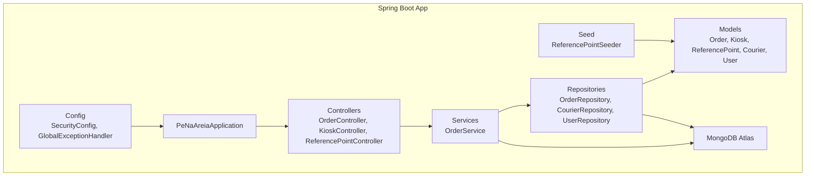
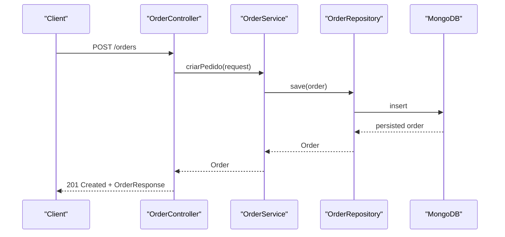
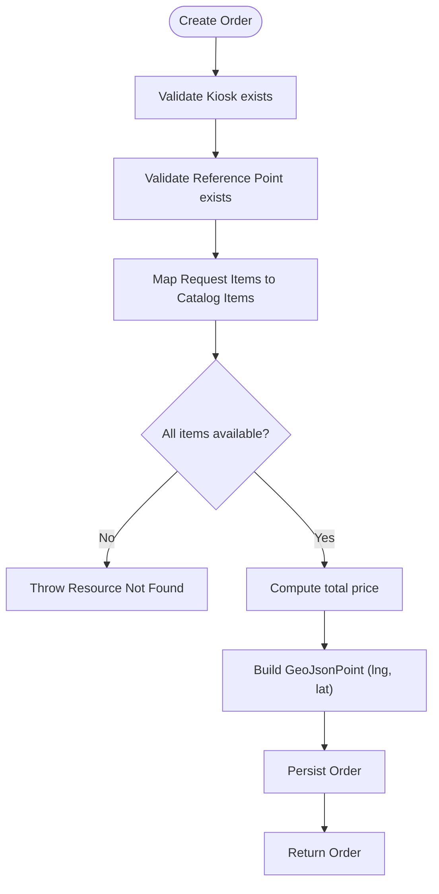
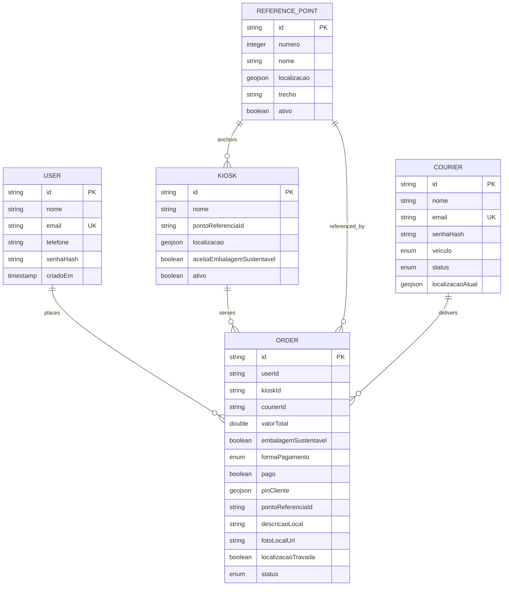
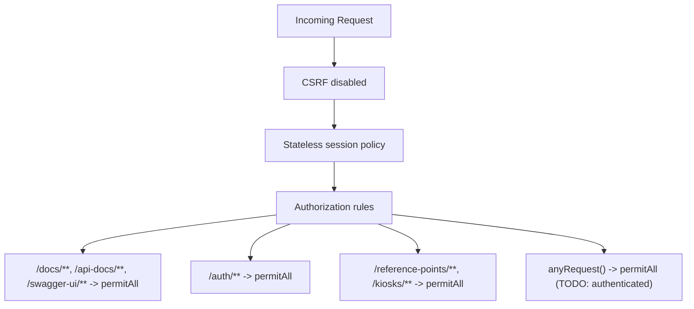
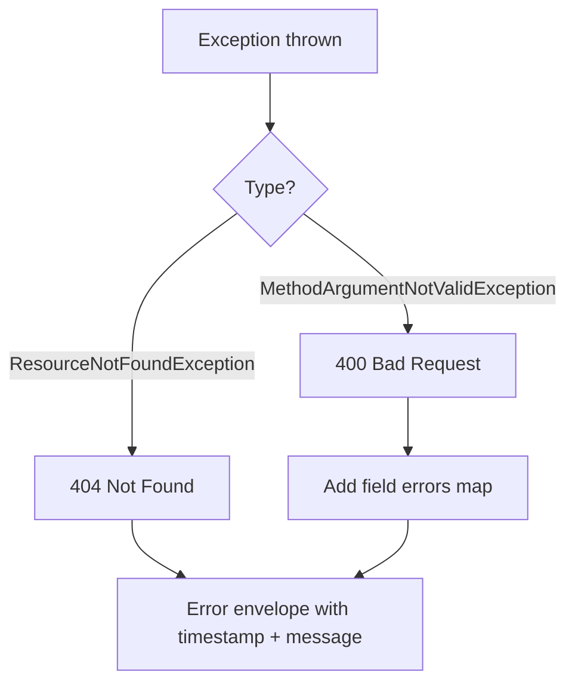
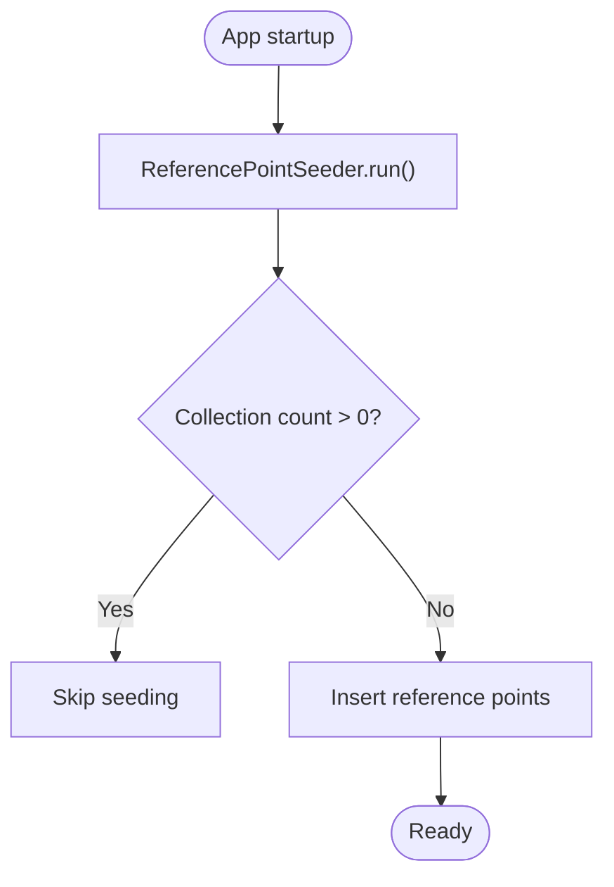
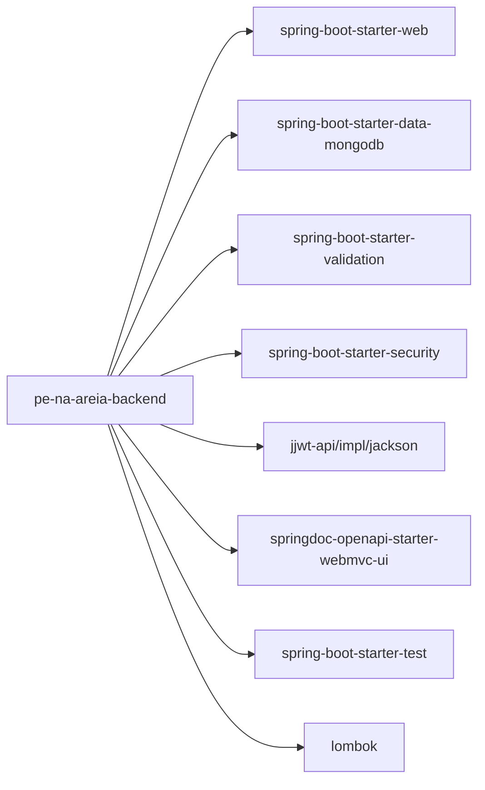

# Backend Architecture

<cite>
**Referenced Files in This Document**
- [pom.xml](file://backend/pom.xml)
- [application.yml](file://backend/src/main/resources/application.yml)
- [PeNaAreiaApplication.java](file://backend/src/main/java/com/penaareia/PeNaAreiaApplication.java)
- [SecurityConfig.java](file://backend/src/main/java/com/penaareia/config/SecurityConfig.java)
- [GlobalExceptionHandler.java](file://backend/src/main/java/com/penaareia/config/GlobalExceptionHandler.java)
- [OrderController.java](file://backend/src/main/java/com/penaareia/controller/OrderController.java)
- [KioskController.java](file://backend/src/main/java/com/penaareia/controller/KioskController.java)
- [ReferencePointController.java](file://backend/src/main/java/com/penaareia/controller/ReferencePointController.java)
- [OrderService.java](file://backend/src/main/java/com/penaareia/service/OrderService.java)
- [ResourceNotFoundException.java](file://backend/src/main/java/com/penaareia/service/ResourceNotFoundException.java)
- [OrderRepository.java](file://backend/src/main/java/com/penaareia/repository/OrderRepository.java)
- [CourierRepository.java](file://backend/src/main/java/com/penaareia/repository/CourierRepository.java)
- [UserRepository.java](file://backend/src/main/java/com/penaareia/repository/UserRepository.java)
- [Order.java](file://backend/src/main/java/com/penaareia/model/Order.java)
- [Kiosk.java](file://backend/src/main/java/com/penaareia/model/Kiosk.java)
- [ReferencePoint.java](file://backend/src/main/java/com/penaareia/model/ReferencePoint.java)
- [Courier.java](file://backend/src/main/java/com/penaareia/model/Courier.java)
- [User.java](file://backend/src/main/java/com/penaareia/model/User.java)
- [ReferencePointSeeder.java](file://backend/src/main/java/com/penaareia/seed/ReferencePointSeeder.java)
</cite>

## Table of Contents
1. Introduction
2. Project Structure
3. Core Components
4. Architecture Overview
5. Detailed Component Analysis
6. Dependency Analysis
7. Performance Considerations
8. Troubleshooting Guide
9. Conclusion

## Introduction
This document describes the backend architecture of the Pé na Areia system, a Spring Boot application that exposes REST APIs for managing beachside kiosks, reference points, and delivery orders with geospatial features. The system uses MongoDB for persistence, integrates JWT-based security (with an initial permissive configuration), and provides global exception handling and API documentation via OpenAPI/Swagger.

Key goals:
- Clear separation of concerns across controllers, services, repositories, and models
- Geospatial data modeling and indexing for location-aware queries
- Secure-by-default posture with extensible JWT integration
- Seed data to bootstrap reference points for development and testing

## Project Structure
The backend follows a layered structure:
- Controllers expose REST endpoints
- Services implement business logic
- Repositories provide data access via Spring Data MongoDB
- Models represent domain entities with geospatial annotations
- Configuration includes security, exception handling, and application settings
- Seed components initialize static reference data

**Diagram sources**
- [PeNaAreiaApplication.java:6-10](file://backend/src/main/java/com/penaareia/PeNaAreiaApplication.java#L6-L10)
- [OrderController.java:15-35](file://backend/src/main/java/com/penaareia/controller/OrderController.java#L15-L35)
- [KioskController.java:12-30](file://backend/src/main/java/com/penaareia/controller/KioskController.java#L12-L30)
- [ReferencePointController.java:12-33](file://backend/src/main/java/com/penaareia/controller/ReferencePointController.java#L12-L33)
- [OrderService.java:17-77](file://backend/src/main/java/com/penaareia/service/OrderService.java#L17-L77)
- [OrderRepository.java:9-15](file://backend/src/main/java/com/penaareia/repository/OrderRepository.java#L9-L15)
- [CourierRepository.java:8-9](file://backend/src/main/java/com/penaareia/repository/CourierRepository.java#L8-L9)
- [UserRepository.java:8-9](file://backend/src/main/java/com/penaareia/repository/UserRepository.java#L8-L9)
- [Order.java:15-70](file://backend/src/main/java/com/penaareia/model/Order.java#L15-L70)
- [Kiosk.java:14-47](file://backend/src/main/java/com/penaareia/model/Kiosk.java#L14-L47)
- [ReferencePoint.java:16-38](file://backend/src/main/java/com/penaareia/model/ReferencePoint.java#L16-L38)
- [Courier.java:13-46](file://backend/src/main/java/com/penaareia/model/Courier.java#L13-L46)
- [User.java:12-32](file://backend/src/main/java/com/penaareia/model/User.java#L12-L32)
- [SecurityConfig.java:19-40](file://backend/src/main/java/com/penaareia/config/SecurityConfig.java#L19-L40)
- [GlobalExceptionHandler.java:15-39](file://backend/src/main/java/com/penaareia/config/GlobalExceptionHandler.java#L15-L39)
- [ReferencePointSeeder.java:18-47](file://backend/src/main/java/com/penaareia/seed/ReferencePointSeeder.java#L18-L47)

**Section sources**
- [PeNaAreiaApplication.java:6-10](file://backend/src/main/java/com/penaareia/PeNaAreiaApplication.java#L6-L10)
- [application.yml:1-32](file://backend/src/main/resources/application.yml#L1-L32)

## Core Components
- Application entry point: Spring Boot application class bootstraps the context.
- Controllers: REST endpoints for orders, kiosks, and reference points.
- Services: Business logic for order creation and retrieval.
- Repositories: Spring Data MongoDB interfaces for persistence.
- Models: Domain entities with geospatial fields and indexes.
- Security: Stateless session policy, public endpoints, and password encoder; JWT filter placeholder.
- Exception handling: Global handler for not found and validation errors.
- Seed data: CommandLineRunner to populate reference points on first run.

Technology stack highlights:
- Java 17
- Spring Boot 3.3.4
- Spring Web, Validation, Security
- Spring Data MongoDB
- JJWT (JSON Web Token)
- SpringDoc OpenAPI/Swagger UI
- Lombok

**Section sources**
- [pom.xml:7-22](file://backend/pom.xml#L7-L22)
- [pom.xml:24-91](file://backend/pom.xml#L24-L91)
- [application.yml:1-32](file://backend/src/main/resources/application.yml#L1-L32)

## Architecture Overview
The system is a typical Spring MVC layered architecture backed by MongoDB. Controllers receive HTTP requests, delegate to services, which orchestrate business rules and repository calls. Geospatial data is modeled using GeoJSON points with 2dsphere indexes for proximity queries.

**Diagram sources**
- [OrderController.java:23-28](file://backend/src/main/java/com/penaareia/controller/OrderController.java#L23-L28)
- [OrderService.java:25-70](file://backend/src/main/java/com/penaareia/service/OrderService.java#L25-L70)
- [OrderRepository.java:9-15](file://backend/src/main/java/com/penaareia/repository/OrderRepository.java#L9-L15)

## Detailed Component Analysis

### Controllers
- OrderController: Creates orders and retrieves by ID. Uses DTOs for input/output and validates request bodies.
- KioskController: Lists active kiosks and filters by reference point.
- ReferencePointController: Lists active reference points and suggests nearby points based on coordinates and radius.

REST design patterns:
- Resource-oriented URLs (/orders, /kiosks, /reference-points)
- Standard HTTP methods (GET, POST)
- Consistent error responses via global exception handler
- API documentation via OpenAPI tags and operations

**Section sources**
- [OrderController.java:15-35](file://backend/src/main/java/com/penaareia/controller/OrderController.java#L15-L35)
- [KioskController.java:12-30](file://backend/src/main/java/com/penaareia/controller/KioskController.java#L12-L30)
- [ReferencePointController.java:12-33](file://backend/src/main/java/com/penaareia/controller/ReferencePointController.java#L12-L33)

### Services
- OrderService: Validates kiosk and reference point existence, maps menu items from kiosk catalog, computes totals, constructs geospatial pin, and persists orders.

Business rules:
- Menu item availability check before order creation
- Total price calculation from line items
- Geospatial pin construction using longitude-first convention

**Diagram sources**
- [OrderService.java:25-70](file://backend/src/main/java/com/penaareia/service/OrderService.java#L25-L70)

**Section sources**
- [OrderService.java:17-77](file://backend/src/main/java/com/penaareia/service/OrderService.java#L17-L77)

### Repositories
- OrderRepository: Queries by user timeline, courier status, and general status.
- CourierRepository: Lookup by email.
- UserRepository: Lookup by email.

These extend MongoRepository, leveraging Spring Data’s query derivation and geospatial capabilities where needed.

**Section sources**
- [OrderRepository.java:9-15](file://backend/src/main/java/com/penaareia/repository/OrderRepository.java#L9-L15)
- [CourierRepository.java:8-9](file://backend/src/main/java/com/penaareia/repository/CourierRepository.java#L8-L9)
- [UserRepository.java:8-9](file://backend/src/main/java/com/penaareia/repository/UserRepository.java#L8-L9)

### Models and Data Schema
Core entities include:
- Order: Contains user/kiosk/courier references, items, payment info, geospatial pin, reference point link, and status timeline.
- Kiosk: Location, menu items, sustainability flag, and active status.
- ReferencePoint: Official beach rescue stations with location and metadata.
- Courier: Delivery personnel with vehicle type, status, and current location.
- User: Customer account with hashed password.

Geospatial strategy:
- All location-bearing fields use GeoJsonPoint with 2dsphere indexes for proximity queries.
- Orders lock location after payment to prevent post-payment changes.

**Diagram sources**
- [Order.java:15-70](file://backend/src/main/java/com/penaareia/model/Order.java#L15-L70)
- [Kiosk.java:14-47](file://backend/src/main/java/com/penaareia/model/Kiosk.java#L14-L47)
- [ReferencePoint.java:16-38](file://backend/src/main/java/com/penaareia/model/ReferencePoint.java#L16-L38)
- [Courier.java:13-46](file://backend/src/main/java/com/penaareia/model/Courier.java#L13-L46)
- [User.java:12-32](file://backend/src/main/java/com/penaareia/model/User.java#L12-L32)

**Section sources**
- [Order.java:15-70](file://backend/src/main/java/com/penaareia/model/Order.java#L15-L70)
- [Kiosk.java:14-47](file://backend/src/main/java/com/penaareia/model/Kiosk.java#L14-L47)
- [ReferencePoint.java:16-38](file://backend/src/main/java/com/penaareia/model/ReferencePoint.java#L16-L38)
- [Courier.java:13-46](file://backend/src/main/java/com/penaareia/model/Courier.java#L13-L46)
- [User.java:12-32](file://backend/src/main/java/com/penaareia/model/User.java#L12-L32)

### Security Configuration
- Password encoding: BCryptPasswordEncoder bean provided.
- Session management: Stateless sessions suitable for JWT.
- Public endpoints: Documentation, auth endpoints (placeholder), kiosks, and reference points are permitted without authentication.
- JWT integration: Placeholder comment indicates future addition of JwtAuthenticationFilter before UsernamePasswordAuthenticationFilter.

**Diagram sources**
- [SecurityConfig.java:27-39](file://backend/src/main/java/com/penaareia/config/SecurityConfig.java#L27-L39)

**Section sources**
- [SecurityConfig.java:19-40](file://backend/src/main/java/com/penaareia/config/SecurityConfig.java#L19-L40)

### Global Exception Handling
- Handles ResourceNotFoundException with 404 and message body.
- Handles MethodArgumentNotValidException with 400 and field-level validation errors.
- Provides consistent error envelope including timestamp and message.

**Diagram sources**
- [GlobalExceptionHandler.java:18-32](file://backend/src/main/java/com/penaareia/config/GlobalExceptionHandler.java#L18-L32)

**Section sources**
- [GlobalExceptionHandler.java:15-39](file://backend/src/main/java/com/penaareia/config/GlobalExceptionHandler.java#L15-L39)
- [ResourceNotFoundException.java:1-1](file://backend/src/main/java/com/penaareia/service/ResourceNotFoundException.java#L1-L1)

### Seed Data Mechanism
- ReferencePointSeeder implements CommandLineRunner to populate reference points only if the collection is empty.
- Ensures safe re-runs without duplicating data.
- Seeds approximate coordinates for Santos beach rescue stations.

**Diagram sources**
- [ReferencePointSeeder.java:24-47](file://backend/src/main/java/com/penaareia/seed/ReferencePointSeeder.java#L24-L47)

**Section sources**
- [ReferencePointSeeder.java:18-47](file://backend/src/main/java/com/penaareia/seed/ReferencePointSeeder.java#L18-L47)

## Dependency Analysis
External dependencies define the runtime capabilities:
- Web layer: spring-boot-starter-web
- Persistence: spring-boot-starter-data-mongodb
- Validation: spring-boot-starter-validation
- Security: spring-boot-starter-security
- JWT: jjwt-api, jjwt-impl, jjwt-jackson
- API docs: springdoc-openapi-starter-webmvc-ui
- Test support: spring-boot-starter-test, embedded mongo for tests
- Boilerplate reduction: lombok

**Diagram sources**
- [pom.xml:24-91](file://backend/pom.xml#L24-L91)

**Section sources**
- [pom.xml:7-22](file://backend/pom.xml#L7-L22)
- [pom.xml:24-91](file://backend/pom.xml#L24-L91)

## Performance Considerations
- Geospatial queries: Use 2dsphere indexes already defined on location fields to optimize proximity searches.
- Query design: Prefer specific repository methods (e.g., findByUserIdOrderByTimelineCriadoEmDesc) to reduce server-side filtering.
- Payload size: Keep order items minimal; consider pagination for large lists.
- Connection pooling: Rely on Spring Data MongoDB defaults; tune connection pool size based on workload.
- Indexing strategy: Ensure additional composite indexes if frequent queries combine status and timestamps.
- Caching: Consider caching reference points and kiosks if read-heavy and relatively static.

[No sources needed since this section provides general guidance]

## Troubleshooting Guide
Common issues and resolutions:
- Missing MongoDB connection: Verify MONGODB_URI and MONGODB_DATABASE environment variables or update application.yml.
- Authentication not enforced: SecurityConfig currently permits all requests; add JWT filter and restrict endpoints as planned.
- Validation failures: Check request payloads against DTO constraints; GlobalExceptionHandler returns field-level errors.
- Not found errors: Ensure referenced kiosks, users, and reference points exist before creating orders.

Operational checks:
- Confirm seed data presence by querying reference points.
- Validate Swagger UI at /docs and API docs at /api-docs.

**Section sources**
- [application.yml:8-20](file://backend/src/main/resources/application.yml#L8-L20)
- [SecurityConfig.java:27-39](file://backend/src/main/java/com/penaareia/config/SecurityConfig.java#L27-L39)
- [GlobalExceptionHandler.java:18-32](file://backend/src/main/java/com/penaareia/config/GlobalExceptionHandler.java#L18-L32)

## Conclusion
The Pé na Areia backend provides a clean, layered Spring Boot architecture with strong geospatial support for location-aware delivery workflows. It is configured for stateless security with room for JWT integration, offers robust exception handling, and seeds essential reference data. With MongoDB Atlas backing and well-defined data models, the system is positioned for scalable growth and further feature expansion.

[No sources needed since this section summarizes without analyzing specific files]