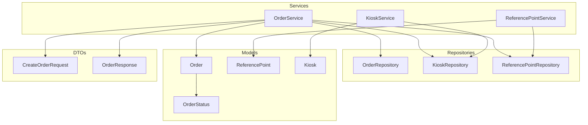
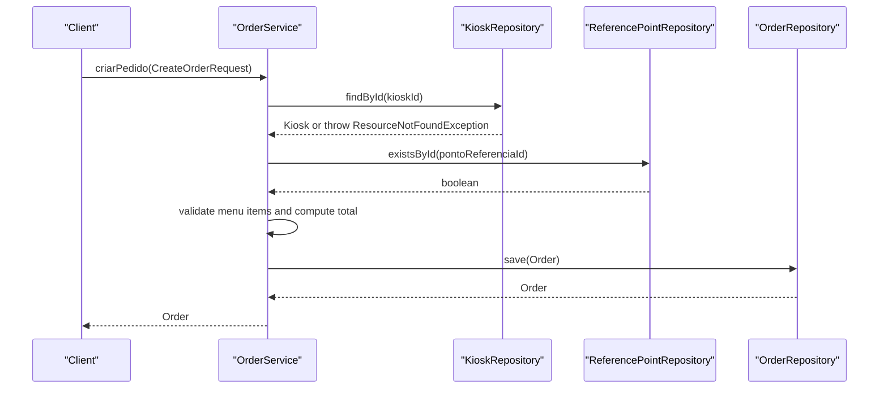
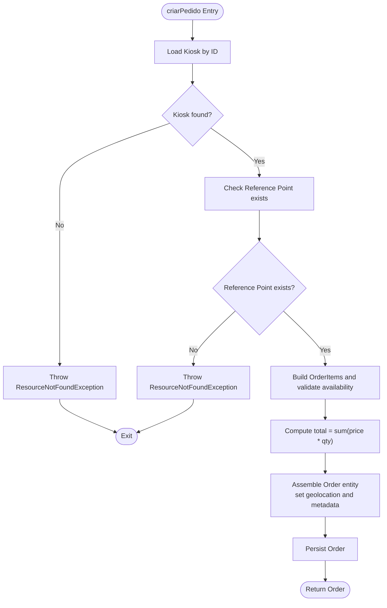
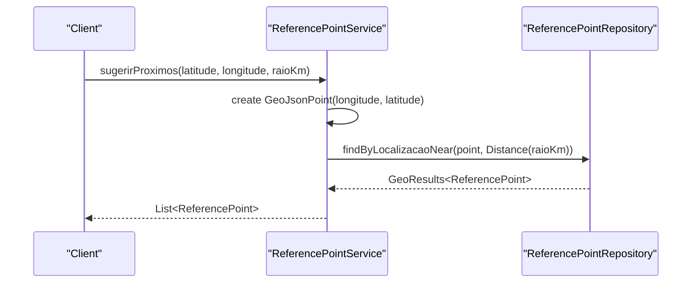
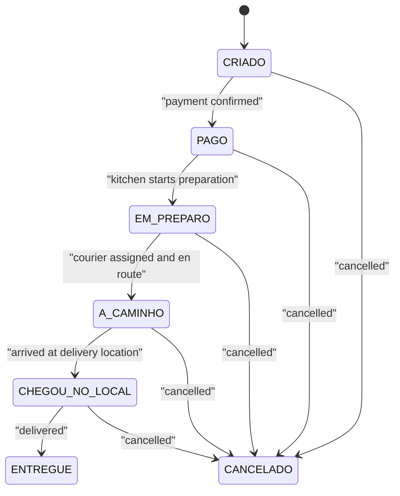
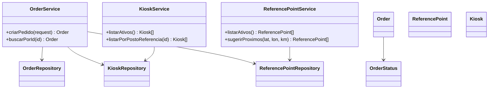

# Business Logic Layer

<cite>
**Referenced Files in This Document**
- [OrderService.java](file://backend/src/main/java/com/penaareia/service/OrderService.java)
- [ReferencePointService.java](file://backend/src/main/java/com/penaareia/service/ReferencePointService.java)
- [KioskService.java](file://backend/src/main/java/com/penaareia/service/KioskService.java)
- [Order.java](file://backend/src/main/java/com/penaareia/model/Order.java)
- [ReferencePoint.java](file://backend/src/main/java/com/penaareia/model/ReferencePoint.java)
- [Kiosk.java](file://backend/src/main/java/com/penaareia/model/Kiosk.java)
- [OrderStatus.java](file://backend/src/main/java/com/penaareia/model/OrderStatus.java)
- [CreateOrderRequest.java](file://backend/src/main/java/com/penaareia/dto/CreateOrderRequest.java)
- [OrderResponse.java](file://backend/src/main/java/com/penaareia/dto/OrderResponse.java)
- [OrderRepository.java](file://backend/src/main/java/com/penaareia/repository/OrderRepository.java)
- [KioskRepository.java](file://backend/src/main/java/com/penaareia/repository/KioskRepository.java)
- [ReferencePointRepository.java](file://backend/src/main/java/com/penaareia/repository/ReferencePointRepository.java)
- [ResourceNotFoundException.java](file://backend/src/main/java/com/penaareia/service/ResourceNotFoundException.java)
</cite>

## Table of Contents
1. [Introduction](#introduction)
2. [Project Structure](#project-structure)
3. [Core Components](#core-components)
4. [Architecture Overview](#architecture-overview)
5. [Detailed Component Analysis](#detailed-component-analysis)
6. [Dependency Analysis](#dependency-analysis)
7. [Performance Considerations](#performance-considerations)
8. [Troubleshooting Guide](#troubleshooting-guide)
9. [Conclusion](#conclusion)

## Introduction
This document explains the business logic layer for order creation, location validation, and reference point proximity search. It focuses on three services: OrderService, ReferencePointService, and KioskService. You will learn how orders are created, validated, and persisted; how nearby reference points are suggested using geospatial queries; and how kiosks are listed and filtered. The documentation also covers repository usage, transaction behavior, error handling, and the order status workflow.

## Project Structure
The backend implements a layered architecture:
- Controllers expose HTTP endpoints (not analyzed here).
- Services encapsulate business rules.
- Repositories provide data access via Spring Data MongoDB.
- Models represent domain entities with geospatial fields.
- DTOs carry request/response payloads.

**Diagram sources**
- [OrderService.java:17-77](file://backend/src/main/java/com/penaareia/service/OrderService.java#L17-L77)
- [ReferencePointService.java:15-38](file://backend/src/main/java/com/penaareia/service/ReferencePointService.java#L15-L38)
- [KioskService.java:10-23](file://backend/src/main/java/com/penaareia/service/KioskService.java#L10-L23)
- [OrderRepository.java:9-16](file://backend/src/main/java/com/penaareia/repository/OrderRepository.java#L9-L16)
- [KioskRepository.java:11-18](file://backend/src/main/java/com/penaareia/repository/KioskRepository.java#L11-L18)
- [ReferencePointRepository.java:11-17](file://backend/src/main/java/com/penaareia/repository/ReferencePointRepository.java#L11-L17)
- [Order.java:15-49](file://backend/src/main/java/com/penaareia/model/Order.java#L15-L49)
- [ReferencePoint.java:16-38](file://backend/src/main/java/com/penaareia/model/ReferencePoint.java#L16-L38)
- [Kiosk.java:14-47](file://backend/src/main/java/com/penaareia/model/Kiosk.java#L14-L47)
- [OrderStatus.java:3-11](file://backend/src/main/java/com/penaareia/model/OrderStatus.java#L3-L11)
- [CreateOrderRequest.java:12-53](file://backend/src/main/java/com/penaareia/dto/CreateOrderRequest.java#L12-L53)
- [OrderResponse.java:12-38](file://backend/src/main/java/com/penaareia/dto/OrderResponse.java#L12-L38)

**Section sources**
- [OrderService.java:17-77](file://backend/src/main/java/com/penaareia/service/OrderService.java#L17-L77)
- [ReferencePointService.java:15-38](file://backend/src/main/java/com/penaareia/service/ReferencePointService.java#L15-L38)
- [KioskService.java:10-23](file://backend/src/main/java/com/penaareia/service/KioskService.java#L10-L23)

## Core Components
- OrderService: Orchestrates order creation, validates kiosk and menu items, computes totals, stores geolocation, and persists orders. Provides lookup by ID.
- ReferencePointService: Lists active reference points and suggests nearby ones based on a client pin and radius.
- KioskService: Lists active kiosks and filters kiosks by reference point.

Key responsibilities:
- Validation and enrichment of incoming requests.
- Geospatial operations for proximity suggestions.
- Repository-based persistence and querying.

**Section sources**
- [OrderService.java:25-76](file://backend/src/main/java/com/penaareia/service/OrderService.java#L25-L76)
- [ReferencePointService.java:21-37](file://backend/src/main/java/com/penaareia/service/ReferencePointService.java#L21-L37)
- [KioskService.java:16-22](file://backend/src/main/java/com/penaareia/service/KioskService.java#L16-L22)

## Architecture Overview
The services use the repository pattern to abstract data access. Geospatial features rely on MongoDB’s GeoJSON indexing and Spring Data’s near queries.

**Diagram sources**
- [OrderService.java:25-70](file://backend/src/main/java/com/penaareia/service/OrderService.java#L25-L70)
- [KioskRepository.java:11-18](file://backend/src/main/java/com/penaareia/repository/KioskRepository.java#L11-L18)
- [ReferencePointRepository.java:11-17](file://backend/src/main/java/com/penaareia/repository/ReferencePointRepository.java#L11-L17)
- [OrderRepository.java:9-16](file://backend/src/main/java/com/penaareia/repository/OrderRepository.java#L9-L16)

## Detailed Component Analysis

### OrderService
Responsibilities:
- Validate that the kiosk exists.
- Validate that the selected reference point exists.
- Validate each requested menu item against the kiosk’s menu and availability.
- Compute the order total from unit prices and quantities.
- Build an Order entity with user, payment method, sustainability flag, and geolocation.
- Persist the order and return it.

Method signatures and behaviors:
- criarPedido(CreateOrderRequest): Order
  - Validates kiosk existence.
  - Validates reference point existence.
  - Builds OrderItem list from request items, checking availability.
  - Computes total price.
  - Sets geolocation using longitude first, latitude second.
  - Persists and returns Order.
- buscarPorId(String): Order
  - Returns order by ID or throws ResourceNotFoundException.

Business rules:
- A kiosk must exist before creating an order.
- A reference point must exist before creating an order.
- Each requested menu item must exist in the kiosk’s menu and be available.
- Total is computed as sum of (unit price × quantity) across all items.
- Geolocation uses GeoJsonPoint with (longitude, latitude) ordering.

Error handling:
- Throws ResourceNotFoundException when kiosk, reference point, or menu item is invalid.

Example invocation flow:
- Input: CreateOrderRequest with userId, kioskId, itens[], formaPagamento, embalagemSustentavel, latitude, longitude, pontoReferenciaId, descricaoLocal, fotoLocalUrl.
- Output: Order with id, userId, kioskId, itens, valorTotal, formaPagamento, embalagemSustentavel, pinCliente, pontoReferenciaId, descricaoLocal, fotoLocalUrl, status=OrderStatus.CRIADO, timeline.criadoEm set.

**Diagram sources**
- [OrderService.java:25-70](file://backend/src/main/java/com/penaareia/service/OrderService.java#L25-L70)
- [ResourceNotFoundException.java:3-7](file://backend/src/main/java/com/penaareia/service/ResourceNotFoundException.java#L3-L7)

**Section sources**
- [OrderService.java:25-76](file://backend/src/main/java/com/penaareia/service/OrderService.java#L25-L76)
- [CreateOrderRequest.java:12-53](file://backend/src/main/java/com/penaareia/dto/CreateOrderRequest.java#L12-L53)
- [Order.java:15-49](file://backend/src/main/java/com/penaareia/model/Order.java#L15-L49)
- [Kiosk.java:14-47](file://backend/src/main/java/com/penaareia/model/Kiosk.java#L14-L47)

### ReferencePointService
Responsibilities:
- List active reference points.
- Suggest nearby reference points based on a client pin and radius.

Method signatures and behaviors:
- listarAtivos(): List<ReferencePoint>
  - Returns all reference points where ativo=true.
- sugerirProximos(double latitude, double longitude, double raioKm): List<ReferencePoint>
  - Creates a GeoJsonPoint from longitude and latitude.
  - Queries repositories for points within raioKm.
  - Returns a list of ReferencePoint results.

Geospatial query details:
- Uses Spring Data MongoDB’s near query with Distance in kilometers.
- Requires a 2dsphere index on the localizacao field.

**Diagram sources**
- [ReferencePointService.java:29-37](file://backend/src/main/java/com/penaareia/service/ReferencePointService.java#L29-L37)
- [ReferencePointRepository.java:11-17](file://backend/src/main/java/com/penaareia/repository/ReferencePointRepository.java#L11-L17)
- [ReferencePoint.java:31-32](file://backend/src/main/java/com/penaareia/model/ReferencePoint.java#L31-L32)

**Section sources**
- [ReferencePointService.java:21-37](file://backend/src/main/java/com/penaareia/service/ReferencePointService.java#L21-L37)
- [ReferencePointRepository.java:11-17](file://backend/src/main/java/com/penaareia/repository/ReferencePointRepository.java#L11-L17)
- [ReferencePoint.java:31-32](file://backend/src/main/java/com/penaareia/model/ReferencePoint.java#L31-L32)

### KioskService
Responsibilities:
- List active kiosks.
- Filter kiosks by reference point and active status.

Method signatures and behaviors:
- listarAtivos(): List<Kiosk>
  - Returns kiosks where ativo=true.
- listarPorPostoReferencia(String pontoReferenciaId): List<Kiosk>
  - Returns kiosks associated with the given reference point and active.

**Section sources**
- [KioskService.java:16-22](file://backend/src/main/java/com/penaareia/service/KioskService.java#L16-L22)
- [KioskRepository.java:11-18](file://backend/src/main/java/com/penaareia/repository/KioskRepository.java#L11-L18)
- [Kiosk.java:14-47](file://backend/src/main/java/com/penaareia/model/Kiosk.java#L14-L47)

### Order Model and Status Workflow
Order model highlights:
- Contains user, kiosk, courier identifiers, items, total, payment method, sustainability flag.
- Stores geolocation via GeoJsonPoint and a pinned location description.
- Tracks whether the location is locked after payment.
- Maintains an OrderStatus and a StatusTimeline with timestamps for lifecycle events.

Order statuses:
- CRIADO, PAGO, EM_PREPARO, A_CAMINHO, CHEGOU_NO_LOCAL, ENTREGUE, CANCELADO.

Status timeline fields:
- criadoEm, pagoEm, emPreparoEm, aCaminhoEm, chegouNoLocalEm, entregueEm.

**Diagram sources**
- [OrderStatus.java:3-11](file://backend/src/main/java/com/penaareia/model/OrderStatus.java#L3-L11)
- [Order.java:46-48](file://backend/src/main/java/com/penaareia/model/Order.java#L46-L48)

**Section sources**
- [Order.java:15-49](file://backend/src/main/java/com/penaareia/model/Order.java#L15-L49)
- [OrderStatus.java:3-11](file://backend/src/main/java/com/penaareia/model/OrderStatus.java#L3-L11)

## Dependency Analysis
Service-to-repository relationships:
- OrderService depends on OrderRepository, KioskRepository, and ReferencePointRepository.
- ReferencePointService depends on ReferencePointRepository.
- KioskService depends on KioskRepository.

Model dependencies:
- Order references OrderStatus and contains nested OrderItem.
- Kiosk contains MenuItem.
- ReferencePoint includes a geospatial field.

**Diagram sources**
- [OrderService.java:17-77](file://backend/src/main/java/com/penaareia/service/OrderService.java#L17-L77)
- [ReferencePointService.java:15-38](file://backend/src/main/java/com/penaareia/service/ReferencePointService.java#L15-L38)
- [KioskService.java:10-23](file://backend/src/main/java/com/penaareia/service/KioskService.java#L10-L23)
- [OrderRepository.java:9-16](file://backend/src/main/java/com/penaareia/repository/OrderRepository.java#L9-L16)
- [KioskRepository.java:11-18](file://backend/src/main/java/com/penaareia/repository/KioskRepository.java#L11-L18)
- [ReferencePointRepository.java:11-17](file://backend/src/main/java/com/penaareia/repository/ReferencePointRepository.java#L11-L17)
- [Order.java:15-49](file://backend/src/main/java/com/penaareia/model/Order.java#L15-L49)
- [ReferencePoint.java:16-38](file://backend/src/main/java/com/penaareia/model/ReferencePoint.java#L16-L38)
- [Kiosk.java:14-47](file://backend/src/main/java/com/penaareia/model/Kiosk.java#L14-L47)
- [OrderStatus.java:3-11](file://backend/src/main/java/com/penaareia/model/OrderStatus.java#L3-L11)

**Section sources**
- [OrderService.java:17-77](file://backend/src/main/java/com/penaareia/service/OrderService.java#L17-L77)
- [ReferencePointService.java:15-38](file://backend/src/main/java/com/penaareia/service/ReferencePointService.java#L15-L38)
- [KioskService.java:10-23](file://backend/src/main/java/com/penaareia/service/KioskService.java#L10-L23)

## Performance Considerations
- Geospatial queries:
  - Ensure 2dsphere indexes exist on localizacao fields for ReferencePoint and Kiosk, and on pinCliente for Order.
  - Use reasonable radius values in sugerirProximos to limit result sets.
- Menu validation:
  - Building a map of menu items by ID avoids repeated scans and improves performance during item validation.
- Aggregation:
  - Computing totals via streams is efficient for typical order sizes.

[No sources needed since this section provides general guidance]

## Troubleshooting Guide
Common errors and resolutions:
- ResourceNotFoundException for kiosk:
  - Cause: Invalid or missing kioskId in request.
  - Resolution: Verify kioskId exists and is active.
- ResourceNotFoundException for reference point:
  - Cause: Invalid or missing pontoReferenciaId.
  - Resolution: Confirm reference point exists and is active.
- ResourceNotFoundException for menu item:
  - Cause: Item not found or not available in the kiosk’s menu.
  - Resolution: Check menuItemId and disponivel flag in the kiosk’s cardapio.
- Geolocation issues:
  - Cause: Incorrect coordinate order or missing index.
  - Resolution: Ensure coordinates are provided as (longitude, latitude) and 2dsphere indexes exist.

Error handling strategy:
- Services throw ResourceNotFoundException for missing or invalid resources.
- Controllers should handle these exceptions globally to return appropriate HTTP responses.

**Section sources**
- [OrderService.java:25-70](file://backend/src/main/java/com/penaareia/service/OrderService.java#L25-L70)
- [ResourceNotFoundException.java:3-7](file://backend/src/main/java/com/penaareia/service/ResourceNotFoundException.java#L3-L7)

## Conclusion
The business logic layer centers around robust order creation, precise location handling, and efficient geospatial queries. OrderService orchestrates validation and persistence, ReferencePointService enables proximity suggestions, and KioskService supports kiosk discovery. Together, they implement clear business rules, leverage repository abstractions, and maintain consistent error handling. The order status workflow provides a structured lifecycle for tracking orders from creation to delivery.

[No sources needed since this section summarizes without analyzing specific files]