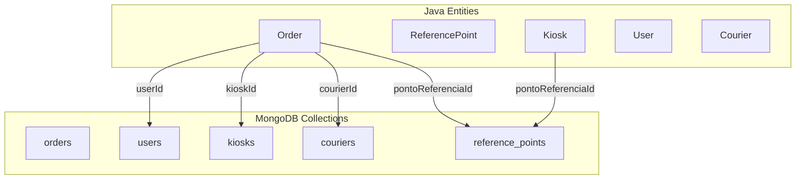
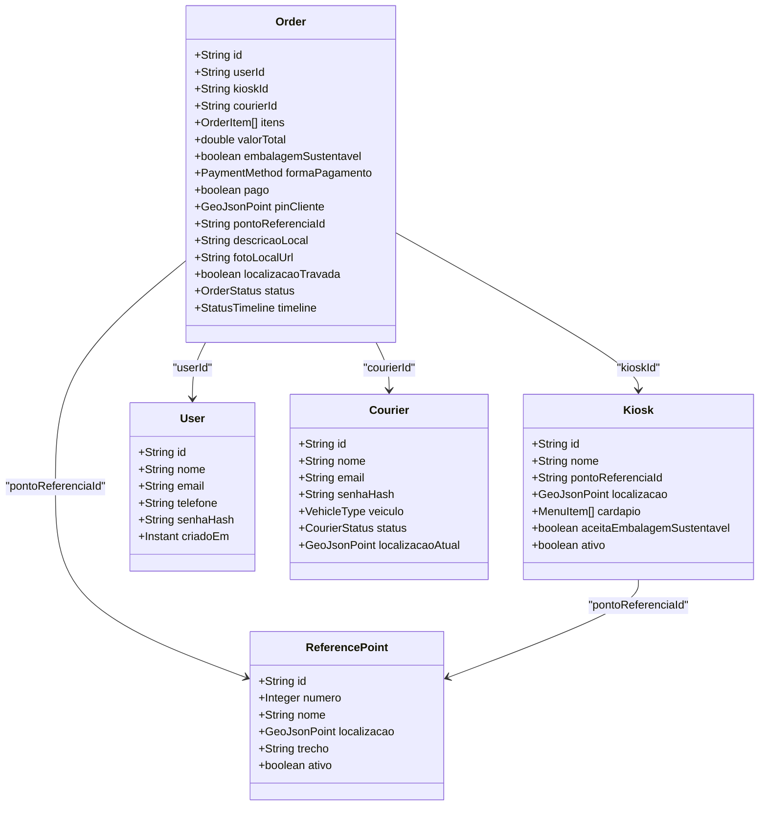
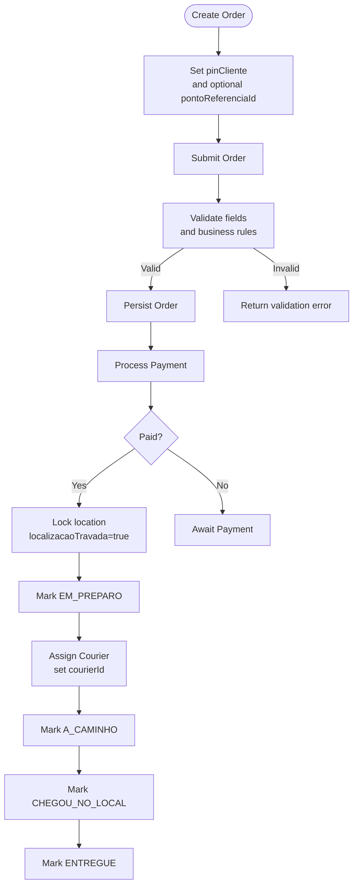
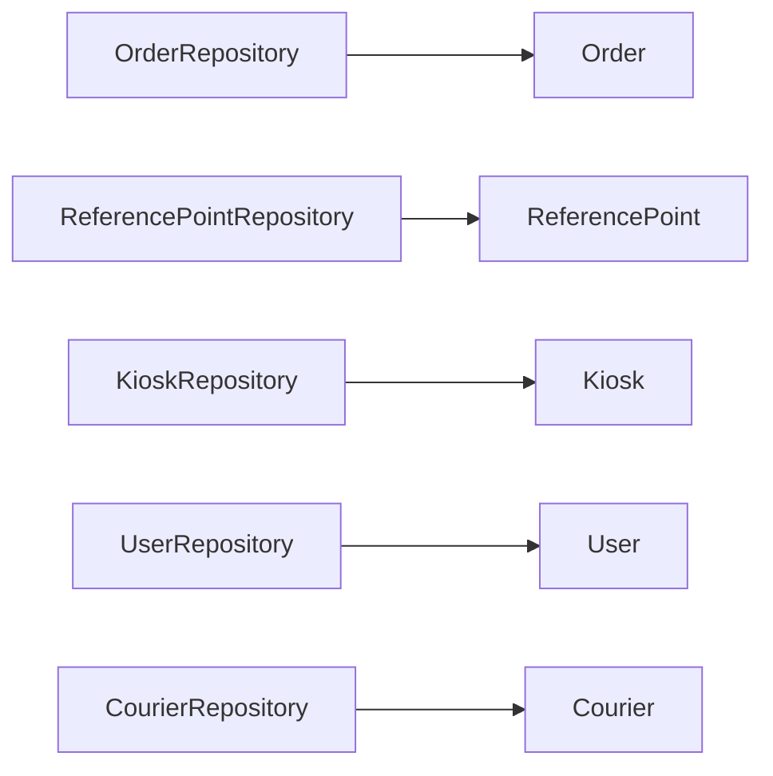

# Data Models and Database Schema

<cite>
**Referenced Files in This Document**
- [Order.java](file://backend/src/main/java/com/penaareia/model/Order.java)
- [ReferencePoint.java](file://backend/src/main/java/com/penaareia/model/ReferencePoint.java)
- [Kiosk.java](file://backend/src/main/java/com/penaareia/model/Kiosk.java)
- [User.java](file://backend/src/main/java/com/penaareia/model/User.java)
- [Courier.java](file://backend/src/main/java/com/penaareia/model/Courier.java)
- [OrderStatus.java](file://backend/src/main/java/com/penaareia/model/OrderStatus.java)
- [PaymentMethod.java](file://backend/src/main/java/com/penaareia/model/PaymentMethod.java)
- [OrderRepository.java](file://backend/src/main/java/com/penaareia/repository/OrderRepository.java)
- [ReferencePointRepository.java](file://backend/src/main/java/com/penaareia/repository/ReferencePointRepository.java)
- [KioskRepository.java](file://backend/src/main/java/com/penaareia/repository/KioskRepository.java)
- [UserRepository.java](file://backend/src/main/java/com/penaareia/repository/UserRepository.java)
- [CourierRepository.java](file://backend/src/main/java/com/penaareia/repository/CourierRepository.java)
</cite>

## Table of Contents
1. [Introduction](#introduction)
2. [Project Structure](#project-structure)
3. [Core Components](#core-components)
4. [Architecture Overview](#architecture-overview)
5. [Detailed Component Analysis](#detailed-component-analysis)
6. [Dependency Analysis](#dependency-analysis)
7. [Performance Considerations](#performance-considerations)
8. [Troubleshooting Guide](#troubleshooting-guide)
9. [Conclusion](#conclusion)
10. [Appendices](#appendices)

## Introduction
This document describes the data models and database schema for the Pé na Areia MVP backend. It focuses on MongoDB document structures, geospatial data formats using GeoJSON, indexing strategies, entity relationships, validation rules, business constraints, and data lifecycle management. The primary entities are Order, ReferencePoint, Kiosk, User, and Courier, with supporting enums OrderStatus and PaymentMethod.

## Project Structure
The data model is implemented as Spring Data MongoDB entities under the model package, with corresponding repositories under repository. Each entity maps to a MongoDB collection via annotations. Geospatial fields use GeoJsonPoint and are indexed with 2dsphere indexes.

**Diagram sources**
- [Order.java:18-49](file://backend/src/main/java/com/penaareia/model/Order.java#L18-L49)
- [ReferencePoint.java:19-37](file://backend/src/main/java/com/penaareia/model/ReferencePoint.java#L19-L37)
- [Kiosk.java:17-35](file://backend/src/main/java/com/penaareia/model/Kiosk.java#L17-L35)
- [User.java:15-31](file://backend/src/main/java/com/penaareia/model/User.java#L15-L31)
- [Courier.java:16-34](file://backend/src/main/java/com/penaareia/model/Courier.java#L16-L34)

**Section sources**
- [Order.java:18-49](file://backend/src/main/java/com/penaareia/model/Order.java#L18-L49)
- [ReferencePoint.java:19-37](file://backend/src/main/java/com/penaareia/model/ReferencePoint.java#L19-L37)
- [Kiosk.java:17-35](file://backend/src/main/java/com/penaareia/model/Kiosk.java#L17-L35)
- [User.java:15-31](file://backend/src/main/java/com/penaareia/model/User.java#L15-L31)
- [Courier.java:16-34](file://backend/src/main/java/com/penaareia/model/Courier.java#L16-L34)

## Core Components
This section summarizes each core entity’s purpose, fields, types, and mapping to MongoDB collections.

- Order
  - Collection: orders
  - Purpose: Represents a customer order, including items, payment, location pin, reference point link, status, and timeline.
  - Key fields: id (String), userId (String), kioskId (String), courierId (String), itens (List<OrderItem>), valorTotal (double), embalagemSustentavel (boolean), formaPagamento (enum), pago (boolean), pinCliente (GeoJsonPoint), pontoReferenciaId (String), descricaoLocal (String), fotoLocalUrl (String), localizacaoTravada (boolean), status (OrderStatus), timeline (StatusTimeline).
  - Geospatial: pinCliente uses 2dsphere index.
  - Business rules: Location pin is locked after payment; status transitions tracked via timeline timestamps.

- ReferencePoint
  - Collection: reference_points
  - Purpose: Official beach reference posts (e.g., numbered lifeguard stations).
  - Key fields: id (String), numero (Integer), nome (String), localizacao (GeoJsonPoint), trecho (String), ativo (boolean).
  - Geospatial: localizacao uses 2dsphere index.

- Kiosk
  - Collection: kiosks
  - Purpose: Beach kiosks with menu and location.
  - Key fields: id (String), nome (String), pontoReferenciaId (String), localizacao (GeoJsonPoint), cardapio (List<MenuItem>), aceitaEmbalagemSustentavel (boolean), ativo (boolean).
  - Geospatial: localizacao uses 2dsphere index.

- User
  - Collection: users
  - Purpose: Customer account information.
  - Key fields: id (String), nome (String), email (String), telefone (String), senhaHash (String), criadoEm (Instant).
  - Indexing: email has unique index.

- Courier
  - Collection: couriers
  - Purpose: Delivery personnel with vehicle type, status, and current location.
  - Key fields: id (String), nome (String), email (String), senhaHash (String), veiculo (enum), status (enum), localizacaoAtual (GeoJsonPoint).
  - Geospatial: localizacaoAtual uses 2dsphere index.

- Enums
  - OrderStatus: CRIADO, PAGO, EM_PREPARO, A_CAMINHO, CHEGOU_NO_LOCAL, ENTREGUE, CANCELADO.
  - PaymentMethod: PIX, CARTAO.

**Section sources**
- [Order.java:18-69](file://backend/src/main/java/com/penaareia/model/Order.java#L18-L69)
- [ReferencePoint.java:19-37](file://backend/src/main/java/com/penaareia/model/ReferencePoint.java#L19-L37)
- [Kiosk.java:17-46](file://backend/src/main/java/com/penaareia/model/Kiosk.java#L17-L46)
- [User.java:15-31](file://backend/src/main/java/com/penaareia/model/User.java#L15-L31)
- [Courier.java:16-45](file://backend/src/main/java/com/penaareia/model/Courier.java#L16-L45)
- [OrderStatus.java:3-10](file://backend/src/main/java/com/penaareia/model/OrderStatus.java#L3-L10)
- [PaymentMethod.java:3-6](file://backend/src/main/java/com/penaareia/model/PaymentMethod.java#L3-L6)

## Architecture Overview
The data layer follows a standard Spring Data MongoDB pattern:
- Entities define documents and mappings.
- Repositories extend MongoRepository and provide query methods.
- Geospatial queries leverage GeoJsonPoint and 2dsphere indexes.

**Diagram sources**
- [Order.java:18-69](file://backend/src/main/java/com/penaareia/model/Order.java#L18-L69)
- [ReferencePoint.java:19-37](file://backend/src/main/java/com/penaareia/model/ReferencePoint.java#L19-L37)
- [Kiosk.java:17-46](file://backend/src/main/java/com/penaareia/model/Kiosk.java#L17-L46)
- [User.java:15-31](file://backend/src/main/java/com/penaareia/model/User.java#L15-L31)
- [Courier.java:16-45](file://backend/src/main/java/com/penaareia/model/Courier.java#L16-L45)

## Detailed Component Analysis

### Order Model
- Mapping: @Document(collection = "orders")
- Primary key: id (String)
- Relationships:
  - userId references User.id
  - kioskId references Kiosk.id
  - courierId references Courier.id (nullable until accepted)
  - pontoReferenciaId references ReferencePoint.id
- Embedded structures:
  - itens: List<OrderItem> with menuItemId, nome, quantidade, precoUnitario
  - timeline: StatusTimeline with creation and event timestamps
- Geospatial:
  - pinCliente: GeoJsonPoint with 2dsphere index
- Validation and constraints:
  - localizacaoTravada prevents pin changes after payment
  - status enum enforces lifecycle states
  - formaPagamento restricted to PIX or CARTAO
- Lifecycle:
  - Timeline tracks created, paid, preparing, on route, arrived, delivered timestamps
  - Status transitions reflect operational flow

**Diagram sources**
- [Order.java:35-49](file://backend/src/main/java/com/penaareia/model/Order.java#L35-L49)
- [OrderStatus.java:3-10](file://backend/src/main/java/com/penaareia/model/OrderStatus.java#L3-L10)

**Section sources**
- [Order.java:18-69](file://backend/src/main/java/com/penaareia/model/Order.java#L18-L69)
- [OrderStatus.java:3-10](file://backend/src/main/java/com/penaareia/model/OrderStatus.java#L3-L10)

### ReferencePoint Model
- Mapping: @Document(collection = "reference_points")
- Primary key: id (String)
- Fields: numero (official post number), nome (display name), localizacao (GeoJsonPoint), trecho (beach segment), ativo (boolean)
- Geospatial: localizacao uses 2dsphere index
- Usage: Used to anchor kiosks and suggest nearest reference points to customers

**Section sources**
- [ReferencePoint.java:19-37](file://backend/src/main/java/com/penaareia/model/ReferencePoint.java#L19-L37)

### Kiosk Model
- Mapping: @Document(collection = "kiosks")
- Primary key: id (String)
- Fields: nome, pontoReferenciaId (FK-like reference), localizacao (GeoJsonPoint), cardapio (List<MenuItem>), aceitaEmbalagemSustentavel, ativo
- Geospatial: localizacao uses 2dsphere index
- Relationships:
  - Links to ReferencePoint via pontoReferenciaId
- Menu item structure: MenuItem includes id, nome, descricao, preco, disponivel

**Section sources**
- [Kiosk.java:17-46](file://backend/src/main/java/com/penaareia/model/Kiosk.java#L17-L46)

### User Model
- Mapping: @Document(collection = "users")
- Primary key: id (String)
- Fields: nome, email (unique index), telefone, senhaHash, criadoEm
- Security: Passwords stored as hashes; never plain text

**Section sources**
- [User.java:15-31](file://backend/src/main/java/com/penaareia/model/User.java#L15-L31)

### Courier Model
- Mapping: @Document(collection = "couriers")
- Primary key: id (String)
- Fields: nome, email (unique index), senhaHash, veiculo (A_PE or BICICLETA), status (OFFLINE, DISPONIVEL, EM_ROTA), localizacaoAtual (GeoJsonPoint)
- Geospatial: localizacaoAtual uses 2dsphere index

**Section sources**
- [Courier.java:16-45](file://backend/src/main/java/com/penaareia/model/Courier.java#L16-L45)

## Dependency Analysis
Repositories define access patterns and geospatial queries:

- OrderRepository
  - findByUserIdOrderByTimelineCriadoEmDesc(userId): Orders by user, newest first
  - findByCourierIdAndStatus(courierId, status): Orders assigned to courier with specific status
  - findByStatus(status): Orders filtered by status

- ReferencePointRepository
  - findByAtivoTrue(): Active reference points
  - findByLocalizacaoNear(localizacao, maxDistance): Nearest reference points within distance

- KioskRepository
  - findByAtivoTrue(): Active kiosks
  - findByPontoReferenciaIdAndAtivoTrue(pontoReferenciaId): Kiosks near a reference point
  - findByLocalizacaoNear(localizacao, maxDistance): Nearby kiosks

- UserRepository
  - findByEmail(email): Lookup by email

- CourierRepository
  - findByEmail(email): Lookup by email

**Diagram sources**
- [OrderRepository.java:9-16](file://backend/src/main/java/com/penaareia/repository/OrderRepository.java#L9-L16)
- [ReferencePointRepository.java:11-17](file://backend/src/main/java/com/penaareia/repository/ReferencePointRepository.java#L11-L17)
- [KioskRepository.java:11-18](file://backend/src/main/java/com/penaareia/repository/KioskRepository.java#L11-L18)
- [UserRepository.java:8-10](file://backend/src/main/java/com/penaareia/repository/UserRepository.java#L8-L10)
- [CourierRepository.java:8-10](file://backend/src/main/java/com/penaareia/repository/CourierRepository.java#L8-L10)

**Section sources**
- [OrderRepository.java:9-16](file://backend/src/main/java/com/penaareia/repository/OrderRepository.java#L9-L16)
- [ReferencePointRepository.java:11-17](file://backend/src/main/java/com/penaareia/repository/ReferencePointRepository.java#L11-L17)
- [KioskRepository.java:11-18](file://backend/src/main/java/com/penaareia/repository/KioskRepository.java#L11-L18)
- [UserRepository.java:8-10](file://backend/src/main/java/com/penaareia/repository/UserRepository.java#L8-L10)
- [CourierRepository.java:8-10](file://backend/src/main/java/com/penaareia/repository/CourierRepository.java#L8-L10)

## Performance Considerations
- Geospatial indexes
  - All GeoJsonPoint fields are annotated with 2dsphere indexes, enabling efficient proximity queries and nearest-neighbor searches.
- Query optimization
  - Use repository methods that filter by active flags (ativo=true) to reduce result sets.
  - Leverage findByLocalizacaoNear for spatial queries to minimize full scans.
- Indexing recommendations
  - Ensure composite indexes where appropriate (e.g., status + courierId) if querying frequently by both fields.
  - Unique indexes already exist for email fields in User and Courier.
- Data size considerations
  - Keep embedded arrays (itens, cardapio) reasonably sized to avoid large documents.
  - Consider denormalization only when read-heavy and write-light patterns justify it.

[No sources needed since this section provides general guidance]

## Troubleshooting Guide
Common issues and resolutions:
- Geospatial query failures
  - Verify that GeoJsonPoint coordinates are valid and that 2dsphere indexes exist on the relevant fields.
  - Check coordinate ordering (longitude, latitude) per GeoJSON specification.
- Uniqueness violations
  - Email uniqueness enforced by indexes; ensure no duplicate emails during user/courier registration.
- Payment lock behavior
  - If location cannot be updated after payment, confirm localizacaoTravada is set appropriately and payment state is consistent.
- Status transitions
  - Ensure status updates follow allowed transitions defined by OrderStatus; invalid transitions should be rejected at service layer.

**Section sources**
- [Order.java:35-49](file://backend/src/main/java/com/penaareia/model/Order.java#L35-L49)
- [User.java:23-24](file://backend/src/main/java/com/penaareia/model/User.java#L23-L24)
- [Courier.java:24-25](file://backend/src/main/java/com/penaareia/model/Courier.java#L24-L25)

## Conclusion
The Pé na Areia data model centers around geospatial capabilities to support beach-based delivery operations. Entities are clearly mapped to MongoDB collections with well-defined relationships and constraints. Geospatial indexes enable efficient location-based queries, while enums and boolean flags enforce business rules such as payment locking and availability. Repositories provide focused access patterns aligned with operational needs.

[No sources needed since this section summarizes without analyzing specific files]

## Appendices

### MongoDB Document Structures and Field Definitions

- orders
  - _id: String (primary key)
  - userId: String (references users._id)
  - kioskId: String (references kiosks._id)
  - courierId: String (references couriers._id; nullable until accepted)
  - itens: Array of objects { menuItemId: String, nome: String, quantidade: NumberInt, precoUnitario: NumberDouble }
  - valorTotal: NumberDouble
  - embalagemSustentavel: Boolean
  - formaPagamento: Enum (PIX | CARTAO)
  - pago: Boolean
  - pinCliente: GeoJSON Point (2dsphere indexed)
  - pontoReferenciaId: String (references reference_points._id)
  - descricaoLocal: String
  - fotoLocalUrl: String
  - localizacaoTravada: Boolean
  - status: Enum (CRIADO | PAGO | EM_PREPARO | A_CAMINHO | CHEGOU_NO_LOCAL | ENTREGUE | CANCELADO)
  - timeline: Object { criadoEm: Date, pagoEm: Date?, emPreparoEm: Date?, aCaminhoEm: Date?, chegouNoLocalEm: Date?, entregueEm: Date? }

- reference_points
  - _id: String
  - numero: NumberInt
  - nome: String
  - localizacao: GeoJSON Point (2dsphere indexed)
  - trecho: String
  - ativo: Boolean

- kiosks
  - _id: String
  - nome: String
  - pontoReferenciaId: String (references reference_points._id)
  - localizacao: GeoJSON Point (2dsphere indexed)
  - cardapio: Array of objects { id: String, nome: String, descricao: String, preco: NumberDouble, disponivel: Boolean }
  - aceitaEmbalagemSustentavel: Boolean
  - ativo: Boolean

- users
  - _id: String
  - nome: String
  - email: String (unique index)
  - telefone: String
  - senhaHash: String
  - criadoEm: Date

- couriers
  - _id: String
  - nome: String
  - email: String (unique index)
  - senhaHash: String
  - veiculo: Enum (A_PE | BICICLETA)
  - status: Enum (OFFLINE | DISPONIVEL | EM_ROTA)
  - localizacaoAtual: GeoJSON Point (2dsphere indexed)

**Section sources**
- [Order.java:18-69](file://backend/src/main/java/com/penaareia/model/Order.java#L18-L69)
- [ReferencePoint.java:19-37](file://backend/src/main/java/com/penaareia/model/ReferencePoint.java#L19-L37)
- [Kiosk.java:17-46](file://backend/src/main/java/com/penaareia/model/Kiosk.java#L17-L46)
- [User.java:15-31](file://backend/src/main/java/com/penaareia/model/User.java#L15-L31)
- [Courier.java:16-45](file://backend/src/main/java/com/penaareia/model/Courier.java#L16-L45)
- [OrderStatus.java:3-10](file://backend/src/main/java/com/penaareia/model/OrderStatus.java#L3-L10)
- [PaymentMethod.java:3-6](file://backend/src/main/java/com/penaareia/model/PaymentMethod.java#L3-L6)

### Geospatial Coordinates System
- Format: GeoJSON Point
- Coordinate system: WGS84 (longitude, latitude)
- Indexes: 2dsphere on all GeoJsonPoint fields to support proximity and radius queries
- Usage:
  - pinCliente: Customer’s exact beach location
  - localizacao: Kiosk and ReferencePoint fixed locations
  - localizacaoAtual: Courier’s live position

**Section sources**
- [Order.java:36-37](file://backend/src/main/java/com/penaareia/model/Order.java#L36-L37)
- [ReferencePoint.java:31-32](file://backend/src/main/java/com/penaareia/model/ReferencePoint.java#L31-L32)
- [Kiosk.java:28-29](file://backend/src/main/java/com/penaareia/model/Kiosk.java#L28-L29)
- [Courier.java:33-34](file://backend/src/main/java/com/penaareia/model/Courier.java#L33-L34)

### Indexing Strategy Summary
- 2dsphere indexes on:
  - Order.pinCliente
  - ReferencePoint.localizacao
  - Kiosk.localizacao
  - Courier.localizacaoAtual
- Unique indexes on:
  - User.email
  - Courier.email
- Repository-driven queries rely on these indexes for performance.

**Section sources**
- [Order.java:36-37](file://backend/src/main/java/com/penaareia/model/Order.java#L36-L37)
- [ReferencePoint.java:31-32](file://backend/src/main/java/com/penaareia/model/ReferencePoint.java#L31-L32)
- [Kiosk.java:28-29](file://backend/src/main/java/com/penaareia/model/Kiosk.java#L28-L29)
- [Courier.java:33-34](file://backend/src/main/java/com/penaareia/model/Courier.java#L33-L34)
- [User.java:23-24](file://backend/src/main/java/com/penaareia/model/User.java#L23-L24)
- [Courier.java:24-25](file://backend/src/main/java/com/penaareia/model/Courier.java#L24-L25)

### Relationship and Referential Integrity Notes
- Foreign-key-like references are represented as String IDs:
  - Order.userId → User.id
  - Order.kioskId → Kiosk.id
  - Order.courierId → Courier.id
  - Order.pontoReferenciaId → ReferencePoint.id
  - Kiosk.pontoReferenciaId → ReferencePoint.id
- Enforced at application level; MongoDB does not enforce referential integrity by default.
- Validation should ensure referenced entities exist before persisting.

**Section sources**
- [Order.java:24-40](file://backend/src/main/java/com/penaareia/model/Order.java#L24-L40)
- [Kiosk.java:25-26](file://backend/src/main/java/com/penaareia/model/Kiosk.java#L25-L26)

### Data Migration and Versioning Strategies
- Backward compatibility
  - Add new fields as optional; avoid removing existing fields without migration scripts.
- Enum evolution
  - Introduce new statuses or payment methods carefully; map legacy values during migration.
- Geospatial schema changes
  - When changing coordinate systems or adding new geospatial fields, rebuild 2dsphere indexes.
- Versioning approach
  - Consider adding a version field to documents if schema evolves significantly.
- Migration scripts
  - Use MongoDB migrations to transform documents (e.g., populate missing fields, normalize enums).

[No sources needed since this section provides general guidance]