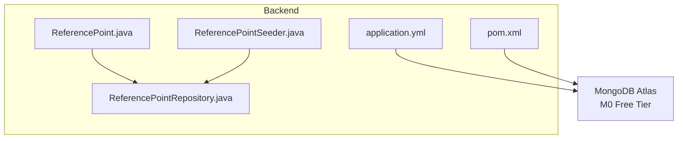
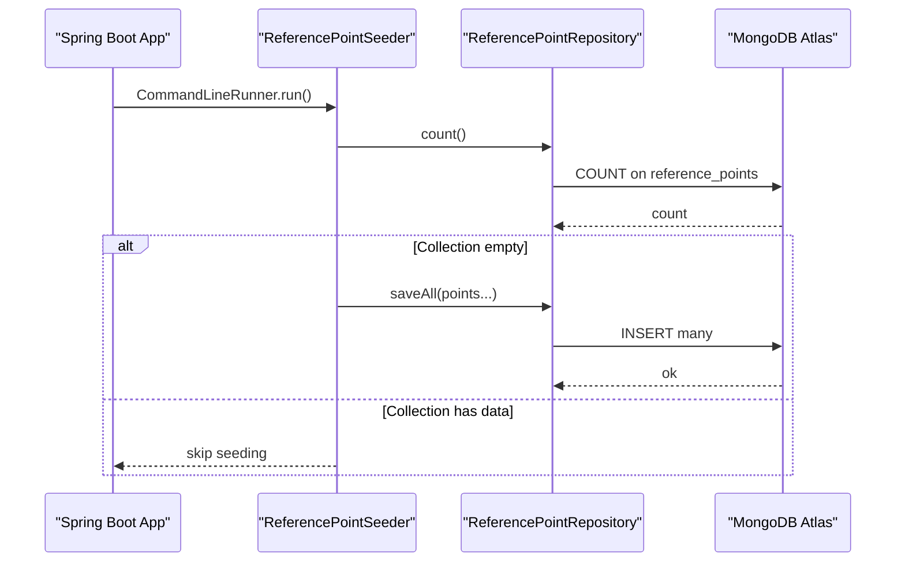
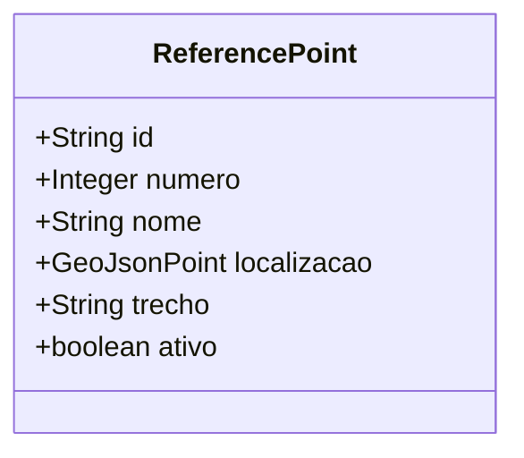
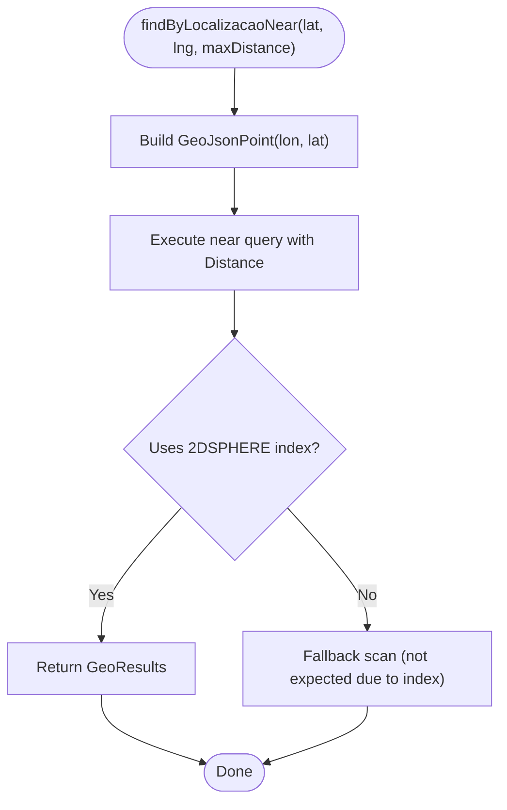
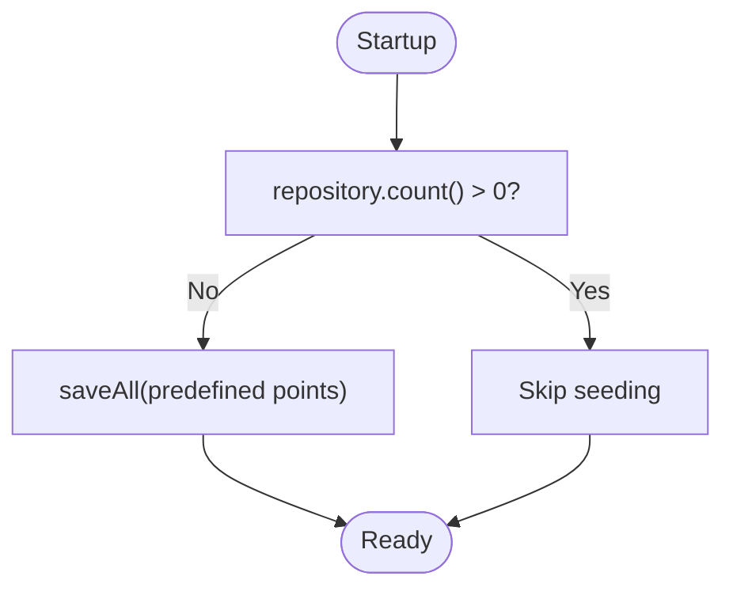
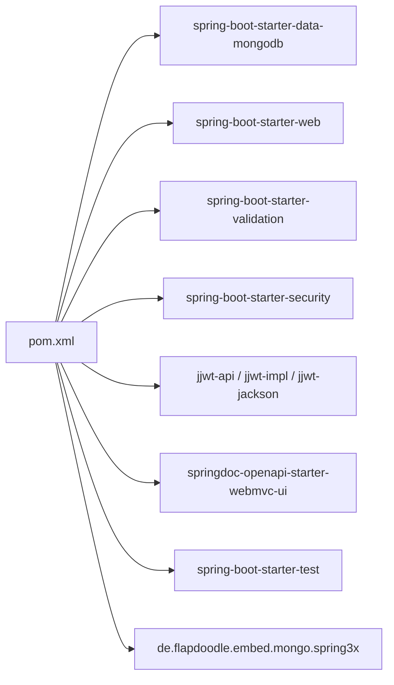

# Database Configuration and Seeding

<cite>
**Referenced Files in This Document**
- [application.yml](file://backend/src/main/resources/application.yml)
- [pom.xml](file://backend/pom.xml)
- [ReferencePoint.java](file://backend/src/main/java/com/penaareia/model/ReferencePoint.java)
- [ReferencePointRepository.java](file://backend/src/main/java/com/penaareia/repository/ReferencePointRepository.java)
- [ReferencePointSeeder.java](file://backend/src/main/java/com/penaareia/seed/ReferencePointSeeder.java)
- [README.md](file://README.md)
</cite>

## Table of Contents
1. [Introduction](#introduction)
2. [Project Structure](#project-structure)
3. [Core Components](#core-components)
4. [Architecture Overview](#architecture-overview)
5. [Detailed Component Analysis](#detailed-component-analysis)
6. [Dependency Analysis](#dependency-analysis)
7. [Performance Considerations](#performance-considerations)
8. [Troubleshooting Guide](#troubleshooting-guide)
9. [Conclusion](#conclusion)
10. [Appendices](#appendices)

## Introduction
This document explains how the Pé na Areia backend connects to MongoDB, initializes the database, and seeds official beach reference points along the Santos coastline. It also documents the geospatial indexing strategy for efficient location queries, environment-specific configuration, Maven dependencies for MongoDB integration, and operational guidance for development versus production setups.

## Project Structure
The database-related code is located under the backend module:
- Configuration: application.yml
- Dependencies: pom.xml
- Domain model: ReferencePoint.java
- Repository: ReferencePointRepository.java
- Seeder: ReferencePointSeeder.java

**Diagram sources**
- [application.yml:11-15](file://backend/src/main/resources/application.yml#L11-L15)
- [pom.xml:31-35](file://backend/pom.xml#L31-L35)
- [ReferencePoint.java:19-32](file://backend/src/main/java/com/penaareia/model/ReferencePoint.java#L19-L32)
- [ReferencePointRepository.java:11-16](file://backend/src/main/java/com/penaareia/repository/ReferencePointRepository.java#L11-L16)
- [ReferencePointSeeder.java:18-35](file://backend/src/main/java/com/penaareia/seed/ReferencePointSeeder.java#L18-L35)

**Section sources**
- [application.yml:1-32](file://backend/src/main/resources/application.yml#L1-L32)
- [pom.xml:1-110](file://backend/pom.xml#L1-L110)

## Core Components
- MongoDB connection settings are defined in application.yml using environment variables MONGODB_URI and MONGODB_DATABASE with sensible defaults.
- The ReferencePoint domain model stores a GeoJSON point and declares a 2DSPHERE index via annotations.
- The repository exposes a near query method that leverages the 2DSPHERE index for proximity searches.
- The seeder populates initial reference points only when the collection is empty.

Key responsibilities:
- Connection and database selection: application.yml
- Geospatial model and indexing: ReferencePoint.java
- Querying by proximity: ReferencePointRepository.java
- Initial data population: ReferencePointSeeder.java

**Section sources**
- [application.yml:11-15](file://backend/src/main/resources/application.yml#L11-L15)
- [ReferencePoint.java:19-37](file://backend/src/main/java/com/penaareia/model/ReferencePoint.java#L19-L37)
- [ReferencePointRepository.java:11-16](file://backend/src/main/java/com/penaareia/repository/ReferencePointRepository.java#L11-L16)
- [ReferencePointSeeder.java:18-47](file://backend/src/main/java/com/penaareia/seed/ReferencePointSeeder.java#L18-L47)

## Architecture Overview
The backend uses Spring Boot with Spring Data MongoDB to connect to MongoDB Atlas. On startup, the seeder runs once to populate reference points if none exist. Queries for nearby points use MongoDB’s 2DSPHERE index for performance.

**Diagram sources**
- [ReferencePointSeeder.java:24-35](file://backend/src/main/java/com/penaareia/seed/ReferencePointSeeder.java#L24-L35)
- [ReferencePointRepository.java:11-16](file://backend/src/main/java/com/penaareia/repository/ReferencePointRepository.java#L11-L16)

## Detailed Component Analysis

### MongoDB Connection and Initialization
- URI and database are configured via environment variables with fallback defaults.
- Auto-index creation is enabled so indexes declared in models are created automatically.

Configuration highlights:
- spring.data.mongodb.uri defaults to a placeholder Atlas URI and can be overridden by MONGODB_URI.
- spring.data.mongodb.database defaults to pe_na_areia and can be overridden by MONGODB_DATABASE.
- auto-index-creation is true.

Environment variables:
- MONGODB_URI: Full MongoDB connection string (e.g., mongodb+srv://...).
- MONGODB_DATABASE: Target database name (default pe_na_areia).

Operational notes:
- For local development, set these variables before running the app.
- For production, ensure the values come from a secure secrets manager or platform environment.

**Section sources**
- [application.yml:11-15](file://backend/src/main/resources/application.yml#L11-L15)
- [README.md:44-58](file://README.md#L44-L58)

### ReferencePoint Model and Geospatial Indexing
- The model maps to the reference_points collection.
- The localizacao field is a GeoJsonPoint annotated with a GEO_2DSPHERE index.
- Additional fields include numero, nome, trecho, and ativo.

Indexing strategy:
- 2DSPHERE index enables efficient $near and distance-based queries.
- Coordinates follow GeoJSON convention [longitude, latitude].

**Diagram sources**
- [ReferencePoint.java:19-37](file://backend/src/main/java/com/penaareia/model/ReferencePoint.java#L19-L37)

**Section sources**
- [ReferencePoint.java:1-39](file://backend/src/main/java/com/penaareia/model/ReferencePoint.java#L1-L39)

### ReferencePointRepository and Near Queries
- Extends MongoRepository for standard CRUD operations.
- Exposes findByAtivoTrue for listing active points.
- Exposes findByLocalizacaoNear(GeoJsonPoint, Distance) to find nearby points within a radius.

Query flow:
- Client provides a GeoJsonPoint and a maximum distance.
- MongoDB uses the 2DSPHERE index to compute distances and return results ordered by proximity.

**Diagram sources**
- [ReferencePointRepository.java:11-16](file://backend/src/main/java/com/penaareia/repository/ReferencePointRepository.java#L11-L16)
- [ReferencePoint.java:31-32](file://backend/src/main/java/com/penaareia/model/ReferencePoint.java#L31-L32)

**Section sources**
- [ReferencePointRepository.java:1-18](file://backend/src/main/java/com/penaareia/repository/ReferencePointRepository.java#L1-L18)

### ReferencePointSeeder Implementation
- Implements CommandLineRunner to run at application startup.
- Checks if the reference_points collection already contains documents; if not, inserts a predefined set of official beach reference points along Santos’ coastline.
- Uses GeoJsonPoint with longitude first, then latitude.

Behavior:
- Idempotent: safe to restart without duplicating data because it checks count > 0.
- Intended for initial data; coordinates should be validated against official city data before production.

**Diagram sources**
- [ReferencePointSeeder.java:24-35](file://backend/src/main/java/com/penaareia/seed/ReferencePointSeeder.java#L24-L35)

**Section sources**
- [ReferencePointSeeder.java:1-49](file://backend/src/main/java/com/penaareia/seed/ReferencePointSeeder.java#L1-L49)

## Dependency Analysis
The project integrates MongoDB through Spring Boot starters and test utilities.

**Diagram sources**
- [pom.xml:24-90](file://backend/pom.xml#L24-L90)

**Section sources**
- [pom.xml:1-110](file://backend/pom.xml#L1-L110)

## Performance Considerations
- Geospatial queries:
  - Ensure the 2DSPHERE index exists on the localizacao field (declared via annotation; auto-index-creation is enabled).
  - Prefer bounded queries using Distance to limit result sets.
- Indexing best practices:
  - Keep queries selective; avoid full scans by filtering on indexed fields where possible.
  - Monitor slow queries and add compound indexes if additional filters are frequently used.
- Connection pooling:
  - Spring Data MongoDB uses an embedded driver pool; tune pool size and timeouts based on workload and Atlas cluster limits.
- Read/write patterns:
  - Batch writes (as done by the seeder) reduce round-trips.
  - Use pagination for large result sets.
- Monitoring:
  - Use MongoDB Atlas dashboard to track query latency and index usage.

[No sources needed since this section provides general guidance]

## Troubleshooting Guide
Common issues and resolutions:
- Cannot connect to MongoDB:
  - Verify MONGODB_URI is correctly set and includes valid credentials and cluster host.
  - Confirm network access rules in MongoDB Atlas allow your deployment IP range.
- Wrong database selected:
  - Ensure MONGODB_DATABASE is set to the intended database (default pe_na_areia).
- No results for near queries:
  - Confirm the localizacao field contains valid GeoJSON points and that the 2DSPHERE index exists.
  - Validate that coordinates are provided as [longitude, latitude].
- Seeder not running:
  - The seeder runs only if the collection is empty; verify collection count.
  - If you need to re-seed, drop the collection or remove existing documents.

**Section sources**
- [application.yml:11-15](file://backend/src/main/resources/application.yml#L11-L15)
- [ReferencePointSeeder.java:24-35](file://backend/src/main/java/com/penaareia/seed/ReferencePointSeeder.java#L24-L35)

## Conclusion
The Pé na Areia backend configures MongoDB via environment variables, relies on Spring Data MongoDB for connectivity and indexing, and seeds official beach reference points at startup. The 2DSPHERE index on the localizacao field enables efficient proximity queries. Follow the environment variable guidelines for development and production, and apply the performance recommendations to maintain responsive geospatial operations.

[No sources needed since this section summarizes without analyzing specific files]

## Appendices

### Environment Variables
- MONGODB_URI: Full MongoDB connection string (required in production).
- MONGODB_DATABASE: Database name (default pe_na_areia).

**Section sources**
- [application.yml:11-15](file://backend/src/main/resources/application.yml#L11-L15)
- [README.md:44-58](file://README.md#L44-L58)

### Development vs Production Setup
- Development:
  - Set MONGODB_URI and MONGODB_DATABASE locally before running the backend.
  - Use free-tier MongoDB Atlas M0 cluster.
- Production:
  - Provide MONGODB_URI and MONGODB_DATABASE via secure environment management.
  - Review Atlas security settings (IP whitelisting, authentication).
  - Consider upgrading cluster tier and enabling backups as needed.

**Section sources**
- [README.md:44-63](file://README.md#L44-L63)

### Data Migration Procedures
- Initial seed:
  - The seeder runs once when the collection is empty.
- Updating reference points:
  - Replace seeded data with official coordinates from the city authority.
  - Implement a migration script or admin endpoint to update records safely.
- Backups:
  - Use MongoDB Atlas automated backups and point-in-time recovery.
  - Schedule regular exports for critical datasets.

**Section sources**
- [ReferencePointSeeder.java:24-35](file://backend/src/main/java/com/penaareia/seed/ReferencePointSeeder.java#L24-L35)