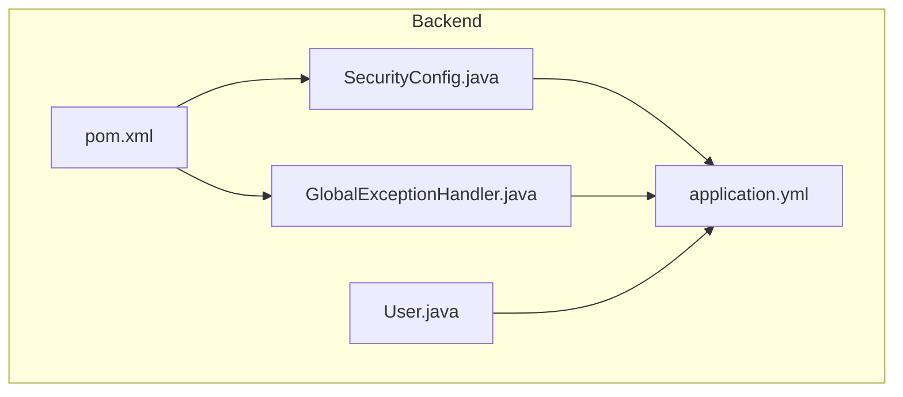
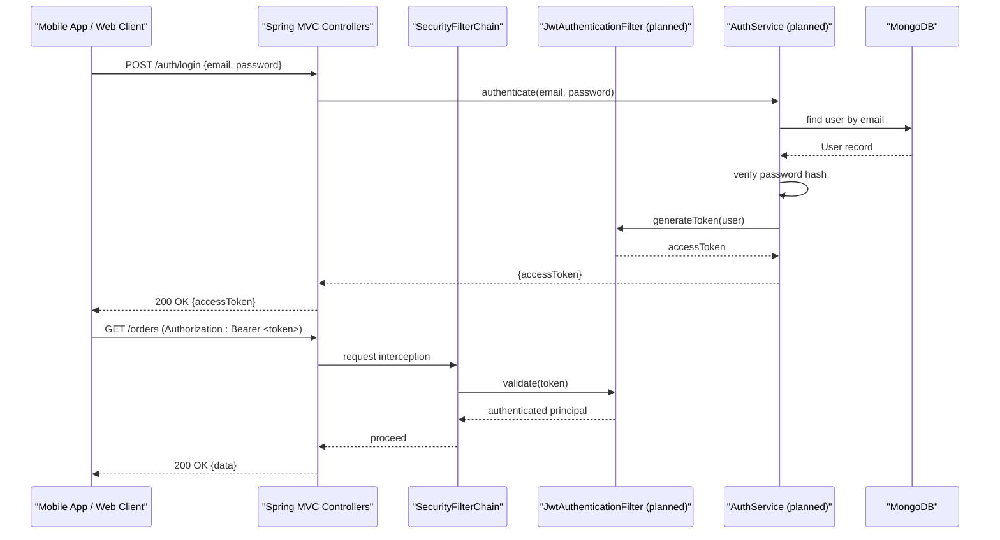
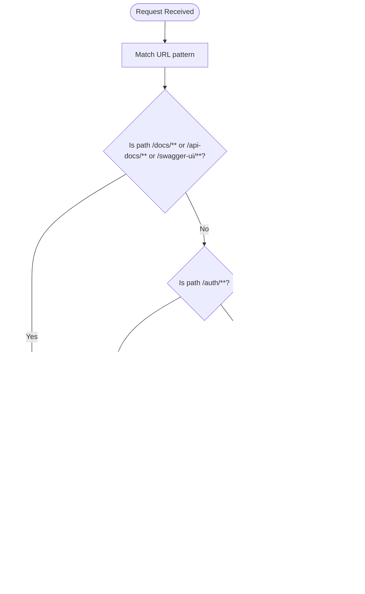
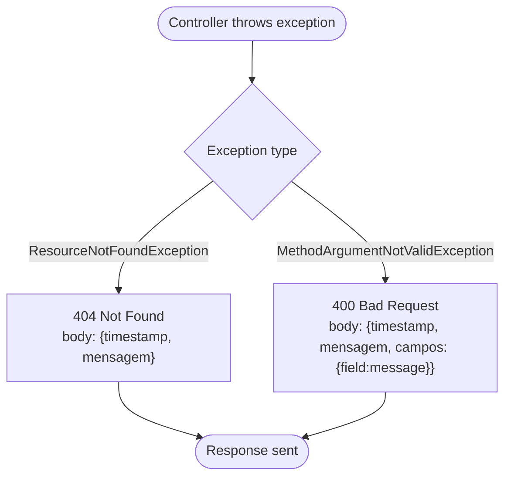
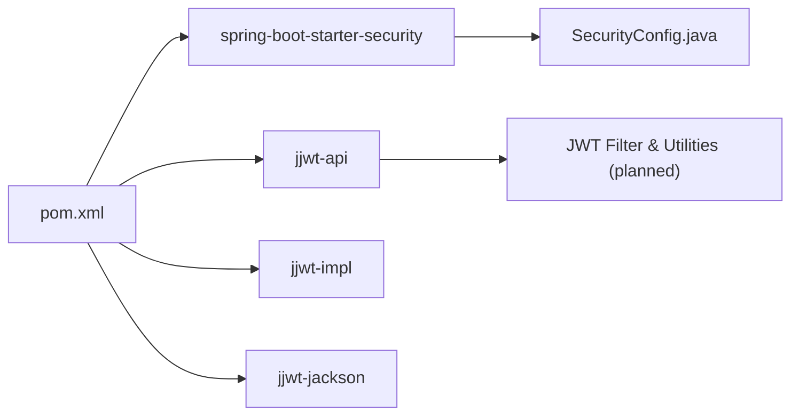

# Security and Authentication

<cite>
**Referenced Files in This Document**
- [SecurityConfig.java](file://backend/src/main/java/com/penaareia/config/SecurityConfig.java)
- [GlobalExceptionHandler.java](file://backend/src/main/java/com/penaareia/config/GlobalExceptionHandler.java)
- [application.yml](file://backend/src/main/resources/application.yml)
- [User.java](file://backend/src/main/java/com/penaareia/model/User.java)
- [pom.xml](file://backend/pom.xml)
</cite>

## Table of Contents
1. [Introduction](#introduction)
2. [Project Structure](#project-structure)
3. [Core Components](#core-components)
4. [Architecture Overview](#architecture-overview)
5. [Detailed Component Analysis](#detailed-component-analysis)
6. [Dependency Analysis](#dependency-analysis)
7. [Performance Considerations](#performance-considerations)
8. [Troubleshooting Guide](#troubleshooting-guide)
9. [Conclusion](#conclusion)

## Introduction
This document describes the security and authentication posture of the Pé na Areia backend, focusing on:
- The current Spring Security configuration and planned JWT-based authentication flow
- Token generation and validation strategy (to be implemented)
- Password hashing with BCrypt
- Global exception handling for consistent error responses
- Environment variable management for sensitive configuration
- CORS and authorization considerations
- Security best practices and mobile app integration guidance

The backend is a Spring Boot application using MongoDB and includes dependencies for Spring Security and JJWT. At this stage, most endpoints are publicly accessible by design to support catalog browsing; authentication will be enabled once the JWT filter and auth endpoints are implemented.

## Project Structure
Security-related code is concentrated under the config package, with supporting models and configuration files as follows:
- Security configuration: SecurityConfig.java
- Global exception handling: GlobalExceptionHandler.java
- Application configuration and secrets: application.yml
- User model with hashed password field: User.java
- Dependencies including Spring Security and JJWT: pom.xml

**Diagram sources**
- [SecurityConfig.java:1-41](file://backend/src/main/java/com/penaareia/config/SecurityConfig.java#L1-L41)
- [GlobalExceptionHandler.java:1-41](file://backend/src/main/java/com/penaareia/config/GlobalExceptionHandler.java#L1-L41)
- [application.yml:1-32](file://backend/src/main/resources/application.yml#L1-L32)
- [User.java:1-33](file://backend/src/main/java/com/penaareia/model/User.java#L1-L33)
- [pom.xml:43-64](file://backend/pom.xml#L43-L64)

**Section sources**
- [SecurityConfig.java:1-41](file://backend/src/main/java/com/penaareia/config/SecurityConfig.java#L1-L41)
- [GlobalExceptionHandler.java:1-41](file://backend/src/main/java/com/penaareia/config/GlobalExceptionHandler.java#L1-L41)
- [application.yml:1-32](file://backend/src/main/resources/application.yml#L1-L32)
- [User.java:1-33](file://backend/src/main/java/com/penaareia/model/User.java#L1-L33)
- [pom.xml:43-64](file://backend/pom.xml#L43-L64)

## Core Components
- Security configuration: Defines CSRF policy, stateless sessions, public endpoint allow-lists, and password encoder.
- Global exception handler: Normalizes error responses for not-found and validation errors.
- Application configuration: Provides MongoDB connection details, JWT secret and expiration, Swagger paths, and delivery settings.
- User model: Stores user data including a hashed password field.
- Dependencies: Declares Spring Security and JJWT libraries required for authentication and token handling.

Key responsibilities:
- SecurityConfig sets up Spring Security defaults and prepares the chain for a future JWT filter.
- GlobalExceptionHandler centralizes error response formatting.
- application.yml exposes environment-driven configuration for secrets and runtime behavior.
- User.java defines the persisted user schema with a hashed password attribute.
- pom.xml declares the security and JWT libraries used by the project.

**Section sources**
- [SecurityConfig.java:22-40](file://backend/src/main/java/com/penaareia/config/SecurityConfig.java#L22-L40)
- [GlobalExceptionHandler.java:15-39](file://backend/src/main/java/com/penaareia/config/GlobalExceptionHandler.java#L15-L39)
- [application.yml:17-20](file://backend/src/main/resources/application.yml#L17-L20)
- [User.java:28-29](file://backend/src/main/java/com/penaareia/model/User.java#L28-L29)
- [pom.xml:43-64](file://backend/pom.xml#L43-L64)

## Architecture Overview
The intended authentication architecture uses Spring Security with a stateless session policy and a custom JWT filter. The current configuration allows all requests but is prepared to enforce authentication once the JWT filter is added.

**Diagram sources**
- [SecurityConfig.java:27-40](file://backend/src/main/java/com/penaareia/config/SecurityConfig.java#L27-L40)
- [application.yml:17-20](file://backend/src/main/resources/application.yml#L17-L20)
- [pom.xml:43-64](file://backend/pom.xml#L43-L64)

## Detailed Component Analysis

### Security Configuration (SecurityConfig)
- CSRF protection is disabled, appropriate for stateless APIs that use tokens.
- Session creation policy is set to STATELESS, aligning with JWT usage.
- Public endpoints include documentation routes (/docs/**, /api-docs/**, /swagger-ui/**), authentication routes (/auth/**), and catalog routes (/reference-points/**, /kiosks/**).
- All other requests currently permit all access; a TODO indicates switching to require authentication once the JWT filter is integrated.
- Password encoding uses BCryptPasswordEncoder.

**Diagram sources**
- [SecurityConfig.java:27-40](file://backend/src/main/java/com/penaareia/config/SecurityConfig.java#L27-L40)

**Section sources**
- [SecurityConfig.java:22-40](file://backend/src/main/java/com/penaareia/config/SecurityConfig.java#L22-L40)

### Global Exception Handling (GlobalExceptionHandler)
- Centralized error responses via @RestControllerAdvice.
- Handles ResourceNotFoundException with 404 status and a standardized body containing timestamp and message.
- Handles MethodArgumentNotValidException with 400 status, aggregating field-level validation errors into a map under a fields key.
- Standardizes response body structure with timestamp and mensagem fields.

**Diagram sources**
- [GlobalExceptionHandler.java:18-31](file://backend/src/main/java/com/penaareia/config/GlobalExceptionHandler.java#L18-L31)

**Section sources**
- [GlobalExceptionHandler.java:15-39](file://backend/src/main/java/com/penaareia/config/GlobalExceptionHandler.java#L15-L39)

### JWT Token Generation and Validation (Planned)
- The project includes JJWT dependencies and a JWT secret configuration property, indicating the plan to implement token issuance and verification.
- A TODO in SecurityConfig specifies adding a JwtAuthenticationFilter before UsernamePasswordAuthenticationFilter and restricting order endpoints to authenticated users.
- Once implemented, token generation should occur after successful login, and validation should happen within the filter chain for protected endpoints.

Implementation notes:
- Use the configured secret from application.yml for signing tokens.
- Set token expiration based on jwt.expiration-ms.
- Store minimal claims in the token (e.g., user identifier) and avoid sensitive data.
- Validate signature and expiration on each request.

**Section sources**
- [SecurityConfig.java:11-18](file://backend/src/main/java/com/penaareia/config/SecurityConfig.java#L11-L18)
- [application.yml:17-20](file://backend/src/main/resources/application.yml#L17-L20)
- [pom.xml:43-64](file://backend/pom.xml#L43-L64)

### Password Hashing and Storage
- Passwords must never be stored in plain text.
- The User model includes a senhaHash field for storing BCrypt hashes.
- BCryptPasswordEncoder is provided as a Spring bean for secure hashing and comparison.

Best practices:
- Always hash passwords at registration and update time.
- Compare provided passwords using the PasswordEncoder.matches method.
- Avoid logging or exposing password hashes in API responses.

**Section sources**
- [User.java:28-29](file://backend/src/main/java/com/penaareia/model/User.java#L28-L29)
- [SecurityConfig.java:22-25](file://backend/src/main/java/com/penaareia/config/SecurityConfig.java#L22-L25)

### Input Validation Strategy
- Validation annotations on DTOs trigger MethodArgumentNotValidException when invalid.
- GlobalExceptionHandler aggregates field errors into a structured response for clients.

Recommendations:
- Apply Bean Validation constraints (e.g., @NotBlank, @Email, @Size) on DTOs.
- Provide clear error messages for each field.
- Return consistent error payloads across the API.

**Section sources**
- [GlobalExceptionHandler.java:23-31](file://backend/src/main/java/com/penaareia/config/GlobalExceptionHandler.java#L23-L31)

### Environment Variable Management
- MongoDB URI and database name are loaded from environment variables MONGODB_URI and MONGODB_DATABASE.
- JWT secret and expiration are configured via jwt.secret and jwt.expiration-ms, with the secret expected to be provided through an environment variable in production.
- Swagger UI and API docs paths are configurable.

Operational guidance:
- Never commit secrets to version control.
- Use a secrets manager or environment injection in deployment pipelines.
- Rotate JWT secrets periodically and invalidate existing tokens upon rotation.

**Section sources**
- [application.yml:11-20](file://backend/src/main/resources/application.yml#L11-L20)

### CORS Policies
- No explicit CORS configuration is present in SecurityConfig.
- By default, Spring Security does not configure CORS; if cross-origin requests are needed, add a CorsConfigurationSource bean or use Spring’s global CORS configuration.

Recommendations:
- Restrict allowed origins to known domains.
- Limit allowed methods and headers.
- Avoid wildcard (*) origins in production.

[No sources needed since this section provides general guidance]

### Authorization Mechanisms
- Current authorization allows all requests except explicitly matched public endpoints.
- Future plan: restrict order mutation endpoints to authenticated users once the JWT filter is integrated.

Next steps:
- Implement role-based or scope-based authorization if needed.
- Enforce least privilege for API endpoints.

**Section sources**
- [SecurityConfig.java:32-37](file://backend/src/main/java/com/penaareia/config/SecurityConfig.java#L32-L37)

## Dependency Analysis
The backend relies on Spring Security for request filtering and JJWT for token operations. These dependencies enable the planned JWT-based authentication flow.

**Diagram sources**
- [pom.xml:43-64](file://backend/pom.xml#L43-L64)
- [SecurityConfig.java:27-40](file://backend/src/main/java/com/penaareia/config/SecurityConfig.java#L27-L40)

**Section sources**
- [pom.xml:43-64](file://backend/pom.xml#L43-L64)

## Performance Considerations
- Stateless sessions reduce server-side memory overhead compared to session-based auth.
- BCrypt is intentionally slow to resist brute-force attacks; tune cost factor appropriately for your environment.
- Keep JWT payloads small to minimize network overhead.
- Cache user lookups judiciously if performance becomes a concern, ensuring cache invalidation on profile updates.

[No sources needed since this section provides general guidance]

## Troubleshooting Guide
Common issues and resolutions:
- 401 Unauthorized on protected endpoints:
  - Ensure the client sends Authorization: Bearer <token>.
  - Verify the JWT secret matches between issuer and validator.
  - Confirm token has not expired.
- 400 Bad Request with validation errors:
  - Inspect the campos map in the error response to identify invalid fields.
  - Update client payloads to satisfy validation constraints.
- 404 Not Found:
  - Verify resource IDs and endpoint paths.
- CORS errors:
  - Add explicit CORS configuration allowing only trusted origins.
- MongoDB connection failures:
  - Check MONGODB_URI and MONGODB_DATABASE environment variables.
- Swagger UI not accessible:
  - Confirm /docs and /api-docs paths are permitted and not blocked by firewall rules.

**Section sources**
- [GlobalExceptionHandler.java:18-31](file://backend/src/main/java/com/penaareia/config/GlobalExceptionHandler.java#L18-L31)
- [application.yml:11-20](file://backend/src/main/resources/application.yml#L11-L20)

## Conclusion
The Pé na Areia backend is prepared for JWT-based authentication with Spring Security and JJWT. The current configuration prioritizes open access for development and catalog browsing while laying the groundwork for secured endpoints. To complete the security posture:
- Implement the JWT filter and auth endpoints as indicated by the TODOs.
- Enforce authentication on sensitive endpoints.
- Configure CORS explicitly for production.
- Manage secrets securely via environment variables.
- Adopt consistent input validation and error handling patterns.

[No sources needed since this section summarizes without analyzing specific files]