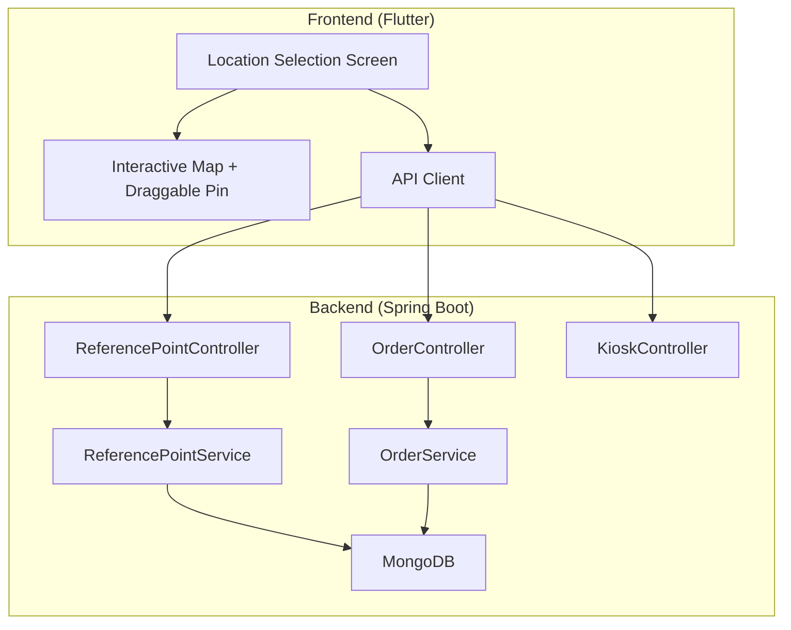
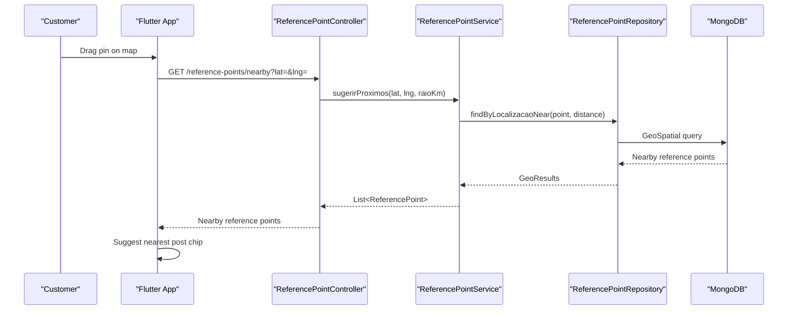
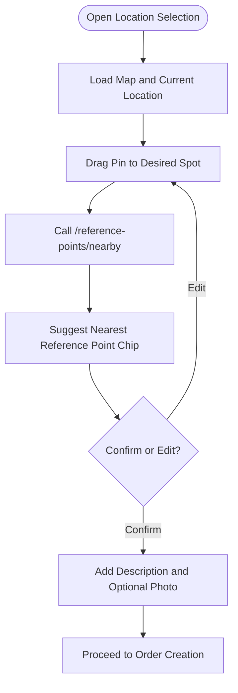
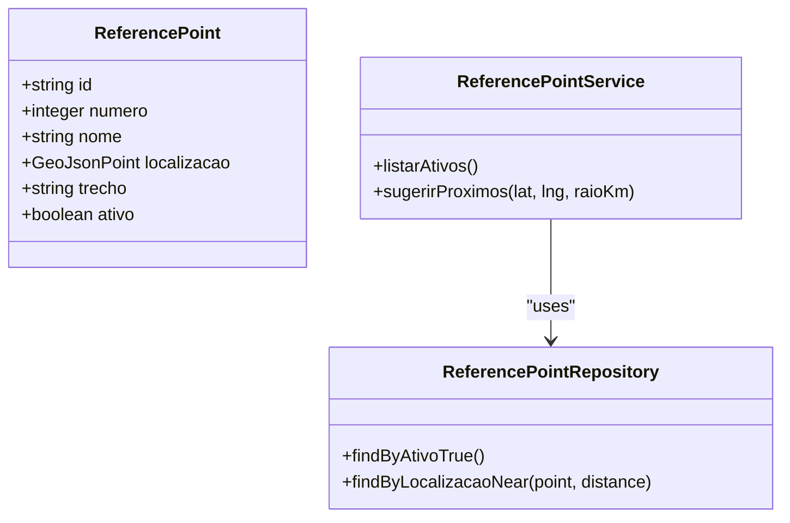
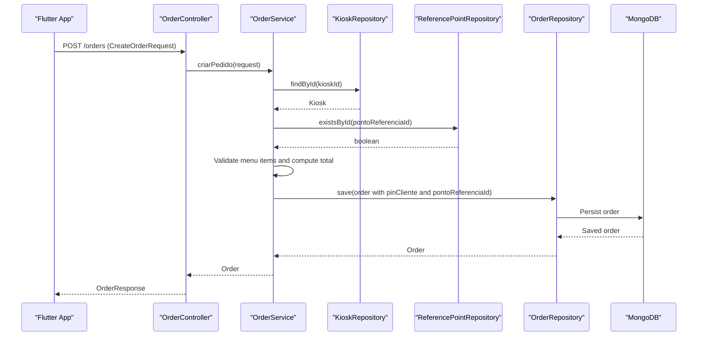
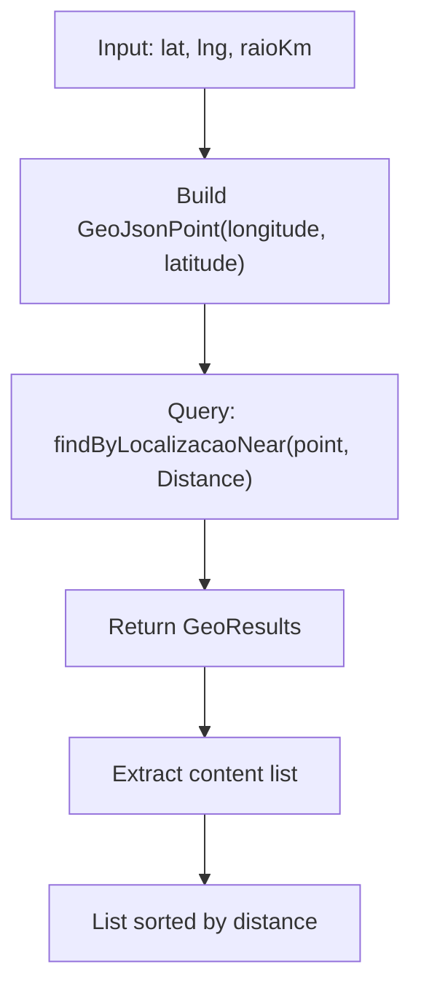
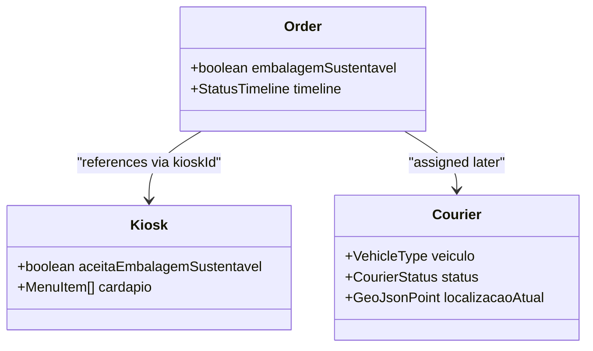
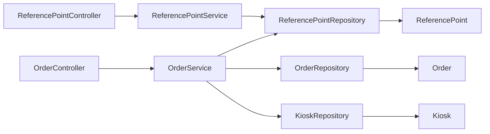

# Core Features

<cite>
**Referenced Files in This Document**
- [README.md](file://README.md)
- [ReferencePoint.java](file://backend/src/main/java/com/penaareia/model/ReferencePoint.java)
- [Order.java](file://backend/src/main/java/com/penaareia/model/Order.java)
- [Kiosk.java](file://backend/src/main/java/com/penaareia/model/Kiosk.java)
- [Courier.java](file://backend/src/main/java/com/penaareia/model/Courier.java)
- [User.java](file://backend/src/main/java/com/penaareia/model/User.java)
- [ReferencePointController.java](file://backend/src/main/java/com/penaareia/controller/ReferencePointController.java)
- [OrderController.java](file://backend/src/main/java/com/penaareia/controller/OrderController.java)
- [KioskController.java](file://backend/src/main/java/com/penaareia/controller/KioskController.java)
- [ReferencePointService.java](file://backend/src/main/java/com/penaareia/service/ReferencePointService.java)
- [OrderService.java](file://backend/src/main/java/com/penaareia/service/OrderService.java)
- [ReferencePointRepository.java](file://backend/src/main/java/com/penaareia/repository/ReferencePointRepository.java)
- [OrderRepository.java](file://backend/src/main/java/com/penaareia/repository/OrderRepository.java)
- [CreateOrderRequest.java](file://backend/src/main/java/com/penaareia/dto/CreateOrderRequest.java)
- [ReferencePointSeeder.java](file://backend/src/main/java/com/penaareia/seed/ReferencePointSeeder.java)
</cite>

## Table of Contents
1. [Introduction](#introduction)
2. [Project Structure](#project-structure)
3. [Core Components](#core-components)
4. [Architecture Overview](#architecture-overview)
5. [Detailed Component Analysis](#detailed-component-analysis)
6. [Dependency Analysis](#dependency-analysis)
7. [Performance Considerations](#performance-considerations)
8. [Troubleshooting Guide](#troubleshooting-guide)
9. [Conclusion](#conclusion)

## Introduction
Pé na Areia is a sustainable beachfront delivery app that replaces formal addresses with an interactive map and draggable pins, anchored by official reference points (lifeguard posts). Users select their exact spot on the sand, optionally link it to the nearest official post, add descriptive details and photos, and place orders from partner kiosks along the shore. The backend provides geospatial endpoints for nearby reference points and order creation, while the frontend implements the location selection screen with automatic suggestions and a pin-based workflow.

This document explains how the location selection system, reference point management, and order processing pipeline work together to solve beachfront delivery without formal addresses, including user workflows, data flows, integration points, geospatial algorithms, and sustainability considerations.

## Project Structure
The project follows a clear two-layer architecture:
- Backend: Java 17 + Spring Boot + MongoDB, exposing REST endpoints for reference points, kiosks, and orders. It includes geospatial indexing and queries.
- Frontend: Flutter application implementing the interactive map, draggable pin, and reference point suggestion UI.

**Diagram sources**
- [ReferencePointController.java:12-33](file://backend/src/main/java/com/penaareia/controller/ReferencePointController.java#L12-L33)
- [OrderController.java:15-35](file://backend/src/main/java/com/penaareia/controller/OrderController.java#L15-L35)
- [KioskController.java:12-30](file://backend/src/main/java/com/penaareia/controller/KioskController.java#L12-L30)
- [ReferencePointService.java:15-37](file://backend/src/main/java/com/penaareia/service/ReferencePointService.java#L15-L37)
- [OrderService.java:17-77](file://backend/src/main/java/com/penaareia/service/OrderService.java#L17-L77)

**Section sources**
- [README.md:1-84](file://README.md#L1-L84)

## Core Components
- Location Selection System: Interactive map with draggable pin; automatic suggestion of nearby official reference points; optional photo and description capture.
- Reference Point Management: Official lifeguard posts stored with geospatial coordinates; seeded at startup; queried via proximity search.
- Order Processing Pipeline: Validates kiosk and menu items, computes totals, stores the customer’s pin and associated reference point, and persists the order with status tracking.

Key responsibilities:
- ReferencePoint model and repository provide geospatial storage and near queries.
- Order model captures the customer pin and reference point linkage, plus sustainability flags and timeline.
- Controllers expose REST endpoints for listing reference points, finding nearby points, listing kiosks, and creating orders.
- Services orchestrate validation, geospatial queries, and persistence.

**Section sources**
- [ReferencePoint.java:12-38](file://backend/src/main/java/com/penaareia/model/ReferencePoint.java#L12-L38)
- [Order.java:15-70](file://backend/src/main/java/com/penaareia/model/Order.java#L15-L70)
- [ReferencePointController.java:12-33](file://backend/src/main/java/com/penaareia/controller/ReferencePointController.java#L12-L33)
- [OrderController.java:15-35](file://backend/src/main/java/com/penaareia/controller/OrderController.java#L15-L35)
- [ReferencePointService.java:15-37](file://backend/src/main/java/com/penaareia/service/ReferencePointService.java#L15-L37)
- [OrderService.java:17-77](file://backend/src/main/java/com/penaareia/service/OrderService.java#L17-L77)

## Architecture Overview
The system integrates frontend interactions with backend geospatial services to enable precise beachfront delivery.

**Diagram sources**
- [ReferencePointController.java:26-33](file://backend/src/main/java/com/penaareia/controller/ReferencePointController.java#L26-L33)
- [ReferencePointService.java:29-37](file://backend/src/main/java/com/penaareia/service/ReferencePointService.java#L29-L37)
- [ReferencePointRepository.java:11-17](file://backend/src/main/java/com/penaareia/repository/ReferencePointRepository.java#L11-L17)

## Detailed Component Analysis

### Location Selection System (Interactive Maps and Draggable Pins)
- The frontend displays a map where users drag a pin to mark their exact beach location.
- On pin movement or initial load, the app calls the nearby reference points endpoint to suggest the closest official post.
- Users can refine the location with a text description and optionally attach a photo URL.
- The selected latitude/longitude and chosen reference point are sent when placing the order.

[No sources needed since this diagram shows conceptual workflow, not actual code structure]

**Section sources**
- [README.md:26-30](file://README.md#L26-L30)
- [CreateOrderRequest.java:29-43](file://backend/src/main/java/com/penaareia/dto/CreateOrderRequest.java#L29-L43)

### Reference Point Management (Official Beach Locations)
- Reference points represent official lifeguard posts along the shoreline, each with a number, display name, beach section, and geospatial coordinate.
- A seeder populates a small set of Santos reference points on first run if the collection is empty.
- Active reference points can be listed, and nearby points can be found using a radius-based geospatial query.

**Diagram sources**
- [ReferencePoint.java:12-38](file://backend/src/main/java/com/penaareia/model/ReferencePoint.java#L12-L38)
- [ReferencePointRepository.java:11-17](file://backend/src/main/java/com/penaareia/repository/ReferencePointRepository.java#L11-L17)
- [ReferencePointService.java:15-37](file://backend/src/main/java/com/penaareia/service/ReferencePointService.java#L15-L37)

**Section sources**
- [ReferencePoint.java:12-38](file://backend/src/main/java/com/penaareia/model/ReferencePoint.java#L12-L38)
- [ReferencePointRepository.java:11-17](file://backend/src/main/java/com/penaareia/repository/ReferencePointRepository.java#L11-L17)
- [ReferencePointService.java:15-37](file://backend/src/main/java/com/penaareia/service/ReferencePointService.java#L15-L37)
- [ReferencePointSeeder.java:10-47](file://backend/src/main/java/com/penaareia/seed/ReferencePointSeeder.java#L10-L47)

### Order Processing Pipeline
- The order creation flow validates the kiosk and menu items, computes the total value, and stores the customer’s pin alongside the selected reference point.
- Orders include sustainability flags and a status timeline to track lifecycle events.
- Once paid, the pin can be locked to prevent changes (planned behavior aligned with Domino’s Pinpoint Delivery).

**Diagram sources**
- [OrderController.java:23-28](file://backend/src/main/java/com/penaareia/controller/OrderController.java#L23-L28)
- [OrderService.java:25-70](file://backend/src/main/java/com/penaareia/service/OrderService.java#L25-L70)
- [OrderRepository.java:9-16](file://backend/src/main/java/com/penaareia/repository/OrderRepository.java#L9-L16)

**Section sources**
- [OrderController.java:15-35](file://backend/src/main/java/com/penaareia/controller/OrderController.java#L15-L35)
- [OrderService.java:17-77](file://backend/src/main/java/com/penaareia/service/OrderService.java#L17-L77)
- [OrderRepository.java:9-16](file://backend/src/main/java/com/penaareia/repository/OrderRepository.java#L9-L16)
- [CreateOrderRequest.java:12-53](file://backend/src/main/java/com/penaareia/dto/CreateOrderRequest.java#L12-L53)
- [Order.java:15-70](file://backend/src/main/java/com/penaareia/model/Order.java#L15-L70)

### Geospatial Algorithms and Validation
- Coordinates follow GeoJSON format throughout the backend, consistently using [longitude, latitude].
- Reference points and orders are indexed with a 2dsphere index to support efficient proximity searches.
- Proximity search uses MongoDB’s near query to return reference points within a specified radius (default 1.5 km), ordered by distance.
- Order creation validates the existence of the selected reference point and ensures the kiosk and menu items exist and are available.

**Diagram sources**
- [ReferencePointService.java:29-37](file://backend/src/main/java/com/penaareia/service/ReferencePointService.java#L29-L37)
- [ReferencePointRepository.java:11-17](file://backend/src/main/java/com/penaareia/repository/ReferencePointRepository.java#L11-L17)

**Section sources**
- [README.md:78-84](file://README.md#L78-L84)
- [ReferencePoint.java:31-32](file://backend/src/main/java/com/penaareia/model/ReferencePoint.java#L31-L32)
- [Order.java:36-37](file://backend/src/main/java/com/penaareia/model/Order.java#L36-L37)
- [ReferencePointService.java:29-37](file://backend/src/main/java/com/penaareia/service/ReferencePointService.java#L29-L37)

### Sustainability Aspects and Route Optimization
- Orders include a sustainability flag indicating whether eco-friendly packaging is requested.
- Kiosks declare whether they accept sustainable packaging, enabling alignment between customer preferences and vendor capabilities.
- Couriers are modeled with vehicle types suitable for beach environments (on foot or bicycle), supporting low-impact deliveries.
- While explicit route optimization logic is not implemented yet, the presence of courier models and statuses sets the foundation for future route planning tailored to beach conditions.

**Diagram sources**
- [Order.java:15-70](file://backend/src/main/java/com/penaareia/model/Order.java#L15-L70)
- [Kiosk.java:14-46](file://backend/src/main/java/com/penaareia/model/Kiosk.java#L14-L46)
- [Courier.java:13-45](file://backend/src/main/java/com/penaareia/model/Courier.java#L13-L45)

**Section sources**
- [Order.java:15-70](file://backend/src/main/java/com/penaareia/model/Order.java#L15-L70)
- [Kiosk.java:14-46](file://backend/src/main/java/com/penaareia/model/Kiosk.java#L14-L46)
- [Courier.java:13-45](file://backend/src/main/java/com/penaareia/model/Courier.java#L13-L45)

## Dependency Analysis
The following diagram highlights key dependencies among controllers, services, repositories, and models involved in reference points and orders.

**Diagram sources**
- [ReferencePointController.java:12-33](file://backend/src/main/java/com/penaareia/controller/ReferencePointController.java#L12-L33)
- [ReferencePointService.java:15-37](file://backend/src/main/java/com/penaareia/service/ReferencePointService.java#L15-L37)
- [ReferencePointRepository.java:11-17](file://backend/src/main/java/com/penaareia/repository/ReferencePointRepository.java#L11-L17)
- [OrderController.java:15-35](file://backend/src/main/java/com/penaareia/controller/OrderController.java#L15-L35)
- [OrderService.java:17-77](file://backend/src/main/java/com/penaareia/service/OrderService.java#L17-L77)
- [OrderRepository.java:9-16](file://backend/src/main/java/com/penaareia/repository/OrderRepository.java#L9-L16)
- [ReferencePoint.java:12-38](file://backend/src/main/java/com/penaareia/model/ReferencePoint.java#L12-L38)
- [Order.java:15-70](file://backend/src/main/java/com/penaareia/model/Order.java#L15-L70)
- [Kiosk.java:14-46](file://backend/src/main/java/com/penaareia/model/Kiosk.java#L14-L46)

**Section sources**
- [ReferencePointController.java:12-33](file://backend/src/main/java/com/penaareia/controller/ReferencePointController.java#L12-L33)
- [OrderController.java:15-35](file://backend/src/main/java/com/penaareia/controller/OrderController.java#L15-L35)
- [ReferencePointService.java:15-37](file://backend/src/main/java/com/penaareia/service/ReferencePointService.java#L15-L37)
- [OrderService.java:17-77](file://backend/src/main/java/com/penaareia/service/OrderService.java#L17-L77)

## Performance Considerations
- Geospatial indexes (2dsphere) on reference points and orders enable efficient proximity searches and reduce query latency.
- Default radius for nearby reference points balances relevance and performance; adjust based on beach density and user expectations.
- Menu item validation and total computation are performed server-side to ensure consistency and avoid client-side manipulation.
- Future enhancements could include caching frequently accessed reference points and kiosks to reduce database load during peak hours.

[No sources needed since this section provides general guidance]

## Troubleshooting Guide
Common issues and resolutions:
- Missing reference point: Ensure the selected reference point ID exists before creating an order; the service throws a resource not found error otherwise.
- Invalid kiosk or unavailable menu items: Verify the kiosk exists and all requested menu items are present and available; the service validates these constraints.
- Coordinate order errors: Always use longitude-first coordinates when constructing GeoJsonPoint objects; incorrect ordering leads to invalid locations.
- Seed data absence: If no reference points appear, confirm the seeder has run and the collection was initially empty; the seeder only inserts data when the collection count is zero.

**Section sources**
- [OrderService.java:25-70](file://backend/src/main/java/com/penaareia/service/OrderService.java#L25-L70)
- [ReferencePointSeeder.java:10-47](file://backend/src/main/java/com/penaareia/seed/ReferencePointSeeder.java#L10-L47)
- [README.md:78-84](file://README.md#L78-L84)

## Conclusion
Pé na Areia’s core features combine an intuitive beachfront location selection experience with robust geospatial backend support. By anchoring customer pins to official reference points and validating orders against kiosks and menus, the system delivers reliable, sustainable beachfront deliveries. The current implementation lays a solid foundation for future enhancements such as real-time courier tracking, advanced route optimization for beach environments, and expanded sustainability integrations.

[No sources needed since this section summarizes without analyzing specific files]