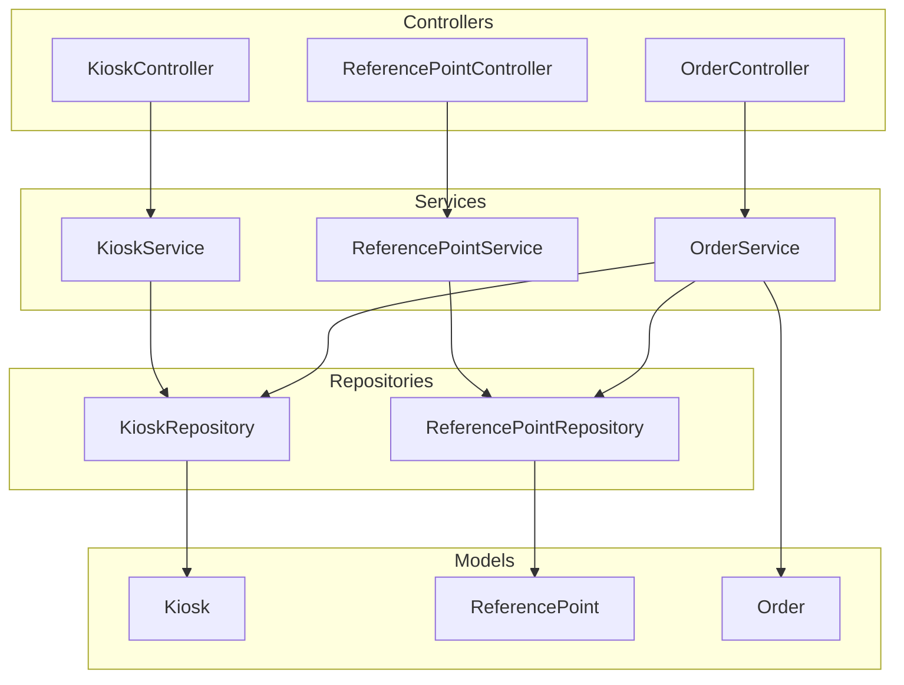
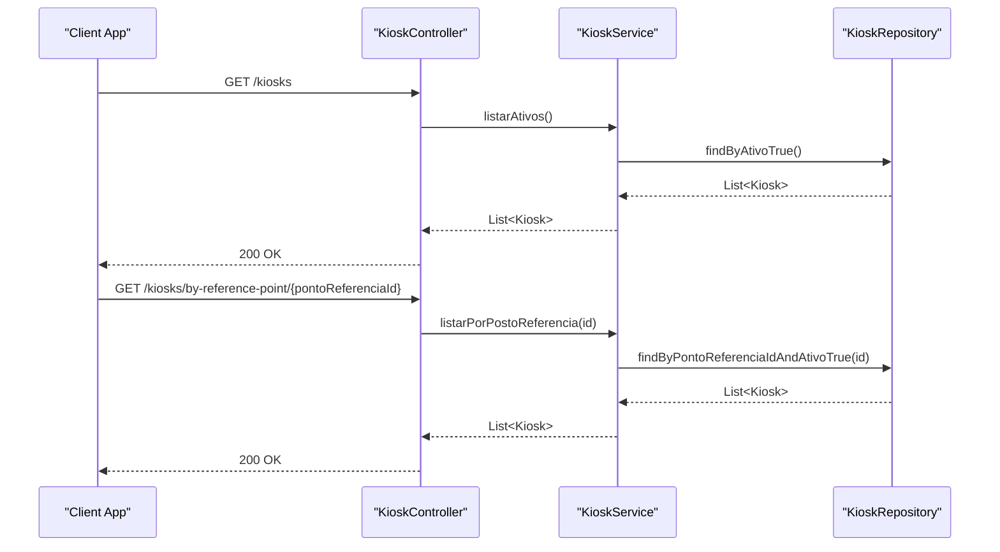
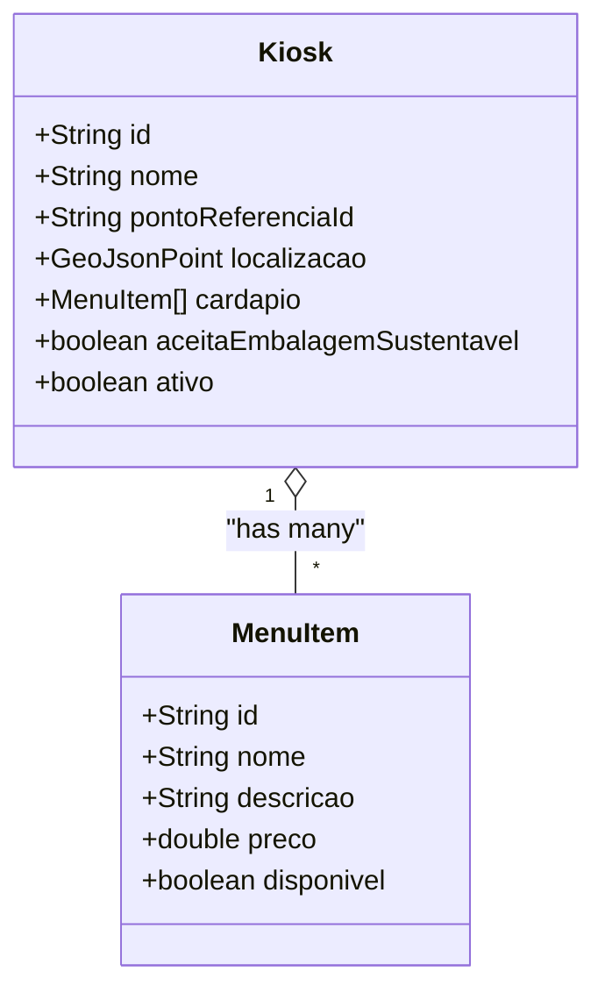
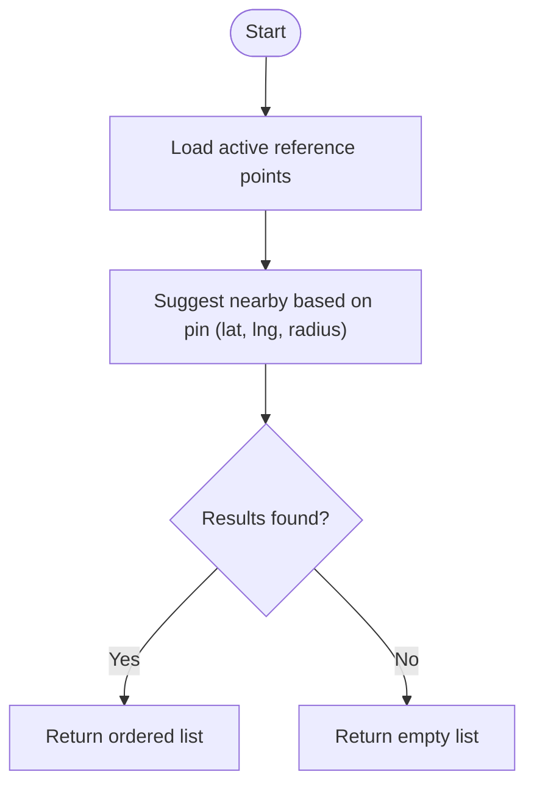
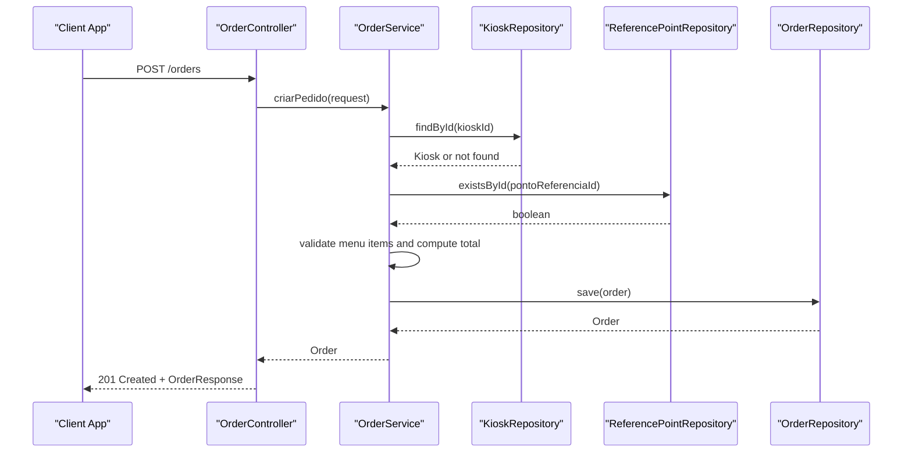
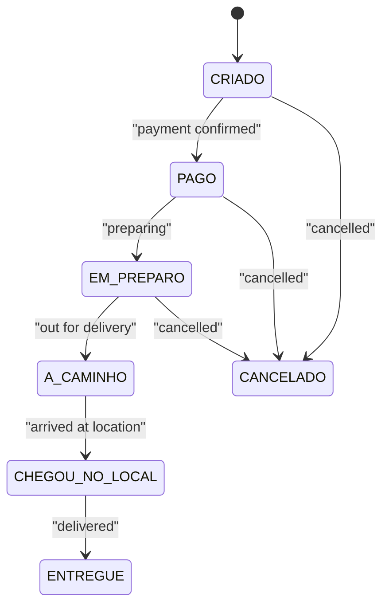
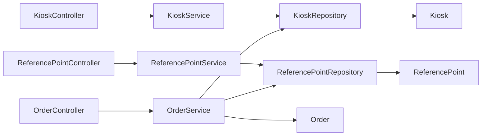

# Kiosk Integration

<cite>
**Referenced Files in This Document**
- [Kiosk.java](file://backend/src/main/java/com/penaareia/model/Kiosk.java)
- [ReferencePoint.java](file://backend/src/main/java/com/penaareia/model/ReferencePoint.java)
- [Order.java](file://backend/src/main/java/com/penaareia/model/Order.java)
- [OrderStatus.java](file://backend/src/main/java/com/penaareia/model/OrderStatus.java)
- [PaymentMethod.java](file://backend/src/main/java/com/penaareia/model/PaymentMethod.java)
- [CreateOrderRequest.java](file://backend/src/main/java/com/penaareia/dto/CreateOrderRequest.java)
- [OrderResponse.java](file://backend/src/main/java/com/penaareia/dto/OrderResponse.java)
- [KioskController.java](file://backend/src/main/java/com/penaareia/controller/KioskController.java)
- [ReferencePointController.java](file://backend/src/main/java/com/penaareia/controller/ReferencePointController.java)
- [OrderController.java](file://backend/src/main/java/com/penaareia/controller/OrderController.java)
- [KioskService.java](file://backend/src/main/java/com/penaareia/service/KioskService.java)
- [ReferencePointService.java](file://backend/src/main/java/com/penaareia/service/ReferencePointService.java)
- [OrderService.java](file://backend/src/main/java/com/penaareia/service/OrderService.java)
- [KioskRepository.java](file://backend/src/main/java/com/penaareia/repository/KioskRepository.java)
- [ReferencePointRepository.java](file://backend/src/main/java/com/penaareia/repository/ReferencePointRepository.java)
- [ReferencePointSeeder.java](file://backend/src/main/java/com/penaareia/seed/ReferencePointSeeder.java)
</cite>

## Table of Contents
1. Introduction
2. Project Structure
3. Core Components
4. Architecture Overview
5. Detailed Component Analysis
6. Dependency Analysis
7. Performance Considerations
8. Troubleshooting Guide
9. Conclusion

## Introduction
This document explains the kiosk integration system that manages restaurant and partner establishments (kiosks), their menus, sustainability preferences, operational status, and delivery zone mapping via reference points. It also covers menu item management, order creation, and integration points with the order system and delivery coordination workflows. The goal is to provide a clear, code-grounded understanding for both technical and non-technical readers.

## Project Structure
The backend implements a Spring Boot application with:
- Controllers exposing REST endpoints for kiosks, reference points, and orders
- Services encapsulating business logic
- Repositories providing data access to MongoDB collections
- Models representing domain entities
- DTOs for request/response contracts
- A seeder to populate initial reference points

**Diagram sources**
- [KioskController.java:12-30](file://backend/src/main/java/com/penaareia/controller/KioskController.java#L12-L30)
- [ReferencePointController.java:12-33](file://backend/src/main/java/com/penaareia/controller/ReferencePointController.java#L12-L33)
- [OrderController.java:15-34](file://backend/src/main/java/com/penaareia/controller/OrderController.java#L15-L34)
- [KioskService.java:10-22](file://backend/src/main/java/com/penaareia/service/KioskService.java#L10-L22)
- [ReferencePointService.java:15-37](file://backend/src/main/java/com/penaareia/service/ReferencePointService.java#L15-L37)
- [OrderService.java:17-70](file://backend/src/main/java/com/penaareia/service/OrderService.java#L17-L70)
- [KioskRepository.java:11-17](file://backend/src/main/java/com/penaareia/repository/KioskRepository.java#L11-L17)
- [ReferencePointRepository.java:11-16](file://backend/src/main/java/com/penaareia/repository/ReferencePointRepository.java#L11-L16)
- [Kiosk.java:14-46](file://backend/src/main/java/com/penaareia/model/Kiosk.java#L14-L46)
- [ReferencePoint.java:16-37](file://backend/src/main/java/com/penaareia/model/ReferencePoint.java#L16-L37)
- [Order.java:15-48](file://backend/src/main/java/com/penaareia/model/Order.java#L15-L48)

**Section sources**
- [KioskController.java:12-30](file://backend/src/main/java/com/penaareia/controller/KioskController.java#L12-L30)
- [ReferencePointController.java:12-33](file://backend/src/main/java/com/penaareia/controller/ReferencePointController.java#L12-L33)
- [OrderController.java:15-34](file://backend/src/main/java/com/penaareia/controller/OrderController.java#L15-L34)

## Core Components
- Kiosk entity: Represents a restaurant/partner establishment with location, menu catalog, sustainability preference flag, and active status. Includes an embedded MenuItem structure for catalog items with id, name, description, price, and availability.
- ReferencePoint entity: Official beach rescue posts used as delivery zone anchors, with geo-indexed coordinates, display name, section/trecho, and active status.
- Order entity: Captures customer order details including kiosk association, items, total value, payment method, sustainability packaging preference, geospatial pin, reference point anchor, local description/photo, location lock after payment, lifecycle status, and timeline.

Key attributes and behaviors:
- Menu catalog management: Kiosk.cardapio holds MenuItem entries; availability and pricing are part of each item.
- Sustainability preferences: Kiosk.aceitaEmbalagemSustentavel indicates acceptance; Order.embalagemSustentavel captures customer choice.
- Operational status: Kiosk.ativo controls visibility; Order.status tracks lifecycle.

**Section sources**
- [Kiosk.java:14-46](file://backend/src/main/java/com/penaareia/model/Kiosk.java#L14-L46)
- [ReferencePoint.java:16-37](file://backend/src/main/java/com/penaareia/model/ReferencePoint.java#L16-L37)
- [Order.java:15-48](file://backend/src/main/java/com/penaareia/model/Order.java#L15-L48)

## Architecture Overview
The system exposes REST APIs for:
- Listing active kiosks and filtering by reference point
- Listing active reference points and suggesting nearby ones based on a pin
- Creating and retrieving orders with validation, menu verification, and geospatial anchoring

**Diagram sources**
- [KioskController.java:20-30](file://backend/src/main/java/com/penaareia/controller/KioskController.java#L20-L30)
- [KioskService.java:16-22](file://backend/src/main/java/com/penaareia/service/KioskService.java#L16-L22)
- [KioskRepository.java:13-15](file://backend/src/main/java/com/penaareia/repository/KioskRepository.java#L13-L15)

## Detailed Component Analysis

### Kiosk Entity and Menu Management
- Fields:
  - id: unique identifier
  - nome: display name
  - pontoReferenciaId: link to nearest official reference point
  - localizacao: GeoJsonPoint with 2dsphere index
  - cardapio: list of MenuItem
  - aceitaEmbalagemSustentavel: boolean default true
  - ativo: boolean default true
- MenuItem:
  - id, nome, descricao, preco, disponivel (default true)

Operational implications:
- Only active kiosks are returned by listing endpoints.
- Menu availability drives order validation; unavailable items cause order creation to fail.
- Sustainability preference at kiosk level can be used to inform UI or policies.

**Diagram sources**
- [Kiosk.java:14-46](file://backend/src/main/java/com/penaareia/model/Kiosk.java#L14-L46)

**Section sources**
- [Kiosk.java:14-46](file://backend/src/main/java/com/penaareia/model/Kiosk.java#L14-L46)

### Reference Points and Delivery Zone Mapping
- Purpose: Anchor delivery zones using official beach rescue posts.
- Fields:
  - id, numero, nome, trecho, localizacao (GeoJsonPoint with 2dsphere index), ativo
- Seeding: Initial set populated on first run if collection is empty.
- Nearby suggestions: Service computes proximity using MongoDB geospatial queries.

**Diagram sources**
- [ReferencePointService.java:29-37](file://backend/src/main/java/com/penaareia/service/ReferencePointService.java#L29-L37)
- [ReferencePointRepository.java:15-16](file://backend/src/main/java/com/penaareia/repository/ReferencePointRepository.java#L15-L16)

**Section sources**
- [ReferencePoint.java:16-37](file://backend/src/main/java/com/penaareia/model/ReferencePoint.java#L16-L37)
- [ReferencePointService.java:21-37](file://backend/src/main/java/com/penaareia/service/ReferencePointService.java#L21-L37)
- [ReferencePointSeeder.java:24-47](file://backend/src/main/java/com/penaareia/seed/ReferencePointSeeder.java#L24-L47)

### Order Creation Flow and Validation
- Endpoints:
  - POST /orders: create order with validation
  - GET /orders/{id}: retrieve order
- Request contract:
  - userId, kioskId, itens[], formaPagamento, embalagemSustentavel, latitude, longitude, pontoReferenciaId, descricaoLocal, fotoLocalUrl
- Business rules:
  - Validate kiosk exists
  - Validate reference point exists
  - Validate each menuItemId exists in kiosk menu and is available
  - Compute total from unit prices and quantities
  - Store geospatial pin and reference point anchor

**Diagram sources**
- [OrderController.java:23-28](file://backend/src/main/java/com/penaareia/controller/OrderController.java#L23-L28)
- [OrderService.java:25-70](file://backend/src/main/java/com/penaareia/service/OrderService.java#L25-L70)
- [KioskRepository.java:11-17](file://backend/src/main/java/com/penaareia/repository/KioskRepository.java#L11-L17)
- [ReferencePointRepository.java:11-16](file://backend/src/main/java/com/penaareia/repository/ReferencePointRepository.java#L11-L16)

**Section sources**
- [OrderController.java:15-34](file://backend/src/main/java/com/penaareia/controller/OrderController.java#L15-L34)
- [CreateOrderRequest.java:12-52](file://backend/src/main/java/com/penaareia/dto/CreateOrderRequest.java#L12-L52)
- [OrderService.java:25-70](file://backend/src/main/java/com/penaareia/service/OrderService.java#L25-L70)
- [OrderResponse.java:15-37](file://backend/src/main/java/com/penaareia/dto/OrderResponse.java#L15-L37)

### Kiosk Registration and Menu Updates
- Registration:
  - Create a Kiosk document with nome, localizacao, cardapio, aceitaEmbalagemSustentavel, and ativo flags.
  - Associate with a valid ReferencePoint via pontoReferenciaId.
- Menu updates:
  - Update Kiosk.cardapio to add/remove/modify MenuItem entries.
  - Ensure each MenuItem has a stable id, accurate preco, and correct disponivel state.
- Visibility:
  - Only active kiosks are returned by listing endpoints.

Note: There is no dedicated registration endpoint in the current controllers; registration typically occurs through administrative operations or seeding processes outside the exposed API surface.

**Section sources**
- [Kiosk.java:14-46](file://backend/src/main/java/com/penaareia/model/Kiosk.java#L14-L46)
- [KioskController.java:20-30](file://backend/src/main/java/com/penaareia/controller/KioskController.java#L20-L30)

### Order Fulfillment Workflow
- Lifecycle states: CRIADO, PAGO, EM_PREPARO, A_CAMINHO, CHEGOU_NO_LOCAL, ENTREGUE, CANCELADO
- Location locking: Once paid, the pin cannot be changed (localizacaoTravada).
- Timeline tracking: StatusTimeline records key timestamps per stage.

**Diagram sources**
- [OrderStatus.java:3-10](file://backend/src/main/java/com/penaareia/model/OrderStatus.java#L3-L10)
- [Order.java:43-48](file://backend/src/main/java/com/penaareia/model/Order.java#L43-L48)

**Section sources**
- [Order.java:15-48](file://backend/src/main/java/com/penaareia/model/Order.java#L15-L48)
- [OrderStatus.java:3-10](file://backend/src/main/java/com/penaareia/model/OrderStatus.java#L3-L10)

## Dependency Analysis
- Controller-to-service coupling: Each controller delegates to a single service.
- Service-to-repository coupling: Services use repositories for persistence and geospatial queries.
- Model relationships:
  - Kiosk references ReferencePoint indirectly via pontoReferenciaId.
  - Order references Kiosk via kioskId and ReferencePoint via pontoReferenciaId.
- External integrations:
  - MongoDB geospatial queries for proximity calculations.
  - Potential downstream integrations for payments and courier assignment are implied by Order fields but not implemented here.

**Diagram sources**
- [KioskController.java:12-30](file://backend/src/main/java/com/penaareia/controller/KioskController.java#L12-L30)
- [ReferencePointController.java:12-33](file://backend/src/main/java/com/penaareia/controller/ReferencePointController.java#L12-L33)
- [OrderController.java:15-34](file://backend/src/main/java/com/penaareia/controller/OrderController.java#L15-L34)
- [KioskService.java:10-22](file://backend/src/main/java/com/penaareia/service/KioskService.java#L10-L22)
- [ReferencePointService.java:15-37](file://backend/src/main/java/com/penaareia/service/ReferencePointService.java#L15-L37)
- [OrderService.java:17-70](file://backend/src/main/java/com/penaareia/service/OrderService.java#L17-L70)
- [KioskRepository.java:11-17](file://backend/src/main/java/com/penaareia/repository/KioskRepository.java#L11-L17)
- [ReferencePointRepository.java:11-16](file://backend/src/main/java/com/penaareia/repository/ReferencePointRepository.java#L11-L16)
- [Kiosk.java:14-46](file://backend/src/main/java/com/penaareia/model/Kiosk.java#L14-L46)
- [ReferencePoint.java:16-37](file://backend/src/main/java/com/penaareia/model/ReferencePoint.java#L16-L37)
- [Order.java:15-48](file://backend/src/main/java/com/penaareia/model/Order.java#L15-L48)

**Section sources**
- [KioskRepository.java:11-17](file://backend/src/main/java/com/penaareia/repository/KioskRepository.java#L11-L17)
- [ReferencePointRepository.java:11-16](file://backend/src/main/java/com/penaareia/repository/ReferencePointRepository.java#L11-L16)

## Performance Considerations
- Geospatial indexing: Both Kiosk.localizacao and ReferencePoint.localizacao are indexed with 2dsphere to optimize proximity queries.
- Query efficiency: Repository methods leverage Spring Data MongoDB derived queries and geospatial near queries to minimize server-side processing.
- Menu lookup optimization: OrderService builds a map of menu items by id for O(1) lookups during validation.

Recommendations:
- Keep menu catalogs concise and avoid excessive nested structures.
- Use pagination for large lists of kiosks or reference points when scaling.
- Monitor MongoDB query plans for near queries to ensure indexes are utilized effectively.

[No sources needed since this section provides general guidance]

## Troubleshooting Guide
Common issues and resolutions:
- Resource not found errors:
  - Kiosk not found: Occurs when kioskId does not exist during order creation.
  - Reference point not found: Occurs when pontoReferenciaId is invalid.
  - Menu item not found or unavailable: Occurs when menuItemId is missing or disponivel is false.
- Geospatial pin issues:
  - Ensure latitude and longitude are provided and correctly ordered (longitude, latitude) when constructing GeoJsonPoint.
- Active filters:
  - Only active kiosks and reference points are returned; verify ativo flags if data is missing from listings.

Validation and error handling:
- Request validation uses Jakarta Validation annotations on CreateOrderRequest.
- Service layer throws ResourceNotFoundException for missing entities or invalid menu items.

**Section sources**
- [OrderService.java:25-70](file://backend/src/main/java/com/penaareia/service/OrderService.java#L25-L70)
- [CreateOrderRequest.java:12-52](file://backend/src/main/java/com/penaareia/dto/CreateOrderRequest.java#L12-L52)

## Conclusion
The kiosk integration system provides a robust foundation for managing partner establishments, their menus, and delivery zone mapping through reference points. Orders are validated against live menu availability and anchored to precise locations with geospatial support. While payment processing and courier assignment are represented in the model, they are not yet implemented in the current services. Future enhancements should focus on extending order fulfillment workflows, integrating payment gateways, and adding courier dispatch capabilities while preserving the strong geospatial anchoring and menu validation already in place.

[No sources needed since this section summarizes without analyzing specific files]