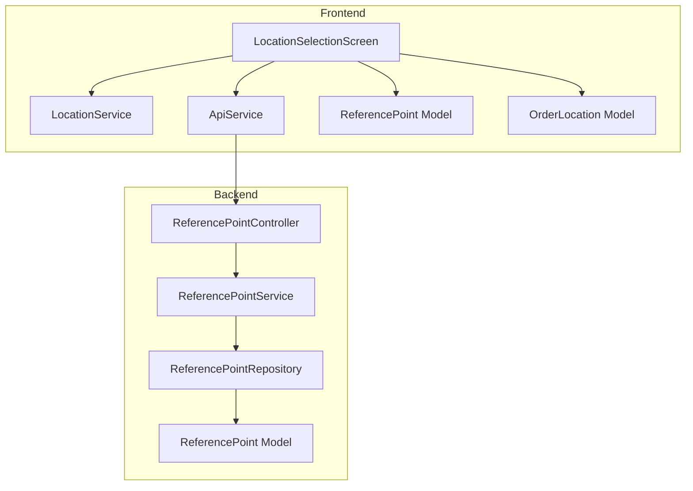
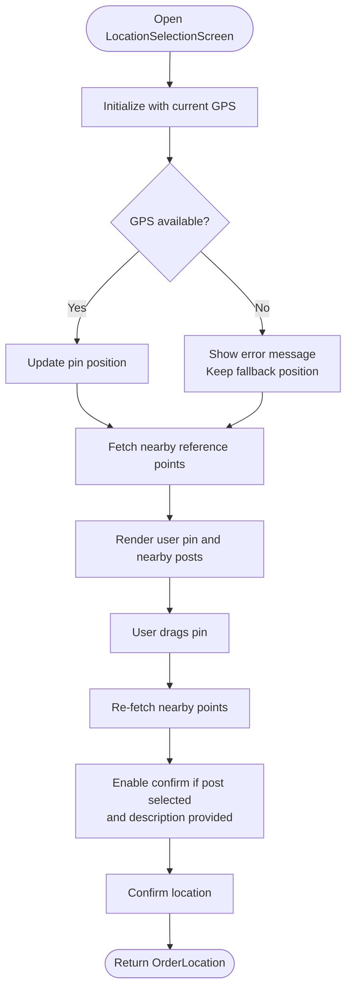
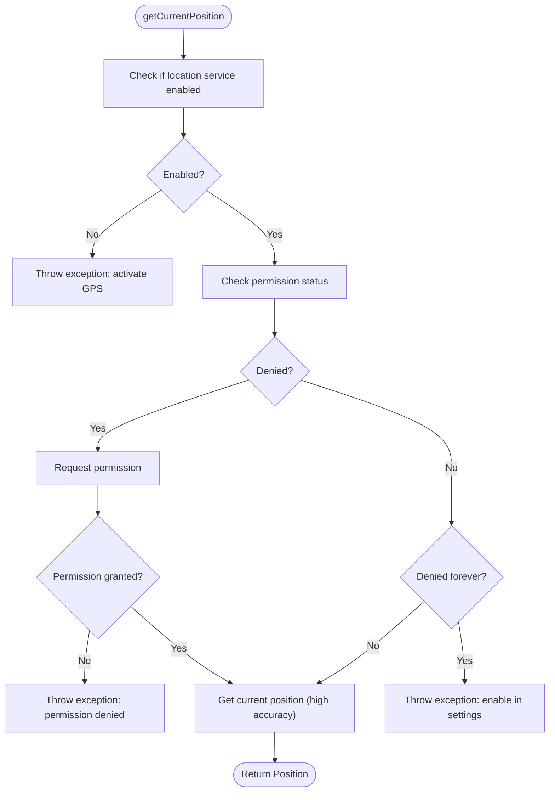
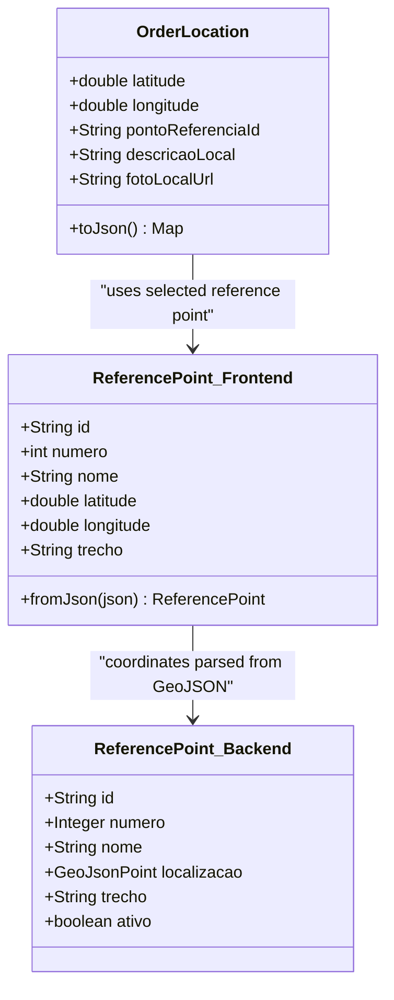
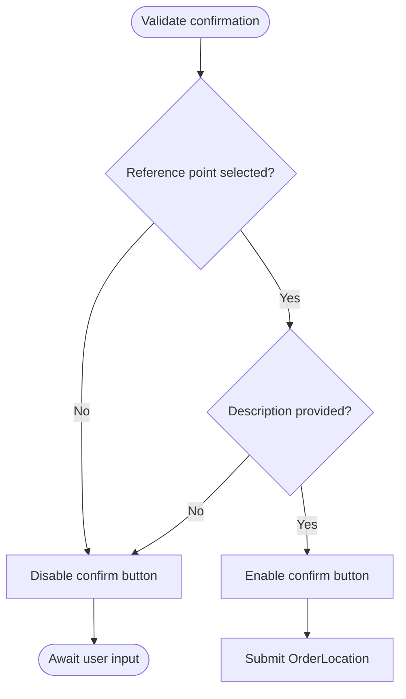
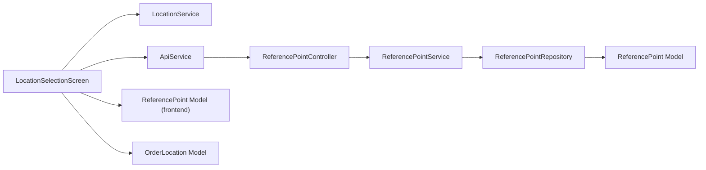

# Location Selection System

<cite>
**Referenced Files in This Document**
- [location_selection_screen.dart](file://frontend/lib/screens/location_selection_screen.dart)
- [location_service.dart](file://frontend/lib/services/location_service.dart)
- [api_service.dart](file://frontend/lib/services/api_service.dart)
- [reference_point.dart](file://frontend/lib/models/reference_point.dart)
- [order_location.dart](file://frontend/lib/models/order_location.dart)
- [ReferencePoint.java](file://backend/src/main/java/com/penaareia/model/ReferencePoint.java)
- [ReferencePointController.java](file://backend/src/main/java/com/penaareia/controller/ReferencePointController.java)
- [ReferencePointService.java](file://backend/src/main/java/com/penaareia/service/ReferencePointService.java)
- [ReferencePointRepository.java](file://backend/src/main/java/com/penaareia/repository/ReferencePointRepository.java)
</cite>

## Table of Contents
1. [Introduction](#introduction)
2. [Project Structure](#project-structure)
3. [Core Components](#core-components)
4. [Architecture Overview](#architecture-overview)
5. [Detailed Component Analysis](#detailed-component-analysis)
6. [Dependency Analysis](#dependency-analysis)
7. [Performance Considerations](#performance-considerations)
8. [Troubleshooting Guide](#troubleshooting-guide)
9. [Conclusion](#conclusion)

## Introduction
This document explains the location selection system that lets users pinpoint their exact beach location using an interactive map with a draggable pin, automatic GPS detection, and validation before confirming the selected spot. The frontend uses Flutter with Google Maps and geolocation services to capture device coordinates, while the backend exposes reference points stored as MongoDB GeoJSON locations. The system also handles geolocation permissions, background location considerations, error states when GPS is unavailable, and coordinate transformation between device GPS and MongoDB GeoJSON format.

## Project Structure
The location selection feature spans both frontend and backend:

- Frontend (Flutter):
  - Interactive map screen with draggable pin and nearby reference point chips
  - Geolocation service for permission checks and current position retrieval
  - API service for calling backend endpoints
  - Models for reference points and order location payload
- Backend (Spring Boot + MongoDB):
  - Reference point model with GeoJSON location field
  - REST controller exposing list and nearby endpoints
  - Service layer performing geospatial queries
  - Repository extending MongoRepository with geo query methods



**Diagram sources**
- [location_selection_screen.dart:1-324](file://frontend/lib/screens/location_selection_screen.dart#L1-L324)
- [location_service.dart:1-31](file://frontend/lib/services/location_service.dart#L1-L31)
- [api_service.dart:1-69](file://frontend/lib/services/api_service.dart#L1-L69)
- [reference_point.dart:1-32](file://frontend/lib/models/reference_point.dart#L1-L32)
- [order_location.dart:1-26](file://frontend/lib/models/order_location.dart#L1-L26)
- [ReferencePointController.java:1-35](file://backend/src/main/java/com/penaareia/controller/ReferencePointController.java#L1-L35)
- [ReferencePointService.java:1-39](file://backend/src/main/java/com/penaareia/service/ReferencePointService.java#L1-L39)
- [ReferencePointRepository.java:1-18](file://backend/src/main/java/com/penaareia/repository/ReferencePointRepository.java#L1-L18)
- [ReferencePoint.java:1-39](file://backend/src/main/java/com/penaareia/model/ReferencePoint.java#L1-L39)

**Section sources**
- [location_selection_screen.dart:1-324](file://frontend/lib/screens/location_selection_screen.dart#L1-L324)
- [location_service.dart:1-31](file://frontend/lib/services/location_service.dart#L1-L31)
- [api_service.dart:1-69](file://frontend/lib/services/api_service.dart#L1-L69)
- [reference_point.dart:1-32](file://frontend/lib/models/reference_point.dart#L1-L32)
- [order_location.dart:1-26](file://frontend/lib/models/order_location.dart#L1-L26)
- [ReferencePointController.java:1-35](file://backend/src/main/java/com/penaareia/controller/ReferencePointController.java#L1-L35)
- [ReferencePointService.java:1-39](file://backend/src/main/java/com/penaareia/service/ReferencePointService.java#L1-L39)
- [ReferencePointRepository.java:1-18](file://backend/src/main/java/com/penaareia/repository/ReferencePointRepository.java#L1-L18)
- [ReferencePoint.java:1-39](file://backend/src/main/java/com/penaareia/model/ReferencePoint.java#L1-L39)

## Core Components
- LocationSelectionScreen: Renders the interactive map, manages the draggable pin, updates nearby reference points on drag, and validates user input before confirmation.
- LocationService: Handles geolocation permissions, checks if GPS is enabled, requests permission if denied, and retrieves the current high-accuracy position.
- ApiService: Calls backend endpoints for listing reference points and fetching nearby points based on latitude/longitude.
- ReferencePoint Model (frontend): Parses GeoJSON location from backend responses into latitude/longitude values used by the UI.
- OrderLocation Model: Represents the final selected location payload sent back to the checkout flow.
- Backend ReferencePoint Controller/Service/Repository: Exposes endpoints and performs geospatial queries against MongoDB GeoJSON data.
- Backend ReferencePoint Model: Defines the GeoJSON location field indexed for spatial queries.

Key responsibilities:
- Permission handling and GPS availability checks
- Draggable pin interaction and real-time nearby suggestions
- Coordinate transformation between device GPS and GeoJSON
- Validation rules for selecting a reference point and providing a description
- Error states and fallback mechanisms when GPS is unavailable

**Section sources**
- [location_selection_screen.dart:1-324](file://frontend/lib/screens/location_selection_screen.dart#L1-L324)
- [location_service.dart:1-31](file://frontend/lib/services/location_service.dart#L1-L31)
- [api_service.dart:1-69](file://frontend/lib/services/api_service.dart#L1-L69)
- [reference_point.dart:1-32](file://frontend/lib/models/reference_point.dart#L1-L32)
- [order_location.dart:1-26](file://frontend/lib/models/order_location.dart#L1-L26)
- [ReferencePointController.java:1-35](file://backend/src/main/java/com/penaareia/controller/ReferencePointController.java#L1-L35)
- [ReferencePointService.java:1-39](file://backend/src/main/java/com/penaareia/service/ReferencePointService.java#L1-L39)
- [ReferencePointRepository.java:1-18](file://backend/src/main/java/com/penaareia/repository/ReferencePointRepository.java#L1-L18)
- [ReferencePoint.java:1-39](file://backend/src/main/java/com/penaareia/model/ReferencePoint.java#L1-L39)

## Architecture Overview
The location selection workflow integrates UI interactions, geolocation services, and backend geospatial queries:

```mermaid
sequenceDiagram
participant User as "User"
participant Screen as "LocationSelectionScreen"
participant Map as "GoogleMap"
participant LocSvc as "LocationService"
participant Api as "ApiService"
participant Ctrl as "ReferencePointController"
participant Svc as "ReferencePointService"
participant Repo as "ReferencePointRepository"
participant DB as "MongoDB"
User->>Screen : Open location selection
Screen->>LocSvc : getCurrentPosition()
LocSvc-->>Screen : Position or throws exception
Screen->>Map : Set initial camera at position
Screen->>Api : fetchNearbyReferencePoints(lat, lng)
Api->>Ctrl : GET /reference-points/nearby?lat&lng
Ctrl->>Svc : sugerirProximos(lat, lng)
Svc->>Repo : findByLocalizacaoNear(GeoJsonPoint, Distance)
Repo->>DB : Query 2dsphere index
DB-->>Repo : GeoResults
Repo-->>Svc : List<ReferencePoint>
Svc-->>Ctrl : List<ReferencePoint>
Ctrl-->>Api : JSON list
Api-->>Screen : Parsed ReferencePoint list
Screen->>Map : Render markers for user pin and nearby posts
User->>Map : Drag pin
Map-->>Screen : onDragEnd(new LatLng)
Screen->>Api : fetchNearbyReferencePoints(new lat, lng)
Note over Screen : Pre-select nearest post; require description
User->>Screen : Confirm location
Screen-->>User : Return OrderLocation to checkout
```

**Diagram sources**
- [location_selection_screen.dart:52-87](file://frontend/lib/screens/location_selection_screen.dart#L52-L87)
- [location_selection_screen.dart:142-171](file://frontend/lib/screens/location_selection_screen.dart#L142-L171)
- [location_selection_screen.dart:106-125](file://frontend/lib/screens/location_selection_screen.dart#L106-L125)
- [location_service.dart:6-28](file://frontend/lib/services/location_service.dart#L6-L28)
- [api_service.dart:24-42](file://frontend/lib/services/api_service.dart#L24-L42)
- [ReferencePointController.java:26-33](file://backend/src/main/java/com/penaareia/controller/ReferencePointController.java#L26-L33)
- [ReferencePointService.java:29-37](file://backend/src/main/java/com/penaareia/service/ReferencePointService.java#L29-L37)
- [ReferencePointRepository.java:15-16](file://backend/src/main/java/com/penaareia/repository/ReferencePointRepository.java#L15-L16)

## Detailed Component Analysis

### Interactive Map Interface with Draggable Pin
- The screen initializes with a default fallback position and attempts to update it via GPS.
- A draggable marker represents the user’s chosen spot; dragging triggers an update of nearby reference points.
- Nearby official posts are rendered as markers with info windows showing their names.
- The UI guides the user to drag the pin to the exact beach location.

Validation and state:
- Loading state shows a spinner until GPS initialization completes.
- Errors from GPS or API calls are displayed inline.
- Confirmation button is enabled only when a reference point is selected and a description is provided.



**Diagram sources**
- [location_selection_screen.dart:52-87](file://frontend/lib/screens/location_selection_screen.dart#L52-L87)
- [location_selection_screen.dart:142-171](file://frontend/lib/screens/location_selection_screen.dart#L142-L171)
- [location_selection_screen.dart:101-125](file://frontend/lib/screens/location_selection_screen.dart#L101-L125)

**Section sources**
- [location_selection_screen.dart:1-324](file://frontend/lib/screens/location_selection_screen.dart#L1-L324)

### GPS Integration and Permissions Handling
- Checks whether location services are enabled; throws an exception if disabled.
- Requests permission if denied; throws an exception if permanently denied.
- Retrieves the current position with high accuracy.

Behavioral notes:
- If GPS is unavailable, the screen keeps a fallback position and allows manual pin dragging.
- Errors are surfaced to the user so they can adjust settings or proceed manually.



**Diagram sources**
- [location_service.dart:6-28](file://frontend/lib/services/location_service.dart#L6-L28)

**Section sources**
- [location_service.dart:1-31](file://frontend/lib/services/location_service.dart#L1-L31)

### Coordinate Transformation Between Device GPS and MongoDB GeoJSON
- Device GPS returns latitude and longitude values used directly by the UI and API calls.
- Backend stores locations as GeoJSON Point objects with a 2dsphere index.
- Frontend parses GeoJSON coordinates from backend responses:
  - Coordinates array is [longitude, latitude] per GeoJSON spec.
  - The model extracts these values into latitude and longitude fields for display.

Important details:
- When constructing GeoJsonPoint on the backend, longitude comes first, then latitude.
- The frontend must interpret coordinates correctly to avoid swapped values.



**Diagram sources**
- [order_location.dart:1-26](file://frontend/lib/models/order_location.dart#L1-L26)
- [reference_point.dart:1-32](file://frontend/lib/models/reference_point.dart#L1-L32)
- [ReferencePoint.java:1-39](file://backend/src/main/java/com/penaareia/model/ReferencePoint.java#L1-L39)

**Section sources**
- [reference_point.dart:18-30](file://frontend/lib/models/reference_point.dart#L18-L30)
- [ReferencePoint.java:31-32](file://backend/src/main/java/com/penaareia/model/ReferencePoint.java#L31-L32)

### Validation Rules and Fallback Mechanisms
- Required inputs for confirmation:
  - A reference point must be selected (pre-selected as nearest).
  - A non-empty description must be provided.
- Fallback behavior:
  - If GPS is unavailable, the screen retains a default fallback position and allows manual pin dragging.
  - If no nearby reference points are found, the UI instructs the user to move closer to the shoreline.
- Optional photo capture:
  - Users can take a photo of the location; currently not uploaded but reserved for future integration.



**Diagram sources**
- [location_selection_screen.dart:101-125](file://frontend/lib/screens/location_selection_screen.dart#L101-L125)

**Section sources**
- [location_selection_screen.dart:101-125](file://frontend/lib/screens/location_selection_screen.dart#L101-L125)

### Background Location Services
- The current implementation does not implement continuous background location tracking.
- It requests the current position once upon screen initialization.
- For background updates, additional configuration and platform-specific setup would be required beyond the current scope.

[No sources needed since this section provides general guidance]

### Error States When GPS Is Unavailable
- Exceptions are thrown for disabled GPS, denied permissions, and permanently denied permissions.
- The screen catches exceptions, displays an error message, and continues with the fallback position.
- API errors during nearby point fetching are caught and shown as user-facing messages.

**Section sources**
- [location_service.dart:6-28](file://frontend/lib/services/location_service.dart#L6-L28)
- [location_selection_screen.dart:52-82](file://frontend/lib/screens/location_selection_screen.dart#L52-L82)

## Dependency Analysis
The following diagram maps dependencies among components involved in location selection:



**Diagram sources**
- [location_selection_screen.dart:1-324](file://frontend/lib/screens/location_selection_screen.dart#L1-L324)
- [location_service.dart:1-31](file://frontend/lib/services/location_service.dart#L1-L31)
- [api_service.dart:1-69](file://frontend/lib/services/api_service.dart#L1-L69)
- [ReferencePointController.java:1-35](file://backend/src/main/java/com/penaareia/controller/ReferencePointController.java#L1-L35)
- [ReferencePointService.java:1-39](file://backend/src/main/java/com/penaareia/service/ReferencePointService.java#L1-L39)
- [ReferencePointRepository.java:1-18](file://backend/src/main/java/com/penaareia/repository/ReferencePointRepository.java#L1-L18)
- [ReferencePoint.java:1-39](file://backend/src/main/java/com/penaareia/model/ReferencePoint.java#L1-L39)

**Section sources**
- [location_selection_screen.dart:1-324](file://frontend/lib/screens/location_selection_screen.dart#L1-L324)
- [api_service.dart:1-69](file://frontend/lib/services/api_service.dart#L1-L69)
- [ReferencePointController.java:1-35](file://backend/src/main/java/com/penaareia/controller/ReferencePointController.java#L1-L35)
- [ReferencePointService.java:1-39](file://backend/src/main/java/com/penaareia/service/ReferencePointService.java#L1-L39)
- [ReferencePointRepository.java:1-18](file://backend/src/main/java/com/penaareia/repository/ReferencePointRepository.java#L1-L18)
- [ReferencePoint.java:1-39](file://backend/src/main/java/com/penaareia/model/ReferencePoint.java#L1-L39)

## Performance Considerations
- Map rendering:
  - The number of markers includes the user pin plus all nearby reference points. Large result sets may impact rendering performance.
  - Consider limiting the radius parameter for nearby queries to reduce marker count.
- Location updates:
  - GPS acquisition occurs once on screen init; subsequent updates happen only when the pin is dragged.
  - Avoid frequent polling; rely on user-driven updates to minimize battery usage.
- Network calls:
  - Nearby reference points are fetched on each pin drag; debounce or throttle could reduce redundant calls if needed.
- Data parsing:
  - GeoJSON parsing is straightforward; ensure coordinates are handled correctly to prevent unnecessary re-renders due to incorrect values.

[No sources needed since this section provides general guidance]

## Troubleshooting Guide
Common issues and resolutions:
- GPS disabled:
  - Symptom: Exception indicating GPS must be activated.
  - Resolution: Enable location services on the device and retry.
- Permission denied:
  - Symptom: Exception indicating location permission denied.
  - Resolution: Grant permission when prompted; if permanently denied, enable in app settings.
- No nearby reference points:
  - Symptom: Message indicating no posts found near the pin.
  - Resolution: Drag the pin closer to the shoreline or increase the search radius on the backend.
- API errors:
  - Symptom: Error message about loading reference points.
  - Resolution: Verify backend connectivity and endpoint availability; check network logs.

**Section sources**
- [location_service.dart:6-28](file://frontend/lib/services/location_service.dart#L6-L28)
- [location_selection_screen.dart:52-82](file://frontend/lib/screens/location_selection_screen.dart#L52-L82)
- [api_service.dart:61-67](file://frontend/lib/services/api_service.dart#L61-L67)

## Conclusion
The location selection system combines an interactive map with a draggable pin, robust GPS permission handling, and backend geospatial queries to help users select precise beach locations. It transforms device GPS coordinates into MongoDB GeoJSON format, validates user inputs, and provides clear fallbacks and error states when GPS is unavailable. Future enhancements may include background location tracking, stricter accuracy thresholds, and photo upload integration.