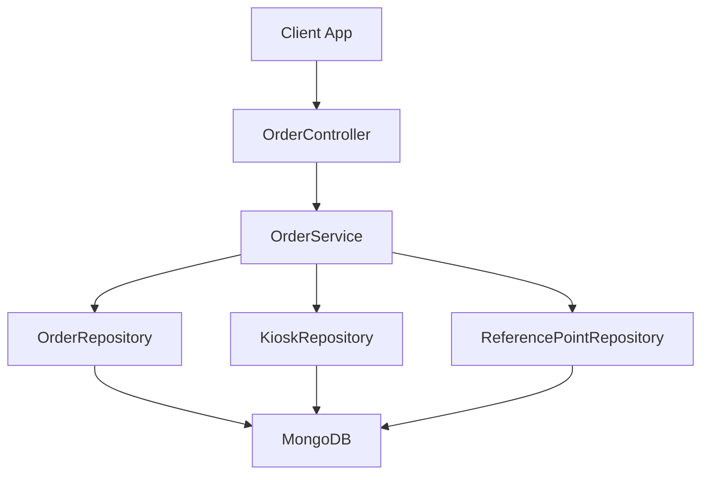
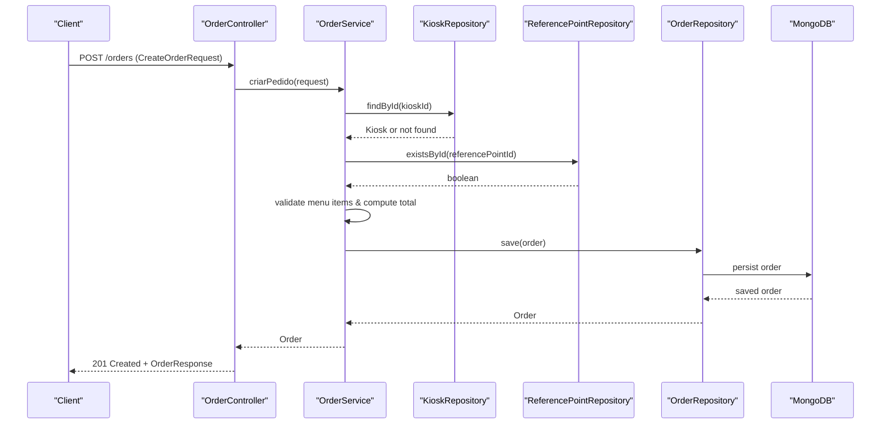
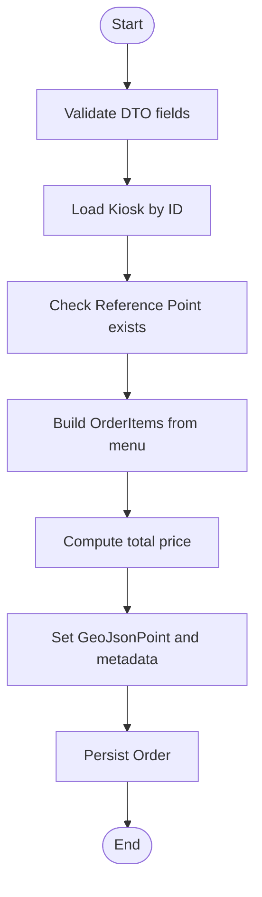
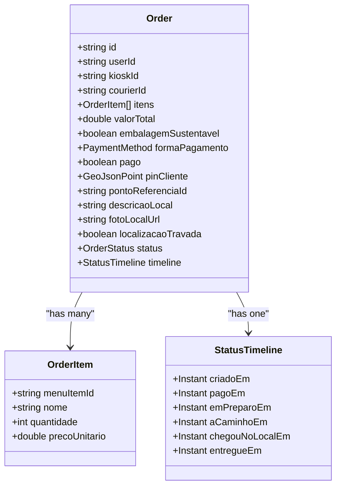
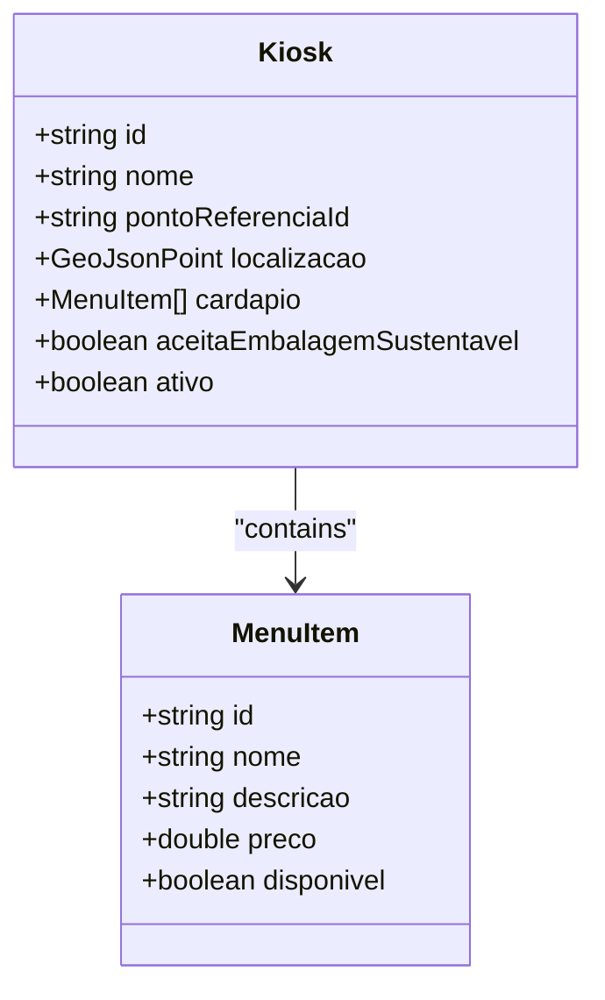
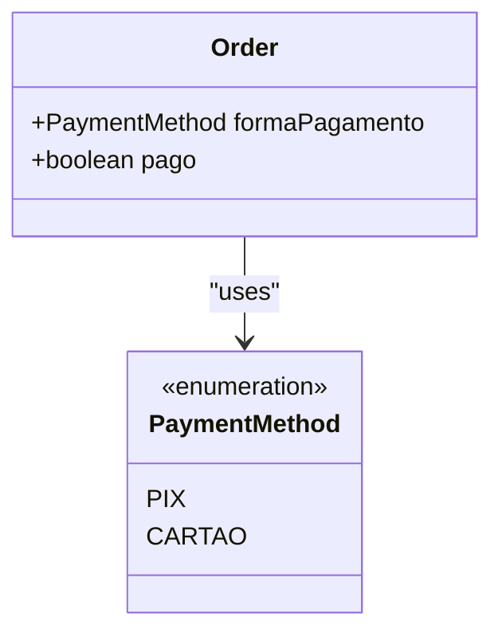
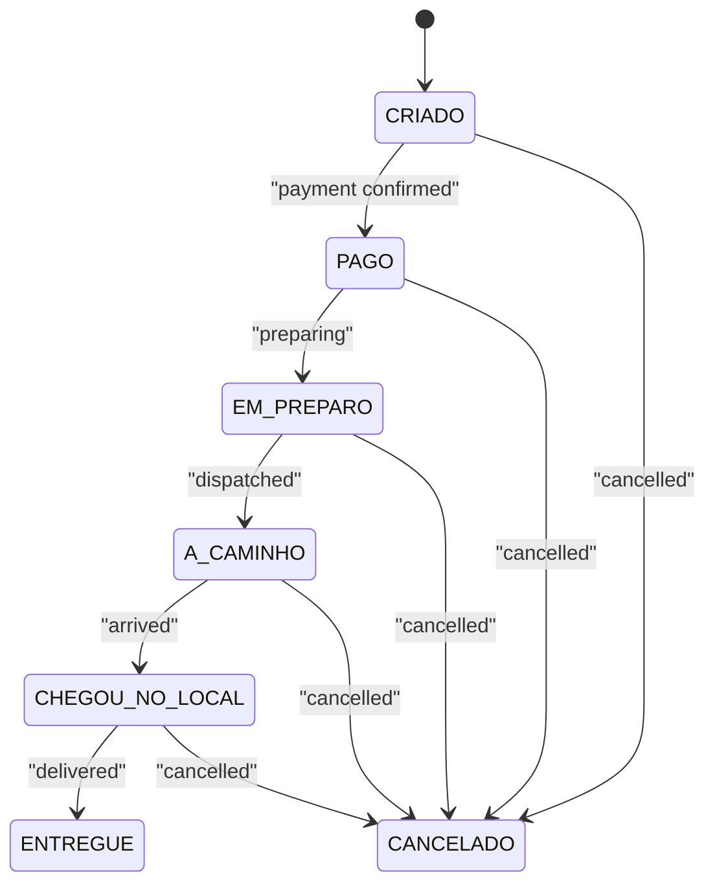
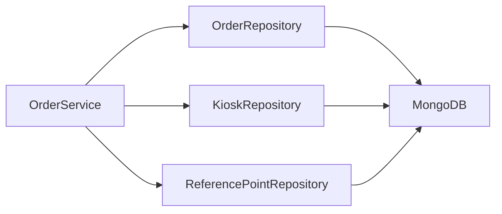

# Order Processing Pipeline

<cite>
**Referenced Files in This Document**   
- [OrderController.java](file://backend/src/main/java/com/penaareia/controller/OrderController.java)
- [OrderService.java](file://backend/src/main/java/com/penaareia/service/OrderService.java)
- [Order.java](file://backend/src/main/java/com/penaareia/model/Order.java)
- [CreateOrderRequest.java](file://backend/src/main/java/com/penaareia/dto/CreateOrderRequest.java)
- [OrderResponse.java](file://backend/src/main/java/com/penaareia/dto/OrderResponse.java)
- [OrderStatus.java](file://backend/src/main/java/com/penaareia/model/OrderStatus.java)
- [OrderRepository.java](file://backend/src/main/java/com/penaareia/repository/OrderRepository.java)
- [Kiosk.java](file://backend/src/main/java/com/penaareia/model/Kiosk.java)
- [PaymentMethod.java](file://backend/src/main/java/com/penaareia/model/PaymentMethod.java)
- [KioskService.java](file://backend/src/main/java/com/penaareia/service/KioskService.java)
- [KioskController.java](file://backend/src/main/java/com/penaareia/controller/KioskController.java)
- [KioskRepository.java](file://backend/src/main/java/com/penaareia/repository/KioskRepository.java)
</cite>

## Table of Contents
1. [Introduction](#introduction)
2. [Project Structure](#project-structure)
3. [Core Components](#core-components)
4. [Architecture Overview](#architecture-overview)
5. [Detailed Component Analysis](#detailed-component-analysis)
6. [Dependency Analysis](#dependency-analysis)
7. [Performance Considerations](#performance-considerations)
8. [Troubleshooting Guide](#troubleshooting-guide)
9. [Conclusion](#conclusion)

## Introduction
This document explains the end-to-end order processing pipeline for food delivery orders, focusing on:
- Request validation and kiosk menu item availability checks
- Price calculation and sustainability preference handling
- Location pin capture and locking mechanism to prevent address changes after placement
- Order status timeline tracking and payment method integration points
- Business rules for validation, error handling, concurrency, transactions, and data consistency

The backend is a Spring Boot application using MongoDB for persistence. Orders are created via a REST API, validated against kiosk menus and reference locations, persisted with geospatial data, and exposed through controllers and services.

## Project Structure
The relevant backend modules for order processing include:
- Controllers: HTTP endpoints for creating and retrieving orders
- Services: Business logic for order creation, validation, and queries
- Models: Domain entities for orders, kiosks, statuses, and payment methods
- DTOs: Request and response contracts
- Repositories: Data access interfaces for MongoDB

**Diagram sources**
- [OrderController.java:15-35](file://backend/src/main/java/com/penaareia/controller/OrderController.java#L15-L35)
- [OrderService.java:17-77](file://backend/src/main/java/com/penaareia/service/OrderService.java#L17-L77)
- [OrderRepository.java:9-16](file://backend/src/main/java/com/penaareia/repository/OrderRepository.java#L9-L16)
- [KioskRepository.java:11-18](file://backend/src/main/java/com/penaareia/repository/KioskRepository.java#L11-L18)

**Section sources**
- [OrderController.java:15-35](file://backend/src/main/java/com/penaareia/controller/OrderController.java#L15-L35)
- [OrderService.java:17-77](file://backend/src/main/java/com/penaareia/service/OrderService.java#L17-L77)

## Core Components
- OrderController: Exposes POST /orders to create an order and GET /orders/{id} to retrieve it. Validates request bodies and maps responses.
- OrderService: Implements order creation workflow including kiosk lookup, reference point existence check, menu item validation, price calculation, location pin assignment, and persistence.
- Order: Domain model representing an order with items, total value, payment method, sustainability flag, geospatial pin, location metadata, status, and timeline.
- CreateOrderRequest: Input contract with validations for user, kiosk, items, payment method, location coordinates, reference point, and description.
- OrderResponse: Output contract exposing order summary fields.
- OrderStatus: Enumerates lifecycle states from creation to delivery or cancellation.
- Kiosk and MenuItem: Menu definitions and availability flags used during order validation.
- PaymentMethod: Enumerates supported payment types.
- Repositories: MongoRepository-based accessors for orders, kiosks, and reference points.

**Section sources**
- [OrderController.java:15-35](file://backend/src/main/java/com/penaareia/controller/OrderController.java#L15-L35)
- [OrderService.java:25-70](file://backend/src/main/java/com/penaareia/service/OrderService.java#L25-L70)
- [Order.java:15-69](file://backend/src/main/java/com/penaareia/model/Order.java#L15-L69)
- [CreateOrderRequest.java:12-52](file://backend/src/main/java/com/penaareia/dto/CreateOrderRequest.java#L12-L52)
- [OrderResponse.java:12-37](file://backend/src/main/java/com/penaareia/dto/OrderResponse.java#L12-L37)
- [OrderStatus.java:3-11](file://backend/src/main/java/com/penaareia/model/OrderStatus.java#L3-L11)
- [Kiosk.java:14-46](file://backend/src/main/java/com/penaareia/model/Kiosk.java#L14-L46)
- [PaymentMethod.java:3-6](file://backend/src/main/java/com/penaareia/model/PaymentMethod.java#L3-L6)

## Architecture Overview
The order creation flow validates inputs, ensures referenced entities exist, verifies menu item availability, computes totals, captures location, and persists the order. The response exposes key order attributes without sensitive internal state.

**Diagram sources**
- [OrderController.java:23-28](file://backend/src/main/java/com/penaareia/controller/OrderController.java#L23-L28)
- [OrderService.java:25-70](file://backend/src/main/java/com/penaareia/service/OrderService.java#L25-L70)
- [OrderRepository.java:9-16](file://backend/src/main/java/com/penaareia/repository/OrderRepository.java#L9-L16)
- [KioskRepository.java:11-18](file://backend/src/main/java/com/penaareia/repository/KioskRepository.java#L11-L18)

## Detailed Component Analysis

### Order Creation Workflow
- Request Validation:
  - User ID, kiosk ID, at least one item, payment method, latitude, longitude, reference point ID, and local description are required by DTO constraints.
- Kiosk and Reference Point Validation:
  - Kiosk must exist; reference point must exist.
- Menu Item Validation:
  - Each requested item must be present in the kiosk’s menu and marked available.
- Price Calculation:
  - Total is computed as sum of unit price multiplied by quantity for each item.
- Sustainability Preference:
  - The request includes a boolean for sustainable packaging; this is stored on the order.
- Location Pin Capture:
  - Latitude and longitude are converted into a GeoJsonPoint and stored on the order.
- Persistence:
  - The order is saved to MongoDB and returned via response mapping.

**Diagram sources**
- [OrderService.java:25-70](file://backend/src/main/java/com/penaareia/service/OrderService.java#L25-L70)
- [CreateOrderRequest.java:12-52](file://backend/src/main/java/com/penaareia/dto/CreateOrderRequest.java#L12-L52)

**Section sources**
- [OrderService.java:25-70](file://backend/src/main/java/com/penaareia/service/OrderService.java#L25-L70)
- [CreateOrderRequest.java:12-52](file://backend/src/main/java/com/penaareia/dto/CreateOrderRequest.java#L12-L52)

### Order Model and Status Timeline
- Fields:
  - Identifier, user/kiosk/courier IDs, items list, total value, sustainable packaging flag, payment method, paid flag, geospatial pin, reference point ID, local description, optional photo URL, location lock flag, status, and timeline.
- Status Timeline:
  - Tracks timestamps for creation, payment, preparation, transit, arrival, and delivery.
- Location Locking:
  - Once paid, the location cannot be changed (lock flag).

**Diagram sources**
- [Order.java:15-69](file://backend/src/main/java/com/penaareia/model/Order.java#L15-L69)

**Section sources**
- [Order.java:15-69](file://backend/src/main/java/com/penaareia/model/Order.java#L15-L69)

### Kiosk Menu and Availability
- Kiosk contains a list of menu items with pricing and availability flags.
- During order creation, each requested item is validated against the kiosk’s menu and availability.

**Diagram sources**
- [Kiosk.java:14-46](file://backend/src/main/java/com/penaareia/model/Kiosk.java#L14-L46)

**Section sources**
- [Kiosk.java:14-46](file://backend/src/main/java/com/penaareia/model/Kiosk.java#L14-L46)

### Payment Method Integration Points
- Supported payment methods are enumerated.
- The order stores the selected payment method and a paid flag.
- The current implementation does not integrate with external payment gateways; payment confirmation is represented by the paid flag and status transitions.

**Diagram sources**
- [PaymentMethod.java:3-6](file://backend/src/main/java/com/penaareia/model/PaymentMethod.java#L3-L6)
- [Order.java:32-33](file://backend/src/main/java/com/penaareia/model/Order.java#L32-L33)

**Section sources**
- [PaymentMethod.java:3-6](file://backend/src/main/java/com/penaareia/model/PaymentMethod.java#L3-L6)
- [Order.java:32-33](file://backend/src/main/java/com/penaareia/model/Order.java#L32-L33)

### Location Locking Mechanism
- The order includes a geospatial pin and a lock flag indicating that once the order is paid, the location cannot be altered.
- This enforces delivery address immutability post-payment, aligning with operational safety and logistics constraints.

**Diagram sources**
- [OrderStatus.java:3-11](file://backend/src/main/java/com/penaareia/model/OrderStatus.java#L3-L11)
- [Order.java:43-48](file://backend/src/main/java/com/penaareia/model/Order.java#L43-L48)

**Section sources**
- [OrderStatus.java:3-11](file://backend/src/main/java/com/penaareia/model/OrderStatus.java#L3-L11)
- [Order.java:43-48](file://backend/src/main/java/com/penaareia/model/Order.java#L43-L48)

### API Contracts and Examples

- Create Order Request (CreateOrderRequest):
  - Required fields: userId, kioskId, itens (non-empty), formaPagamento, latitude, longitude, pontoReferenciaId, descricaoLocal.
  - Optional: fotoLocalUrl, embalagemSustentavel.
  - Items contain menuItemId and quantidade.

- Create Order Response (OrderResponse):
  - Fields: id, valorTotal, status, formaPagamento, embalagemSustentavel, pontoReferenciaId, descricaoLocal, itens.

- Example Request Payload Shape:
  - {
      "userId": "user-1",
      "kioskId": "kiosk-1",
      "itens": [
        {"menuItemId": "item-a", "quantidade": 2},
        {"menuItemId": "item-b", "quantidade": 1}
      ],
      "formaPagamento": "PIX",
      "embalagemSustentavel": true,
      "latitude": -23.5505,
      "longitude": -46.6333,
      "pontoReferenciaId": "ref-1",
      "descricaoLocal": "near the blue umbrella"
    }

- Example Response Payload Shape:
  - {
      "id": "order-1",
      "valorTotal": 45.0,
      "status": "CRIADO",
      "formaPagamento": "PIX",
      "embalagemSustentavel": true,
      "pontoReferenciaId": "ref-1",
      "descricaoLocal": "near the blue umbrella",
      "itens": [
        {"menuItemId": "item-a", "nome": "Burger", "quantidade": 2, "precoUnitario": 15.0},
        {"menuItemId": "item-b", "nome": "Fries", "quantidade": 1, "precoUnitario": 15.0}
      ]
    }

**Section sources**
- [CreateOrderRequest.java:12-52](file://backend/src/main/java/com/penaareia/dto/CreateOrderRequest.java#L12-L52)
- [OrderResponse.java:12-37](file://backend/src/main/java/com/penaareia/dto/OrderResponse.java#L12-L37)

### Error Handling Strategies
- Resource Not Found:
  - If kiosk or reference point does not exist, a resource not found exception is thrown.
  - If a requested menu item is missing or unavailable, a resource not found exception is thrown.
- Validation Errors:
  - Missing or invalid fields in the request body trigger validation errors before reaching service logic.

**Section sources**
- [OrderService.java:25-49](file://backend/src/main/java/com/penaareia/service/OrderService.java#L25-L49)
- [CreateOrderRequest.java:12-52](file://backend/src/main/java/com/penaareia/dto/CreateOrderRequest.java#L12-L52)

## Dependency Analysis
The order creation process depends on:
- KioskRepository to load kiosk and menu items
- ReferencePointRepository to ensure reference point existence
- OrderRepository to persist orders and query by user, courier, or status

**Diagram sources**
- [OrderService.java:21-23](file://backend/src/main/java/com/penaareia/service/OrderService.java#L21-L23)
- [OrderRepository.java:9-16](file://backend/src/main/java/com/penaareia/repository/OrderRepository.java#L9-L16)
- [KioskRepository.java:11-18](file://backend/src/main/java/com/penaareia/repository/KioskRepository.java#L11-L18)

**Section sources**
- [OrderService.java:21-23](file://backend/src/main/java/com/penaareia/service/OrderService.java#L21-L23)
- [OrderRepository.java:9-16](file://backend/src/main/java/com/penaareia/repository/OrderRepository.java#L9-L16)
- [KioskRepository.java:11-18](file://backend/src/main/java/com/penaareia/repository/KioskRepository.java#L11-L18)

## Performance Considerations
- Menu Lookup Optimization:
  - Building a map of menu items by ID avoids repeated lookups and reduces complexity during item validation.
- Geospatial Indexing:
  - Orders and kiosks use geospatial indexes to support efficient location-based queries.
- Query Patterns:
  - Repository methods provide common queries such as listing orders by user, courier, or status.

[No sources needed since this section provides general guidance]

## Troubleshooting Guide
- Common Issues:
  - Invalid or missing request fields: Ensure all required fields are provided and valid.
  - Kiosk not found: Verify kioskId exists and is active.
  - Reference point not found: Confirm the selected reference point exists.
  - Menu item unavailable: Check menuItemId and availability flags in the kiosk menu.
- Debugging Tips:
  - Inspect the order status and timeline to track lifecycle progression.
  - Validate geospatial coordinates and reference point selection.

**Section sources**
- [OrderService.java:25-49](file://backend/src/main/java/com/penaareia/service/OrderService.java#L25-L49)
- [Order.java:46-69](file://backend/src/main/java/com/penaareia/model/Order.java#L46-L69)

## Conclusion
The order processing pipeline validates requests, ensures entity references exist, verifies menu availability, calculates totals, captures location, and persists orders with comprehensive status and timeline tracking. Location locking prevents delivery address changes after payment, ensuring operational integrity. While payment method integration points are modeled, external payment gateway integration is not implemented in the current codebase. Concurrency and transaction management rely on MongoDB operations within the service layer; additional safeguards may be needed for high-concurrency scenarios.

[No sources needed since this section summarizes without analyzing specific files]