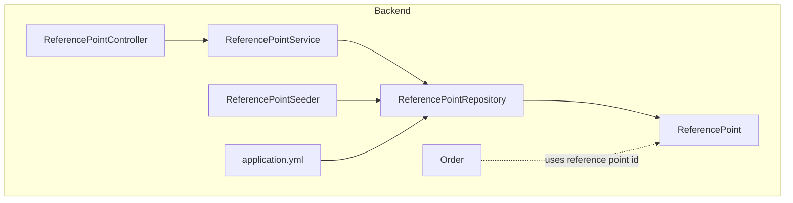
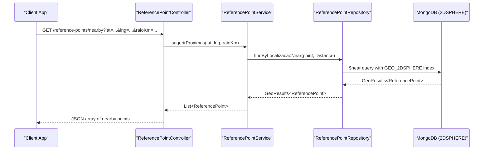
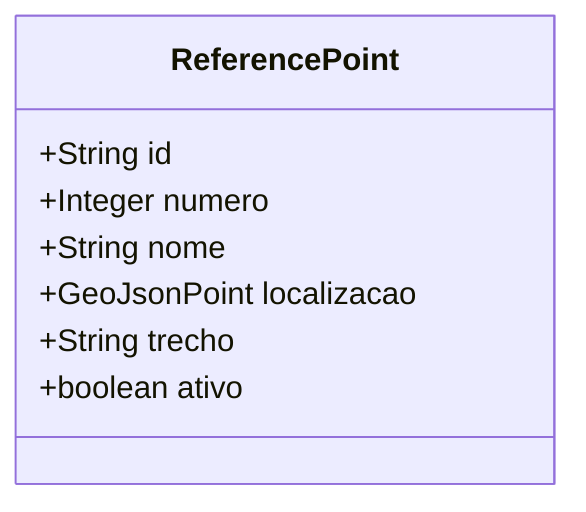
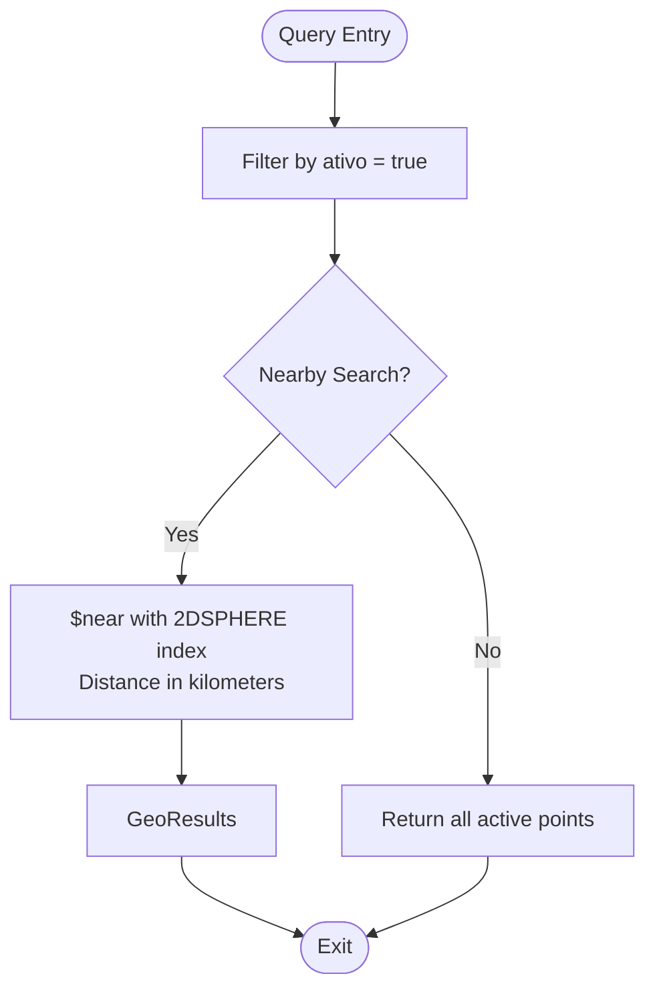
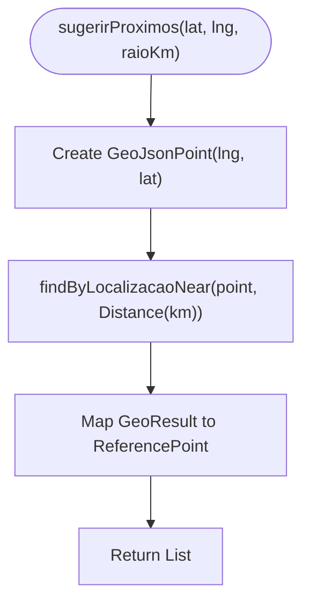
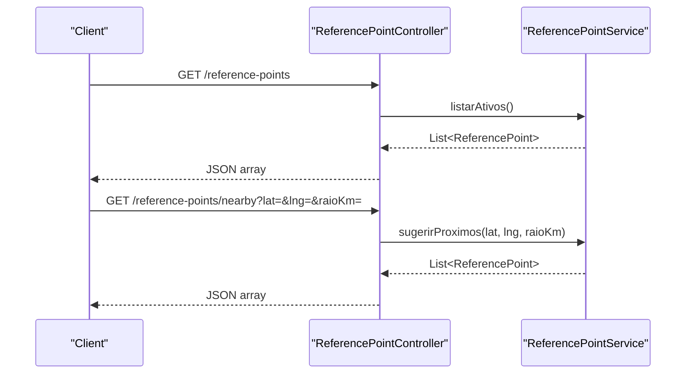
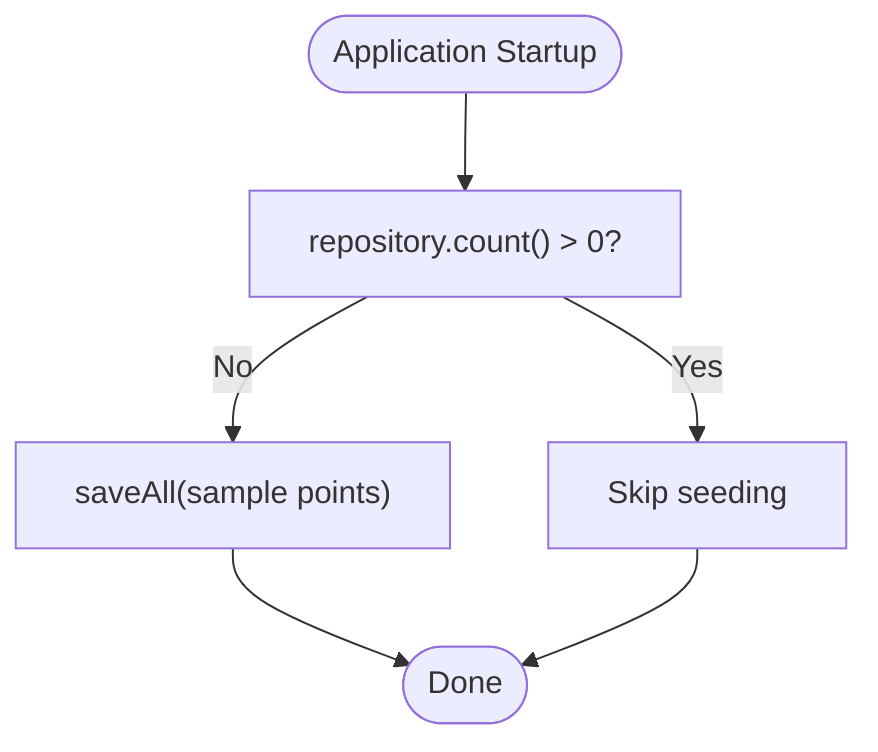
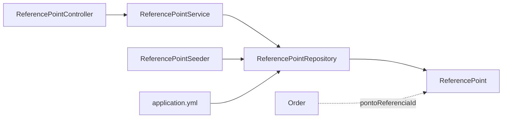

# Reference Point Management

<cite>
**Referenced Files in This Document**
- [ReferencePoint.java](file://backend/src/main/java/com/penaareia/model/ReferencePoint.java)
- [ReferencePointRepository.java](file://backend/src/main/java/com/penaareia/repository/ReferencePointRepository.java)
- [ReferencePointService.java](file://backend/src/main/java/com/penaareia/service/ReferencePointService.java)
- [ReferencePointController.java](file://backend/src/main/java/com/penaareia/controller/ReferencePointController.java)
- [ReferencePointSeeder.java](file://backend/src/main/java/com/penaareia/seed/ReferencePointSeeder.java)
- [application.yml](file://backend/src/main/resources/application.yml)
- [Order.java](file://backend/src/main/java/com/penaareia/model/Order.java)
</cite>

## Table of Contents
1. [Introduction](#introduction)
2. [Project Structure](#project-structure)
3. [Core Components](#core-components)
4. [Architecture Overview](#architecture-overview)
5. [Detailed Component Analysis](#detailed-component-analysis)
6. [Dependency Analysis](#dependency-analysis)
7. [Performance Considerations](#performance-considerations)
8. [Troubleshooting Guide](#troubleshooting-guide)
9. [Conclusion](#conclusion)

## Introduction
This document explains the reference point management system that stores official beach locations along the Santos coastline. It covers the ReferencePoint entity, MongoDB 2DSPHERE geospatial indexing, seed data initialization, proximity search algorithms, CRUD operations (including activation/deactivation and metadata), geospatial query examples, performance optimization techniques for large datasets, and how reference points relate to order delivery verification.

## Project Structure
The backend is a Spring Boot application with MongoDB as the persistence layer. The reference point feature spans model, repository, service, controller, and seed components:

**Diagram sources**
- [ReferencePointController.java:12-34](file://backend/src/main/java/com/penaareia/controller/ReferencePointController.java#L12-L34)
- [ReferencePointService.java:15-37](file://backend/src/main/java/com/penaareia/service/ReferencePointService.java#L15-L37)
- [ReferencePointRepository.java:11-17](file://backend/src/main/java/com/penaareia/repository/ReferencePointRepository.java#L11-L17)
- [ReferencePoint.java:19-38](file://backend/src/main/java/com/penaareia/model/ReferencePoint.java#L19-L38)
- [ReferencePointSeeder.java:18-47](file://backend/src/main/java/com/penaareia/seed/ReferencePointSeeder.java#L18-L47)
- [application.yml:8-15](file://backend/src/main/resources/application.yml#L8-L15)
- [Order.java:35-40](file://backend/src/main/java/com/penaareia/model/Order.java#L35-L40)

**Section sources**
- [ReferencePointController.java:12-34](file://backend/src/main/java/com/penaareia/controller/ReferencePointController.java#L12-L34)
- [ReferencePointService.java:15-37](file://backend/src/main/java/com/penaareia/service/ReferencePointService.java#L15-L37)
- [ReferencePointRepository.java:11-17](file://backend/src/main/java/com/penaareia/repository/ReferencePointRepository.java#L11-L17)
- [ReferencePoint.java:19-38](file://backend/src/main/java/com/penaareia/model/ReferencePoint.java#L19-L38)
- [ReferencePointSeeder.java:18-47](file://backend/src/main/java/com/penaareia/seed/ReferencePointSeeder.java#L18-L47)
- [application.yml:8-15](file://backend/src/main/resources/application.yml#L8-L15)
- [Order.java:35-40](file://backend/src/main/java/com/penaareia/model/Order.java#L35-L40)

## Core Components
- ReferencePoint: Represents an official beach post with number, display name, geolocation, neighborhood segment, and active status.
- ReferencePointRepository: Provides queries for active points and nearness search using GeoJSON points and distance metrics.
- ReferencePointService: Orchestrates listing active points and suggesting nearby points based on user coordinates and radius.
- ReferencePointController: Exposes REST endpoints to list active points and find nearby points by latitude, longitude, and optional radius.
- ReferencePointSeeder: Initializes sample reference points on first run if the collection is empty.
- application.yml: Configures MongoDB connection, auto-index creation, and delivery confirmation radius used during order verification.

Key responsibilities:
- Geospatial indexing via MongoDB 2DSPHERE for efficient proximity searches.
- Seed-only population of static reference points.
- Read-heavy API surface for discovery and suggestion features.

**Section sources**
- [ReferencePoint.java:19-38](file://backend/src/main/java/com/penaareia/model/ReferencePoint.java#L19-L38)
- [ReferencePointRepository.java:11-17](file://backend/src/main/java/com/penaareia/repository/ReferencePointRepository.java#L11-L17)
- [ReferencePointService.java:15-37](file://backend/src/main/java/com/penaareia/service/ReferencePointService.java#L15-L37)
- [ReferencePointController.java:12-34](file://backend/src/main/java/com/penaareia/controller/ReferencePointController.java#L12-L34)
- [ReferencePointSeeder.java:18-47](file://backend/src/main/java/com/penaareia/seed/ReferencePointSeeder.java#L18-L47)
- [application.yml:8-15](file://backend/src/main/resources/application.yml#L8-L15)

## Architecture Overview
The reference point subsystem follows a layered architecture:

**Diagram sources**
- [ReferencePointController.java:26-33](file://backend/src/main/java/com/penaareia/controller/ReferencePointController.java#L26-L33)
- [ReferencePointService.java:29-36](file://backend/src/main/java/com/penaareia/service/ReferencePointService.java#L29-L36)
- [ReferencePointRepository.java:15-16](file://backend/src/main/java/com/penaareia/repository/ReferencePointRepository.java#L15-L16)
- [ReferencePoint.java:31-32](file://backend/src/main/java/com/penaareia/model/ReferencePoint.java#L31-L32)

## Detailed Component Analysis

### ReferencePoint Entity
- Purpose: Stores official beach posts with geolocation and administrative metadata.
- Key fields:
  - id: Document identifier.
  - numero: Official post number.
  - nome: Display name.
  - localizacao: GeoJsonPoint with 2DSPHERE index for geospatial queries.
  - trecho: Neighborhood or stretch label for easier searching.
  - ativo: Boolean flag indicating whether the point is active.

Geospatial indexing strategy:
- Uses MongoDB’s 2DSPHERE index on the location field to enable efficient $near and $geoWithin queries.
- Coordinates are stored as GeoJSON Points (longitude, latitude).

Activation semantics:
- Active points are returned by default; inactive points can be filtered out at query time.

**Diagram sources**
- [ReferencePoint.java:19-38](file://backend/src/main/java/com/penaareia/model/ReferencePoint.java#L19-L38)

**Section sources**
- [ReferencePoint.java:19-38](file://backend/src/main/java/com/penaareia/model/ReferencePoint.java#L19-L38)

### ReferencePointRepository
- Provides:
  - Listing of active points.
  - Nearness search returning GeoResults with distances.

**Diagram sources**
- [ReferencePointRepository.java:11-17](file://backend/src/main/java/com/penaareia/repository/ReferencePointRepository.java#L11-L17)

**Section sources**
- [ReferencePointRepository.java:11-17](file://backend/src/main/java/com/penaareia/repository/ReferencePointRepository.java#L11-L17)

### ReferencePointService
- Responsibilities:
  - List active reference points.
  - Suggest nearby points given user lat/lng and radius in kilometers.
- Proximity algorithm:
  - Converts input lat/lng into a GeoJsonPoint.
  - Executes a geospatial near query with a specified distance metric (kilometers).
  - Returns a list of nearby points, ordered by distance from the query point.

**Diagram sources**
- [ReferencePointService.java:29-36](file://backend/src/main/java/com/penaareia/service/ReferencePointService.java#L29-L36)

**Section sources**
- [ReferencePointService.java:15-37](file://backend/src/main/java/com/penaareia/service/ReferencePointService.java#L15-L37)

### ReferencePointController
- Endpoints:
  - GET /reference-points: Lists all active reference points.
  - GET /reference-points/nearby: Finds nearby points by lat, lng, and optional radius (default 1.5 km).

**Diagram sources**
- [ReferencePointController.java:20-33](file://backend/src/main/java/com/penaareia/controller/ReferencePointController.java#L20-L33)
- [ReferencePointService.java:21-36](file://backend/src/main/java/com/penaareia/service/ReferencePointService.java#L21-L36)

**Section sources**
- [ReferencePointController.java:12-34](file://backend/src/main/java/com/penaareia/controller/ReferencePointController.java#L12-L34)

### ReferencePointSeeder
- Purpose: Populates initial reference points when the collection is empty.
- Behavior:
  - Checks if any reference points exist; if so, skips seeding.
  - Inserts sample points with approximate coordinates for Santos beaches.
  - Sets each point as active.

**Diagram sources**
- [ReferencePointSeeder.java:24-36](file://backend/src/main/java/com/penaareia/seed/ReferencePointSeeder.java#L24-L36)

**Section sources**
- [ReferencePointSeeder.java:18-47](file://backend/src/main/java/com/penaareia/seed/ReferencePointSeeder.java#L18-L47)

### Configuration (application.yml)
- MongoDB configuration:
  - URI and database name configured via environment variables.
  - Auto-index creation enabled to ensure 2DSPHERE indexes are created automatically.
- Delivery configuration:
  - Confirmation radius in meters used for verifying delivery proximity.

**Section sources**
- [application.yml:8-15](file://backend/src/main/resources/application.yml#L8-L15)
- [application.yml:28-31](file://backend/src/main/resources/application.yml#L28-L31)

## Dependency Analysis
The following diagram shows component relationships and dependencies:

**Diagram sources**
- [ReferencePointController.java:12-34](file://backend/src/main/java/com/penaareia/controller/ReferencePointController.java#L12-L34)
- [ReferencePointService.java:15-37](file://backend/src/main/java/com/penaareia/service/ReferencePointService.java#L15-L37)
- [ReferencePointRepository.java:11-17](file://backend/src/main/java/com/penaareia/repository/ReferencePointRepository.java#L11-L17)
- [ReferencePoint.java:19-38](file://backend/src/main/java/com/penaareia/model/ReferencePoint.java#L19-L38)
- [ReferencePointSeeder.java:18-47](file://backend/src/main/java/com/penaareia/seed/ReferencePointSeeder.java#L18-L47)
- [application.yml:8-15](file://backend/src/main/resources/application.yml#L8-L15)
- [Order.java:35-40](file://backend/src/main/java/com/penaareia/model/Order.java#L35-L40)

**Section sources**
- [ReferencePointController.java:12-34](file://backend/src/main/java/com/penaareia/controller/ReferencePointController.java#L12-L34)
- [ReferencePointService.java:15-37](file://backend/src/main/java/com/penaareia/service/ReferencePointService.java#L15-L37)
- [ReferencePointRepository.java:11-17](file://backend/src/main/java/com/penaareia/repository/ReferencePointRepository.java#L11-L17)
- [ReferencePoint.java:19-38](file://backend/src/main/java/com/penaareia/model/ReferencePoint.java#L19-L38)
- [ReferencePointSeeder.java:18-47](file://backend/src/main/java/com/penaareia/seed/ReferencePointSeeder.java#L18-L47)
- [application.yml:8-15](file://backend/src/main/resources/application.yml#L8-L15)
- [Order.java:35-40](file://backend/src/main/java/com/penaareia/model/Order.java#L35-L40)

## Performance Considerations
- Indexing:
  - 2DSPHERE index on the location field enables efficient proximity searches.
  - Auto-index creation ensures indexes are applied without manual steps.
- Query design:
  - Use bounded radius queries to limit result sets and reduce computation.
  - Prefer filtering by active status at the repository level to avoid client-side filtering overhead.
- Data volume:
  - For large datasets, consider sharding by geographic region or adding compound indexes on trecho and ativo where appropriate.
  - Cache frequent “nearby” results at the service layer for hotspots (e.g., popular neighborhoods).
- Metrics:
  - Leverage GeoResults metrics to analyze distances and tune radius thresholds per use case.

[No sources needed since this section provides general guidance]

## Troubleshooting Guide
Common issues and resolutions:
- Missing or incorrect coordinates:
  - Ensure GeoJsonPoint uses (longitude, latitude) order.
  - Validate coordinates fall within expected bounds for Santos coastline.
- No results from nearby search:
  - Increase the radius parameter.
  - Verify the 2DSPHERE index exists (auto-index creation should handle this).
- Seeding not running:
  - Confirm the collection is empty; seeder only runs when count equals zero.
- Activation state:
  - If points do not appear in listings, check the ativo flag and repository filter.

Operational tips:
- Monitor MongoDB logs for slow queries and adjust indices or query filters accordingly.
- Validate environment variables for MongoDB URI and database name.

**Section sources**
- [ReferencePointSeeder.java:24-36](file://backend/src/main/java/com/penaareia/seed/ReferencePointSeeder.java#L24-L36)
- [application.yml:8-15](file://backend/src/main/resources/application.yml#L8-L15)

## Conclusion
The reference point management system provides a robust foundation for storing and querying official beach locations along the Santos coastline. With MongoDB 2DSPHERE indexing, seed-based initialization, and clear separation of concerns across controller, service, and repository layers, it supports efficient proximity searches and integrates seamlessly with order delivery verification through the reference point identifier. Proper configuration, careful coordinate handling, and thoughtful query design ensure reliable performance even as the dataset grows.

[No sources needed since this section summarizes without analyzing specific files]