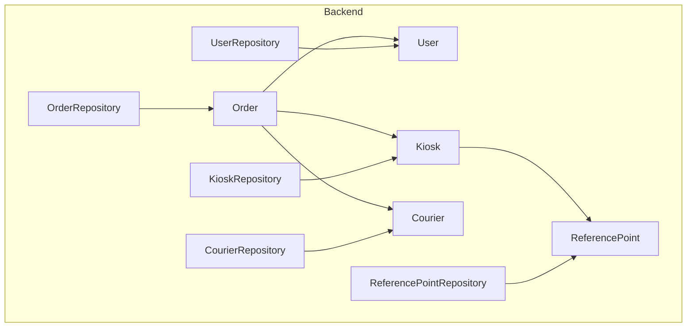
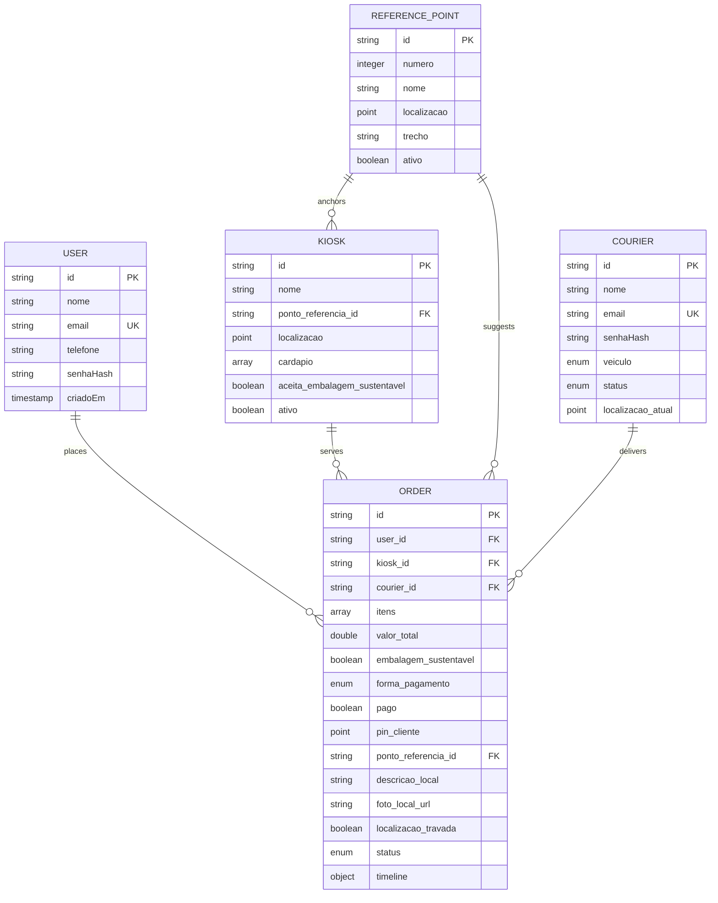
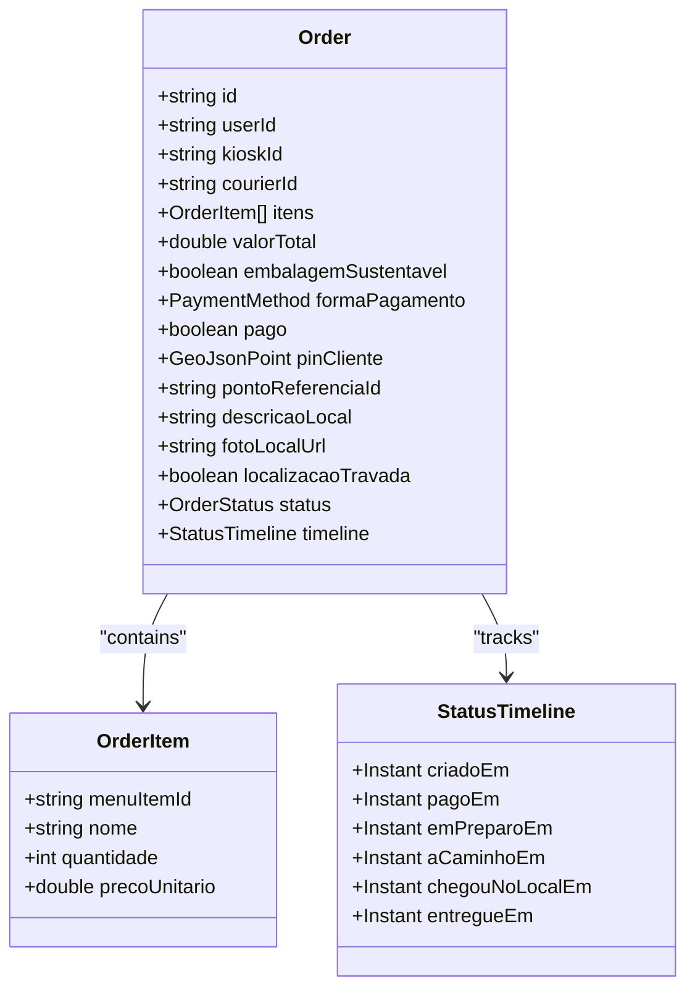
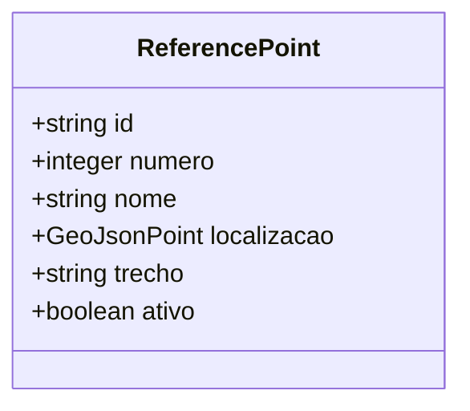
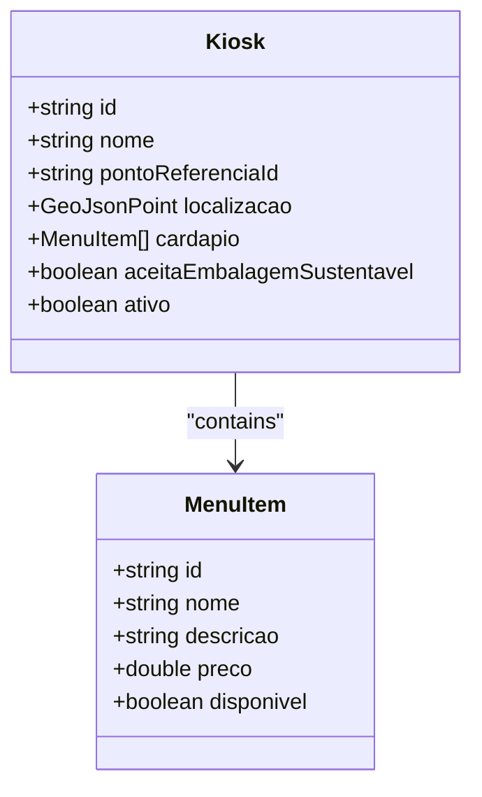
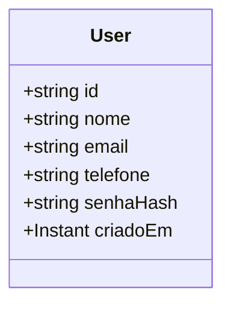
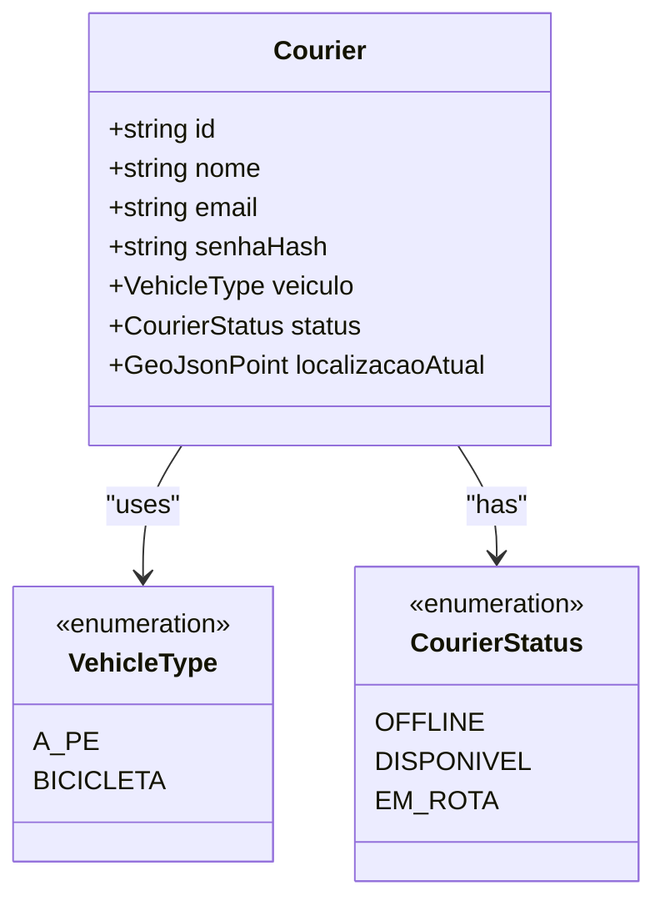
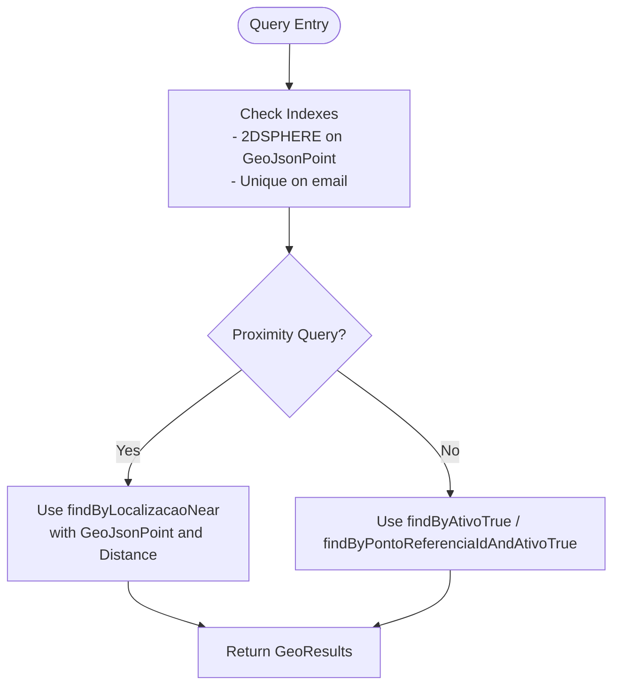

# Data Models

<cite>
**Referenced Files in This Document**
- [Order.java](file://backend/src/main/java/com/penaareia/model/Order.java)
- [ReferencePoint.java](file://backend/src/main/java/com/penaareia/model/ReferencePoint.java)
- [Kiosk.java](file://backend/src/main/java/com/penaareia/model/Kiosk.java)
- [User.java](file://backend/src/main/java/com/penaareia/model/User.java)
- [Courier.java](file://backend/src/main/java/com/penaareia/model/Courier.java)
- [OrderStatus.java](file://backend/src/main/java/com/penaareia/model/OrderStatus.java)
- [PaymentMethod.java](file://backend/src/main/java/com/penaareia/model/PaymentMethod.java)
- [OrderRepository.java](file://backend/src/main/java/com/penaareia/repository/OrderRepository.java)
- [ReferencePointRepository.java](file://backend/src/main/java/com/penaareia/repository/ReferencePointRepository.java)
- [KioskRepository.java](file://backend/src/main/java/com/penaareia/repository/KioskRepository.java)
- [UserRepository.java](file://backend/src/main/java/com/penaareia/repository/UserRepository.java)
- [CourierRepository.java](file://backend/src/main/java/com/penaareia/repository/CourierRepository.java)
</cite>

## Table of Contents
1. [Introduction](#introduction)
2. [Project Structure](#project-structure)
3. [Core Components](#core-components)
4. [Architecture Overview](#architecture-overview)
5. [Detailed Component Analysis](#detailed-component-analysis)
6. [Dependency Analysis](#dependency-analysis)
7. [Performance Considerations](#performance-considerations)
8. [Troubleshooting Guide](#troubleshooting-guide)
9. [Conclusion](#conclusion)

## Introduction
This document describes Pé na Areia’s data models and their relationships, focusing on Order, ReferencePoint, Kiosk, User, and Courier. It explains field definitions, types, validation constraints, geospatial structures (GeoJSON), coordinate systems, MongoDB 2DSPHERE indexing, primary keys, foreign key relationships, and data integrity rules. It also outlines business rules enforced at the data layer, migration considerations, and performance implications of the schema design.

## Project Structure
The backend is a Spring Boot application using Spring Data MongoDB. Entities are defined as annotated classes under the model package, with corresponding repositories under repository. Geospatial queries use GeoJsonPoint and 2DSPHERE indexes.

**Diagram sources**
- [Order.java:15-48](file://backend/src/main/java/com/penaareia/model/Order.java#L15-L48)
- [ReferencePoint.java:16-37](file://backend/src/main/java/com/penaareia/model/ReferencePoint.java#L16-L37)
- [Kiosk.java:14-35](file://backend/src/main/java/com/penaareia/model/Kiosk.java#L14-L35)
- [User.java:12-31](file://backend/src/main/java/com/penaareia/model/User.java#L12-L31)
- [Courier.java:13-34](file://backend/src/main/java/com/penaareia/model/Courier.java#L13-L34)
- [OrderRepository.java:9-15](file://backend/src/main/java/com/penaareia/repository/OrderRepository.java#L9-L15)
- [ReferencePointRepository.java:11-16](file://backend/src/main/java/com/penaareia/repository/ReferencePointRepository.java#L11-L16)
- [KioskRepository.java:11-17](file://backend/src/main/java/com/penaareia/repository/KioskRepository.java#L11-L17)
- [UserRepository.java:8-9](file://backend/src/main/java/com/penaareia/repository/UserRepository.java#L8-L9)
- [CourierRepository.java:8-9](file://backend/src/main/java/com/penaareia/repository/CourierRepository.java#L8-L9)

**Section sources**
- [Order.java:15-48](file://backend/src/main/java/com/penaareia/model/Order.java#L15-L48)
- [ReferencePoint.java:16-37](file://backend/src/main/java/com/penaareia/model/ReferencePoint.java#L16-L37)
- [Kiosk.java:14-35](file://backend/src/main/java/com/penaareia/model/Kiosk.java#L14-L35)
- [User.java:12-31](file://backend/src/main/java/com/penaareia/model/User.java#L12-L31)
- [Courier.java:13-34](file://backend/src/main/java/com/penaareia/model/Courier.java#L13-L34)
- [OrderRepository.java:9-15](file://backend/src/main/java/com/penaareia/repository/OrderRepository.java#L9-L15)
- [ReferencePointRepository.java:11-16](file://backend/src/main/java/com/penaareia/repository/ReferencePointRepository.java#L11-L16)
- [KioskRepository.java:11-17](file://backend/src/main/java/com/penaareia/repository/KioskRepository.java#L11-L17)
- [UserRepository.java:8-9](file://backend/src/main/java/com/penaareia/repository/UserRepository.java#L8-L9)
- [CourierRepository.java:8-9](file://backend/src/main/java/com/penaareia/repository/CourierRepository.java#L8-L9)

## Core Components
This section summarizes each entity’s purpose, fields, types, constraints, and relationships.

- Order
  - Purpose: Represents a customer order with items, payment, location, and lifecycle tracking.
  - Key fields: id (String), userId (String), kioskId (String), courierId (nullable until accepted), itens (list of OrderItem), valorTotal (double), embalagemSustentavel (boolean), formaPagamento (enum), pago (boolean), pinCliente (GeoJsonPoint), pontoReferenciaId (String), descricaoLocal (String), fotoLocalUrl (String), localizacaoTravada (boolean), status (OrderStatus), timeline (StatusTimeline).
  - Constraints: pinCliente uses 2DSPHERE index; localizacaoTravada prevents post-payment location changes; status drives workflow.
  - Relationships: references User via userId, Kiosk via kioskId, ReferencePoint via pontoReferenciaId, Courier via courierId.

- ReferencePoint
  - Purpose: Official beach reference posts used for proximity suggestions and anchoring locations.
  - Key fields: id (String), numero (Integer), nome (String), localizacao (GeoJsonPoint), trecho (String), ativo (boolean).
  - Constraints: localizacao uses 2DSPHERE index; ativo filters active points.
  - Relationships: referenced by Kiosk via pontoReferenciaId.

- Kiosk
  - Purpose: Beachside vendor stalls offering menu items.
  - Key fields: id (String), nome (String), pontoReferenciaId (String), localizacao (GeoJsonPoint), cardapio (list of MenuItem), aceitaEmbalagemSustentavel (boolean), ativo (boolean).
  - Constraints: localizacao uses 2DSPHERE index; ativo filters active kiosks.
  - Relationships: references ReferencePoint via pontoReferenciaId; referenced by Order via kioskId.

- User
  - Purpose: Customer account holder.
  - Key fields: id (String), nome (String), email (unique indexed), telefone (String), senhaHash (String), criadoEm (Instant).
  - Constraints: email unique index; senhaHash stores secure password hash.
  - Relationships: referenced by Order via userId.

- Courier
  - Purpose: Delivery personnel with vehicle type and current location.
  - Key fields: id (String), nome (String), email (unique indexed), senhaHash (String), veiculo (enum), status (enum), localizacaoAtual (GeoJsonPoint).
  - Constraints: email unique index; localizacaoAtual uses 2DSPHERE index; status indicates availability.
  - Relationships: referenced by Order via courierId.

**Section sources**
- [Order.java:15-48](file://backend/src/main/java/com/penaareia/model/Order.java#L15-L48)
- [ReferencePoint.java:16-37](file://backend/src/main/java/com/penaareia/model/ReferencePoint.java#L16-L37)
- [Kiosk.java:14-35](file://backend/src/main/java/com/penaareia/model/Kiosk.java#L14-L35)
- [User.java:12-31](file://backend/src/main/java/com/penaareia/model/User.java#L12-L31)
- [Courier.java:13-34](file://backend/src/main/java/com/penaareia/model/Courier.java#L13-L34)

## Architecture Overview
The data architecture centers around MongoDB documents with embedded lists and references to other collections. Geospatial features rely on GeoJSON Point objects and 2DSPHERE indexes to support proximity queries for kiosks and reference points.

**Diagram sources**
- [Order.java:15-48](file://backend/src/main/java/com/penaareia/model/Order.java#L15-L48)
- [ReferencePoint.java:16-37](file://backend/src/main/java/com/penaareia/model/ReferencePoint.java#L16-L37)
- [Kiosk.java:14-35](file://backend/src/main/java/com/penaareia/model/Kiosk.java#L14-L35)
- [User.java:12-31](file://backend/src/main/java/com/penaareia/model/User.java#L12-L31)
- [Courier.java:13-34](file://backend/src/main/java/com/penaareia/model/Courier.java#L13-L34)

## Detailed Component Analysis

### Order Model
- Primary key: id (String).
- Foreign keys:
  - userId references User.id.
  - kioskId references Kiosk.id.
  - courierId references Courier.id (nullable until accepted).
  - pontoReferenciaId references ReferencePoint.id.
- Embedded structures:
  - itens: list of OrderItem with menuItemId, nome, quantidade, precoUnitario.
  - timeline: StatusTimeline with timestamps for lifecycle events.
- Validation and business rules:
  - localizacaoTravada prevents changing pinCliente after payment.
  - status enforces order lifecycle transitions.
  - formaPagamento restricts payment methods to PIX or CARTAO.
  - valorTotal aggregates item prices (business rule enforced at service layer).
- Geospatial:
  - pinCliente is a GeoJsonPoint with 2DSPHERE index for proximity queries.

**Diagram sources**
- [Order.java:15-48](file://backend/src/main/java/com/penaareia/model/Order.java#L15-L48)
- [Order.java:50-69](file://backend/src/main/java/com/penaareia/model/Order.java#L50-L69)

**Section sources**
- [Order.java:15-48](file://backend/src/main/java/com/penaareia/model/Order.java#L15-L48)
- [Order.java:50-69](file://backend/src/main/java/com/penaareia/model/Order.java#L50-L69)
- [OrderStatus.java:3-10](file://backend/src/main/java/com/penaareia/model/OrderStatus.java#L3-L10)
- [PaymentMethod.java:3-6](file://backend/src/main/java/com/penaareia/model/PaymentMethod.java#L3-L6)

### ReferencePoint Model
- Primary key: id (String).
- Fields: numero (Integer), nome (String), localizacao (GeoJsonPoint), trecho (String), ativo (boolean).
- Geospatial: localizacao uses 2DSPHERE index.
- Business rules:
  - ativo filters available reference points.
  - Used to suggest nearest reference point based on client pin.

**Diagram sources**
- [ReferencePoint.java:16-37](file://backend/src/main/java/com/penaareia/model/ReferencePoint.java#L16-L37)

**Section sources**
- [ReferencePoint.java:16-37](file://backend/src/main/java/com/penaareia/model/ReferencePoint.java#L16-L37)

### Kiosk Model
- Primary key: id (String).
- Fields: nome (String), pontoReferenciaId (String), localizacao (GeoJsonPoint), cardapio (list of MenuItem), aceitaEmbalagemSustentavel (boolean), ativo (boolean).
- Geospatial: localizacao uses 2DSPHERE index.
- Business rules:
  - ativo filters active kiosks.
  - Cardápio defines available menu items with pricing and availability.

**Diagram sources**
- [Kiosk.java:14-35](file://backend/src/main/java/com/penaareia/model/Kiosk.java#L14-L35)
- [Kiosk.java:37-46](file://backend/src/main/java/com/penaareia/model/Kiosk.java#L37-L46)

**Section sources**
- [Kiosk.java:14-35](file://backend/src/main/java/com/penaareia/model/Kiosk.java#L14-L35)
- [Kiosk.java:37-46](file://backend/src/main/java/com/penaareia/model/Kiosk.java#L37-L46)

### User Model
- Primary key: id (String).
- Fields: nome (String), email (unique indexed), telefone (String), senhaHash (String), criadoEm (Instant).
- Business rules:
  - Unique email constraint ensures single registration per email.
  - Password stored as hash for security.

**Diagram sources**
- [User.java:12-31](file://backend/src/main/java/com/penaareia/model/User.java#L12-L31)

**Section sources**
- [User.java:12-31](file://backend/src/main/java/com/penaareia/model/User.java#L12-L31)

### Courier Model
- Primary key: id (String).
- Fields: nome (String), email (unique indexed), senhaHash (String), veiculo (enum), status (enum), localizacaoAtual (GeoJsonPoint).
- Geospatial: localizacaoAtual uses 2DSPHERE index.
- Business rules:
  - Unique email constraint.
  - status indicates OFFLINE, DISPONIVEL, or EM_ROTA.
  - veiculo limits delivery modes to A_PE or BICICLETA.

**Diagram sources**
- [Courier.java:13-34](file://backend/src/main/java/com/penaareia/model/Courier.java#L13-L34)
- [Courier.java:36-45](file://backend/src/main/java/com/penaareia/model/Courier.java#L36-L45)

**Section sources**
- [Courier.java:13-34](file://backend/src/main/java/com/penaareia/model/Courier.java#L13-L34)
- [Courier.java:36-45](file://backend/src/main/java/com/penaareia/model/Courier.java#L36-L45)

## Dependency Analysis
Repositories define query patterns that reflect domain needs and leverage indexes.

- OrderRepository
  - findByUserIdOrderByTimelineCriadoEmDesc(userId): retrieves user orders sorted by creation time.
  - findByCourierIdAndStatus(courierId, status): finds orders assigned to a courier with specific status.
  - findByStatus(status): lists orders by status.

- ReferencePointRepository
  - findByAtivoTrue(): returns active reference points.
  - findByLocalizacaoNear(localizacao, maxDistance): proximity search using GeoJsonPoint and Distance.

- KioskRepository
  - findByAtivoTrue(): returns active kiosks.
  - findByPontoReferenciaIdAndAtivoTrue(pontoReferenciaId): kiosks anchored to a reference point.
  - findByLocalizacaoNear(localizacao, maxDistance): proximity search using GeoJsonPoint and Distance.

- UserRepository
  - findByEmail(email): lookup by unique email.

- CourierRepository
  - findByEmail(email): lookup by unique email.

**Diagram sources**
- [OrderRepository.java:9-15](file://backend/src/main/java/com/penaareia/repository/OrderRepository.java#L9-L15)
- [ReferencePointRepository.java:11-16](file://backend/src/main/java/com/penaareia/repository/ReferencePointRepository.java#L11-L16)
- [KioskRepository.java:11-17](file://backend/src/main/java/com/penaareia/repository/KioskRepository.java#L11-L17)
- [UserRepository.java:8-9](file://backend/src/main/java/com/penaareia/repository/UserRepository.java#L8-L9)
- [CourierRepository.java:8-9](file://backend/src/main/java/com/penaareia/repository/CourierRepository.java#L8-L9)

**Section sources**
- [OrderRepository.java:9-15](file://backend/src/main/java/com/penaareia/repository/OrderRepository.java#L9-L15)
- [ReferencePointRepository.java:11-16](file://backend/src/main/java/com/penaareia/repository/ReferencePointRepository.java#L11-L16)
- [KioskRepository.java:11-17](file://backend/src/main/java/com/penaareia/repository/KioskRepository.java#L11-L17)
- [UserRepository.java:8-9](file://backend/src/main/java/com/penaareia/repository/UserRepository.java#L8-L9)
- [CourierRepository.java:8-9](file://backend/src/main/java/com/penaareia/repository/CourierRepository.java#L8-L9)

## Performance Considerations
- Geospatial indexing:
  - 2DSPHERE indexes on GeoJsonPoint fields (pinCliente, localizacao, localizacaoAtual) enable efficient proximity searches and nearest-neighbor queries.
  - Use appropriate maxDistance values to limit result sets and reduce computation.
- Query optimization:
  - Leverage findByAtivoTrue and findByPontoReferenciaIdAndAtivoTrue to filter early and reduce dataset size.
  - Sort by created timestamps using derived fields (e.g., timeline.criadoEm) to avoid expensive runtime sorting.
- Storage efficiency:
  - Embed lightweight arrays like cardapio and itens to reduce joins; consider denormalization if read-heavy.
- Indexing strategy:
  - Unique indexes on email ensure fast lookups and enforce uniqueness.
  - Consider compound indexes for frequent query combinations (e.g., status + courierId).

[No sources needed since this section provides general guidance]

## Troubleshooting Guide
- Geospatial queries return empty results:
  - Verify GeoJsonPoint coordinates are valid WGS84 (longitude, latitude).
  - Ensure 2DSPHERE indexes exist on relevant fields.
- Uniqueness violations:
  - Email conflicts indicate duplicate registrations; validate input before persistence.
- Order location not updating:
  - Check localizacaoTravada flag; once true, pinCliente cannot be changed.
- Status transitions:
  - Validate state machine transitions; ensure status updates follow allowed paths.

**Section sources**
- [Order.java:35-48](file://backend/src/main/java/com/penaareia/model/Order.java#L35-L48)
- [User.java:23-29](file://backend/src/main/java/com/penaareia/model/User.java#L23-L29)
- [Courier.java:24-34](file://backend/src/main/java/com/penaareia/model/Courier.java#L24-L34)

## Conclusion
Pé na Areia’s data models provide a clear, geospatial-enabled foundation for ordering, delivery, and location-based services. The schema leverages MongoDB’s 2DSPHERE indexing for proximity queries, enforces data integrity through unique indexes and enums, and supports domain workflows via status-driven state machines. Proper indexing, careful embedding strategies, and adherence to business rules ensure scalability and reliability.

[No sources needed since this section summarizes without analyzing specific files]