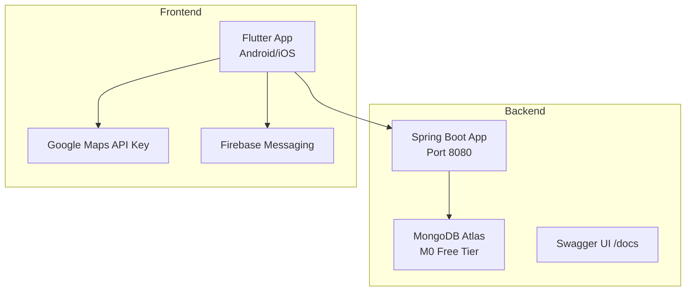
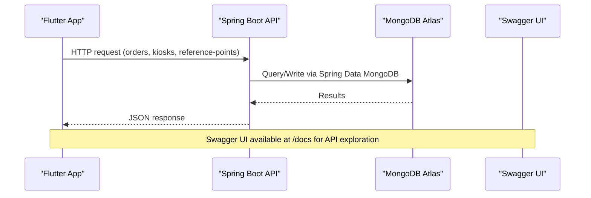
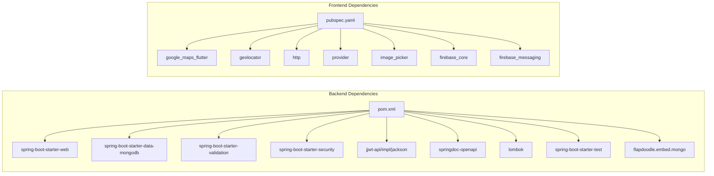

# Deployment & Configuration

<cite>
**Referenced Files in This Document**
- [README.md](file://README.md)
- [backend/pom.xml](file://backend/pom.xml)
- [backend/src/main/resources/application.yml](file://backend/src/main/resources/application.yml)
- [backend/src/main/java/com/penaareia/PeNaAreiaApplication.java](file://backend/src/main/java/com/penaareia/PeNaAreiaApplication.java)
- [backend/src/main/java/com/penaareia/config/SecurityConfig.java](file://backend/src/main/java/com/penaareia/config/SecurityConfig.java)
- [frontend/pubspec.yaml](file://frontend/pubspec.yaml)
- [frontend/lib/services/api_service.dart](file://frontend/lib/services/api_service.dart)
- [frontend/android/app/src/main/AndroidManifest.xml](file://frontend/android/app/src/main/AndroidManifest.xml)
- [frontend/ios/Runner/AppDelegate.swift](file://frontend/ios/Runner/AppDelegate.swift)
</cite>

## Table of Contents
1. [Introduction](#introduction)
2. [Project Structure](#project-structure)
3. [Core Components](#core-components)
4. [Architecture Overview](#architecture-overview)
5. [Detailed Component Analysis](#detailed-component-analysis)
6. [Dependency Analysis](#dependency-analysis)
7. [Performance Considerations](#performance-considerations)
8. [Troubleshooting Guide](#troubleshooting-guide)
9. [Conclusion](#conclusion)
10. [Appendices](#appendices)

## Introduction
This document provides comprehensive deployment and configuration guidance for Pé na Areia, covering both the Spring Boot backend and the Flutter frontend. It includes environment-specific configuration, database provisioning with MongoDB Atlas, cloud platform setup on Render or Railway, build processes, dependency management, containerization options, monitoring/logging/debugging recommendations, scaling considerations, backup strategies, disaster recovery procedures, and mobile app distribution requirements for Android and iOS.

## Project Structure
Pé na Areia is a two-layer application:
- Backend: Java 17 + Spring Boot + MongoDB (Spring Data MongoDB), with Swagger/OpenAPI documentation.
- Frontend: Flutter application targeting Android and iOS, using Google Maps and Firebase Messaging.

**Diagram sources**
- [backend/src/main/resources/application.yml:1-31](file://backend/src/main/resources/application.yml#L1-L31)
- [frontend/lib/services/api_service.dart:1-68](file://frontend/lib/services/api_service.dart#L1-L68)
- [frontend/pubspec.yaml:1-38](file://frontend/pubspec.yaml#L1-L38)

**Section sources**
- [README.md:6-12](file://README.md#L6-L12)
- [backend/pom.xml:20-22](file://backend/pom.xml#L20-L22)
- [frontend/pubspec.yaml:1-38](file://frontend/pubspec.yaml#L1-L38)

## Core Components
- Backend entry point: Spring Boot application class that starts the web server and auto-configures components.
- Security configuration: Public endpoints are allowed; JWT authentication is prepared but not yet enforced.
- Application configuration: Server port, MongoDB connection, JWT secret, Swagger paths, and delivery radius setting.
- Frontend API client: Reads the backend base URL from a Dart define at build time, defaulting to an emulator-friendly address.

Key responsibilities:
- Backend exposes REST endpoints for reference points, kiosks, and orders.
- Frontend consumes these endpoints and integrates maps and messaging services.

**Section sources**
- [backend/src/main/java/com/penaareia/PeNaAreiaApplication.java:6-11](file://backend/src/main/java/com/penaareia/PeNaAreiaApplication.java#L6-L11)
- [backend/src/main/java/com/penaareia/config/SecurityConfig.java:11-40](file://backend/src/main/java/com/penaareia/config/SecurityConfig.java#L11-L40)
- [backend/src/main/resources/application.yml:1-31](file://backend/src/main/resources/application.yml#L1-L31)
- [frontend/lib/services/api_service.dart:7-13](file://frontend/lib/services/api_service.dart#L7-L13)

## Architecture Overview
The production architecture consists of:
- A stateless Spring Boot service running behind a reverse proxy or platform load balancer.
- MongoDB Atlas as the managed database.
- Flutter clients communicating over HTTPS to the backend.
- Optional integrations: Google Maps API key and Firebase Messaging for location and notifications.

**Diagram sources**
- [backend/src/main/resources/application.yml:22-26](file://backend/src/main/resources/application.yml#L22-L26)
- [frontend/lib/services/api_service.dart:15-59](file://frontend/lib/services/api_service.dart#L15-L59)

## Detailed Component Analysis

### Backend Deployment and Configuration
- Runtime: Java 17, Spring Boot 3.3.4.
- Build tool: Maven via spring-boot-maven-plugin.
- Database: MongoDB Atlas M0 free tier. Connection configured via environment variables.
- Ports: Exposes port 8080 by default.
- Documentation: Swagger UI at /docs and OpenAPI spec at /api-docs.
- Security: CSRF disabled, session stateless, public endpoints allowed; JWT filter placeholder present.

Environment variables:
- MONGODB_URI: MongoDB Atlas connection string.
- MONGODB_DATABASE: Database name (default pe_na_areia).
- JWT_SECRET: Secret used for JWT operations (must be set in production).

Production checklist:
- Set MONGODB_URI and MONGODB_DATABASE in your platform’s environment settings.
- Set JWT_SECRET to a strong value.
- Restrict access to /docs and /api-docs in production if needed.
- Enforce authentication on protected endpoints once JWT integration is complete.

Build and run:
- Build: mvn clean package
- Run: java -jar target/pe-na-areia-backend-0.1.0-SNAPSHOT.jar
- Or use platform-native runners (Render/Railway) which execute Maven and start the Spring Boot app.

Containerization:
- No Dockerfile is present in the repository. You can create a multi-stage Dockerfile based on Eclipse Temurin JDK 17 and copy the built JAR.
- Example approach:
  - Stage 1: maven:3.9-eclipse-temurin-17 to build the JAR.
  - Stage 2: eclipse-temurin:17-jre-alpine to run the JAR.
- Ensure environment variables are injected at runtime by your orchestrator or platform.

Scaling considerations:
- The backend is stateless; scale horizontally by running multiple instances behind a load balancer.
- Use MongoDB Atlas replica sets for high availability and read scalability.
- Enable health checks and readiness probes for orchestration platforms.

Monitoring and logging:
- Add structured logging (e.g., Logback JSON) and ship logs to a centralized system.
- Integrate metrics (Micrometer) and expose /actuator endpoints if you enable Actuator.
- Configure error handling globally and capture contextual information for production incidents.

Disaster recovery:
- Use MongoDB Atlas automated backups and point-in-time restore features.
- Export critical seed data (reference points) periodically.
- Maintain environment variable secrets in a secure vault (platform-managed secret store).

**Section sources**
- [backend/pom.xml:7-22](file://backend/pom.xml#L7-L22)
- [backend/pom.xml:24-90](file://backend/pom.xml#L24-L90)
- [backend/pom.xml:93-108](file://backend/pom.xml#L93-L108)
- [backend/src/main/resources/application.yml:1-31](file://backend/src/main/resources/application.yml#L1-L31)
- [backend/src/main/java/com/penaareia/config/SecurityConfig.java:27-40](file://backend/src/main/java/com/penaareia/config/SecurityConfig.java#L27-L40)

### Frontend Deployment and Configuration
- SDK: Dart >=3.3.0 <4.0.0.
- Dependencies: Google Maps, geolocation, HTTP client, state management, image picker, Firebase core and messaging.
- Base URL: Configured via --dart-define=API_BASE_URL at build time; defaults to emulator host when not provided.

Environment configuration:
- Development: flutter run --dart-define=API_BASE_URL=http://10.0.2.2:8080
- Production: Set API_BASE_URL to your deployed backend domain (HTTPS recommended).

Platform-specific notes:
- Android: Requires Google Maps API key configured in AndroidManifest and related files.
- iOS: Requires Google Maps API key configured in AppDelegate and associated iOS project files.
- Firebase Messaging: Initialize firebase_core and configure Firebase for push notifications.

Build and distribute:
- Android:
  - Generate signed APK/AAB using keystore.
  - Publish to Google Play Store or distribute via internal testing tracks.
- iOS:
  - Configure code signing with Apple Developer account and provisioning profiles.
  - Archive and submit to App Store Connect or distribute via TestFlight.

Code signing and platform requirements:
- Android: Keystore file and Gradle signing config must be securely managed.
- iOS: Certificates, identifiers, and provisioning profiles must be maintained in Apple Developer Portal and Xcode.

**Section sources**
- [frontend/pubspec.yaml:6-38](file://frontend/pubspec.yaml#L6-L38)
- [frontend/lib/services/api_service.dart:7-13](file://frontend/lib/services/api_service.dart#L7-L13)
- [frontend/android/app/src/main/AndroidManifest.xml:1-46](file://frontend/android/app/src/main/AndroidManifest.xml#L1-L46)
- [frontend/ios/Runner/AppDelegate.swift:1-14](file://frontend/ios/Runner/AppDelegate.swift#L1-L14)

### Cloud Platform Setup (MongoDB Atlas, Render/Railway)
- MongoDB Atlas:
  - Create a cluster (M0 free tier).
  - Whitelist IP ranges or allow access from platform egress IPs.
  - Create a database user and obtain the connection string for MONGODB_URI.
  - Set MONGODB_DATABASE to pe_na_areia.
- Render:
  - Connect your repository or provide a build command (mvn clean package).
  - Set environment variables: MONGODB_URI, MONGODB_DATABASE, JWT_SECRET.
  - Set the service port to 8080 or let Render detect it.
- Railway:
  - Connect your repository or provide a build command (mvn clean package).
  - Set environment variables: MONGODB_URI, MONGODB_DATABASE, JWT_SECRET.
  - Ensure the process listens on the assigned port (default 8080).

**Section sources**
- [README.md:42-63](file://README.md#L42-L63)
- [backend/src/main/resources/application.yml:8-15](file://backend/src/main/resources/application.yml#L8-L15)

### Build Processes and Dependency Management
- Backend:
  - Dependencies declared in pom.xml include Spring Web, MongoDB, Validation, Security, JWT libraries, Swagger, Lombok, and test dependencies.
  - Build uses spring-boot-maven-plugin; Lombok is excluded from the final artifact.
- Frontend:
  - Dependencies declared in pubspec.yaml include Google Maps, geolocator, http, provider, image_picker, firebase_core, firebase_messaging.
  - Dev dependencies include flutter_test and flutter_lints.

Recommendations:
- Pin versions for reproducibility where appropriate.
- Keep dev dependencies separate from runtime dependencies.
- Regularly update dependencies and review security advisories.

**Section sources**
- [backend/pom.xml:24-90](file://backend/pom.xml#L24-L90)
- [backend/pom.xml:93-108](file://backend/pom.xml#L93-L108)
- [frontend/pubspec.yaml:9-33](file://frontend/pubspec.yaml#L9-L33)

### Containerization Options
- No Dockerfile is present in the repository.
- Recommended approach:
  - Multi-stage build:
    - Builder stage: maven:3.9-eclipse-temurin-17 to compile and package the Spring Boot app.
    - Runtime stage: eclipse-temurin:17-jre-alpine to run the JAR.
  - Inject environment variables at runtime via platform secrets management.
  - Expose port 8080 and configure health checks.

[No sources needed since this section provides general guidance]

### Monitoring, Logging, and Debugging
- Logging:
  - Use structured logging (JSON) for easier parsing and aggregation.
  - Include correlation IDs across requests for traceability.
- Metrics:
  - Introduce Micrometer to collect JVM and application metrics.
  - Expose metrics endpoint to Prometheus or a hosted metrics service.
- Error handling:
  - Centralize exception handling and return consistent error responses.
  - Capture stack traces and context without exposing sensitive details.
- Debugging:
  - Enable debug flags in development only.
  - Use remote debugging cautiously in production; prefer log-based diagnostics.

[No sources needed since this section provides general guidance]

### Scaling Considerations
- Horizontal scaling:
  - Deploy multiple backend instances behind a load balancer.
  - Use platform autoscaling policies based on CPU/memory or custom metrics.
- Database scaling:
  - MongoDB Atlas supports sharding and read replicas; choose appropriate cluster tiers.
- Caching:
  - Consider adding a cache layer (e.g., Redis) for frequently accessed reference points and kiosks.

[No sources needed since this section provides general guidance]

### Backup Strategies and Disaster Recovery
- MongoDB Atlas:
  - Enable automated backups and configure retention policies.
  - Perform periodic manual snapshots for critical datasets.
- Seed data:
  - Back up reference points and other static data separately.
- Restore procedures:
  - Define runbooks for restoring databases and re-seeding data.
  - Test restore procedures regularly in non-production environments.

[No sources needed since this section provides general guidance]

### Mobile App Distribution
- Android:
  - Generate a signed bundle (AAB) using a secure keystore.
  - Publish to Google Play Store or distribute via internal testing tracks.
  - Ensure Google Maps API key is configured in AndroidManifest and related files.
- iOS:
  - Configure code signing with certificates and provisioning profiles.
  - Archive and submit to App Store Connect or distribute via TestFlight.
  - Ensure Google Maps API key is configured in AppDelegate and iOS project files.
- Firebase Messaging:
  - Initialize Firebase and configure messaging permissions and tokens.

**Section sources**
- [frontend/android/app/src/main/AndroidManifest.xml:1-46](file://frontend/android/app/src/main/AndroidManifest.xml#L1-L46)
- [frontend/ios/Runner/AppDelegate.swift:1-14](file://frontend/ios/Runner/AppDelegate.swift#L1-L14)
- [frontend/pubspec.yaml:25-27](file://frontend/pubspec.yaml#L25-L27)

## Dependency Analysis
The backend depends on Spring ecosystem modules and MongoDB. The frontend depends on Flutter plugins for maps, geolocation, HTTP, state management, images, and Firebase.

**Diagram sources**
- [backend/pom.xml:24-90](file://backend/pom.xml#L24-L90)
- [frontend/pubspec.yaml:9-33](file://frontend/pubspec.yaml#L9-L33)

**Section sources**
- [backend/pom.xml:24-90](file://backend/pom.xml#L24-L90)
- [frontend/pubspec.yaml:9-33](file://frontend/pubspec.yaml#L9-L33)

## Performance Considerations
- Backend:
  - Tune JVM heap size and GC parameters for your workload.
  - Use connection pooling and optimize MongoDB queries.
  - Enable compression for network traffic if supported by your platform.
- Frontend:
  - Minimize payload sizes and avoid unnecessary map updates.
  - Cache reference points locally when appropriate.
  - Use efficient image loading and caching strategies.

[No sources needed since this section provides general guidance]

## Troubleshooting Guide
Common issues and resolutions:
- Cannot connect to MongoDB:
  - Verify MONGODB_URI and MONGODB_DATABASE environment variables.
  - Check IP whitelisting in MongoDB Atlas.
- Backend endpoints return unexpected results:
  - Confirm Swagger UI paths (/docs, /api-docs) are accessible.
  - Validate request payloads against DTO validation rules.
- Frontend cannot reach backend:
  - Ensure API_BASE_URL is correctly set for the target environment.
  - For Android emulator, use 10.0.2.2 instead of localhost.
- Google Maps not loading:
  - Verify API key configuration in AndroidManifest and iOS AppDelegate.
- Firebase Messaging not working:
  - Ensure firebase_core is initialized and permissions are granted.

**Section sources**
- [backend/src/main/resources/application.yml:8-15](file://backend/src/main/resources/application.yml#L8-L15)
- [backend/src/main/resources/application.yml:22-26](file://backend/src/main/resources/application.yml#L22-L26)
- [frontend/lib/services/api_service.dart:7-13](file://frontend/lib/services/api_service.dart#L7-L13)
- [frontend/android/app/src/main/AndroidManifest.xml:1-46](file://frontend/android/app/src/main/AndroidManifest.xml#L1-L46)
- [frontend/ios/Runner/AppDelegate.swift:1-14](file://frontend/ios/Runner/AppDelegate.swift#L1-L14)

## Conclusion
Pé na Areia’s backend and frontend are straightforward to deploy with modern cloud platforms. The backend relies on environment-driven configuration for MongoDB and JWT, while the frontend uses build-time defines for the backend URL. For production, ensure secrets are managed securely, enable backups and monitoring, and follow platform best practices for scaling and reliability. Mobile distribution requires proper code signing and platform-specific configurations for Android and iOS.

## Appendices

### Environment Variables Reference
- MONGODB_URI: MongoDB Atlas connection string.
- MONGODB_DATABASE: Database name (default pe_na_areia).
- JWT_SECRET: Secret for JWT operations.
- API_BASE_URL: Backend base URL for the Flutter app (set via --dart-define).

**Section sources**
- [backend/src/main/resources/application.yml:8-20](file://backend/src/main/resources/application.yml#L8-L20)
- [frontend/lib/services/api_service.dart:7-13](file://frontend/lib/services/api_service.dart#L7-L13)

### Build Commands
- Backend:
  - mvn clean package
  - java -jar target/pe-na-areia-backend-0.1.0-SNAPSHOT.jar
- Frontend:
  - flutter pub get
  - flutter run --dart-define=API_BASE_URL=<your-backend-url>

**Section sources**
- [backend/pom.xml:93-108](file://backend/pom.xml#L93-L108)
- [README.md:54-60](file://README.md#L54-L60)
- [README.md:66-72](file://README.md#L66-L72)