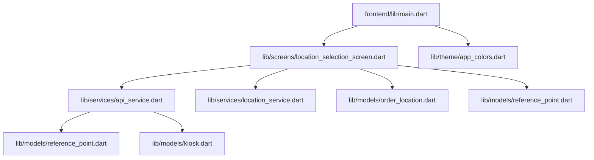
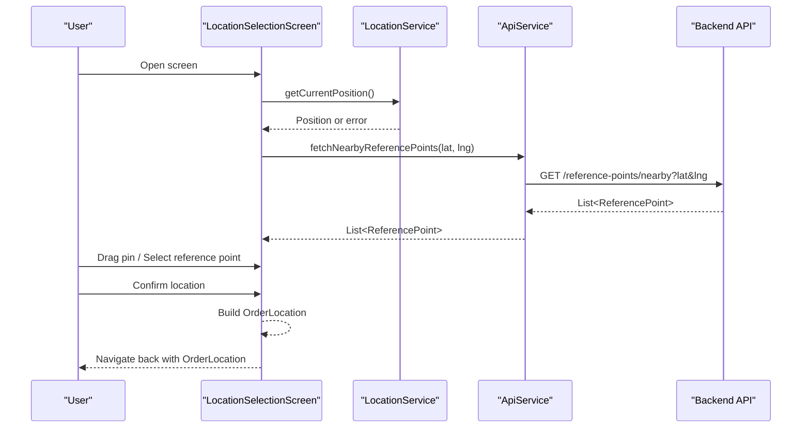
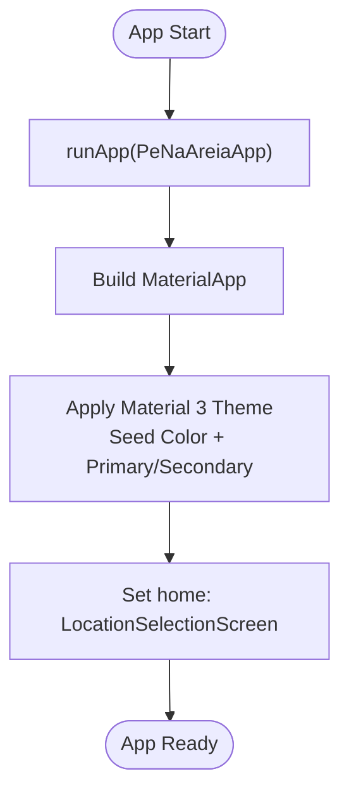
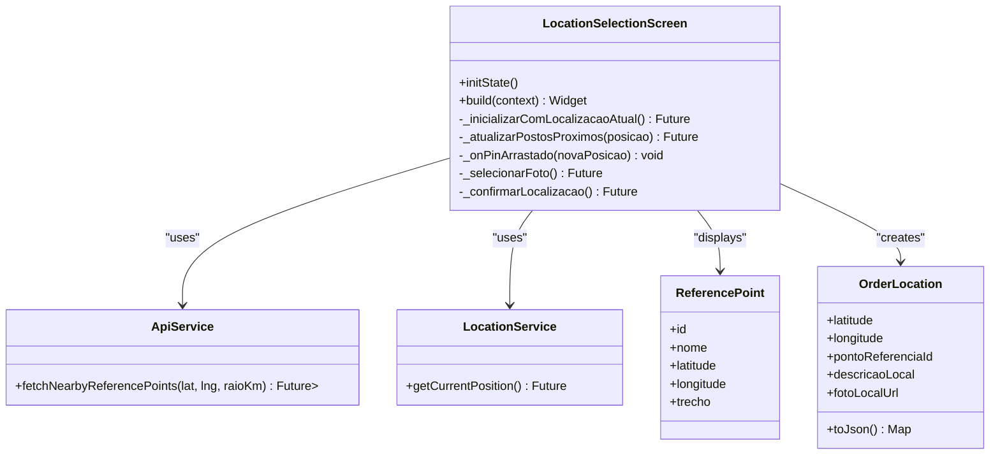
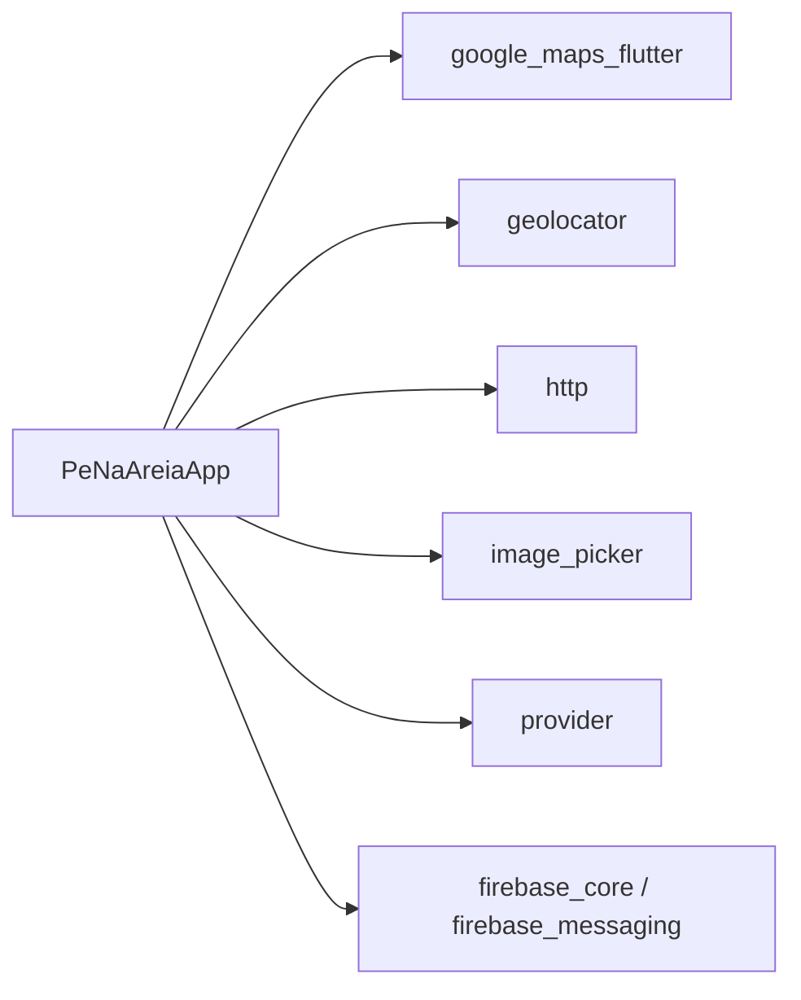

# Flutter Application Structure

<cite>
**Referenced Files in This Document**
- [main.dart](file://frontend/lib/main.dart)
- [app_colors.dart](file://frontend/lib/theme/app_colors.dart)
- [location_selection_screen.dart](file://frontend/lib/screens/location_selection_screen.dart)
- [api_service.dart](file://frontend/lib/services/api_service.dart)
- [location_service.dart](file://frontend/lib/services/location_service.dart)
- [order_location.dart](file://frontend/lib/models/order_location.dart)
- [reference_point.dart](file://frontend/lib/models/reference_point.dart)
- [kiosk.dart](file://frontend/lib/models/kiosk.dart)
- [pubspec.yaml](file://frontend/pubspec.yaml)
</cite>

## Table of Contents
1. [Introduction](#introduction)
2. [Project Structure](#project-structure)
3. [Core Components](#core-components)
4. [Architecture Overview](#architecture-overview)
5. [Detailed Component Analysis](#detailed-component-analysis)
6. [Dependency Analysis](#dependency-analysis)
7. [Performance Considerations](#performance-considerations)
8. [Troubleshooting Guide](#troubleshooting-guide)
9. [Conclusion](#conclusion)
10. [Appendices](#appendices)

## Introduction
This document explains the Flutter application structure and project organization for the “Pé na Areia” MVP. It covers the main entry point, app initialization, Material Design 3 theming, the lib directory layout (models, screens, services, theme), and the pubspec.yaml configuration. It also provides best practices for code organization, state management, and development workflow setup.

## Project Structure
The Flutter frontend lives under frontend/. The Dart source code is organized by feature layers:
- lib/main.dart: App entry point and root widget configuration.
- lib/screens/: UI screens (e.g., location selection).
- lib/services/: Network and device capability abstractions (API client, geolocation).
- lib/models/: Data models with JSON serialization helpers.
- lib/theme/: Shared design tokens (colors).

**Diagram sources**
- [main.dart:1-34](file://frontend/lib/main.dart#L1-L34)
- [location_selection_screen.dart:1-324](file://frontend/lib/screens/location_selection_screen.dart#L1-L324)
- [api_service.dart:1-69](file://frontend/lib/services/api_service.dart#L1-L69)
- [location_service.dart:1-31](file://frontend/lib/services/location_service.dart#L1-L31)
- [order_location.dart:1-26](file://frontend/lib/models/order_location.dart#L1-L26)
- [reference_point.dart:1-32](file://frontend/lib/models/reference_point.dart#L1-L32)
- [kiosk.dart:1-48](file://frontend/lib/models/kiosk.dart#L1-L48)

**Section sources**
- [main.dart:1-34](file://frontend/lib/main.dart#L1-L34)
- [pubspec.yaml:1-38](file://frontend/pubspec.yaml#L1-L38)

## Core Components
- Entry point and app shell:
  - main.dart initializes runApp and defines PeNaAreiaApp as a StatelessWidget that configures MaterialApp with Material 3, seed-based color scheme, custom scaffold background, font family, and sets the initial screen.
- Theme:
  - app_colors.dart centralizes brand colors used across the app (ocean, sand, mango, seafoam, ink).
- Screens:
  - location_selection_screen.dart implements the core customer flow to pick a delivery location on a map, select a nearby reference point, add optional photo, and confirm the location.
- Services:
  - api_service.dart encapsulates HTTP calls to the backend for reference points, kiosks, and order creation.
  - location_service.dart abstracts geolocation permissions and current position retrieval.
- Models:
  - order_location.dart represents the payload sent to the backend when confirming a location.
  - reference_point.dart parses GeoJSON-like coordinates from the API response.
  - kiosk.dart models kiosks and menu items returned by the backend.

**Section sources**
- [main.dart:6-33](file://frontend/lib/main.dart#L6-L33)
- [app_colors.dart:1-14](file://frontend/lib/theme/app_colors.dart#L1-L14)
- [location_selection_screen.dart:16-139](file://frontend/lib/screens/location_selection_screen.dart#L16-L139)
- [api_service.dart:7-69](file://frontend/lib/services/api_service.dart#L7-L69)
- [location_service.dart:3-31](file://frontend/lib/services/location_service.dart#L3-L31)
- [order_location.dart:1-26](file://frontend/lib/models/order_location.dart#L1-L26)
- [reference_point.dart:1-32](file://frontend/lib/models/reference_point.dart#L1-L32)
- [kiosk.dart:1-48](file://frontend/lib/models/kiosk.dart#L1-L48)

## Architecture Overview
High-level data flow during location selection:
- The screen requests the device’s current position via LocationService.
- On success, it fetches nearby reference points using ApiService.
- The user drags the pin and selects a reference point chip.
- On confirmation, the screen builds an OrderLocation and navigates back with the result.

**Diagram sources**
- [location_selection_screen.dart:52-125](file://frontend/lib/screens/location_selection_screen.dart#L52-L125)
- [api_service.dart:24-42](file://frontend/lib/services/api_service.dart#L24-L42)
- [location_service.dart:6-29](file://frontend/lib/services/location_service.dart#L6-L29)

## Detailed Component Analysis

### App Entry Point and Material 3 Theme
- Initialization:
  - main.dart calls runApp with PeNaAreiaApp.
- Theme configuration:
  - Uses Material 3 (useMaterial3: true).
  - Seed-based ColorScheme with primary/secondary derived from AppColors.
  - Scaffold background set to a light sand tone.
  - Font family set to Roboto.
  - Initial route is LocationSelectionScreen.

**Diagram sources**
- [main.dart:6-33](file://frontend/lib/main.dart#L6-L33)
- [app_colors.dart:1-14](file://frontend/lib/theme/app_colors.dart#L1-L14)

**Section sources**
- [main.dart:6-33](file://frontend/lib/main.dart#L6-L33)
- [app_colors.dart:1-14](file://frontend/lib/theme/app_colors.dart#L1-L14)

### Location Selection Screen
Responsibilities:
- Obtain current device location and handle permission errors.
- Fetch nearby reference points based on the current pin position.
- Render Google Map with draggable user pin and reference point markers.
- Present chips for selecting the nearest reference point.
- Allow optional photo capture and description input.
- Validate inputs and navigate back with OrderLocation.

Key behaviors:
- initState triggers location acquisition and nearby points loading.
- Pin drag updates position and refreshes nearby points.
- Confirmation builds OrderLocation and returns via Navigator.pop.

**Diagram sources**
- [location_selection_screen.dart:16-125](file://frontend/lib/screens/location_selection_screen.dart#L16-L125)
- [api_service.dart:24-42](file://frontend/lib/services/api_service.dart#L24-L42)
- [location_service.dart:6-29](file://frontend/lib/services/location_service.dart#L6-L29)
- [reference_point.dart:1-32](file://frontend/lib/models/reference_point.dart#L1-L32)
- [order_location.dart:1-26](file://frontend/lib/models/order_location.dart#L1-L26)

**Section sources**
- [location_selection_screen.dart:16-139](file://frontend/lib/screens/location_selection_screen.dart#L16-L139)
- [location_selection_screen.dart:142-194](file://frontend/lib/screens/location_selection_screen.dart#L142-L194)
- [location_selection_screen.dart:196-289](file://frontend/lib/screens/location_selection_screen.dart#L196-L289)
- [location_selection_screen.dart:291-322](file://frontend/lib/screens/location_selection_screen.dart#L291-L322)

### API Service
Responsibilities:
- Centralize HTTP communication with the backend.
- Provide methods to fetch reference points, kiosks, and create orders.
- Enforce expected status codes and throw exceptions on failures.
- Support environment-specific base URL via build-time constants.

Notes:
- Base URL defaults to a local emulator address but can be overridden at compile time.
- Response parsing maps JSON into domain models.

**Section sources**
- [api_service.dart:7-69](file://frontend/lib/services/api_service.dart#L7-L69)

### Location Service
Responsibilities:
- Check and request location permissions.
- Throw descriptive exceptions when GPS is disabled or permissions are denied/permanently denied.
- Return high-accuracy current position.

**Section sources**
- [location_service.dart:3-31](file://frontend/lib/services/location_service.dart#L3-L31)

### Models
- OrderLocation:
  - Immutable value object representing the confirmed delivery location payload.
  - Provides toJson for serialization.
- ReferencePoint:
  - Parses GeoJSON-style coordinates from API responses.
- Kiosk and MenuItem:
  - Represent kiosks and their menus; include JSON factories for deserialization.

**Section sources**
- [order_location.dart:1-26](file://frontend/lib/models/order_location.dart#L1-L26)
- [reference_point.dart:1-32](file://frontend/lib/models/reference_point.dart#L1-L32)
- [kiosk.dart:1-48](file://frontend/lib/models/kiosk.dart#L1-L48)

## Dependency Analysis
External dependencies and their roles:
- google_maps_flutter: Renders interactive maps and markers.
- geolocator: Retrieves device location and manages permissions.
- http: Performs HTTP requests to the backend.
- provider: Available for state management (not used yet in analyzed files).
- image_picker: Captures images from camera/gallery.
- firebase_core and firebase_messaging: Prepared for push notifications.

**Diagram sources**
- [pubspec.yaml:9-32](file://frontend/pubspec.yaml#L9-L32)

**Section sources**
- [pubspec.yaml:9-32](file://frontend/pubspec.yaml#L9-L32)

## Performance Considerations
- Geolocation:
  - Cache recent positions if repeatedly accessed to avoid redundant permission prompts.
  - Debounce pin-drag events before calling API to reduce network churn.
- Networking:
  - Use retry/backoff for transient failures.
  - Consider caching reference points locally to minimize repeated calls.
- UI rendering:
  - Avoid rebuilding large lists frequently; use const widgets where possible.
  - Limit marker count; cluster nearby points if needed.
- Image handling:
  - Compress images before upload to reduce bandwidth and storage costs.

[No sources needed since this section provides general guidance]

## Troubleshooting Guide
Common issues and resolutions:
- Location not available:
  - Ensure GPS is enabled and permissions granted. The service throws explicit exceptions for disabled GPS or denied permissions.
- API connectivity:
  - Verify API_BASE_URL matches your deployment target. For Android emulators, localhost resolves differently; use the documented loopback address or configure a build-time constant.
- Status code mismatches:
  - The API service enforces expected status codes; unexpected responses will throw exceptions with details.

**Section sources**
- [location_service.dart:6-29](file://frontend/lib/services/location_service.dart#L6-L29)
- [api_service.dart:10-13](file://frontend/lib/services/api_service.dart#L10-L13)
- [api_service.dart:61-67](file://frontend/lib/services/api_service.dart#L61-L67)

## Conclusion
The application follows a clean separation of concerns with dedicated folders for screens, services, models, and theme. Material 3 theming is centralized through seed colors and shared tokens. The location selection flow integrates geolocation, mapping, and API calls in a straightforward sequence. With additional state management and caching, the app can scale efficiently while maintaining readability and testability.

[No sources needed since this section summarizes without analyzing specific files]

## Appendices

### pubspec.yaml Configuration Summary
- SDK constraints: Dart SDK version range.
- Dependencies:
  - Core: flutter, cupertino_icons.
  - Maps and location: google_maps_flutter, geolocator.
  - Networking and state: http, provider.
  - Media: image_picker.
  - Notifications: firebase_core, firebase_messaging.
- Dev dependencies:
  - flutter_test, flutter_lints.
- Flutter assets:
  - uses-material-design enabled.
  - assets folder configured.

**Section sources**
- [pubspec.yaml:1-38](file://frontend/pubspec.yaml#L1-L38)

### Development Workflow Setup
- Environment variables:
  - Define API_BASE_URL at build time to switch between local and production endpoints.
- Running the app:
  - Use standard Flutter commands to run on connected devices or emulators.
- Linting and analysis:
  - Enable flutter_lints rules via analysis_options.yaml (if present) to enforce consistent style.
- Testing:
  - Add unit tests for services and model parsers; widget tests for critical UI flows like location selection.

[No sources needed since this section provides general guidance]