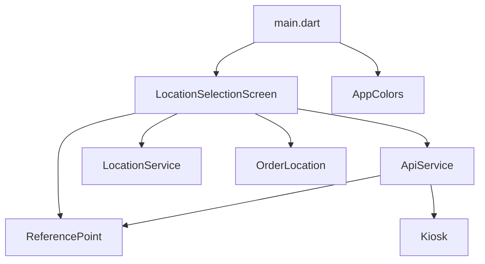
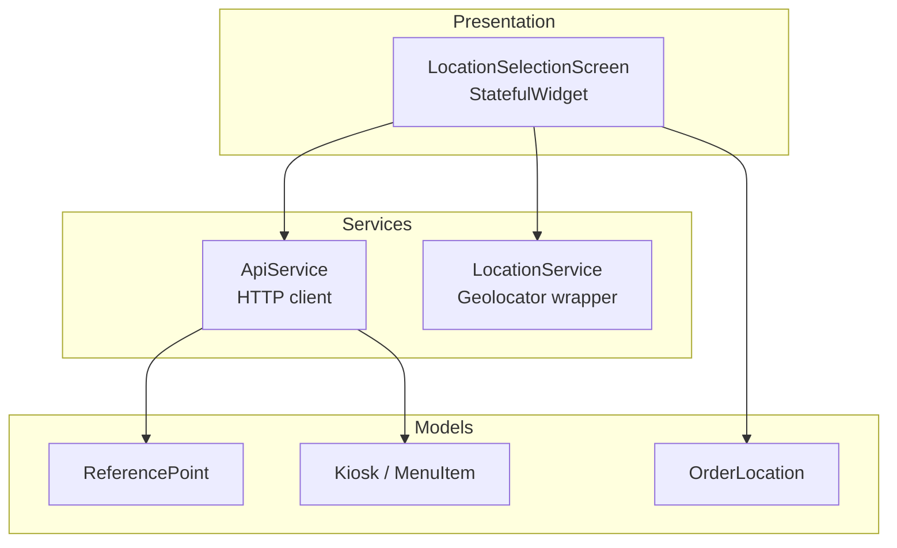
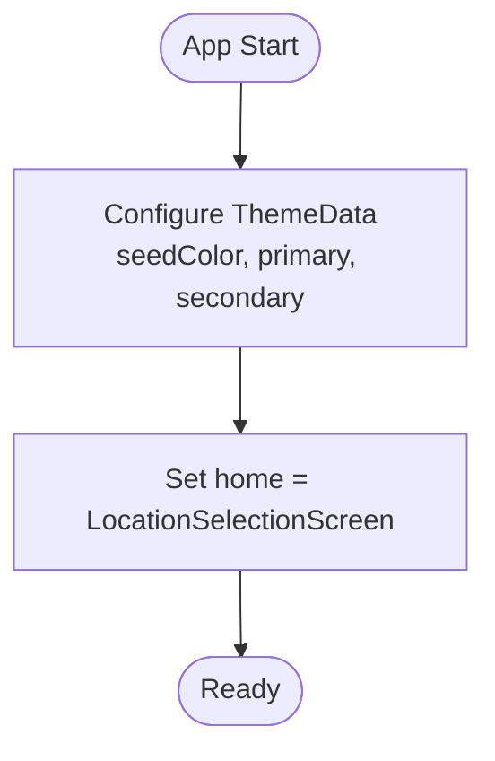
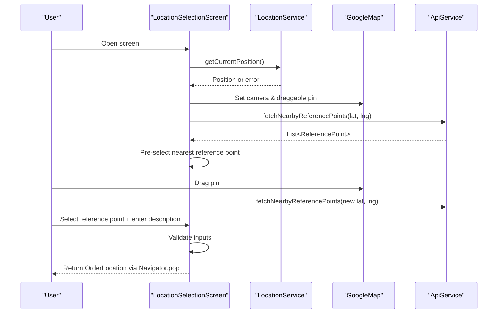
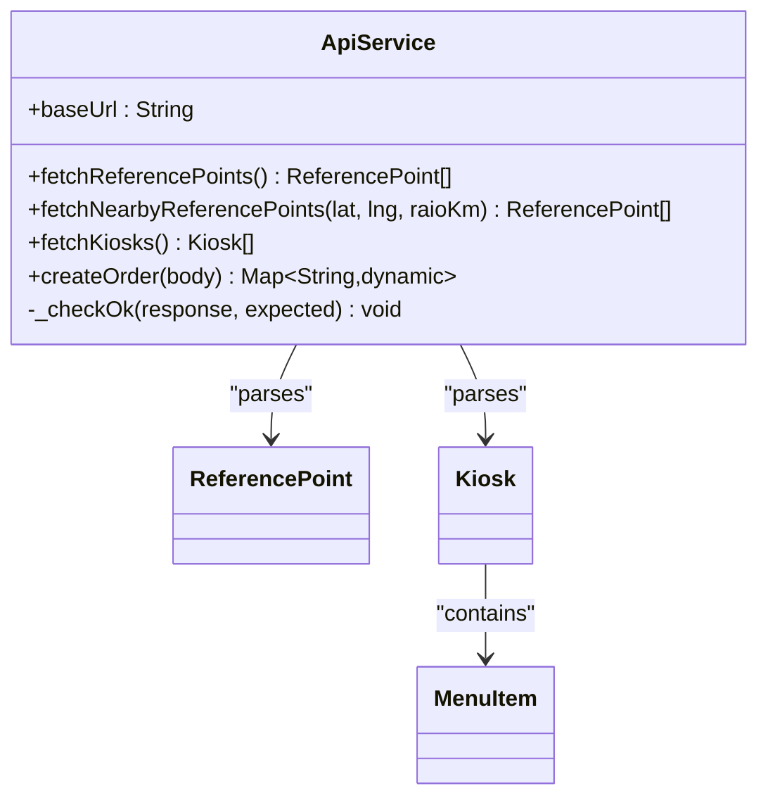
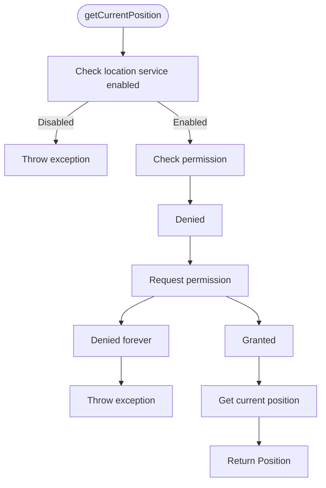
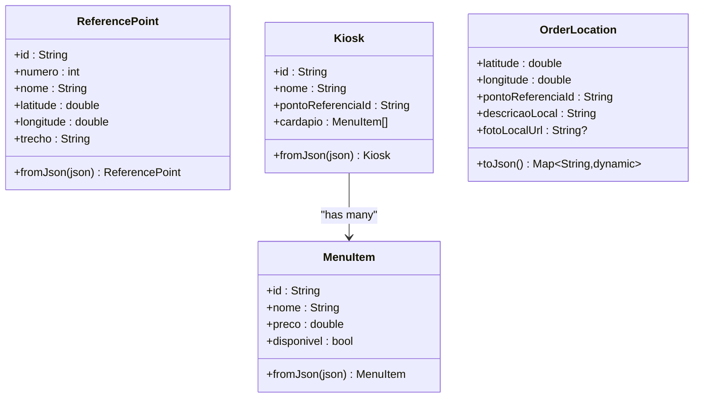
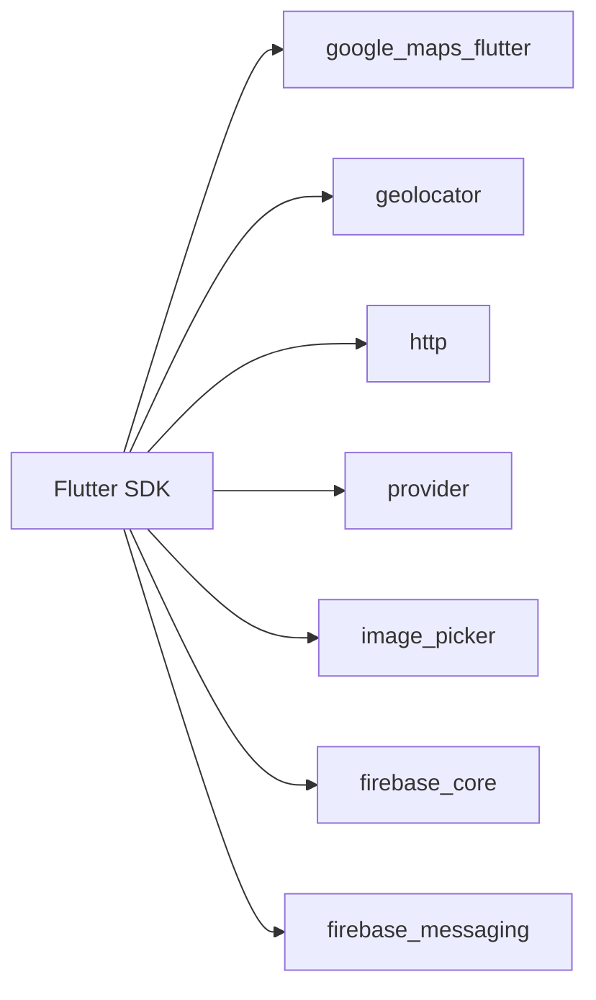

# Frontend Architecture

<cite>
**Referenced Files in This Document**
- [main.dart](file://frontend/lib/main.dart)
- [location_selection_screen.dart](file://frontend/lib/screens/location_selection_screen.dart)
- [api_service.dart](file://frontend/lib/services/api_service.dart)
- [location_service.dart](file://frontend/lib/services/location_service.dart)
- [app_colors.dart](file://frontend/lib/theme/app_colors.dart)
- [kiosk.dart](file://frontend/lib/models/kiosk.dart)
- [order_location.dart](file://frontend/lib/models/order_location.dart)
- [reference_point.dart](file://frontend/lib/models/reference_point.dart)
- [pubspec.yaml](file://frontend/pubspec.yaml)
</cite>

## Table of Contents
1. [Introduction](#introduction)
2. [Project Structure](#project-structure)
3. [Core Components](#core-components)
4. [Architecture Overview](#architecture-overview)
5. [Detailed Component Analysis](#detailed-component-analysis)
6. [Dependency Analysis](#dependency-analysis)
7. [Performance Considerations](#performance-considerations)
8. [Troubleshooting Guide](#troubleshooting-guide)
9. [Conclusion](#conclusion)

## Introduction
This document describes the architecture of the Pé na Areia Flutter frontend application. It explains the project structure, UI composition, state handling, and integration with Google Maps for interactive location selection. It also covers geolocation services, API communication patterns, theming, responsive design considerations, platform-specific configurations, navigation flow, data binding strategies, and mobile-specific concerns such as permissions and offline behavior.

The app currently centers around a Location Selection Screen that lets users drag a pin on a map, choose the nearest reference point, add a description (and optional photo), and confirm the selected delivery location to proceed to checkout.

## Project Structure
The Flutter project follows a feature-oriented layout under lib:
- main.dart: Application entry point, theme configuration, and initial route.
- screens/: UI screens; currently includes the core location selection screen.
- services/: External integrations (API client and geolocation).
- models/: Data models for domain entities and payloads.
- theme/: Shared color palette used across the UI.

**Diagram sources**
- [main.dart:10-33](file://frontend/lib/main.dart#L10-L33)
- [location_selection_screen.dart:16-125](file://frontend/lib/screens/location_selection_screen.dart#L16-L125)
- [api_service.dart:7-69](file://frontend/lib/services/api_service.dart#L7-L69)
- [location_service.dart:3-30](file://frontend/lib/services/location_service.dart#L3-L30)
- [order_location.dart:3-25](file://frontend/lib/models/order_location.dart#L3-L25)
- [reference_point.dart:1-31](file://frontend/lib/models/reference_point.dart#L1-L31)
- [kiosk.dart:1-47](file://frontend/lib/models/kiosk.dart#L1-L47)
- [app_colors.dart:4-13](file://frontend/lib/theme/app_colors.dart#L4-L13)

**Section sources**
- [main.dart:1-34](file://frontend/lib/main.dart#L1-L34)
- [pubspec.yaml:1-38](file://frontend/pubspec.yaml#L1-L38)

## Core Components
- Application shell and theme: The app initializes Material 3 theme using a custom color palette and sets the default home screen to the location selection flow.
- Location selection screen: A stateful widget orchestrating map interaction, reference point selection, user input, and confirmation.
- API service: HTTP client wrapping backend endpoints for reference points, kiosks, and order creation.
- Geolocation service: Encapsulates permission checks and current position retrieval.
- Models: Domain and payload types for ReferencePoint, Kiosk, MenuItem, and OrderLocation.

Key responsibilities:
- UI composition and user interactions are centralized in the location selection screen.
- Network calls and JSON parsing are isolated in the API service.
- Device capabilities (GPS) are abstracted by the location service.
- Data contracts are defined via strongly typed models.

**Section sources**
- [main.dart:10-33](file://frontend/lib/main.dart#L10-L33)
- [location_selection_screen.dart:16-125](file://frontend/lib/screens/location_selection_screen.dart#L16-L125)
- [api_service.dart:7-69](file://frontend/lib/services/api_service.dart#L7-L69)
- [location_service.dart:3-30](file://frontend/lib/services/location_service.dart#L3-L30)
- [reference_point.dart:1-31](file://frontend/lib/models/reference_point.dart#L1-L31)
- [kiosk.dart:1-47](file://frontend/lib/models/kiosk.dart#L1-L47)
- [order_location.dart:3-25](file://frontend/lib/models/order_location.dart#L3-L25)

## Architecture Overview
The app uses a simple layered architecture:
- Presentation layer: Screens compose UI widgets and manage local state.
- Service layer: API and geolocation services encapsulate external dependencies.
- Data layer: Models represent domain entities and request/response payloads.

**Diagram sources**
- [location_selection_screen.dart:16-125](file://frontend/lib/screens/location_selection_screen.dart#L16-L125)
- [api_service.dart:7-69](file://frontend/lib/services/api_service.dart#L7-L69)
- [location_service.dart:3-30](file://frontend/lib/services/location_service.dart#L3-L30)
- [reference_point.dart:1-31](file://frontend/lib/models/reference_point.dart#L1-L31)
- [kiosk.dart:1-47](file://frontend/lib/models/kiosk.dart#L1-L47)
- [order_location.dart:3-25](file://frontend/lib/models/order_location.dart#L3-L25)

## Detailed Component Analysis

### Application Shell and Theme
- Entry point configures MaterialApp with Material 3, seed colors, and a custom font family.
- Default home is set to the location selection screen for quick testing.
- Colors are centralized in AppColors to ensure consistent theming.

**Diagram sources**
- [main.dart:10-33](file://frontend/lib/main.dart#L10-L33)
- [app_colors.dart:4-13](file://frontend/lib/theme/app_colors.dart#L4-L13)

**Section sources**
- [main.dart:10-33](file://frontend/lib/main.dart#L10-L33)
- [app_colors.dart:4-13](file://frontend/lib/theme/app_colors.dart#L4-L13)

### Location Selection Screen
Responsibilities:
- Initialize current device location and show a loading indicator while fetching GPS.
- Render an interactive Google Map with a draggable customer pin and nearby reference point markers.
- Fetch nearby reference points based on the pin position and pre-select the closest one.
- Allow the user to select a reference point chip, type a description, and optionally pick a photo from the camera.
- Validate inputs and return an OrderLocation object to the previous screen.

State management approach:
- Uses StatefulWidget with setState for local UI state (pin position, reference points list, selected reference point, loading flags, errors).
- No global state provider is used at this stage; state is scoped to the screen.

Data binding:
- Maps coordinates to LatLng for the marker and camera target.
- Converts API responses into ReferencePoint objects.
- Builds OrderLocation for navigation back to the parent flow.

Error handling:
- Gracefully handles missing GPS or denied permissions by falling back to a default pin position and showing error messages.
- Displays network errors when fetching reference points.

**Diagram sources**
- [location_selection_screen.dart:41-125](file://frontend/lib/screens/location_selection_screen.dart#L41-L125)
- [location_service.dart:6-29](file://frontend/lib/services/location_service.dart#L6-L29)
- [api_service.dart:24-42](file://frontend/lib/services/api_service.dart#L24-L42)

**Section sources**
- [location_selection_screen.dart:16-324](file://frontend/lib/screens/location_selection_screen.dart#L16-L324)

### API Service
Responsibilities:
- Provide methods to fetch all reference points, fetch nearby reference points, fetch kiosks, and create orders.
- Parse JSON responses into model objects.
- Centralize base URL configuration and response validation.

Key behaviors:
- Base URL is configurable via build-time environment variable; defaults to a local development address suitable for Android emulators.
- Throws exceptions on non-success status codes with details.

**Diagram sources**
- [api_service.dart:7-69](file://frontend/lib/services/api_service.dart#L7-L69)
- [reference_point.dart:1-31](file://frontend/lib/models/reference_point.dart#L1-L31)
- [kiosk.dart:1-47](file://frontend/lib/models/kiosk.dart#L1-L47)

**Section sources**
- [api_service.dart:7-69](file://frontend/lib/services/api_service.dart#L7-L69)

### Geolocation Service
Responsibilities:
- Check if location services are enabled.
- Request runtime permissions if needed.
- Handle permanent denial and throw descriptive exceptions.
- Return high-accuracy current position.

**Diagram sources**
- [location_service.dart:6-29](file://frontend/lib/services/location_service.dart#L6-L29)

**Section sources**
- [location_service.dart:3-31](file://frontend/lib/services/location_service.dart#L3-L31)

### Models
- ReferencePoint: Represents a reference point returned by the backend, including GeoJSON coordinate parsing.
- Kiosk and MenuItem: Represent kiosk entities and their menu items, with JSON deserialization support.
- OrderLocation: Payload for confirmed delivery location, including optional photo URL.

**Diagram sources**
- [reference_point.dart:1-31](file://frontend/lib/models/reference_point.dart#L1-L31)
- [kiosk.dart:1-47](file://frontend/lib/models/kiosk.dart#L1-L47)
- [order_location.dart:3-25](file://frontend/lib/models/order_location.dart#L3-L25)

**Section sources**
- [reference_point.dart:1-32](file://frontend/lib/models/reference_point.dart#L1-L32)
- [kiosk.dart:1-48](file://frontend/lib/models/kiosk.dart#L1-L48)
- [order_location.dart:1-26](file://frontend/lib/models/order_location.dart#L1-L26)

## Dependency Analysis
External dependencies relevant to the frontend architecture:
- google_maps_flutter: Interactive map rendering and marker interactions.
- geolocator: Device geolocation and permission handling.
- http: HTTP client for API communication.
- provider: Available for future global state management (not used yet in the analyzed code).
- image_picker: Camera access for optional location photos.
- firebase_core and firebase_messaging: Push notification infrastructure (present but not wired in the current screens).

**Diagram sources**
- [pubspec.yaml:9-27](file://frontend/pubspec.yaml#L9-L27)

**Section sources**
- [pubspec.yaml:9-27](file://frontend/pubspec.yaml#L9-L27)

## Performance Considerations
- Map performance:
  - Avoid excessive marker updates; batch updates when the pin moves.
  - Use appropriate zoom levels to reduce tile load.
- Network efficiency:
  - Cache nearby reference points locally during a session to avoid repeated requests when dragging the pin.
  - Debounce API calls triggered by frequent pin drags.
- Image handling:
  - Compress images before upload to reduce bandwidth and storage costs.
- State updates:
  - Minimize setState scopes to only affected parts of the UI tree.

[No sources needed since this section provides general guidance]

## Troubleshooting Guide
Common issues and resolutions:
- GPS disabled:
  - Symptom: Exception indicating location services are off.
  - Resolution: Prompt the user to enable location services and retry.
- Permission denied:
  - Symptom: Exceptions for denied or permanently denied permissions.
  - Resolution: Request permission once; if permanently denied, guide the user to system settings.
- Network errors:
  - Symptom: Exceptions thrown by API service due to non-success status codes.
  - Resolution: Display user-friendly error messages and allow retry.
- Empty reference points:
  - Symptom: No reference points near the pin.
  - Resolution: Instruct the user to move the pin closer to the beachfront area.

**Section sources**
- [location_service.dart:6-29](file://frontend/lib/services/location_service.dart#L6-L29)
- [api_service.dart:61-67](file://frontend/lib/services/api_service.dart#L61-L67)
- [location_selection_screen.dart:52-82](file://frontend/lib/screens/location_selection_screen.dart#L52-L82)

## Conclusion
The Pé na Areia Flutter frontend implements a focused, screen-scoped state approach centered on the Location Selection Screen. It integrates Google Maps for interactive pin placement, uses a dedicated geolocation service for permissions and positioning, and communicates with the backend through a clear API service layer. Theming is centralized, and the project is structured for easy extension. Future enhancements can introduce global state with Provider, caching strategies, and push notifications via Firebase.

[No sources needed since this section summarizes without analyzing specific files]