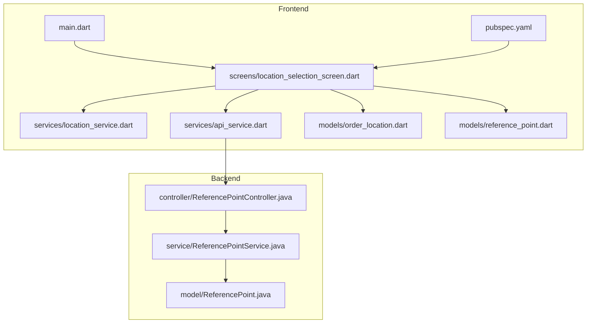
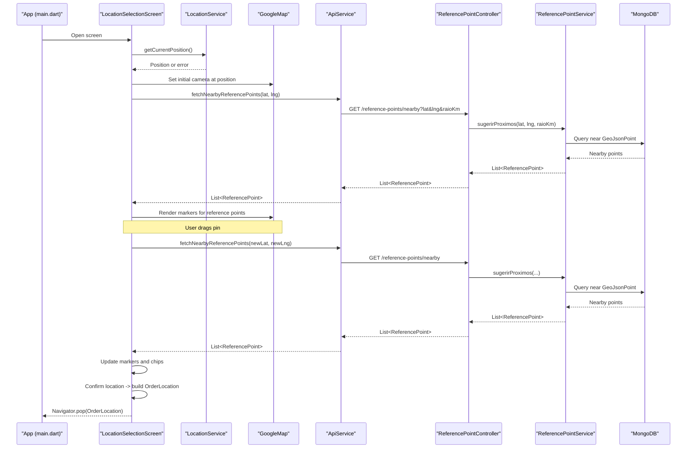
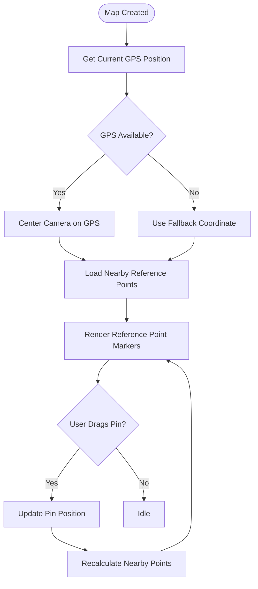
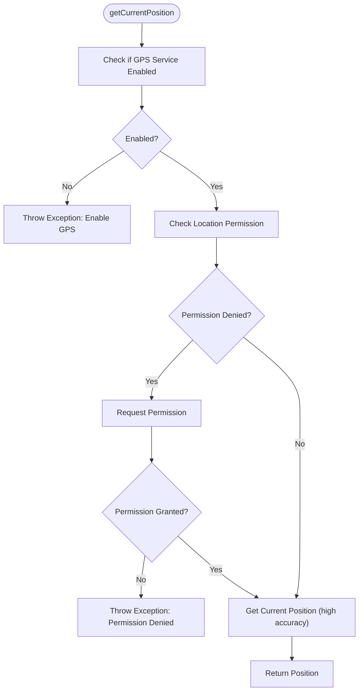
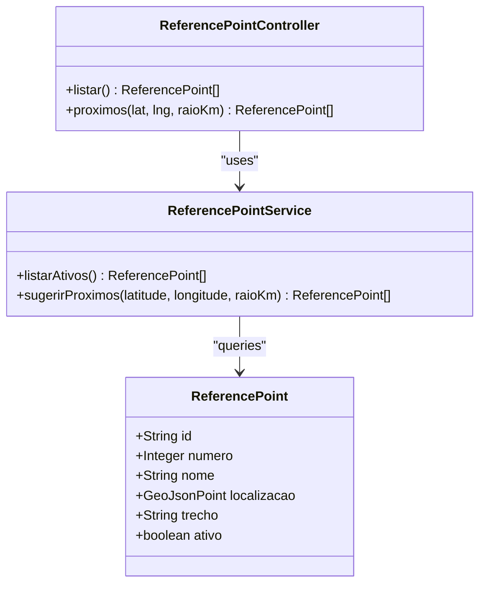
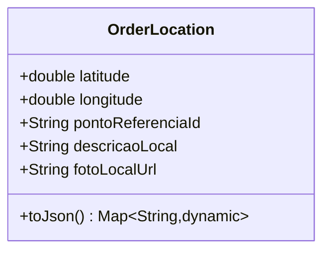
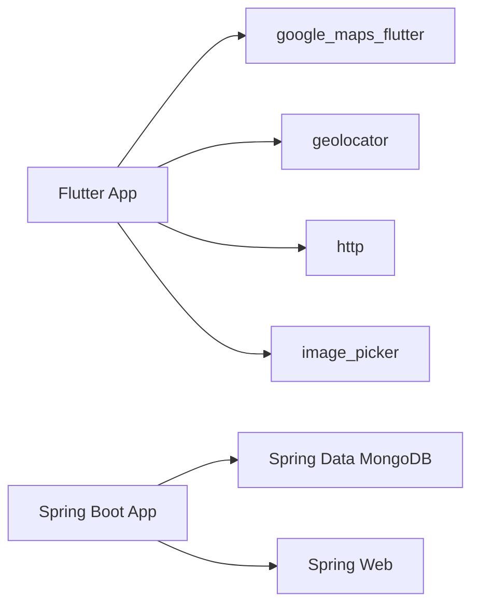

# Map Integration and Geolocation

<cite>
**Referenced Files in This Document**
- [main.dart](file://frontend/lib/main.dart)
- [location_selection_screen.dart](file://frontend/lib/screens/location_selection_screen.dart)
- [location_service.dart](file://frontend/lib/services/location_service.dart)
- [api_service.dart](file://frontend/lib/services/api_service.dart)
- [order_location.dart](file://frontend/lib/models/order_location.dart)
- [reference_point.dart](file://frontend/lib/models/reference_point.dart)
- [pubspec.yaml](file://frontend/pubspec.yaml)
- [ReferencePointController.java](file://backend/src/main/java/com/penaareia/controller/ReferencePointController.java)
- [ReferencePointService.java](file://backend/src/main/java/com/penaareia/service/ReferencePointService.java)
- [ReferencePoint.java](file://backend/src/main/java/com/penaareia/model/ReferencePoint.java)
</cite>

## Table of Contents
1. [Introduction](#introduction)
2. [Project Structure](#project-structure)
3. [Core Components](#core-components)
4. [Architecture Overview](#architecture-overview)
5. [Detailed Component Analysis](#detailed-component-analysis)
6. [Dependency Analysis](#dependency-analysis)
7. [Performance Considerations](#performance-considerations)
8. [Troubleshooting Guide](#troubleshooting-guide)
9. [Accessibility Considerations](#accessibility-considerations)
10. [Conclusion](#conclusion)

## Introduction
This document explains the Google Maps integration and geolocation services used to let users select a precise beach location by dragging a pin on an interactive map, choose the nearest official reference point (lifeguard post), and confirm their order location. It covers:
- Interactive map with draggable pins
- Geolocation permissions handling and GPS coordinate processing
- Real-time updates when the user drags the pin
- Integration with the backend reference points system and proximity search
- Troubleshooting common issues
- Performance optimization for large datasets
- Accessibility considerations for map interactions

## Project Structure
The feature spans both frontend (Flutter) and backend (Spring Boot + MongoDB). The key files are:
- Frontend entrypoint and UI screen for location selection
- Services for geolocation and API calls
- Models for order location and reference points
- Backend controller, service, and model for reference points with geospatial indexing

**Diagram sources**
- [main.dart:1-34](file://frontend/lib/main.dart#L1-L34)
- [location_selection_screen.dart:1-324](file://frontend/lib/screens/location_selection_screen.dart#L1-L324)
- [location_service.dart:1-31](file://frontend/lib/services/location_service.dart#L1-L31)
- [api_service.dart:1-69](file://frontend/lib/services/api_service.dart#L1-L69)
- [order_location.dart:1-26](file://frontend/lib/models/order_location.dart#L1-L26)
- [reference_point.dart:1-32](file://frontend/lib/models/reference_point.dart#L1-L32)
- [pubspec.yaml:1-38](file://frontend/pubspec.yaml#L1-L38)
- [ReferencePointController.java:1-35](file://backend/src/main/java/com/penaareia/controller/ReferencePointController.java#L1-L35)
- [ReferencePointService.java:1-39](file://backend/src/main/java/com/penaareia/service/ReferencePointService.java#L1-L39)
- [ReferencePoint.java:1-39](file://backend/src/main/java/com/penaareia/model/ReferencePoint.java#L1-L39)

**Section sources**
- [main.dart:1-34](file://frontend/lib/main.dart#L1-L34)
- [pubspec.yaml:1-38](file://frontend/pubspec.yaml#L1-L38)

## Core Components
- LocationSelectionScreen: Renders the interactive Google Map, manages the draggable pin, shows nearby reference points as markers, and provides a bottom sheet for selecting the nearest reference point and confirming the location.
- LocationService: Handles geolocation permissions, checks GPS availability, requests permission if needed, and returns the current device position.
- ApiService: Calls the backend endpoints to fetch nearby reference points based on latitude/longitude and radius.
- OrderLocation: Data model representing the selected location payload sent to the backend during order creation.
- ReferencePoint (frontend): Parses reference point JSON from the backend into a Dart object.
- ReferencePointController/Service/Model (backend): Expose endpoints and perform geospatial queries against MongoDB using GeoJSON points and 2dsphere indexes.

Key responsibilities:
- Permission and GPS handling: LocationService
- Map interaction and state: LocationSelectionScreen
- Proximity search: ApiService + ReferencePointController + ReferencePointService
- Payload modeling: OrderLocation

**Section sources**
- [location_selection_screen.dart:1-324](file://frontend/lib/screens/location_selection_screen.dart#L1-L324)
- [location_service.dart:1-31](file://frontend/lib/services/location_service.dart#L1-L31)
- [api_service.dart:1-69](file://frontend/lib/services/api_service.dart#L1-L69)
- [order_location.dart:1-26](file://frontend/lib/models/order_location.dart#L1-L26)
- [reference_point.dart:1-32](file://frontend/lib/models/reference_point.dart#L1-L32)
- [ReferencePointController.java:1-35](file://backend/src/main/java/com/penaareia/controller/ReferencePointController.java#L1-L35)
- [ReferencePointService.java:1-39](file://backend/src/main/java/com/penaareia/service/ReferencePointService.java#L1-L39)
- [ReferencePoint.java:1-39](file://backend/src/main/java/com/penaareia/model/ReferencePoint.java#L1-L39)

## Architecture Overview
The flow starts when the app launches and opens the location selection screen. The screen initializes the map, obtains the current GPS position, and loads nearby reference points. When the user drags the pin, the screen recalculates nearby reference points. On confirmation, it builds an OrderLocation and navigates back to continue checkout.

**Diagram sources**
- [location_selection_screen.dart:52-124](file://frontend/lib/screens/location_selection_screen.dart#L52-L124)
- [location_service.dart:6-28](file://frontend/lib/services/location_service.dart#L6-L28)
- [api_service.dart:24-42](file://frontend/lib/services/api_service.dart#L24-L42)
- [ReferencePointController.java:26-33](file://backend/src/main/java/com/penaareia/controller/ReferencePointController.java#L26-L33)
- [ReferencePointService.java:29-37](file://backend/src/main/java/com/penaareia/service/ReferencePointService.java#L29-L37)

## Detailed Component Analysis

### Interactive Map and Draggable Pin
- The screen renders a GoogleMap with a draggable marker representing the user’s chosen location.
- Initial camera is centered on the current GPS position; if GPS is unavailable, a fallback coordinate is used.
- Dragging the pin triggers recalculation of nearby reference points to keep suggestions relevant.
- Nearby reference points are rendered as non-draggable markers with info windows.

**Diagram sources**
- [location_selection_screen.dart:52-87](file://frontend/lib/screens/location_selection_screen.dart#L52-L87)
- [location_selection_screen.dart:142-194](file://frontend/lib/screens/location_selection_screen.dart#L142-L194)

**Section sources**
- [location_selection_screen.dart:142-194](file://frontend/lib/screens/location_selection_screen.dart#L142-L194)

### Geolocation Permissions and GPS Processing
- Before reading the device position, the service checks whether location services are enabled.
- It checks and requests location permission if denied, and handles permanent denial.
- If successful, it returns a high-accuracy position; otherwise, it throws descriptive exceptions.

**Diagram sources**
- [location_service.dart:6-28](file://frontend/lib/services/location_service.dart#L6-L28)

**Section sources**
- [location_service.dart:1-31](file://frontend/lib/services/location_service.dart#L1-L31)

### Reference Points System and Proximity Search
- The frontend calls the backend endpoint with lat/lng and a default radius (in kilometers).
- The backend constructs a GeoJsonPoint and uses Spring Data MongoDB to query nearby reference points using a 2dsphere index.
- Results are returned sorted by distance and mapped to the frontend model.

**Diagram sources**
- [ReferencePoint.java:1-39](file://backend/src/main/java/com/penaareia/model/ReferencePoint.java#L1-L39)
- [ReferencePointController.java:1-35](file://backend/src/main/java/com/penaareia/controller/ReferencePointController.java#L1-L35)
- [ReferencePointService.java:1-39](file://backend/src/main/java/com/penaareia/service/ReferencePointService.java#L1-L39)

**Section sources**
- [ReferencePointController.java:20-33](file://backend/src/main/java/com/penaareia/controller/ReferencePointController.java#L20-L33)
- [ReferencePointService.java:21-37](file://backend/src/main/java/com/penaareia/service/ReferencePointService.java#L21-L37)
- [ReferencePoint.java:19-37](file://backend/src/main/java/com/penaareia/model/ReferencePoint.java#L19-L37)

### Order Location Payload
- After confirming the location, the screen builds an OrderLocation containing coordinates, the selected reference point ID, description, and optional photo URL placeholder.
- This model is intended to be serialized and sent to the backend during order creation.

**Diagram sources**
- [order_location.dart:1-26](file://frontend/lib/models/order_location.dart#L1-L26)

**Section sources**
- [order_location.dart:1-26](file://frontend/lib/models/order_location.dart#L1-L26)

## Dependency Analysis
- Frontend dependencies:
  - google_maps_flutter for rendering maps and markers
  - geolocator for device location access
  - http for HTTP requests
  - provider for state management (available but not used in this feature)
  - image_picker for optional photo capture
- Backend dependencies:
  - Spring Web for REST endpoints
  - Spring Data MongoDB for geospatial queries
  - Lombok for boilerplate reduction

**Diagram sources**
- [pubspec.yaml:9-27](file://frontend/pubspec.yaml#L9-L27)

**Section sources**
- [pubspec.yaml:9-27](file://frontend/pubspec.yaml#L9-L27)

## Performance Considerations
- Debounce pin drag events: Throttle calls to fetch nearby reference points while the user drags the pin to avoid excessive network requests.
- Cache reference points: Cache the list of reference points locally and only refresh when necessary (e.g., on app start or explicit refresh).
- Optimize map markers: Limit the number of visible markers by clustering or filtering beyond a larger radius when zoomed out.
- Reduce payload size: Ensure the backend returns only required fields for reference points.
- Use appropriate accuracy: For general use, consider medium accuracy to reduce battery drain; reserve high accuracy for critical steps.
- Network resilience: Implement retry logic and timeouts for API calls.

[No sources needed since this section provides general guidance]

## Troubleshooting Guide
Common issues and resolutions:
- GPS disabled:
  - Symptom: Error indicating GPS must be enabled.
  - Resolution: Prompt the user to enable location services and retry.
- Location permission denied:
  - Symptom: Error indicating permission denied.
  - Resolution: Request permission again; if permanently denied, guide the user to app settings.
- No nearby reference points:
  - Symptom: Empty list of reference points around the pin.
  - Resolution: Instruct the user to move the pin closer to populated areas (e.g., beachfront) or increase the radius parameter.
- API connectivity errors:
  - Symptom: HTTP status code mismatch or network failure.
  - Resolution: Verify backend URL configuration (especially emulator localhost mapping), ensure backend is running, and check CORS/network policies.
- Marker not updating after drag:
  - Symptom: Pin moves but nearby points do not refresh.
  - Resolution: Ensure drag end handler triggers recalculation and that setState is called to rebuild UI.

**Section sources**
- [location_service.dart:6-28](file://frontend/lib/services/location_service.dart#L6-L28)
- [api_service.dart:61-67](file://frontend/lib/services/api_service.dart#L61-L67)
- [location_selection_screen.dart:52-87](file://frontend/lib/screens/location_selection_screen.dart#L52-L87)

## Accessibility Considerations
- Provide clear instructions: Include accessible text explaining how to drag the pin and select a reference point.
- Keyboard and screen reader support: Ensure buttons and chips have proper labels and roles; expose descriptions via accessibility semantics.
- High contrast and readable text: Maintain sufficient color contrast for labels and hints.
- Focus management: Ensure focus moves logically between map controls and form fields.
- Alternative inputs: Offer manual coordinate entry or address search as alternatives to map interaction for users who cannot interact with the map.

[No sources needed since this section provides general guidance]

## Conclusion
The feature combines an interactive Google Map with robust geolocation handling and a backend-powered proximity search to help users precisely select their beach location and associate it with the nearest official reference point. By following the troubleshooting tips, performance recommendations, and accessibility guidelines, the experience can be reliable, efficient, and inclusive across devices and user needs.

[No sources needed since this section summarizes without analyzing specific files]