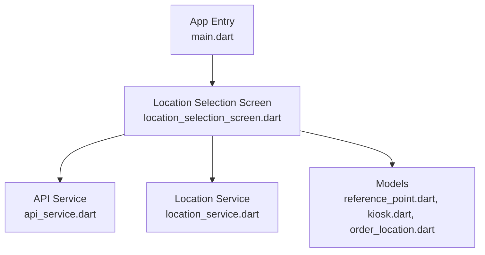
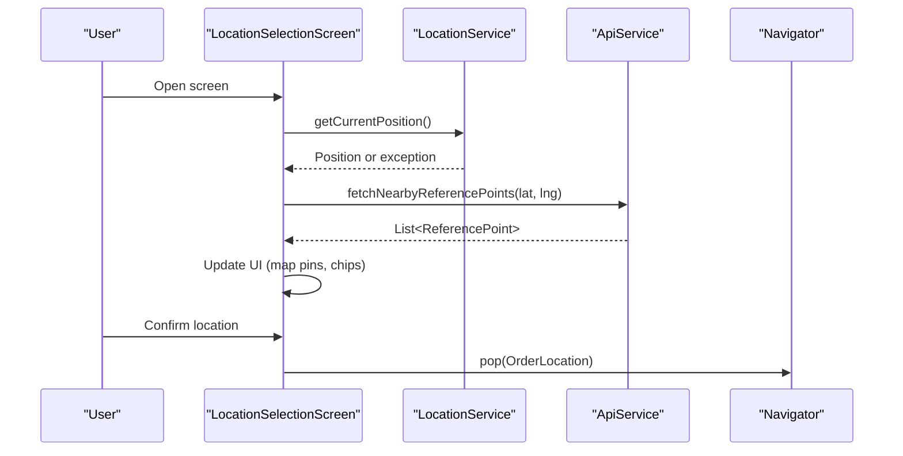
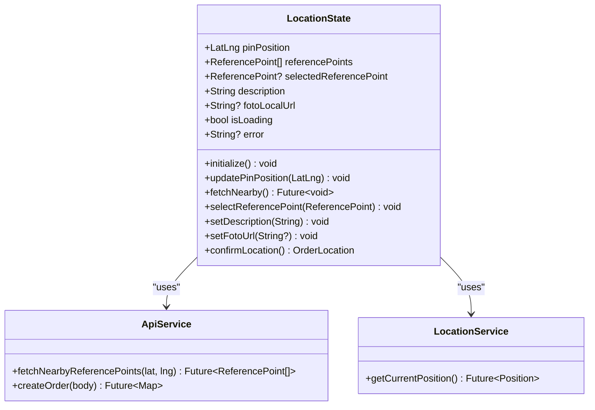
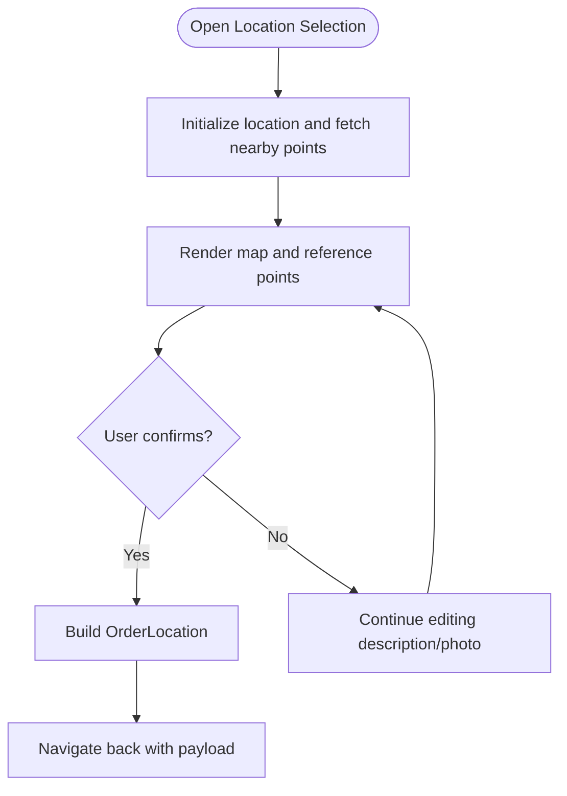
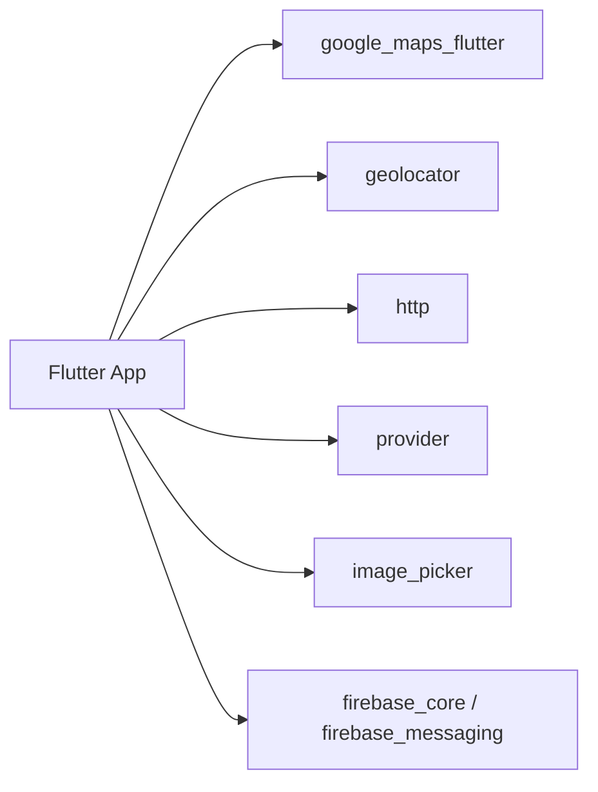

# State Management with Provider

<cite>
**Referenced Files in This Document**
- [main.dart](file://frontend/lib/main.dart)
- [location_selection_screen.dart](file://frontend/lib/screens/location_selection_screen.dart)
- [api_service.dart](file://frontend/lib/services/api_service.dart)
- [location_service.dart](file://frontend/lib/services/location_service.dart)
- [kiosk.dart](file://frontend/lib/models/kiosk.dart)
- [order_location.dart](file://frontend/lib/models/order_location.dart)
- [reference_point.dart](file://frontend/lib/models/reference_point.dart)
- [pubspec.yaml](file://frontend/pubspec.yaml)
</cite>

## Table of Contents
1. [Introduction](#introduction)
2. [Project Structure](#project-structure)
3. [Core Components](#core-components)
4. [Architecture Overview](#architecture-overview)
5. [Detailed Component Analysis](#detailed-component-analysis)
6. [Dependency Analysis](#dependency-analysis)
7. [Performance Considerations](#performance-considerations)
8. [Troubleshooting Guide](#troubleshooting-guide)
9. [Conclusion](#conclusion)
10. [Appendices](#appendices)

## Introduction
This document explains how to implement Provider-based state management in the Flutter frontend for the Pé na Areia MVP. It covers:
- The Provider pattern for managing application state and reactive UI updates
- Data flow between screens using a provider
- Service layer architecture, including an API service for backend communication and a location service for geolocation
- Examples of state providers, consumer widgets, and error handling patterns
- Performance considerations and best practices for scalable state management

The current codebase uses local widget state in the location selection screen. We will show how to refactor it to use Provider while preserving existing behavior and improving testability and scalability.

## Project Structure
The Flutter frontend is organized into models, services, screens, and theme folders. The app entry point initializes the Material app and navigates directly to the location selection screen for testing.

**Diagram sources**
- [main.dart:6-31](file://frontend/lib/main.dart#L6-L31)
- [location_selection_screen.dart:16-140](file://frontend/lib/screens/location_selection_screen.dart#L16-L140)
- [api_service.dart:7-69](file://frontend/lib/services/api_service.dart#L7-L69)
- [location_service.dart:3-31](file://frontend/lib/services/location_service.dart#L3-L31)
- [reference_point.dart:1-32](file://frontend/lib/models/reference_point.dart#L1-L32)
- [kiosk.dart:1-48](file://frontend/lib/models/kiosk.dart#L1-L48)
- [order_location.dart:1-26](file://frontend/lib/models/order_location.dart#L1-L26)

**Section sources**
- [main.dart:6-31](file://frontend/lib/main.dart#L6-L31)
- [pubspec.yaml:9-27](file://frontend/pubspec.yaml#L9-L27)

## Core Components
- Models:
  - ReferencePoint: represents a reference point on the beach with coordinates and metadata.
  - Kiosk and MenuItem: represent kiosks and their menu items.
  - OrderLocation: represents the selected delivery location payload sent to the backend.
- Services:
  - ApiService: HTTP client wrapper for backend endpoints (reference points, kiosks, orders).
  - LocationService: handles device geolocation permissions and position retrieval.
- Screens:
  - LocationSelectionScreen: interactive map and sheet where users select a pin, choose a nearby reference point, add a description and optional photo, then confirm the location.

Key responsibilities:
- Services encapsulate external concerns (networking, geolocation).
- Models define data contracts.
- Screens orchestrate user interactions and display results.

**Section sources**
- [reference_point.dart:1-32](file://frontend/lib/models/reference_point.dart#L1-L32)
- [kiosk.dart:1-48](file://frontend/lib/models/kiosk.dart#L1-L48)
- [order_location.dart:1-26](file://frontend/lib/models/order_location.dart#L1-L26)
- [api_service.dart:7-69](file://frontend/lib/services/api_service.dart#L7-L69)
- [location_service.dart:3-31](file://frontend/lib/services/location_service.dart#L3-L31)
- [location_selection_screen.dart:16-140](file://frontend/lib/screens/location_selection_screen.dart#L16-L140)

## Architecture Overview
The current flow is synchronous within the screen’s state:
- On init, get current device position via LocationService.
- Fetch nearby reference points via ApiService.
- Render Google Map markers and chips for reference points.
- On confirmation, build OrderLocation and navigate back with the result.

We will introduce a Provider that owns this state so multiple widgets can reactively consume it without passing parameters through constructors.

**Diagram sources**
- [location_selection_screen.dart:52-87](file://frontend/lib/screens/location_selection_screen.dart#L52-L87)
- [location_selection_screen.dart:106-125](file://frontend/lib/screens/location_selection_screen.dart#L106-L125)
- [api_service.dart:24-42](file://frontend/lib/services/api_service.dart#L24-L42)
- [location_service.dart:6-29](file://frontend/lib/services/location_service.dart#L6-L29)

## Detailed Component Analysis

### Current Screen-Level State
The location selection screen currently holds all state locally:
- Pin position
- Nearby reference points list
- Selected reference point
- Description text
- Optional photo file
- Loading and confirmation flags
- Error message

This approach works for a single screen but does not scale well when other screens need access to the selected location or when you want to share state across the app.

**Section sources**
- [location_selection_screen.dart:24-39](file://frontend/lib/screens/location_selection_screen.dart#L24-L39)
- [location_selection_screen.dart:52-87](file://frontend/lib/screens/location_selection_screen.dart#L52-L87)
- [location_selection_screen.dart:106-125](file://frontend/lib/screens/location_selection_screen.dart#L106-L125)

### Provider-Based State Refactor Plan
Introduce a ChangeNotifier-based provider to centralize:
- Current pin position
- Nearby reference points
- Selected reference point
- Description text
- Optional photo URL
- Loading and error states
- Methods to update state and perform actions (fetch, confirm)

Provider usage pattern:
- Provide at the top of the app tree using MultiProvider or Provider scope around relevant routes.
- Consume in the screen via context.read or context.watch depending on whether you need to rebuild on changes.
- Keep business logic in the provider; keep UI minimal in the screen.

Recommended provider structure:
- LocationState extends ChangeNotifier
  - Fields: pinPosition, referencePoints, selectedReferencePoint, description, fotoLocalUrl, isLoading, error
  - Methods: initialize(), updatePinPosition(), fetchNearby(), selectReferencePoint(), setDescription(), setFotoUrl(), confirmLocation() returning OrderLocation

Consumer widgets:
- Map widget consumes pinPosition and referencePoints to render markers.
- Sheet widget consumes selectedReferencePoint and description to enable/disable confirmation.
- Confirmation button triggers provider.confirmLocation().

Error handling:
- Catch exceptions from LocationService and ApiService inside provider methods.
- Set error state and notify listeners to update UI.
- Provide user-friendly messages.

Reactive updates:
- Use context.watch in widgets that must rebuild when state changes (e.g., map markers, chip selection).
- Use context.read for actions that do not require immediate rebuilds (e.g., calling confirmLocation()).

Best practices:
- Avoid heavy computations in build methods; move them to the provider.
- Debounce rapid pin drags if needed to reduce network calls.
- Cache reference points per location to avoid redundant requests.
- Separate UI state from domain models.

Note: The following diagrams illustrate the intended Provider-based design. They are conceptual and not tied to specific source files yet.

[No diagram sources since this diagram shows conceptual Provider design, not actual code structure]

### Service Layer Architecture

#### API Service
Responsibilities:
- Define base URL and environment configuration.
- Expose typed methods for backend endpoints:
  - Fetch all reference points
  - Fetch nearby reference points by coordinates
  - Fetch kiosks
  - Create orders
- Validate HTTP responses and throw exceptions on errors.

Error handling:
- Centralized response validation throws exceptions with status codes and bodies.
- Callers should catch and convert to user-facing messages.

Integration points:
- Used by screens or providers to fetch data and submit orders.

**Section sources**
- [api_service.dart:7-69](file://frontend/lib/services/api_service.dart#L7-L69)

#### Location Service
Responsibilities:
- Check and request geolocation permissions.
- Retrieve current device position with high accuracy.
- Throw descriptive exceptions for denied or disabled GPS.

Error handling:
- Exceptions indicate permission issues or disabled GPS.
- Consumers should handle these cases gracefully.

**Section sources**
- [location_service.dart:3-31](file://frontend/lib/services/location_service.dart#L3-L31)

### Data Flow Between Screens
Current flow:
- LocationSelectionScreen constructs OrderLocation and returns it via Navigator.pop.
- The parent route receives the OrderLocation and proceeds to checkout.

Provider-enhanced flow:
- LocationState exposes confirmLocation() which builds and returns OrderLocation.
- Consumer widgets call provider.confirmLocation() and navigate accordingly.
- Other screens can read selectedReferencePoint and description from the provider if needed.

**Diagram sources**
- [location_selection_screen.dart:52-87](file://frontend/lib/screens/location_selection_screen.dart#L52-L87)
- [location_selection_screen.dart:106-125](file://frontend/lib/screens/location_selection_screen.dart#L106-L125)
- [order_location.dart:1-26](file://frontend/lib/models/order_location.dart#L1-L26)

### Example Patterns

#### State Provider Pattern
- Create a ChangeNotifier subclass to hold state and methods.
- Wrap the app or route with Provider/MultiProvider.
- Consume via context.watch for reactive UI and context.read for actions.

Benefits:
- Single source of truth for state.
- Decoupled UI from business logic.
- Easier testing and mocking of services.

#### Consumer Widget Pattern
- Use context.watch to rebuild only when relevant state changes.
- Use context.read to invoke methods without rebuilding unnecessarily.

#### Error Handling Pattern
- Catch exceptions from services in provider methods.
- Set error state and notify listeners.
- Display user-friendly messages in the UI.

[No sources needed since this section provides general guidance]

## Dependency Analysis
The app depends on:
- flutter: core framework
- google_maps_flutter: map rendering
- geolocator: device geolocation
- http: HTTP client
- provider: state management
- image_picker: optional photo capture
- firebase_core and firebase_messaging: push notifications

These dependencies are declared in pubspec.yaml.

**Diagram sources**
- [pubspec.yaml:9-27](file://frontend/pubspec.yaml#L9-L27)

**Section sources**
- [pubspec.yaml:9-27](file://frontend/pubspec.yaml#L9-L27)

## Performance Considerations
- Minimize rebuilds:
  - Use context.read for actions that do not require UI rebuilds.
  - Split widgets into smaller components and use context.watch only where necessary.
- Debounce rapid updates:
  - When dragging the map pin frequently, debounce calls to fetch nearby reference points to avoid excessive network requests.
- Cache data:
  - Cache reference points per coordinate range to prevent redundant API calls.
- Optimize map rendering:
  - Limit the number of markers; consider clustering if many reference points exist.
- Network efficiency:
  - Use appropriate raioKm to balance accuracy and performance.
- Memory management:
  - Dispose controllers and resources properly.
- Asynchronous operations:
  - Show loading indicators during initialization and network calls.
  - Handle cancellation or stale state when navigating away quickly.

[No sources needed since this section provides general guidance]

## Troubleshooting Guide
Common issues and resolutions:
- Geolocation permission denied:
  - Ensure the device has GPS enabled and the app has granted location permissions.
  - Handle exceptions from LocationService and prompt the user to enable permissions.
- No nearby reference points:
  - Adjust the radius parameter or instruct the user to move closer to the shoreline.
  - Verify backend endpoint availability and correct coordinates.
- API errors:
  - Check baseUrl configuration for emulator vs. physical device.
  - Inspect HTTP status codes and error bodies thrown by ApiService.
- Navigation issues:
  - Ensure the screen is mounted before calling Navigator.pop.
  - Validate required fields before confirming location.

**Section sources**
- [location_selection_screen.dart:52-87](file://frontend/lib/screens/location_selection_screen.dart#L52-L87)
- [location_selection_screen.dart:106-125](file://frontend/lib/screens/location_selection_screen.dart#L106-L125)
- [api_service.dart:61-67](file://frontend/lib/services/api_service.dart#L61-L67)
- [location_service.dart:6-29](file://frontend/lib/services/location_service.dart#L6-L29)

## Conclusion
Refactoring the location selection feature to use Provider will centralize state, improve reactivity, and make the codebase more maintainable. The service layer already separates networking and geolocation concerns, making it straightforward to integrate with a provider. By following the patterns outlined here—ChangeNotifier-based state, consumer widgets, robust error handling, and performance optimizations—you can scale the app confidently while keeping UI logic clean and testable.

[No sources needed since this section summarizes without analyzing specific files]

## Appendices

### Key Files Summary
- App entry and theme setup: [main.dart](file://frontend/lib/main.dart)
- Location selection UI and flow: [location_selection_screen.dart](file://frontend/lib/screens/location_selection_screen.dart)
- API client for backend communication: [api_service.dart](file://frontend/lib/services/api_service.dart)
- Geolocation helper: [location_service.dart](file://frontend/lib/services/location_service.dart)
- Domain models:
  - [reference_point.dart](file://frontend/lib/models/reference_point.dart)
  - [kiosk.dart](file://frontend/lib/models/kiosk.dart)
  - [order_location.dart](file://frontend/lib/models/order_location.dart)
- Dependencies declaration: [pubspec.yaml](file://frontend/pubspec.yaml)

**Section sources**
- [main.dart:6-31](file://frontend/lib/main.dart#L6-L31)
- [location_selection_screen.dart:16-140](file://frontend/lib/screens/location_selection_screen.dart#L16-L140)
- [api_service.dart:7-69](file://frontend/lib/services/api_service.dart#L7-L69)
- [location_service.dart:3-31](file://frontend/lib/services/location_service.dart#L3-L31)
- [reference_point.dart:1-32](file://frontend/lib/models/reference_point.dart#L1-L32)
- [kiosk.dart:1-48](file://frontend/lib/models/kiosk.dart#L1-L48)
- [order_location.dart:1-26](file://frontend/lib/models/order_location.dart#L1-L26)
- [pubspec.yaml:9-27](file://frontend/pubspec.yaml#L9-L27)