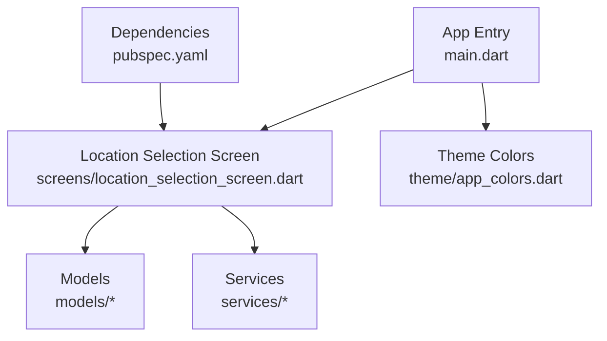
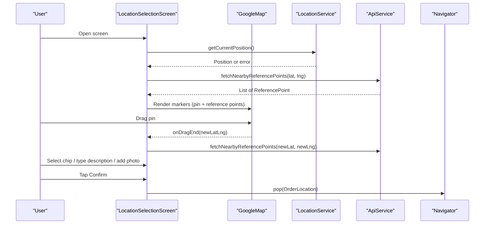
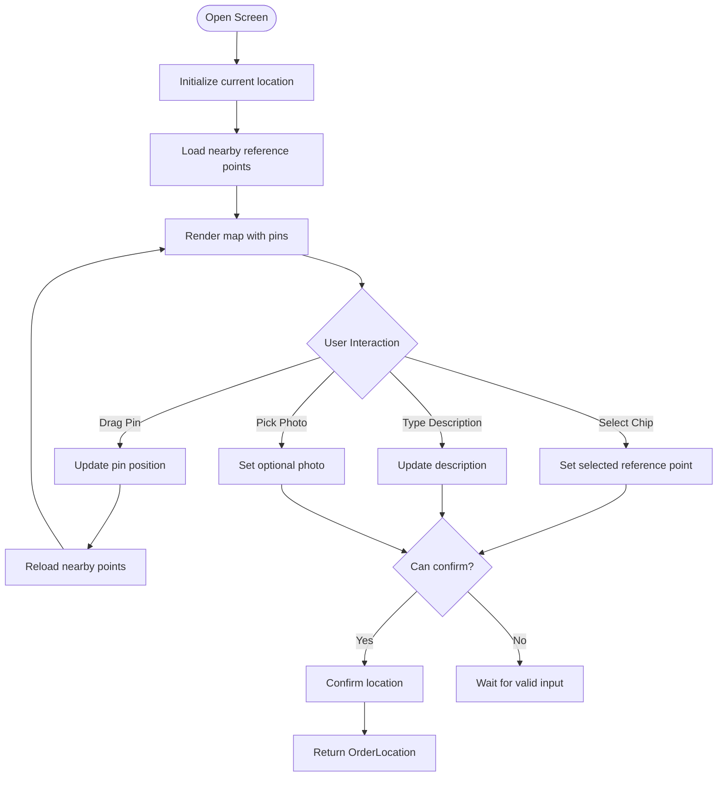
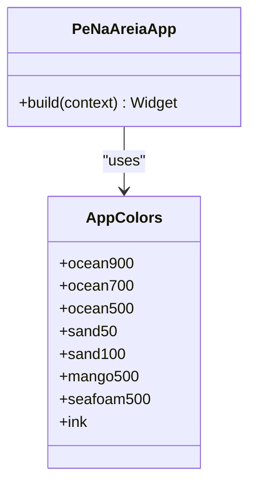
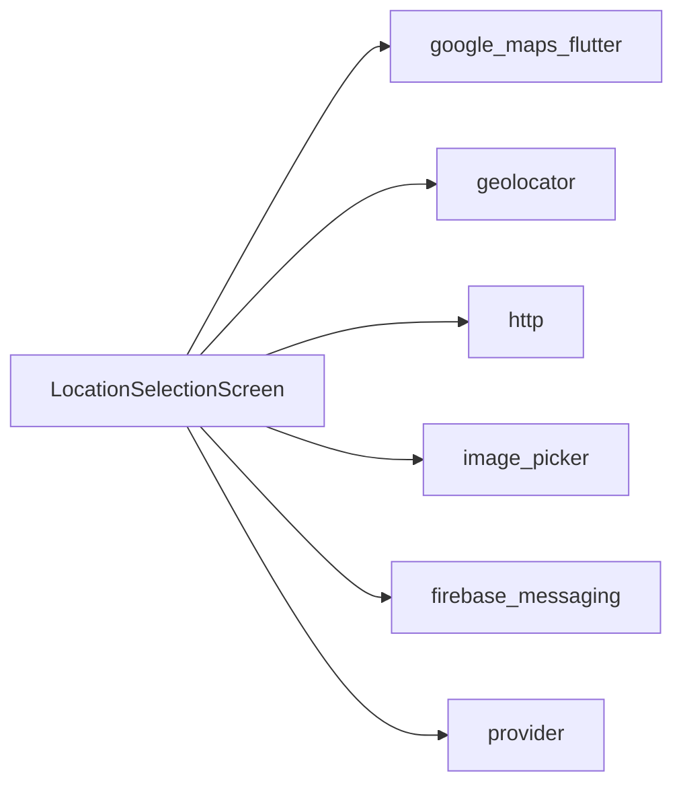

# UI Components and Screens

<cite>
**Referenced Files in This Document**
- [main.dart](file://frontend/lib/main.dart)
- [location_selection_screen.dart](file://frontend/lib/screens/location_selection_screen.dart)
- [app_colors.dart](file://frontend/lib/theme/app_colors.dart)
- [pubspec.yaml](file://frontend/pubspec.yaml)
</cite>

## Table of Contents
1. [Introduction](#introduction)
2. [Project Structure](#project-structure)
3. [Core Components](#core-components)
4. [Architecture Overview](#architecture-overview)
5. [Detailed Component Analysis](#detailed-component-analysis)
6. [Dependency Analysis](#dependency-analysis)
7. [Performance Considerations](#performance-considerations)
8. [Troubleshooting Guide](#troubleshooting-guide)
9. [Conclusion](#conclusion)
10. [Appendices](#appendices)

## Introduction
This document explains the UI components and screen architecture with a focus on the Location Selection Screen, which is the primary user interface for selecting a delivery location on the map. It covers layout structure, user interactions, state management, theme system (colors, typography, design tokens), component composition patterns, reusable widgets, responsive considerations, and guidelines for creating new screens while maintaining consistent UI patterns.

## Project Structure
The Flutter frontend organizes code into logical folders:
- lib/main.dart: Application entry point, global theme configuration, and initial route.
- lib/screens: Feature screens; currently includes the Location Selection Screen.
- lib/theme: Design tokens such as color palette.
- lib/models: Data models used across the app.
- lib/services: External integrations (API, geolocation).
- pubspec.yaml: Dependencies including Google Maps, geolocation, HTTP, provider, image picker, and Firebase messaging.

**Diagram sources**
- [main.dart:10-31](file://frontend/lib/main.dart#L10-L31)
- [location_selection_screen.dart:1-12](file://frontend/lib/screens/location_selection_screen.dart#L1-L12)
- [app_colors.dart:1-14](file://frontend/lib/theme/app_colors.dart#L1-L14)
- [pubspec.yaml:9-27](file://frontend/pubspec.yaml#L9-L27)

**Section sources**
- [main.dart:10-31](file://frontend/lib/main.dart#L10-L31)
- [pubspec.yaml:9-27](file://frontend/pubspec.yaml#L9-L27)

## Core Components
- App Shell and Theme: The application uses Material 3 with a custom seed color and brand colors to define the color scheme and background. Typography defaults to Roboto.
- Location Selection Screen: A StatefulWidget that manages map interaction, nearby reference points, selected reference point, optional photo capture, description input, and confirmation flow.

Key responsibilities:
- Initialize current device location and fallback behavior.
- Fetch nearby reference points from the API based on the pin position.
- Allow dragging the map pin to refine the exact location.
- Present selectable chips for nearby reference points.
- Capture an optional photo using the camera.
- Validate inputs and confirm the selection, returning an OrderLocation object to the previous screen.

**Section sources**
- [main.dart:14-31](file://frontend/lib/main.dart#L14-L31)
- [location_selection_screen.dart:16-140](file://frontend/lib/screens/location_selection_screen.dart#L16-L140)

## Architecture Overview
The UI architecture follows a simple, layered approach:
- Presentation layer: Widgets and screens (e.g., LocationSelectionScreen).
- State layer: Local state within the screen’s State class.
- Service layer: ApiService and LocationService encapsulate external concerns.
- Models: Plain data structures representing domain entities.

**Diagram sources**
- [location_selection_screen.dart:52-87](file://frontend/lib/screens/location_selection_screen.dart#L52-L87)
- [location_selection_screen.dart:142-194](file://frontend/lib/screens/location_selection_screen.dart#L142-L194)
- [location_selection_screen.dart:291-322](file://frontend/lib/screens/location_selection_screen.dart#L291-L322)
- [location_selection_screen.dart:106-125](file://frontend/lib/screens/location_selection_screen.dart#L106-L125)

## Detailed Component Analysis

### Location Selection Screen
Layout and sections:
- Top half: Interactive Google Map with draggable customer pin and nearby reference point markers. An overlay provides guidance text.
- Bottom half: A rounded sheet containing:
  - Title and subtitle explaining the task.
  - Chips for selecting the nearest reference point.
  - Description input field with character limit.
  - Optional photo capture button.
  - Error message display when location or reference points fail to load.
  - Primary “Confirm location” button with loading indicator during submission.

State variables:
- Map controller and current pin position.
- Nearby reference points list and selected reference point.
- Optional local photo file.
- Loading flags and error messages.

User interactions:
- Draggable pin updates position and refreshes nearby reference points.
- Chip selection toggles the chosen reference point.
- Text input updates validation state.
- Camera action picks an image and updates UI state.
- Confirmation validates required fields and navigates back with an OrderLocation payload.

Validation and confirmation logic:
- A boolean getter ensures a reference point is selected, description is non-empty, and no confirmation is in progress.
- On confirmation, it constructs an OrderLocation and returns it via Navigator.pop.

**Diagram sources**
- [location_selection_screen.dart:52-87](file://frontend/lib/screens/location_selection_screen.dart#L52-L87)
- [location_selection_screen.dart:101-125](file://frontend/lib/screens/location_selection_screen.dart#L101-L125)
- [location_selection_screen.dart:142-194](file://frontend/lib/screens/location_selection_screen.dart#L142-L194)
- [location_selection_screen.dart:196-289](file://frontend/lib/screens/location_selection_screen.dart#L196-L289)
- [location_selection_screen.dart:291-322](file://frontend/lib/screens/location_selection_screen.dart#L291-L322)

**Section sources**
- [location_selection_screen.dart:16-140](file://frontend/lib/screens/location_selection_screen.dart#L16-L140)
- [location_selection_screen.dart:142-322](file://frontend/lib/screens/location_selection_screen.dart#L142-L322)

### Theme System
Color palette and usage:
- Ocean tones: Deep ocean for headings and selected states; medium ocean for accents and borders.
- Sand tones: Light sand for backgrounds and subtle surfaces.
- Mango: Accent color for primary actions.
- Seafoam and ink: Additional semantic tokens for future use.

Typography:
- Font family set to Roboto at the app level.
- Consistent font weights and sizes are applied across labels, hints, and buttons.

Design tokens:
- Centralized color constants ensure consistency across screens and components.
- ColorScheme.fromSeed integrates brand colors into Material 3 theming.

**Diagram sources**
- [app_colors.dart:1-14](file://frontend/lib/theme/app_colors.dart#L1-L14)
- [main.dart:14-31](file://frontend/lib/main.dart#L14-L31)

**Section sources**
- [app_colors.dart:1-14](file://frontend/lib/theme/app_colors.dart#L1-L14)
- [main.dart:14-31](file://frontend/lib/main.dart#L14-L31)

### Component Composition Patterns and Reusable Widgets
Patterns observed:
- Single-screen stateful widget with private helper methods for each UI section (_buildMapa, _buildFolhaDeSelecao, _buildChipsDePostos).
- Use of Material 3 components (Scaffold, ElevatedButton, ChoiceChip, TextField) with consistent styling via theme colors.
- Responsive layout achieved through Column with Expanded flex ratios to allocate space between map and bottom sheet.

Reusable elements:
- Chips for reference point selection with consistent shape, colors, and label styles.
- OutlinedButton for optional photo capture with dynamic label based on state.
- Error display using conditional rendering with a small red text snippet.

Responsive considerations:
- Flex-based split between map and bottom sheet adapts well to different screen heights.
- Rounded corners and padding provide comfortable touch targets and visual hierarchy.

Guidelines for new screens:
- Create a dedicated screen file under lib/screens.
- Follow the same pattern: StatefulWidget with focused responsibilities, helper methods per section, and clear state variables.
- Use AppColors for all colors and maintain consistent typography and spacing.
- Integrate services via constructor injection or instance creation inside the screen.
- Provide loading indicators and error feedback for async operations.
- Keep navigation payloads minimal and typed (e.g., return a model like OrderLocation).

**Section sources**
- [location_selection_screen.dart:127-322](file://frontend/lib/screens/location_selection_screen.dart#L127-L322)
- [app_colors.dart:1-14](file://frontend/lib/theme/app_colors.dart#L1-L14)

## Dependency Analysis
External dependencies relevant to the UI:
- google_maps_flutter: Renders the interactive map and markers.
- geolocator: Retrieves the device’s current location.
- http: Performs network requests to fetch reference points.
- image_picker: Captures photos from the camera.
- firebase_messaging: Push notifications capability (not directly used by the screen yet).
- provider: State management library available for future global state needs.

**Diagram sources**
- [location_selection_screen.dart:1-11](file://frontend/lib/screens/location_selection_screen.dart#L1-L11)
- [pubspec.yaml:9-27](file://frontend/pubspec.yaml#L9-L27)

**Section sources**
- [pubspec.yaml:9-27](file://frontend/pubspec.yaml#L9-L27)
- [location_selection_screen.dart:1-11](file://frontend/lib/screens/location_selection_screen.dart#L1-L11)

## Performance Considerations
- Map performance: Avoid excessive marker updates; batch updates when the pin moves and debounce rapid changes if needed.
- Image handling: Resize and compress images before upload to reduce memory and bandwidth usage.
- Network calls: Cache nearby reference points locally when possible to avoid repeated requests on minor pin movements.
- State updates: Minimize setState scope to only affected parts of the UI tree.
- Memory management: Dispose controllers and streams properly to prevent leaks.

[No sources needed since this section provides general guidance]

## Troubleshooting Guide
Common issues and resolutions:
- GPS unavailable: The screen falls back to a default pin position and allows manual dragging. Check permissions and device settings.
- No nearby reference points: Instruct users to move the pin closer to the shoreline or adjust search radius on the backend.
- API errors: Display friendly error messages and allow retry by repositioning the pin or refreshing the screen.
- Photo capture failures: Ensure camera permissions are granted and storage access is allowed.

Operational notes:
- The confirmation flow currently sets photo URL to null; integrate storage upload before finalizing the order.
- Validation prevents confirmation until a reference point is selected and description is provided.

**Section sources**
- [location_selection_screen.dart:52-87](file://frontend/lib/screens/location_selection_screen.dart#L52-L87)
- [location_selection_screen.dart:101-125](file://frontend/lib/screens/location_selection_screen.dart#L101-L125)
- [location_selection_screen.dart:253-256](file://frontend/lib/screens/location_selection_screen.dart#L253-L256)

## Conclusion
The Location Selection Screen provides a focused, intuitive experience for choosing a delivery location via an interactive map and contextual reference points. Its stateful design cleanly separates concerns, leverages Material 3 theming, and integrates essential services for location and networking. By following the established patterns and guidelines, new screens can be added consistently, ensuring a cohesive user experience across the application.

[No sources needed since this section summarizes without analyzing specific files]

## Appendices
- Navigation flow: The screen returns an OrderLocation object to the previous screen upon successful confirmation.
- Future enhancements: Integrate image upload to cloud storage, implement robust error handling with retry strategies, and consider adding a map search bar or autocomplete for faster location selection.

[No sources needed since this section provides general guidance]