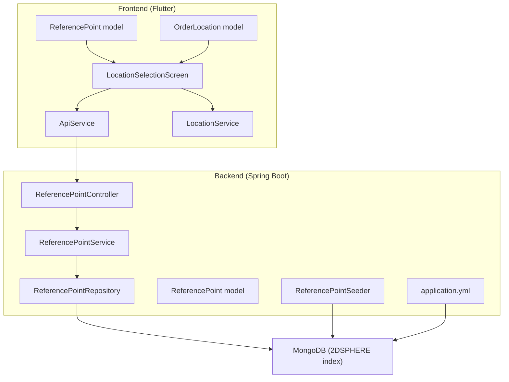
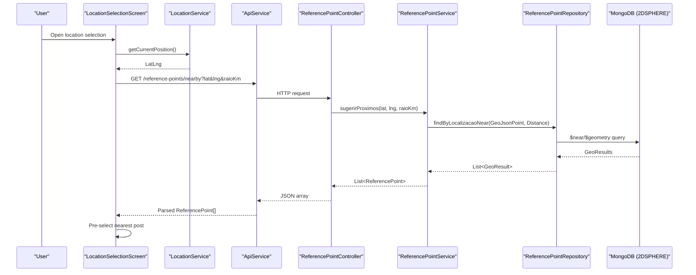
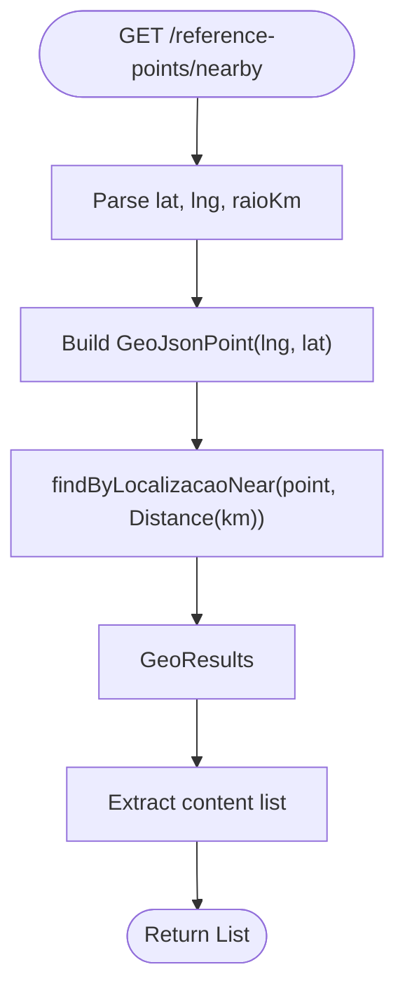
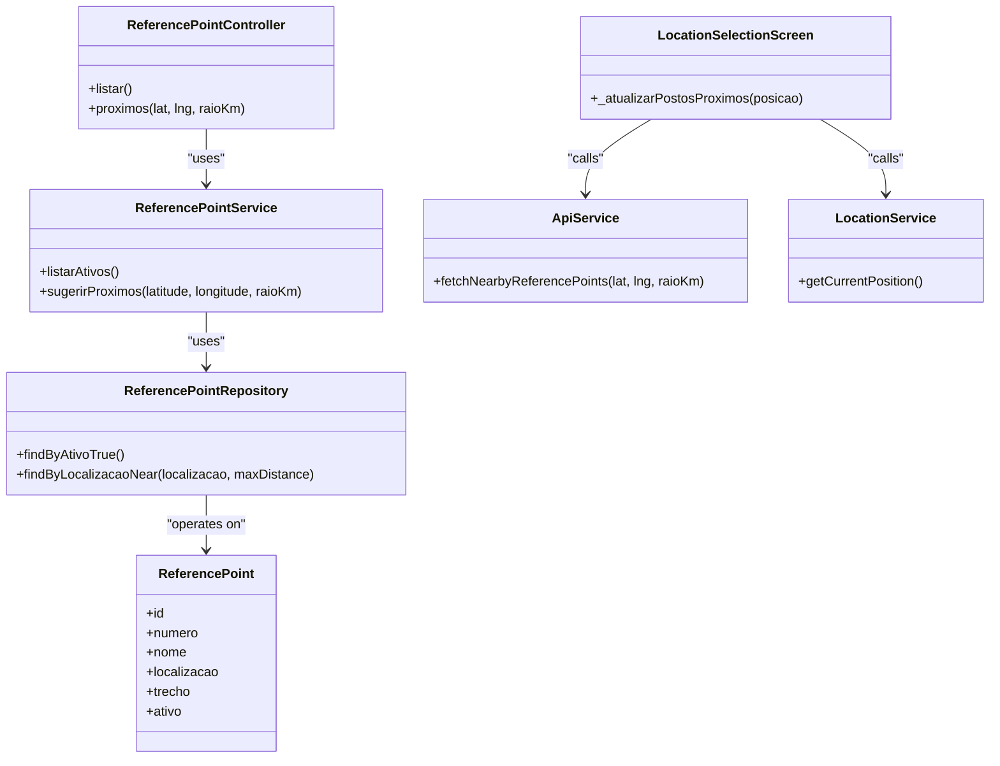

# Geospatial System

<cite>
**Referenced Files in This Document**
- [ReferencePoint.java](file://backend/src/main/java/com/penaareia/model/ReferencePoint.java)
- [ReferencePointRepository.java](file://backend/src/main/java/com/penaareia/repository/ReferencePointRepository.java)
- [ReferencePointService.java](file://backend/src/main/java/com/penaareia/service/ReferencePointService.java)
- [ReferencePointController.java](file://backend/src/main/java/com/penaareia/controller/ReferencePointController.java)
- [ReferencePointSeeder.java](file://backend/src/main/java/com/penaareia/seed/ReferencePointSeeder.java)
- [application.yml](file://backend/src/main/resources/application.yml)
- [reference_point.dart](file://frontend/lib/models/reference_point.dart)
- [order_location.dart](file://frontend/lib/models/order_location.dart)
- [location_selection_screen.dart](file://frontend/lib/screens/location_selection_screen.dart)
- [api_service.dart](file://frontend/lib/services/api_service.dart)
- [location_service.dart](file://frontend/lib/services/location_service.dart)
</cite>

## Table of Contents
1. [Introduction](#introduction)
2. [Project Structure](#project-structure)
3. [Core Components](#core-components)
4. [Architecture Overview](#architecture-overview)
5. [Detailed Component Analysis](#detailed-component-analysis)
6. [Dependency Analysis](#dependency-analysis)
7. [Performance Considerations](#performance-considerations)
8. [Troubleshooting Guide](#troubleshooting-guide)
9. [Conclusion](#conclusion)

## Introduction
This document explains Pé na Areia’s geospatial system for official beach reference points (lifeguard posts). It covers MongoDB 2DSPHERE indexing, GeoJSON coordinate standardization, proximity search, the reference point system, accuracy and validation rules, distance algorithms, and the integration between the Flutter frontend map and backend queries. It also provides performance guidance and troubleshooting tips.

## Project Structure
The geospatial feature spans a Spring Boot backend and a Flutter frontend:
- Backend: models, repository, service, controller, seed data, and application configuration.
- Frontend: location selection screen, API client, device location service, and data models.

**Diagram sources**
- [location_selection_screen.dart:1-324](file://frontend/lib/screens/location_selection_screen.dart#L1-L324)
- [api_service.dart:1-69](file://frontend/lib/services/api_service.dart#L1-L69)
- [location_service.dart:1-31](file://frontend/lib/services/location_service.dart#L1-L31)
- [ReferencePointController.java:1-35](file://backend/src/main/java/com/penaareia/controller/ReferencePointController.java#L1-L35)
- [ReferencePointService.java:1-39](file://backend/src/main/java/com/penaareia/service/ReferencePointService.java#L1-L39)
- [ReferencePointRepository.java:1-18](file://backend/src/main/java/com/penaareia/repository/ReferencePointRepository.java#L1-L18)
- [ReferencePoint.java:1-39](file://backend/src/main/java/com/penaareia/model/ReferencePoint.java#L1-L39)
- [ReferencePointSeeder.java:1-49](file://backend/src/main/java/com/penaareia/seed/ReferencePointSeeder.java#L1-L49)
- [application.yml:1-32](file://backend/src/main/resources/application.yml#L1-L32)

**Section sources**
- [ReferencePoint.java:1-39](file://backend/src/main/java/com/penaareia/model/ReferencePoint.java#L1-L39)
- [ReferencePointRepository.java:1-18](file://backend/src/main/java/com/penaareia/repository/ReferencePointRepository.java#L1-L18)
- [ReferencePointService.java:1-39](file://backend/src/main/java/com/penaareia/service/ReferencePointService.java#L1-L39)
- [ReferencePointController.java:1-35](file://backend/src/main/java/com/penaareia/controller/ReferencePointController.java#L1-L35)
- [ReferencePointSeeder.java:1-49](file://backend/src/main/java/com/penaareia/seed/ReferencePointSeeder.java#L1-L49)
- [application.yml:1-32](file://backend/src/main/resources/application.yml#L1-L32)
- [reference_point.dart:1-32](file://frontend/lib/models/reference_point.dart#L1-L32)
- [order_location.dart:1-26](file://frontend/lib/models/order_location.dart#L1-L26)
- [location_selection_screen.dart:1-324](file://frontend/lib/screens/location_selection_screen.dart#L1-L324)
- [api_service.dart:1-69](file://frontend/lib/services/api_service.dart#L1-L69)
- [location_service.dart:1-31](file://frontend/lib/services/location_service.dart#L1-L31)

## Core Components
- ReferencePoint (backend model): Stores official lifeguard post metadata and a GeoJsonPoint with a 2DSPHERE index.
- ReferencePointRepository: Exposes a near query to find active reference points within a radius.
- ReferencePointService: Converts user input into a GeoJsonPoint and returns nearby points.
- ReferencePointController: REST endpoints to list active points and find nearby points by lat/lng/radius.
- ReferencePointSeeder: Seeds initial reference points with approximate coordinates; enforces GeoJsonPoint order (longitude, latitude).
- application.yml: Configures MongoDB connection and enables auto-index creation.
- Frontend ReferencePoint model: Parses GeoJSON coordinates from backend responses.
- OrderLocation model: Carries selected location details back to the ordering flow.
- LocationSelectionScreen: Draggable pin on Google Maps, fetches nearby reference points, pre-selects the closest one.
- ApiService: HTTP client calling /reference-points and /reference-points/nearby.
- LocationService: Acquires device GPS position with high accuracy.

**Section sources**
- [ReferencePoint.java:1-39](file://backend/src/main/java/com/penaareia/model/ReferencePoint.java#L1-L39)
- [ReferencePointRepository.java:1-18](file://backend/src/main/java/com/penaareia/repository/ReferencePointRepository.java#L1-L18)
- [ReferencePointService.java:1-39](file://backend/src/main/java/com/penaareia/service/ReferencePointService.java#L1-L39)
- [ReferencePointController.java:1-35](file://backend/src/main/java/com/penaareia/controller/ReferencePointController.java#L1-L35)
- [ReferencePointSeeder.java:1-49](file://backend/src/main/java/com/penaareia/seed/ReferencePointSeeder.java#L1-L49)
- [application.yml:1-32](file://backend/src/main/resources/application.yml#L1-L32)
- [reference_point.dart:1-32](file://frontend/lib/models/reference_point.dart#L1-L32)
- [order_location.dart:1-26](file://frontend/lib/models/order_location.dart#L1-L26)
- [location_selection_screen.dart:1-324](file://frontend/lib/screens/location_selection_screen.dart#L1-L324)
- [api_service.dart:1-69](file://frontend/lib/services/api_service.dart#L1-L69)
- [location_service.dart:1-31](file://frontend/lib/services/location_service.dart#L1-L31)

## Architecture Overview
The geospatial workflow connects the mobile map to MongoDB via Spring Data MongoDB.

**Diagram sources**
- [location_selection_screen.dart:52-87](file://frontend/lib/screens/location_selection_screen.dart#L52-L87)
- [api_service.dart:24-42](file://frontend/lib/services/api_service.dart#L24-L42)
- [ReferencePointController.java:26-33](file://backend/src/main/java/com/penaareia/controller/ReferencePointController.java#L26-L33)
- [ReferencePointService.java:29-37](file://backend/src/main/java/com/penaareia/service/ReferencePointService.java#L29-L37)
- [ReferencePointRepository.java:15-16](file://backend/src/main/java/com/penaareia/repository/ReferencePointRepository.java#L15-L16)

## Detailed Component Analysis

### MongoDB 2DSPHERE Indexing Strategy
- The ReferencePoint model declares a GeoSpatialIndexed field using Geo_2DSPHERE for spherical distance calculations.
- Auto-index creation is enabled in application configuration, ensuring the index is created automatically when the collection is first used.

Key behaviors:
- Coordinates are stored as GeoJsonPoint (longitude-first).
- Queries use MongoDB’s $near/$geometry with a maxDistance parameter.

**Section sources**
- [ReferencePoint.java:31-32](file://backend/src/main/java/com/penaareia/model/ReferencePoint.java#L31-L32)
- [application.yml:11-15](file://backend/src/main/resources/application.yml#L11-L15)

### GeoJSON Coordinate Format Standardization
- Backend: GeoJsonPoint expects (longitude, latitude). Seeder constructs points accordingly.
- Frontend: ReferencePoint.fromJson reads coordinates[0] as longitude and coordinates[1] as latitude per GeoJSON spec.

Validation and consistency:
- Always pass longitude before latitude when creating GeoJsonPoint.
- When parsing JSON, treat coordinates[0] as longitude and coordinates[1] as latitude.

**Section sources**
- [ReferencePointSeeder.java:38-46](file://backend/src/main/java/com/penaareia/seed/ReferencePointSeeder.java#L38-L46)
- [reference_point.dart:18-29](file://frontend/lib/models/reference_point.dart#L18-L29)

### Proximity Search Implementation
- Controller exposes GET /reference-points/nearby with parameters lat, lng, and optional raioKm (default 1.5 km).
- Service builds a GeoJsonPoint and calls repository.findByLocalizacaoNear with a Distance in kilometers.
- Repository uses Spring Data MongoDB’s geo query to return results ordered by distance.

**Diagram sources**
- [ReferencePointController.java:26-33](file://backend/src/main/java/com/penaareia/controller/ReferencePointController.java#L26-L33)
- [ReferencePointService.java:29-37](file://backend/src/main/java/com/penaareia/service/ReferencePointService.java#L29-L37)
- [ReferencePointRepository.java:15-16](file://backend/src/main/java/com/penaareia/repository/ReferencePointRepository.java#L15-L16)

**Section sources**
- [ReferencePointController.java:26-33](file://backend/src/main/java/com/penaareia/controller/ReferencePointController.java#L26-L33)
- [ReferencePointService.java:29-37](file://backend/src/main/java/com/penaareia/service/ReferencePointService.java#L29-L37)
- [ReferencePointRepository.java:15-16](file://backend/src/main/java/com/penaareia/repository/ReferencePointRepository.java#L15-L16)

### Reference Point System and Seed Data
- Official lifeguard posts are modeled as ReferencePoint with fields like numero, nome, trecho, and localizacao.
- Seeder populates a small set of example posts if the collection is empty, preventing duplicates on restart.
- Posts are marked ativo=true by default and can be filtered by active status.

Operational notes:
- Seed runs once at startup if the collection is empty.
- Coordinates are approximate and should be replaced with official city data before production.

**Section sources**
- [ReferencePoint.java:12-37](file://backend/src/main/java/com/penaareia/model/ReferencePoint.java#L12-L37)
- [ReferencePointSeeder.java:10-46](file://backend/src/main/java/com/penaareia/seed/ReferencePointSeeder.java#L10-L46)
- [ReferencePointRepository.java:13](file://backend/src/main/java/com/penaareia/repository/ReferencePointRepository.java#L13)

### Geolocation Accuracy Requirements
- Frontend requests high accuracy from the device GPS.
- If permissions are denied or GPS is disabled, explicit exceptions are thrown to guide the user.

Behavior:
- The app checks service availability, then permission state, and finally retrieves the current position with desiredAccuracy=high.

**Section sources**
- [location_service.dart:3-29](file://frontend/lib/services/location_service.dart#L3-L29)

### Location Validation Mechanisms
- Frontend validates that a reference point chip is selected and description is non-empty before confirming location.
- The UI disables confirmation until these conditions are met.

Validation logic:
- Required: postoSelecionado != null and descricao not blank.
- Optional: fotoLocalUrl (placeholder for future upload).

**Section sources**
- [location_selection_screen.dart:101-125](file://frontend/lib/screens/location_selection_screen.dart#L101-L125)
- [order_location.dart:1-26](file://frontend/lib/models/order_location.dart#L1-L26)

### Algorithms for Nearby Points, Distance Calculations, and Transformations
- Nearby algorithm: Uses MongoDB’s 2DSPHERE $near/$geometry with a maximum distance in kilometers.
- Distance calculation: Performed server-side by MongoDB using spherical geometry; results are returned sorted by distance.
- Coordinate transformation:
  - Backend: GeoJsonPoint constructed as (longitude, latitude).
  - Frontend: Parses coordinates[0] as longitude and coordinates[1] as latitude.

Note: No client-side distance computation is performed; the backend handles all geospatial math.

**Section sources**
- [ReferencePointService.java:29-37](file://backend/src/main/java/com/penaareia/service/ReferencePointService.java#L29-L37)
- [ReferencePointSeeder.java:38-46](file://backend/src/main/java/com/penaareia/seed/ReferencePointSeeder.java#L38-L46)
- [reference_point.dart:18-29](file://frontend/lib/models/reference_point.dart#L18-L29)

### Frontend Map Integration and Error Handling
- The map shows a draggable pin; dragging triggers a nearby reference points refresh.
- On initialization, the app attempts to get the current device location; if unavailable, it falls back to a default pin position and still loads nearby posts.
- Errors from location services or API calls are surfaced to the user.

Flow:
- Initialize with current position -> fetch nearby posts -> update markers and chips.
- Dragging pin -> re-fetch nearby posts -> pre-select nearest.

**Section sources**
- [location_selection_screen.dart:52-87](file://frontend/lib/screens/location_selection_screen.dart#L52-L87)
- [location_selection_screen.dart:84-87](file://frontend/lib/screens/location_selection_screen.dart#L84-L87)
- [api_service.dart:61-67](file://frontend/lib/services/api_service.dart#L61-L67)

## Dependency Analysis
The geospatial feature has clear layering with minimal coupling:
- Controller depends only on Service.
- Service depends on Repository.
- Repository interacts with MongoDB via Spring Data.
- Frontend screens depend on ApiService and LocationService.

**Diagram sources**
- [ReferencePointController.java:12-33](file://backend/src/main/java/com/penaareia/controller/ReferencePointController.java#L12-L33)
- [ReferencePointService.java:15-37](file://backend/src/main/java/com/penaareia/service/ReferencePointService.java#L15-L37)
- [ReferencePointRepository.java:11-16](file://backend/src/main/java/com/penaareia/repository/ReferencePointRepository.java#L11-L16)
- [ReferencePoint.java:16-37](file://backend/src/main/java/com/penaareia/model/ReferencePoint.java#L16-L37)
- [location_selection_screen.dart:68-87](file://frontend/lib/screens/location_selection_screen.dart#L68-L87)
- [api_service.dart:24-42](file://frontend/lib/services/api_service.dart#L24-L42)
- [location_service.dart:3-29](file://frontend/lib/services/location_service.dart#L3-L29)

**Section sources**
- [ReferencePointController.java:12-33](file://backend/src/main/java/com/penaareia/controller/ReferencePointController.java#L12-L33)
- [ReferencePointService.java:15-37](file://backend/src/main/java/com/penaareia/service/ReferencePointService.java#L15-L37)
- [ReferencePointRepository.java:11-16](file://backend/src/main/java/com/penaareia/repository/ReferencePointRepository.java#L11-L16)
- [ReferencePoint.java:16-37](file://backend/src/main/java/com/penaareia/model/ReferencePoint.java#L16-L37)
- [location_selection_screen.dart:68-87](file://frontend/lib/screens/location_selection_screen.dart#L68-L87)
- [api_service.dart:24-42](file://frontend/lib/services/api_service.dart#L24-L42)
- [location_service.dart:3-29](file://frontend/lib/services/location_service.dart#L3-L29)

## Performance Considerations
- Indexing:
  - Use 2DSPHERE index on the location field for efficient spherical queries.
  - Ensure auto-index creation is enabled during development; verify index exists in production.
- Query design:
  - Keep raioKm reasonable (e.g., default 1.5 km) to limit result sets.
  - Filter by active posts where applicable to reduce dataset size.
- Network and UI:
  - Debounce rapid pin drags to avoid excessive network calls.
  - Cache nearby results briefly while the user is interacting with the map.
- Data volume:
  - Reference points are static; consider preloading them on app start to avoid repeated queries.
- Database:
  - Monitor MongoDB query plans for $near/$geometry to ensure index usage.
  - Avoid unnecessary fields in responses to reduce payload size.

[No sources needed since this section provides general guidance]

## Troubleshooting Guide
Common issues and resolutions:
- No nearby reference points found:
  - Increase raioKm or move the pin closer to the shoreline.
  - Verify that reference points exist in the database and are marked ativo=true.
- Incorrect coordinates:
  - Confirm that GeoJsonPoint is created with (longitude, latitude).
  - Ensure frontend parses coordinates[0] as longitude and coordinates[1] as latitude.
- Permission errors:
  - Handle denied or permanently denied location permissions and prompt users to enable GPS and permissions.
- API errors:
  - Check response status codes and body; the frontend throws an exception on non-success responses.

Actionable checks:
- Validate MongoDB connection and indexes.
- Inspect seed data and ensure coordinates are correct for the target region.
- Review error messages surfaced by LocationService and ApiService.

**Section sources**
- [location_service.dart:6-29](file://frontend/lib/services/location_service.dart#L6-L29)
- [api_service.dart:61-67](file://frontend/lib/services/api_service.dart#L61-L67)
- [ReferencePointSeeder.java:10-16](file://backend/src/main/java/com/penaareia/seed/ReferencePointSeeder.java#L10-L16)
- [ReferencePoint.java:31-32](file://backend/src/main/java/com/penaareia/model/ReferencePoint.java#L31-L32)

## Conclusion
Pé na Areia’s geospatial system leverages MongoDB’s 2DSPHERE index for accurate and efficient proximity searches around official beach reference points. The backend standardizes GeoJSON coordinates, while the frontend integrates a draggable map pin with real-time nearby suggestions. With careful attention to coordinate order, index usage, and user permissions, the system delivers reliable location selection for beach orders.

[No sources needed since this section summarizes without analyzing specific files]