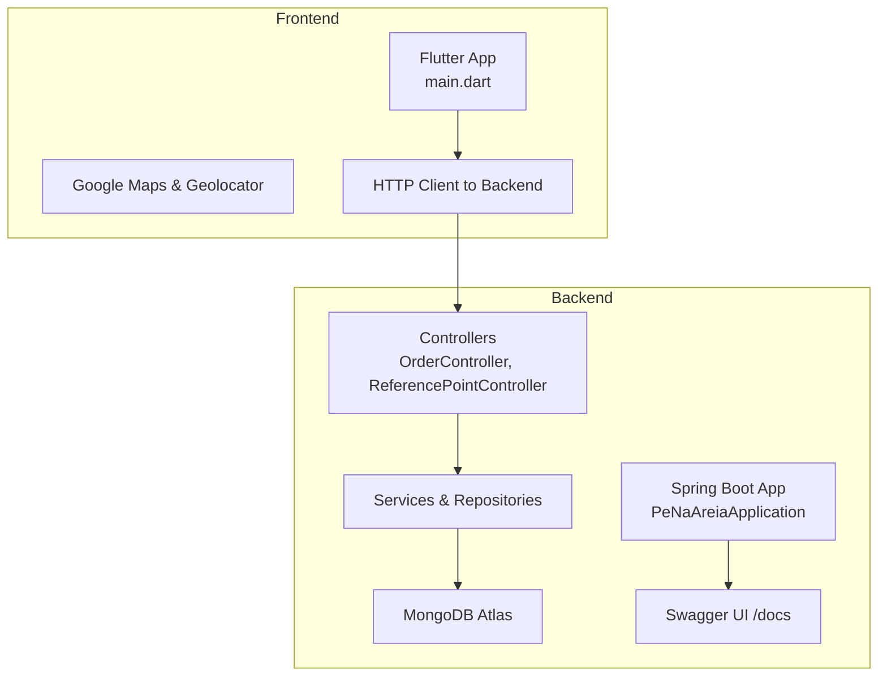
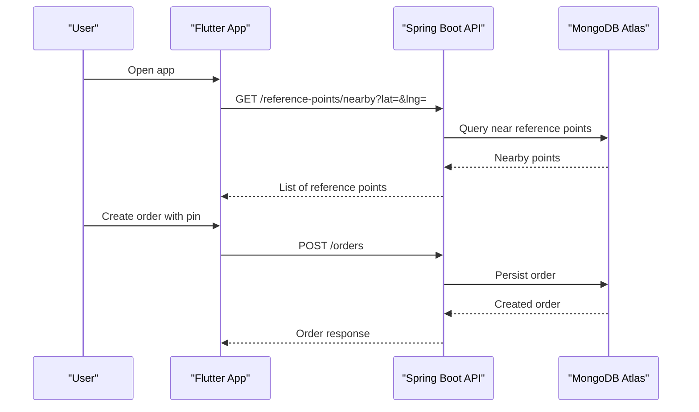
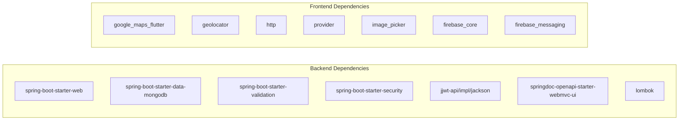

# Getting Started

<cite>
**Referenced Files in This Document**
- [README.md](file://README.md)
- [backend/pom.xml](file://backend/pom.xml)
- [backend/src/main/resources/application.yml](file://backend/src/main/resources/application.yml)
- [backend/src/main/java/com/penaareia/PeNaAreiaApplication.java](file://backend/src/main/java/com/penaareia/PeNaAreiaApplication.java)
- [backend/src/main/java/com/penaareia/config/SecurityConfig.java](file://backend/src/main/java/com/penaareia/config/SecurityConfig.java)
- [backend/src/main/java/com/penaareia/controller/OrderController.java](file://backend/src/main/java/com/penaareia/controller/OrderController.java)
- [backend/src/main/java/com/penaareia/controller/ReferencePointController.java](file://backend/src/main/java/com/penaareia/controller/ReferencePointController.java)
- [frontend/pubspec.yaml](file://frontend/pubspec.yaml)
- [frontend/lib/main.dart](file://frontend/lib/main.dart)
- [frontend/android/app/src/main/AndroidManifest.xml](file://frontend/android/app/src/main/AndroidManifest.xml)
- [frontend/ios/Runner/Info.plist](file://frontend/ios/Runner/Info.plist)
</cite>

## Table of Contents
1. [Introduction](#introduction)
2. [Project Structure](#project-structure)
3. [Core Components](#core-components)
4. [Architecture Overview](#architecture-overview)
5. [Detailed Component Analysis](#detailed-component-analysis)
6. [Dependency Analysis](#dependency-analysis)
7. [Performance Considerations](#performance-considerations)
8. [Troubleshooting Guide](#troubleshooting-guide)
9. [Conclusion](#conclusion)

## Introduction
Pé na Areia is a sustainable delivery app for the Santos waterfront, using geolocation pins and official reference points instead of formal addresses. The project consists of:
- Backend: Java 17 + Spring Boot + MongoDB (Atlas free tier), with Swagger documentation and JWT-ready security configuration.
- Frontend: Flutter app for Android/iOS with Google Maps integration.

This guide helps you set up both backend and frontend locally, configure MongoDB Atlas, generate a JWT secret, run the Spring Boot server, install Flutter dependencies, configure Google Maps API keys, and troubleshoot common issues like emulator-to-backend connectivity.

## Project Structure
The repository is organized into two main layers:
- backend: Spring Boot application with controllers, services, repositories, models, DTOs, seed data, and configuration.
- frontend: Flutter application targeting Android and iOS, with Google Maps and location features.

**Diagram sources**
- [backend/src/main/java/com/penaareia/PeNaAreiaApplication.java:6-11](file://backend/src/main/java/com/penaareia/PeNaAreiaApplication.java#L6-L11)
- [backend/src/main/java/com/penaareia/controller/OrderController.java:15-35](file://backend/src/main/java/com/penaareia/controller/OrderController.java#L15-L35)
- [backend/src/main/java/com/penaareia/controller/ReferencePointController.java:12-34](file://backend/src/main/java/com/penaareia/controller/ReferencePointController.java#L12-L34)
- [frontend/lib/main.dart:6-31](file://frontend/lib/main.dart#L6-L31)

**Section sources**
- [README.md:6-12](file://README.md#L6-L12)

## Core Components
- Backend entry point: Spring Boot application class that starts the server.
- Controllers: REST endpoints for orders and reference points.
- Security: Stateless session management with JWT-ready configuration; currently permits public access for catalog endpoints and docs.
- Database: MongoDB Atlas connection via environment variables.
- Frontend: Flutter app with Google Maps and HTTP client configured to call the backend.

Key responsibilities:
- PeNaAreiaApplication: bootstraps the Spring Boot application.
- OrderController: creates and retrieves orders.
- ReferencePointController: lists reference points and suggests nearby ones based on coordinates.
- SecurityConfig: configures authentication rules and password encoder.
- application.yml: defines server port, MongoDB URI/database, JWT secret, and Swagger paths.
- pubspec.yaml: declares Flutter dependencies including Google Maps, geolocator, http, provider, image_picker, and Firebase messaging.

**Section sources**
- [backend/src/main/java/com/penaareia/PeNaAreiaApplication.java:6-11](file://backend/src/main/java/com/penaareia/PeNaAreiaApplication.java#L6-L11)
- [backend/src/main/java/com/penaareia/controller/OrderController.java:15-35](file://backend/src/main/java/com/penaareia/controller/OrderController.java#L15-L35)
- [backend/src/main/java/com/penaareia/controller/ReferencePointController.java:12-34](file://backend/src/main/java/com/penaareia/controller/ReferencePointController.java#L12-L34)
- [backend/src/main/java/com/penaareia/config/SecurityConfig.java:19-40](file://backend/src/main/java/com/penaareia/config/SecurityConfig.java#L19-L40)
- [backend/src/main/resources/application.yml:1-32](file://backend/src/main/resources/application.yml#L1-L32)
- [frontend/pubspec.yaml:9-27](file://frontend/pubspec.yaml#L9-L27)

## Architecture Overview
High-level flow:
- Flutter app initializes and displays the location selection screen.
- The app calls backend endpoints for reference points and order creation.
- Backend exposes REST APIs served by Spring Boot, backed by MongoDB Atlas.
- Swagger UI provides interactive API documentation at /docs.

**Diagram sources**
- [frontend/lib/main.dart:6-31](file://frontend/lib/main.dart#L6-L31)
- [backend/src/main/java/com/penaareia/controller/ReferencePointController.java:20-33](file://backend/src/main/java/com/penaareia/controller/ReferencePointController.java#L20-L33)
- [backend/src/main/java/com/penaareia/controller/OrderController.java:23-34](file://backend/src/main/java/com/penaareia/controller/OrderController.java#L23-L34)

## Detailed Component Analysis

### Backend Setup and Configuration
- Server port: 8080 by default.
- MongoDB Atlas: Connection string and database name are read from environment variables MONGODB_URI and MONGODB_DATABASE.
- JWT secret: Read from environment variable JWT_SECRET; defaults to a placeholder value.
- Swagger UI: Available at /docs.

Environment variables required:
- MONGODB_URI: MongoDB Atlas connection string.
- MONGODB_DATABASE: Database name (default pe_na_areia).
- JWT_SECRET: Strong secret for JWT signing.

Maven commands:
- Build: mvn clean package
- Run: ./mvnw spring-boot:run (or mvn spring-boot:run)

Port configuration:
- Change server.port in application.yml if needed.

Security notes:
- CSRF disabled, stateless sessions.
- Public endpoints: /docs/**, /api-docs/**, /swagger-ui/**, /auth/**, /reference-points/**, /kiosks/**.
- All other requests are currently permittedAll; replace with authenticated when JWT filter is implemented.

**Section sources**
- [backend/src/main/resources/application.yml:1-32](file://backend/src/main/resources/application.yml#L1-L32)
- [backend/src/main/java/com/penaareia/config/SecurityConfig.java:27-40](file://backend/src/main/java/com/penaareia/config/SecurityConfig.java#L27-L40)
- [backend/pom.xml:24-91](file://backend/pom.xml#L24-L91)

### MongoDB Atlas Free Tier Setup
Steps:
1. Create an account at MongoDB Atlas.
2. Create a cluster (free tier M0).
3. Copy the connection string and export it as MONGODB_URI.
4. Set MONGODB_DATABASE to pe_na_areia (or your preferred name).

Connection details:
- The backend reads uri and database from environment variables.
- Auto-index creation is enabled.

**Section sources**
- [README.md:44-51](file://README.md#L44-L51)
- [backend/src/main/resources/application.yml:8-15](file://backend/src/main/resources/application.yml#L8-L15)

### JWT Secret Generation
- Generate a strong random secret string and export it as JWT_SECRET before running the backend.
- Do not commit secrets to version control; use environment variables or a secrets manager in production.

Usage:
- The backend uses the secret for JWT operations (placeholder implementation pending auth endpoints).

**Section sources**
- [README.md:53-60](file://README.md#L53-L60)
- [backend/src/main/resources/application.yml:17-20](file://backend/src/main/resources/application.yml#L17-L20)

### Running the Spring Boot Backend
Prerequisites:
- Java 17
- Maven wrapper included

Commands:
- Export environment variables:
  - MONGODB_URI
  - MONGODB_DATABASE
  - JWT_SECRET
- Start the server:
  - cd backend
  - ./mvnw spring-boot:run

Access:
- API base URL: http://localhost:8080
- Swagger UI: http://localhost:8080/docs

Endpoints overview:
- GET /reference-points: list active reference points
- GET /reference-points/nearby?lat=&lng=: suggest nearby reference points
- POST /orders: create an order with location pin and payment method
- GET /orders/{id}: retrieve an order by ID

**Section sources**
- [README.md:53-63](file://README.md#L53-L63)
- [backend/src/main/java/com/penaareia/controller/ReferencePointController.java:20-33](file://backend/src/main/java/com/penaareia/controller/ReferencePointController.java#L20-L33)
- [backend/src/main/java/com/penaareia/controller/OrderController.java:23-34](file://backend/src/main/java/com/penaareia/controller/OrderController.java#L23-L34)

### Flutter Setup Requirements
Prerequisites:
- Flutter SDK (>=3.3.0)
- Android Studio or Xcode for platform toolchains
- Emulators or physical devices configured

Install dependencies:
- cd frontend
- flutter pub get

Run the app:
- flutter run --dart-define=API_BASE_URL=http://10.0.2.2:8080

Notes:
- 10.0.2.2 is the host address for Android emulators.
- For iOS Simulator or physical devices, use the actual IP of the backend machine.

**Section sources**
- [frontend/pubspec.yaml:6-7](file://frontend/pubspec.yaml#L6-L7)
- [README.md:65-72](file://README.md#L65-L72)

### Google Maps API Key Setup
Android:
- Add the Google Maps API key to android/app/src/main/AndroidManifest.xml as a meta-data entry.
- Ensure the key has Maps SDK for Android enabled.

iOS:
- Add the Google Maps API key to ios/Runner/AppDelegate.swift or Info.plist according to plugin requirements.
- Ensure the key has Maps SDK for iOS enabled.

Important:
- The README indicates where to place the key for both platforms.
- The current AndroidManifest.xml does not include the key yet; add it as instructed.

**Section sources**
- [README.md:74-76](file://README.md#L74-L76)
- [frontend/android/app/src/main/AndroidManifest.xml:1-46](file://frontend/android/app/src/main/AndroidManifest.xml#L1-L46)
- [frontend/ios/Runner/Info.plist:1-50](file://frontend/ios/Runner/Info.plist#L1-L50)

### Mobile Emulator Configuration
- Android Emulator: Use 10.0.2.2 to reach localhost of the host machine.
- iOS Simulator: Use the actual IP address of the host machine where the backend runs.
- Physical device: Ensure the device can reach the backend over the network (same Wi-Fi or accessible IP).

**Section sources**
- [README.md:69-72](file://README.md#L69-L72)

## Dependency Analysis
Backend dependencies:
- Spring Web, Data MongoDB, Validation, Security, JJWT, SpringDoc OpenAPI, Lombok, Test starters.

Frontend dependencies:
- google_maps_flutter, geolocator, http, provider, image_picker, firebase_core, firebase_messaging.

**Diagram sources**
- [backend/pom.xml:24-91](file://backend/pom.xml#L24-L91)
- [frontend/pubspec.yaml:9-27](file://frontend/pubspec.yaml#L9-L27)

**Section sources**
- [backend/pom.xml:24-91](file://backend/pom.xml#L24-L91)
- [frontend/pubspec.yaml:9-27](file://frontend/pubspec.yaml#L9-L27)

## Performance Considerations
- Keep MongoDB indexes optimized for geospatial queries; auto-index creation is enabled but ensure appropriate indexes for frequent queries.
- Limit request payload sizes and validate inputs early to reduce unnecessary processing.
- Use caching strategies for frequently accessed reference points if needed.
- Monitor API latency and adjust confirmation radius and query parameters to balance accuracy and performance.

[No sources needed since this section provides general guidance]

## Troubleshooting Guide

Common issues and resolutions:
- Cannot connect to MongoDB Atlas:
  - Verify MONGODB_URI and MONGODB_DATABASE environment variables.
  - Ensure network access to MongoDB Atlas and correct credentials.
- Backend not reachable from emulator:
  - On Android Emulator, use 10.0.2.2 instead of localhost.
  - On iOS Simulator or physical device, use the host machine’s IP address.
- Google Maps not loading:
  - Confirm API key is added to AndroidManifest.xml and iOS configuration.
  - Ensure Maps SDKs are enabled for the API key.
- Port conflicts:
  - If port 8080 is in use, change server.port in application.yml and update frontend API_BASE_URL accordingly.
- Flutter dependency issues:
  - Run flutter pub get and ensure Flutter SDK version matches constraints.
- CORS or network errors:
  - Verify backend is running and accessible from the device/emulator network.
  - Check firewall settings and local network permissions.

**Section sources**
- [README.md:44-76](file://README.md#L44-L76)
- [backend/src/main/resources/application.yml:1-32](file://backend/src/main/resources/application.yml#L1-L32)
- [frontend/pubspec.yaml:6-7](file://frontend/pubspec.yaml#L6-L7)

## Conclusion
You now have the steps to set up MongoDB Atlas, configure environment variables, run the Spring Boot backend, install Flutter dependencies, configure Google Maps API keys, and resolve typical setup issues. With these foundations, you can develop and test Pé na Areia across both backend and frontend environments.

[No sources needed since this section summarizes without analyzing specific files]