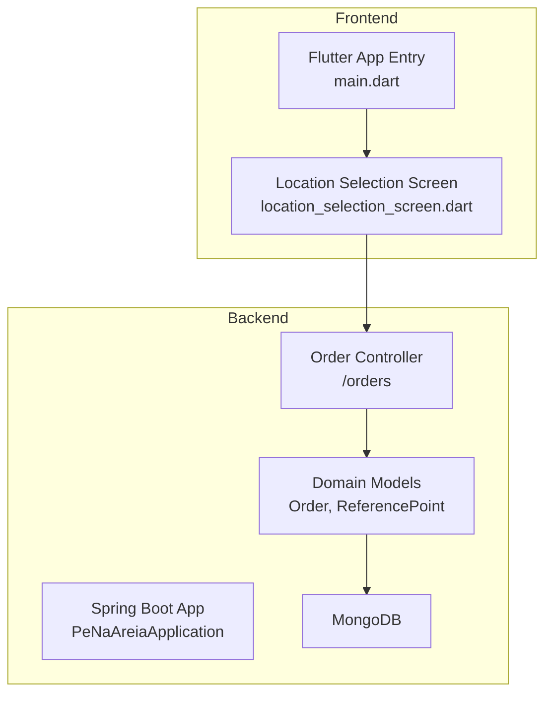
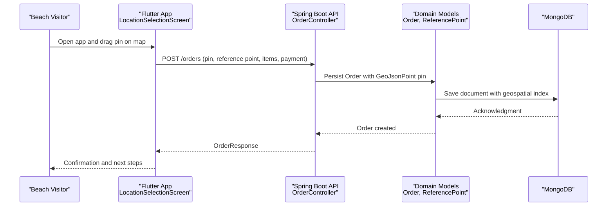
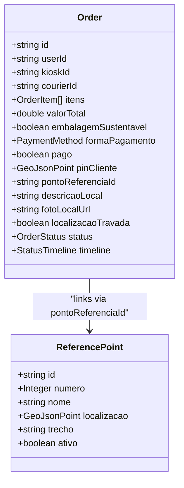
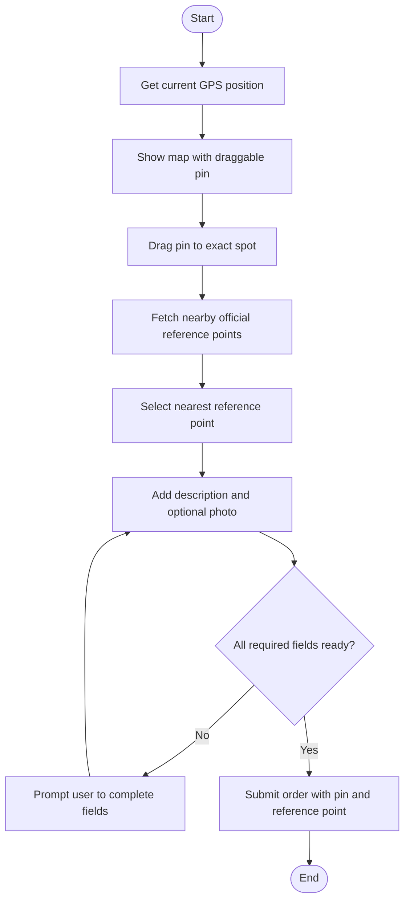
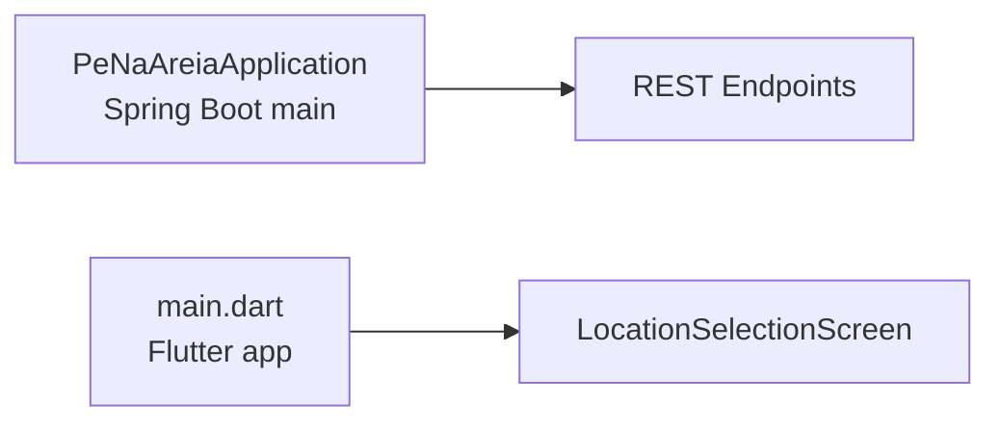
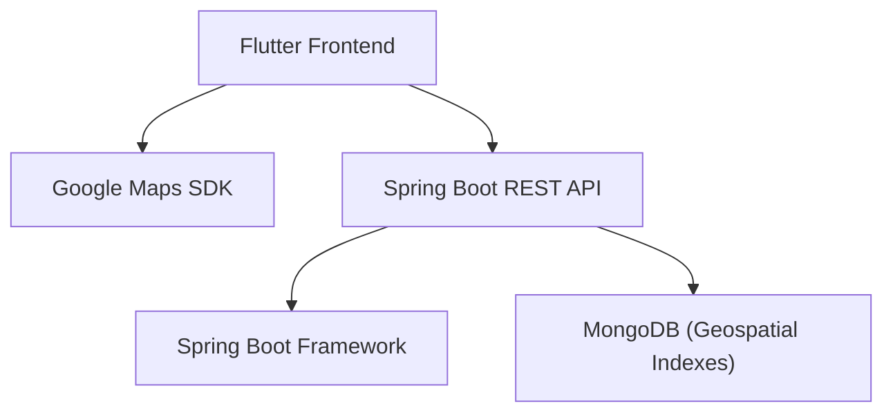

# Project Overview

<cite>
**Referenced Files in This Document**
- [README.md](file://README.md)
- [frontend README.md](file://frontend/README.md)
- [PeNaAreiaApplication.java](file://backend/src/main/java/com/penaareia/PeNaAreiaApplication.java)
- [Order.java](file://backend/src/main/java/com/penaareia/model/Order.java)
- [ReferencePoint.java](file://backend/src/main/java/com/penaareia/model/ReferencePoint.java)
- [OrderController.java](file://backend/src/main/java/com/penaareia/controller/OrderController.java)
- [main.dart](file://frontend/lib/main.dart)
- [location_selection_screen.dart](file://frontend/lib/screens/location_selection_screen.dart)
</cite>

## Table of Contents
1. [Introduction](#introduction)
2. [Project Structure](#project-structure)
3. [Core Components](#core-components)
4. [Architecture Overview](#architecture-overview)
5. [Detailed Component Analysis](#detailed-component-analysis)
6. [Dependency Analysis](#dependency-analysis)
7. [Performance Considerations](#performance-considerations)
8. [Troubleshooting Guide](#troubleshooting-guide)
9. [Conclusion](#conclusion)

## Introduction
Pé na Areia is a sustainable delivery service designed for the beachfront environment of Santos, Brazil. It solves a real-world problem: beachgoers often do not have formal street addresses but instead rely on geolocation pins and official reference points (such as numbered lifeguard posts) to identify their exact spot along the shore. The app enables customers to place orders by dragging a pin on a map, selecting the nearest official reference point, and adding a short description or optional photo of their location.

The project’s mission is to make beach deliveries reliable, fast, and environmentally conscious by replacing traditional address forms with precise geospatial inputs. Its target audience includes:
- Beach visitors who want to order food or drinks to their exact spot on the sand.
- Kiosks and restaurants partnering along the Santos shoreline.
- Couriers who need clear, unambiguous drop-off locations.

Key differentiators from conventional delivery apps include:
- Geolocation-first ordering without requiring a formal address.
- Integration with official beach reference points to standardize delivery locations.
- Optional local photos and descriptions to help couriers find hard-to-spot spots.
- A sustainability focus reflected in order metadata and operational practices.

Context: The Santos beachfront is highly dynamic, crowded, and lacks consistent addressing. Traditional delivery workflows struggle here, which is why Pé na Areia centers its UX around a draggable pin and official reference points.

**Section sources**
- [README.md:1-4](file://README.md#L1-L4)
- [README.md:14-24](file://README.md#L14-L24)
- [README.md:78-84](file://README.md#L78-L84)

## Project Structure
The repository follows a clean separation between backend and frontend:
- Backend: Java 17 + Spring Boot + MongoDB, exposing REST endpoints for reference points, kiosks, and orders.
- Frontend: Flutter application for Android/iOS, featuring a map-based location selection screen and API services.

**Diagram sources**
- [PeNaAreiaApplication.java:6-11](file://backend/src/main/java/com/penaareia/PeNaAreiaApplication.java#L6-L11)
- [OrderController.java:15-35](file://backend/src/main/java/com/penaareia/controller/OrderController.java#L15-L35)
- [Order.java:15-49](file://backend/src/main/java/com/penaareia/model/Order.java#L15-L49)
- [ReferencePoint.java:16-37](file://backend/src/main/java/com/penaareia/model/ReferencePoint.java#L16-L37)
- [main.dart:6-31](file://frontend/lib/main.dart#L6-L31)
- [location_selection_screen.dart:13-15](file://frontend/lib/screens/location_selection_screen.dart#L13-L15)

**Section sources**
- [README.md:6-12](file://README.md#L6-L12)
- [main.dart:6-31](file://frontend/lib/main.dart#L6-L31)

## Core Components
This section highlights the core components that enable geolocation-based delivery.

- Order model: Stores the customer’s pin location using GeoJSON coordinates, links to an official reference point, and supports optional local description and photo URL. It also tracks payment status and a timeline of order events.
- Reference Point model: Represents official beach reference points (e.g., numbered lifeguard posts), including name, number, location, and neighborhood segment.
- Order controller: Exposes endpoints to create orders with a pin location and retrieve orders by ID.
- Location selection screen: Provides the user experience of placing a draggable pin on a map, selecting the nearest official reference point, adding a description, and optionally capturing a photo.

These components together form the unique geospatial capability of the platform: customers never type an address; they select a precise spot on the map and tie it to an official reference point.

**Section sources**
- [Order.java:15-49](file://backend/src/main/java/com/penaareia/model/Order.java#L15-L49)
- [ReferencePoint.java:16-37](file://backend/src/main/java/com/penaareia/model/ReferencePoint.java#L16-L37)
- [OrderController.java:15-35](file://backend/src/main/java/com/penaareia/controller/OrderController.java#L15-L35)
- [location_selection_screen.dart:13-15](file://frontend/lib/screens/location_selection_screen.dart#L13-L15)

## Architecture Overview
At a high level, the system comprises:
- A Spring Boot backend providing REST APIs for orders and reference points.
- A Flutter frontend offering a map-driven interface for location selection.
- MongoDB storing domain entities with geospatial indexing for efficient proximity queries.

**Diagram sources**
- [location_selection_screen.dart:106-125](file://frontend/lib/screens/location_selection_screen.dart#L106-L125)
- [OrderController.java:23-34](file://backend/src/main/java/com/penaareia/controller/OrderController.java#L23-L34)
- [Order.java:35-44](file://backend/src/main/java/com/penaareia/model/Order.java#L35-L44)

## Detailed Component Analysis

### Geospatial Data Model
The geospatial heart of the system lies in how location data is modeled and indexed:
- Orders store a GeoJSON point representing the customer’s pin.
- Reference Points store GeoJSON points for official beach markers.
- Both models use geospatial indexes to support proximity queries (e.g., finding nearby reference points).

**Diagram sources**
- [Order.java:15-49](file://backend/src/main/java/com/penaareia/model/Order.java#L15-L49)
- [ReferencePoint.java:16-37](file://backend/src/main/java/com/penaareia/model/ReferencePoint.java#L16-L37)

**Section sources**
- [Order.java:15-49](file://backend/src/main/java/com/penaareia/model/Order.java#L15-L49)
- [ReferencePoint.java:16-37](file://backend/src/main/java/com/penaareia/model/ReferencePoint.java#L16-L37)

### Order Creation Flow
The order creation flow emphasizes pin-based location capture and ties the order to an official reference point.

**Diagram sources**
- [location_selection_screen.dart:52-87](file://frontend/lib/screens/location_selection_screen.dart#L52-L87)
- [location_selection_screen.dart:106-125](file://frontend/lib/screens/location_selection_screen.dart#L106-L125)

**Section sources**
- [location_selection_screen.dart:52-87](file://frontend/lib/screens/location_selection_screen.dart#L52-L87)
- [location_selection_screen.dart:106-125](file://frontend/lib/screens/location_selection_screen.dart#L106-L125)

### Application Entry Points
- Backend entry point initializes the Spring Boot application.
- Frontend entry point configures the app theme and navigates directly to the location selection screen for testing purposes.

**Diagram sources**
- [PeNaAreiaApplication.java:6-11](file://backend/src/main/java/com/penaareia/PeNaAreiaApplication.java#L6-L11)
- [main.dart:6-31](file://frontend/lib/main.dart#L6-L31)

**Section sources**
- [PeNaAreiaApplication.java:6-11](file://backend/src/main/java/com/penaareia/PeNaAreiaApplication.java#L6-L11)
- [main.dart:6-31](file://frontend/lib/main.dart#L6-L31)

## Dependency Analysis
The primary runtime dependencies are:
- Spring Boot for the backend framework.
- MongoDB for persistence with geospatial capabilities.
- Flutter for cross-platform mobile development.
- Google Maps integration in the frontend for interactive map selection.

**Diagram sources**
- [location_selection_screen.dart:3-10](file://frontend/lib/screens/location_selection_screen.dart#L3-L10)
- [PeNaAreiaApplication.java:3-4](file://backend/src/main/java/com/penaareia/PeNaAreiaApplication.java#L3-L4)
- [Order.java:6-10](file://backend/src/main/java/com/penaareia/model/Order.java#L6-L10)

**Section sources**
- [README.md:42-63](file://README.md#L42-L63)
- [README.md:74-76](file://README.md#L74-L76)

## Performance Considerations
- Geospatial queries benefit from MongoDB’s 2DSPHERE indexes defined on both Order and ReferencePoint models, enabling efficient proximity searches for nearby reference points.
- Keeping the pin locked after payment reduces ambiguity and prevents last-minute changes that could complicate delivery routing.
- Frontend map interactions should minimize unnecessary re-renders when dragging the pin and updating nearby reference points.

[No sources needed since this section provides general guidance]

## Troubleshooting Guide
Common issues and mitigations:
- GPS unavailable: The frontend gracefully falls back to a default location and allows manual pin placement.
- No nearby reference points: Users are prompted to move the pin closer to the shoreline to find official reference points.
- Photo upload: The current implementation captures a local image but does not yet upload it to storage; the field exists for future integration.

Operational notes:
- Ensure MongoDB connection string and database variables are set correctly for the backend.
- Configure Google Maps API keys in the Android and iOS platforms for map rendering.

**Section sources**
- [location_selection_screen.dart:52-66](file://frontend/lib/screens/location_selection_screen.dart#L52-L66)
- [location_selection_screen.dart:291-297](file://frontend/lib/screens/location_selection_screen.dart#L291-L297)
- [location_selection_screen.dart:111-119](file://frontend/lib/screens/location_selection_screen.dart#L111-L119)
- [README.md:42-63](file://README.md#L42-L63)
- [README.md:74-76](file://README.md#L74-L76)

## Conclusion
Pé na Areia reimagines delivery for the Santos beachfront by replacing formal addresses with precise geolocation pins and official reference points. The combination of a Spring Boot backend and a Flutter frontend delivers a focused, geospatial-first experience tailored to beachgoers, kiosks/restaurants, and couriers. By anchoring orders to official reference points and allowing rich local context (description and optional photos), the platform improves delivery accuracy and efficiency while supporting a sustainable approach to beachside commerce.

[No sources needed since this section summarizes without analyzing specific files]