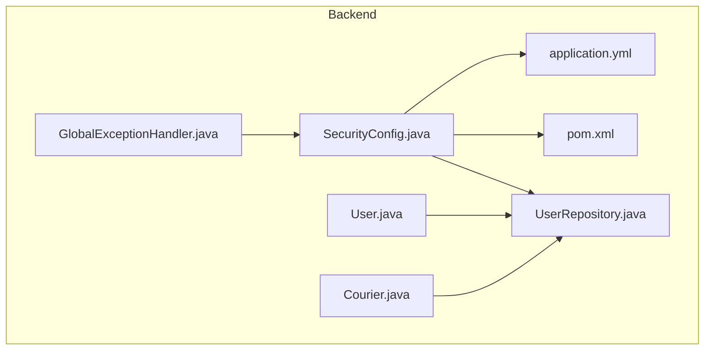
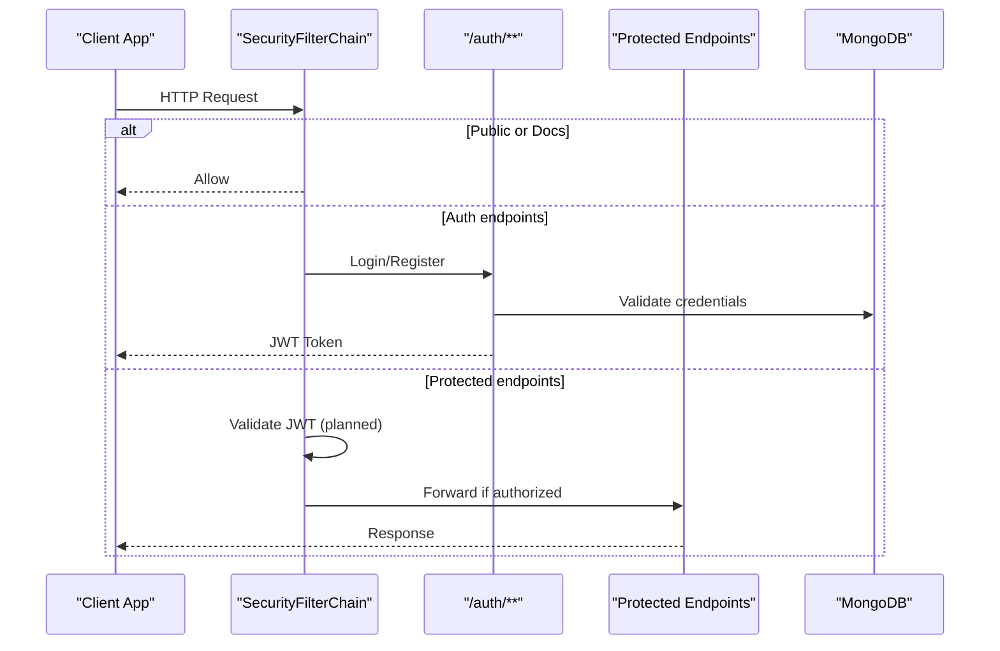
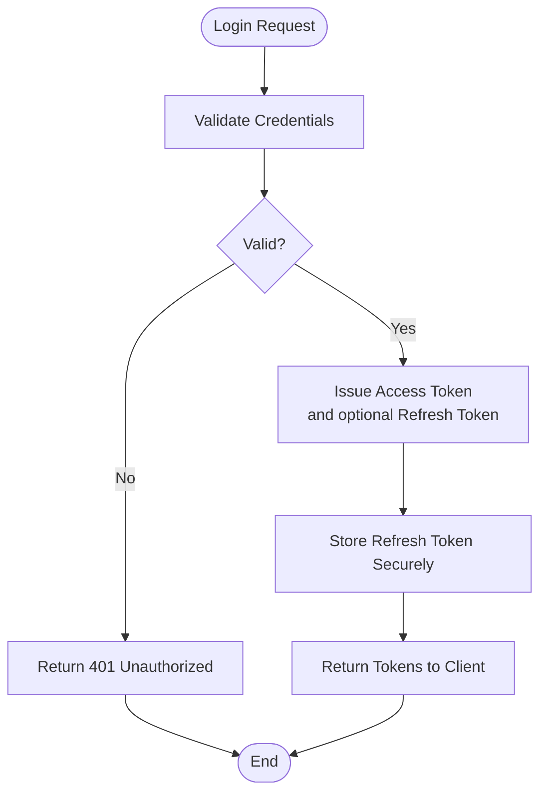
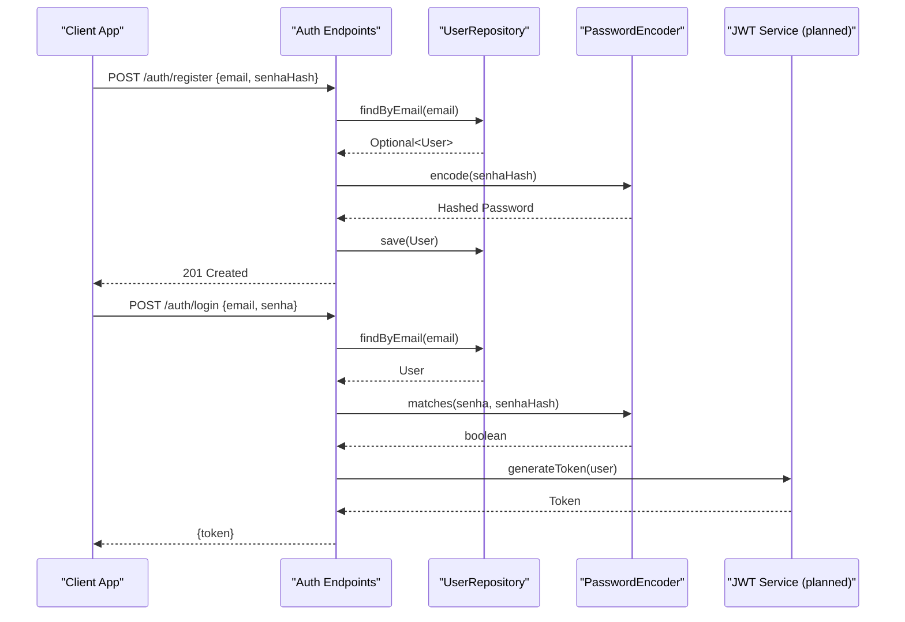
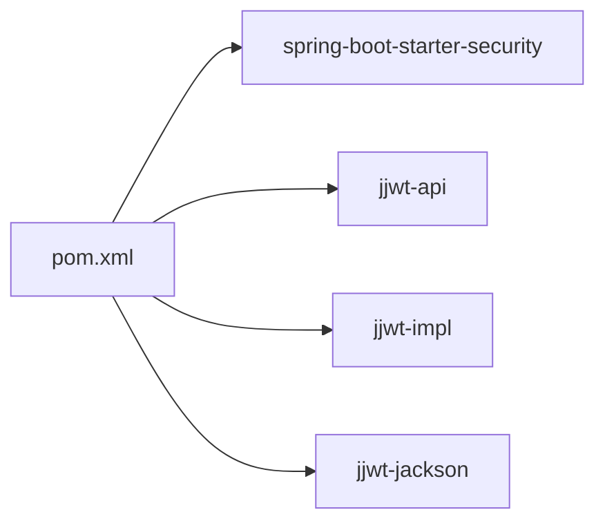

# Security & Authentication

<cite>
**Referenced Files in This Document**
- [SecurityConfig.java](file://backend/src/main/java/com/penaareia/config/SecurityConfig.java)
- [GlobalExceptionHandler.java](file://backend/src/main/java/com/penaareia/config/GlobalExceptionHandler.java)
- [application.yml](file://backend/src/main/resources/application.yml)
- [pom.xml](file://backend/pom.xml)
- [User.java](file://backend/src/main/java/com/penaareia/model/User.java)
- [Courier.java](file://backend/src/main/java/com/penaareia/model/Courier.java)
- [UserRepository.java](file://backend/src/main/java/com/penaareia/repository/UserRepository.java)
</cite>

## Table of Contents
1. [Introduction](#introduction)
2. [Project Structure](#project-structure)
3. [Core Components](#core-components)
4. [Architecture Overview](#architecture-overview)
5. [Detailed Component Analysis](#detailed-component-analysis)
6. [Dependency Analysis](#dependency-analysis)
7. [Performance Considerations](#performance-considerations)
8. [Troubleshooting Guide](#troubleshooting-guide)
9. [Conclusion](#conclusion)
10. [Appendices](#appendices)

## Introduction
This document provides comprehensive security documentation for Pé na Areia’s authentication and authorization framework. It covers the current Spring Security configuration, planned JWT integration, token lifecycle management, authorization policies, CORS posture, API protection strategies, and environment-driven secrets management. It also outlines the intended authentication flows for users, couriers, and kiosk administrators, along with best practices for password hashing, session management, vulnerability mitigation, and global error handling for security-related errors.

## Project Structure
The backend is a Spring Boot application that currently exposes public endpoints for reference points and kiosks, with placeholder routes for authentication. Security configuration is centralized in a dedicated configuration class, while application properties (including JWT settings) are externalized via YAML. Data models for users and couriers include hashed password fields to support secure credential storage.

**Diagram sources**
- [SecurityConfig.java:1-41](file://backend/src/main/java/com/penaareia/config/SecurityConfig.java#L1-L41)
- [application.yml:1-32](file://backend/src/main/resources/application.yml#L1-L32)
- [pom.xml:43-78](file://backend/pom.xml#L43-L78)
- [User.java:1-33](file://backend/src/main/java/com/penaareia/model/User.java#L1-L33)
- [Courier.java:1-47](file://backend/src/main/java/com/penaareia/model/Courier.java#L1-L47)
- [UserRepository.java:1-11](file://backend/src/main/java/com/penaareia/repository/UserRepository.java#L1-L11)
- [GlobalExceptionHandler.java:1-41](file://backend/src/main/java/com/penaareia/config/GlobalExceptionHandler.java#L1-L41)

**Section sources**
- [SecurityConfig.java:1-41](file://backend/src/main/java/com/penaareia/config/SecurityConfig.java#L1-L41)
- [application.yml:1-32](file://backend/src/main/resources/application.yml#L1-L32)
- [pom.xml:43-78](file://backend/pom.xml#L43-L78)

## Core Components
- Security filter chain: Configures CSRF state, session policy, and request authorization rules. Currently permits all requests by default with explicit allow-lists for docs and auth endpoints.
- Password encoder: BCryptPasswordEncoder bean for secure password hashing.
- JWT configuration: Secret and expiration defined in application properties; secret must be provided via environment variables in production.
- Global exception handling: Centralized error responses for not-found and validation errors; extensible for security exceptions.
- Data models: User and Courier entities store hashed passwords and unique email indexes.

**Section sources**
- [SecurityConfig.java:22-40](file://backend/src/main/java/com/penaareia/config/SecurityConfig.java#L22-L40)
- [application.yml:17-20](file://backend/src/main/resources/application.yml#L17-L20)
- [GlobalExceptionHandler.java:15-40](file://backend/src/main/java/com/penaareia/config/GlobalExceptionHandler.java#L15-L40)
- [User.java:18-31](file://backend/src/main/java/com/penaareia/model/User.java#L18-L31)
- [Courier.java:19-28](file://backend/src/main/java/com/penaareia/model/Courier.java#L19-L28)

## Architecture Overview
The system uses Spring Security as the foundation for authentication and authorization. The current setup is intentionally permissive to enable rapid development, with clear TODO markers indicating where JWT-based authentication will be integrated. The plan includes adding a custom JWT filter, securing sensitive endpoints, and enforcing role-based access control for different actor types (users, couriers, kiosk administrators).

**Diagram sources**
- [SecurityConfig.java:27-40](file://backend/src/main/java/com/penaareia/config/SecurityConfig.java#L27-L40)
- [application.yml:17-20](file://backend/src/main/resources/application.yml#L17-L20)

## Detailed Component Analysis

### Security Configuration and Filter Chain
- CSRF is disabled to align with stateless JWT usage.
- Session creation policy is set to STATELESS, ensuring no server-side sessions.
- Authorization rules currently permit all requests, with explicit allow-lists for documentation and authentication endpoints. A TODO indicates switching to authenticated() once JWT is integrated.
- Password encoding uses BCryptPasswordEncoder.

Recommendations:
- Replace the catch-all permitAll with authenticated() to enforce authentication by default.
- Add specific route-level restrictions for order mutation endpoints (e.g., POST /orders, PATCH /orders/**).
- Introduce a JwtAuthenticationFilter before UsernamePasswordAuthenticationFilter to parse and validate tokens.

**Section sources**
- [SecurityConfig.java:22-40](file://backend/src/main/java/com/penaareia/config/SecurityConfig.java#L22-L40)

### JWT Security Configuration and Token Lifecycle
- JWT secret and expiration are configured via application.yml using environment variable placeholders.
- Expiration is set to 24 hours by default.
- Production deployments must supply a strong, unique JWT_SECRET through environment variables.

Token lifecycle plan:
- Issuance: Upon successful login, issue an access token with short-lived validity and optionally a refresh token.
- Validation: Custom filter validates signature, expiration, and claims on each request.
- Rotation: Implement refresh token rotation and revocation mechanisms.
- Storage: Clients should store tokens securely (e.g., HttpOnly cookies for web clients, secure storage for mobile apps).

**Diagram sources**
- [application.yml:17-20](file://backend/src/main/resources/application.yml#L17-L20)

**Section sources**
- [application.yml:17-20](file://backend/src/main/resources/application.yml#L17-L20)

### Authorization Policies and Role-Based Access Control
Current state:
- No role-based annotations are present in controllers or services.
- All endpoints are currently permitted.

Planned policies:
- Users: Create orders, view own data.
- Couriers: Update delivery status, manage location.
- Kiosk Administrators: Manage kiosks, reference points, and administrative operations.

Implementation guidance:
- Define roles such as ROLE_USER, ROLE_COURIER, ROLE_KIOSK_ADMIN.
- Use @PreAuthorize or method-level security to restrict endpoints based on roles.
- Enforce resource-level authorization (e.g., only owners can update their orders).

**Section sources**
- [SecurityConfig.java:27-40](file://backend/src/main/java/com/penaareia/config/SecurityConfig.java#L27-L40)

### CORS Configuration
Current state:
- No explicit CORS configuration is present in the security configuration.
- Default Spring Security behavior applies.

Recommendations:
- Configure CORS explicitly to allow only trusted origins.
- Restrict allowed methods and headers.
- Avoid wildcard origins in production.

**Section sources**
- [SecurityConfig.java:27-40](file://backend/src/main/java/com/penaareia/config/SecurityConfig.java#L27-L40)

### Protection Mechanisms for API Endpoints
Current state:
- Documentation endpoints (/docs/**, /api-docs/**, /swagger-ui/**) are publicly accessible.
- Authentication endpoints (/auth/**) are publicly accessible.
- Catalog endpoints (/reference-points/**, /kiosks/**) are publicly accessible.
- All other endpoints are currently permitted.

Planned protections:
- Require authentication for order mutations and sensitive operations.
- Apply role-based checks for administrative endpoints.
- Rate-limiting and input validation to mitigate abuse.

**Section sources**
- [SecurityConfig.java:27-40](file://backend/src/main/java/com/penaareia/config/SecurityConfig.java#L27-L40)

### Planned Authentication Flows
- Users: Register with email and hashed password; receive JWT upon login; use token to create orders.
- Couriers: Authenticate with email and hashed password; update delivery status and location; restricted to courier-specific endpoints.
- Kiosk Administrators: Authenticate with admin credentials; manage kiosks and reference points; restricted to admin-only endpoints.

**Diagram sources**
- [UserRepository.java:8-10](file://backend/src/main/java/com/penaareia/repository/UserRepository.java#L8-L10)
- [SecurityConfig.java:22-25](file://backend/src/main/java/com/penaareia/config/SecurityConfig.java#L22-L25)

**Section sources**
- [UserRepository.java:8-10](file://backend/src/main/java/com/penaareia/repository/UserRepository.java#L8-L10)
- [SecurityConfig.java:22-25](file://backend/src/main/java/com/penaareia/config/SecurityConfig.java#L22-L25)

### Security Best Practices
- Password hashing: Always store hashed passwords using BCryptPasswordEncoder; never store plaintext.
- Secrets management: Provide JWT_SECRET and database URIs via environment variables; do not commit secrets to version control.
- Statelessness: Maintain stateless sessions when using JWT; avoid server-side session storage.
- Least privilege: Default-deny access; explicitly permit only necessary endpoints.
- Input validation: Validate and sanitize all inputs; return structured error responses.
- Transport security: Enforce HTTPS in production; configure strict CORS policies.
- Vulnerability mitigation: Disable CSRF only when appropriate; implement rate limiting; monitor and log security events.

**Section sources**
- [SecurityConfig.java:22-40](file://backend/src/main/java/com/penaareia/config/SecurityConfig.java#L22-L40)
- [application.yml:17-20](file://backend/src/main/resources/application.yml#L17-L20)

### Environment Variable Management for Secrets and Configuration
- MongoDB URI and database name are externalized via environment variables.
- JWT secret and expiration are externalized; ensure a strong secret in production.
- Application properties include Swagger paths and delivery radius configuration.

Best practices:
- Use a secrets manager or CI/CD vault to inject environment variables at runtime.
- Rotate secrets regularly and audit access.
- Validate required environment variables at startup and fail fast if missing.

**Section sources**
- [application.yml:8-20](file://backend/src/main/resources/application.yml#L8-L20)

## Dependency Analysis
Spring Security and JJWT dependencies are declared in the project build file. These provide the foundation for authentication, authorization, and JWT processing.

**Diagram sources**
- [pom.xml:43-78](file://backend/pom.xml#L43-L78)

**Section sources**
- [pom.xml:43-78](file://backend/pom.xml#L43-L78)

## Performance Considerations
- BCrypt cost factor: Tune the password hashing cost factor to balance security and performance.
- JWT payload size: Keep claims minimal to reduce overhead.
- Stateless architecture: Avoid server-side session storage; leverage distributed caching if needed for token revocation lists.
- Database indexing: Ensure efficient queries for user lookups (unique email index already present).

[No sources needed since this section provides general guidance]

## Troubleshooting Guide
Common issues and resolutions:
- Missing JWT secret: Ensure JWT_SECRET is set in the environment; application expects it via configuration.
- Unsecured endpoints: If endpoints remain open after enabling authentication, verify the filter chain rules and replace catch-all permitAll with authenticated().
- Validation errors: Global exception handler returns structured error bodies with timestamps and messages; extend handlers for security exceptions (e.g., unauthorized, forbidden).
- Not found errors: ResourceNotFoundException is handled centrally; ensure consistent error response formatting across the API.

Recommended enhancements:
- Add handlers for AuthenticationException and AccessDeniedException to standardize security error responses.
- Include correlation IDs in error responses for tracing.
- Log security events without exposing sensitive details.

**Section sources**
- [GlobalExceptionHandler.java:15-40](file://backend/src/main/java/com/penaareia/config/GlobalExceptionHandler.java#L15-L40)
- [application.yml:17-20](file://backend/src/main/resources/application.yml#L17-L20)

## Conclusion
The current security configuration establishes a foundation for stateless, JWT-based authentication with BCrypt password hashing and environment-driven secrets. While the filter chain is intentionally permissive during development, the roadmap clearly identifies steps to integrate JWT filtering, enforce authentication by default, and apply role-based authorization for users, couriers, and kiosk administrators. Adopting the recommended best practices will strengthen the system’s security posture and resilience against common vulnerabilities.

[No sources needed since this section summarizes without analyzing specific files]

## Appendices

### Security Checklist
- [ ] Replace catch-all permitAll with authenticated()
- [ ] Implement JwtAuthenticationFilter
- [ ] Add role-based authorization for protected endpoints
- [ ] Configure explicit CORS policies
- [ ] Harden CSRF policy according to client needs
- [ ] Set strong JWT_SECRET via environment variables
- [ ] Extend GlobalExceptionHandler for security exceptions
- [ ] Enable HTTPS and enforce secure transport
- [ ] Implement rate limiting and input validation
- [ ] Audit and rotate secrets regularly

[No sources needed since this section provides general guidance]