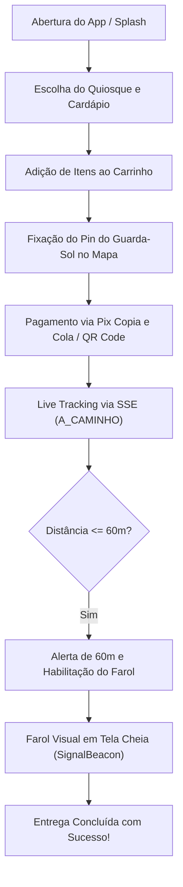

# Pé na Areia · App do Cliente 🏖️

Aplicativo oficial do banista / cliente para realização de pedidos e acompanhamento de entregas na faixa de areia da praia de Santos/SP.

---

## 📌 Sumário

- [Visão Geral e Propósito](#-visão-geral-e-propósito)
- [Funcionalidades Principais](#-funcionalidades-principais)
- [Jornada do Usuário na Praia](#-jornada-do-usuário-na-praia)
- [Arquitetura de Telas e Estrutura de Código](#-arquitetura-de-telas-e-estrutura-de-código)
- [Identificação e Permissões](#-identificação-e-permissões)
- [Configuração de Ambiente](#-configuração-de-ambiente)
- [Comandos de Desenvolvimento, Teste e Build](#-comandos-de-desenvolvimento-teste-e-build)

---

## 🎯 Visão Geral e Propósito

O **App do Cliente** foi projetado especificamente para a realidade de consumo à beira-mar. O cliente não precisa andar até o calçadão nem lidar com dinheiro físico em notas molhadas na areia: ele escolhe produtos com fotos reais de quiosques parceiros, paga antecipadamente via Pix, fixa o pin do seu guarda-sol no mapa e ativa o Farol Visual na tela do celular quando o entregador se aproxima.

---

## 🚀 Funcionalidades Principais

### 1. Catálogo Visual de Quiosques e Produtos

- **Vitrines com Fotos Reais:** Apresentação de quiosques credenciados com logomarca, foto de capa e cardápio organizado por categorias costeiras.
- **Filtro de Embalagem Sustentável:** Opção para priorizar quiosques que utilizam copos e embalagens sustentáveis/biodegradáveis.
- **Itens em Destaque:** Visualização rápida dos itens mais pedidos na praia.

### 2. Pin Interativo na Faixa de Areia e Localização

- **Google Maps Integrado:** O cliente posiciona o marcador diretamente no ponto onde está sentado na praia.
- **Sugestão Automática de Posto de Salvamento:** O app calcula a distância euclidiana até os Postos de Salvamento oficiais da orla de Santos (Posto 1 ao 6) e sugere o posto mais próximo.
- **Identificação do Guarda-Sol:** Campo de texto descritivo limitado a 140 caracteres (ex.: *"Guarda-sol azul e branco, duas cadeiras de alumínio ao lado da rede de futevôlei"*) e captura opcional de foto do local (`POST /uploads/location-photo`).

### 3. Pagamento 100% Antecipado via Pix

- **Zero Dinheiro na Areia:** Geração instantânea de payload Pix Copia e Cola (EMV BR Code) e QR Code dinâmico.
- **Confirmação em Tempo Real:** Atualização automática do status do pedido assim que o webhook de liquidação do Pix é processado pelo backend.

### 4. Live Tracking SSE e Alerta de 60 Metros

- **Acompanhamento em Tempo Real:** Conexão contínua com a API via Server-Sent Events (`GET /orders/{id}/stream`), exibindo a distância em metros até o entregador.
- **Alerta de Proximidade:** Quando o entregador entra no raio de **60 metros**, o app emite alerta visual e vibratório imediato (*"🏖️ Seu entregador está na areia a menos de 60m! Saia do mar e prepare seu celular"*).

### 5. 🔦 Farol Visual Inteligente de Tela Cheia (`SignalBeaconScreen`)

- **Ativação por Proximidade:** Botão do Farol habilitado automaticamente quando o entregador está a menos de 60 metros ou quando o status é `CHEGOU_NO_LOCAL`.
- **Modo Sinalizador Solar:** A tela entra em brilho máximo e alterna ciclicamente cores vibrantes de alto contraste (**Laranja Neon `#FF7A3D`**, **Amarelo Solar `#FFD600`** e **Branco Puro**), visíveis a dezenas de metros mesmo sob sol forte.
- **Código Curto de Verificação:** Exibe em fonte gigante o número do pedido e um temporizador regressivo de 3 minutos para economia de bateria.

### 6. 💬 Canal Rápido de Comunicação na Praia

- **Atalhos Rápidos de 1 Toque:** Mensagens pré-formatadas para imprevistos comuns de praia (*"🌊 A maré subiu, recuei alguns metros"*, *"🔦 Estou erguendo o Farol na tela"*).
- **Atalho WhatsApp:** Abertura direta do aplicativo de mensagens com texto contextual já preenchido.

---

## 🧭 Jornada do Usuário na Praia



---

## 🧩 Arquitetura de Telas e Estrutura de Código

```text
apps/app_cliente/
├── lib/
│   ├── main.dart                                # Ponto de entrada do aplicativo
│   ├── app/
│   │   ├── app.dart                             # MaterialApp configurado com tema do core_shared
│   │   ├── dependencies.dart                    # Injeção de dependências dos repositórios
│   │   └── routes.dart                          # Definição das rotas nomeadas
│   └── presentation/
│       ├── splash/
│       │   └── splash_screen.dart               # Splash temático sustentável da orla de Santos
│       ├── auth/
│       │   └── login_screen.dart                # Login e cadastro com validação de máscaras
│       ├── customer/
│       │   ├── customer_home_screen.dart        # Home do cliente com quiosques e pedidos
│       │   ├── kiosk_storefront_screen.dart     # Vitrine do quiosque e cardápio
│       │   ├── menu_item_details_sheet.dart     # BottomSheet com foto e opções do produto
│       │   ├── popular_kiosks_screen.dart       # Lista de quiosques populares
│       │   ├── beach_cart_screen.dart           # Carrinho, resumo e acionamento do Pix
│       │   └── beach_spot_form_screen.dart      # Formulário e foto do ponto na areia
│       ├── location_selection/
│       │   ├── location_selection_screen.dart   # Pin no Google Maps com busca de postos
│       │   └── location_selection_controller.dart # Lógica de cálculo do posto mais próximo
│       └── beacon/
│           └── signal_beacon_screen.dart        # Farol Visual solar de tela cheia
└── test/                                        # 19 testes automatizados de widget e controladores
```

---

## 🔒 Identificação e Permissões

- **Application ID:** `com.penaareia.cliente`
- **Permissões Android declaradas em `AndroidManifest.xml`:**
  - `android.permission.INTERNET` — Comunicação com a API REST e stream SSE.
  - `android.permission.ACCESS_FINE_LOCATION` — Leitura precisa da posição GPS do cliente para sugerir o pin do guarda-sol na areia.
  - `android.permission.ACCESS_COARSE_LOCATION` — Localização aproximada por rede celular/Wi-Fi.
  - `android.permission.CAMERA` — Captura opcional da foto do guarda-sol ou ponto de referência.

---

## ⚙️ Configuração de Ambiente

A URL base da API é injetada no momento da compilação através de variáveis `--dart-define`:

| Parâmetro Dart Define | Valor Padrão | Descrição |
| :--- | :--- | :--- |
| `API_BASE_URL` | `http://10.0.2.2:8080` | URL da API Backend (emulador Android, IP Wi-Fi ou nuvem) |

---

## 🚀 Comandos de Desenvolvimento, Teste e Build

```powershell
Set-Location apps/app_cliente

# Instalar dependências
flutter pub get

# Executar a suíte de testes unitários e de widgets
flutter test

# Verificar conformidade de código
flutter analyze

# Executar em emulador ou dispositivo físico conectado via USB
flutter run --dart-define=API_BASE_URL=http://192.168.0.4:8080

# Compilar APK de produção apontando para a API local na rede Wi-Fi
flutter build apk --release --dart-define=API_BASE_URL=http://192.168.0.4:8080

# Compilar Android App Bundle (AAB) para a Google Play Store
flutter build appbundle --release --dart-define=API_BASE_URL=https://api.penaareia.com.br
```
