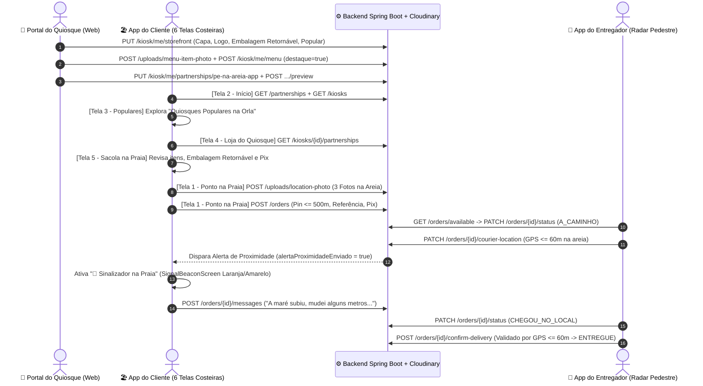

# Guia Passo a Passo de Navegação — Ecossistema "Pé na Areia" v2.1

Este documento descreve o fluxo completo de navegação das 3 aplicações do ecossistema **Pé na Areia** durante uma operação real de entrega na faixa de areia de Santos/SP.

---

## 1. Portal Web do Restaurante / Quiosque (`web/`)

**URL Local:** `http://localhost:5173`  
**Perfis:** `KIOSK_OPERATOR` ou `ADMIN`

### Passo 1.1 — Login e Seleção de Módulo
1. Na tela de acesso ([`LoginPage.tsx`](file:///c:/_development/workspace/pe-na-areia/web/src/components/LoginPage.tsx)), entre com o e-mail e senha do Operador do Quiosque (`kiosk-santos-1`).
2. Na barra de navegação superior ([`App.tsx`](file:///c:/_development/workspace/pe-na-areia/web/src/App.tsx)), alterne entre **Cardápio & Vitrine**, **Canais de Parceria** e **Pedidos**.

### Passo 1.2 — Configurar a Vitrine Costeira e Cardápio ([`MenuManager.tsx`](file:///c:/_development/workspace/pe-na-areia/web/src/components/MenuManager.tsx))
1. No card **"Vitrine do Quiosque no App do Cliente (v2.1)"**:
   - Preencha a **Descrição Curta da Vitrine** (ex.: *"Porções de Frutos do Mar, Água de Coco e Embalagem Retornável no Posto 5"*).
   - Envie ou informe a **Foto de Capa (`16:9`)** e o **Logo Circular** via upload integrado ao Cloudinary Docker (`POST /uploads/menu-item-photo`).
   - Marque os switches **"♻️ Aceita Embalagem Sustentável"** e **"⭐ Destaque em 'Quiosques Populares na Orla'"**.
   - Clique em **"Salvar Vitrine"** (`PUT /kiosk/me/storefront`).
2. Para cadastrar ou editar um prato/bebida ([`MenuItemFormDialog.tsx`](file:///c:/_development/workspace/pe-na-areia/web/src/components/MenuItemFormDialog.tsx)):
   - Clique em **"+ Novo Item"**.
   - Faça upload da foto do produto (`pe-na-areia/cardapio`), informe nome, descrição, categoria, preço e marque:
     - **"⭐ Destaque ('Mais pedidos na areia')"** (`destaque: true`)
     - **"♻️ Embalagem retornável"** (`returnablePackaging: true`)
   - Salve (`POST /kiosk/me/menu`).

### Passo 1.3 — Configurar Parceria e Simulador de Repasse ([`PartnershipPanel.tsx`](file:///c:/_development/workspace/pe-na-areia/web/src/components/PartnershipPanel.tsx))
1. Selecione o canal **`pe-na-areia-app`**.
2. Defina **Taxa de Entrega (`deliveryFee`)**, **Quem paga (`CLIENT` ou `KIOSK`)**, **Pedido Mínimo (`minimumOrder`)**, **Tempo de Preparo (`prepMinutes`)** e quais produtos entram no canal.
3. Utilize o **Simulador de Repasse** (`POST /kiosk/me/partnerships/{id}/preview`) para conferir o `subtotal`, a `commissionAmount` e o valor líquido do quiosque (`kioskNet`) antes de publicar.

---

## 2. App Mobile do Cliente (`frontend/` — Perfil `CLIENT`)

A jornada do banhista no [`CustomerHomeScreen`](file:///c:/_development/workspace/pe-na-areia/frontend/lib/presentation/customer/customer_home_screen.dart) é dividida em **3 abas inferiores (`Início`, `Pedidos`, `Conta`)** e **6 Telas Costeiras**:

### Passo 2.1 — Tela 2: Aba `Início` (Descoberta da Orla)
1. **Cabeçalho Costeiro**: Exibe o Ponto na Praia ativo (ex.: *"Posto 5 — Boqueirão"*). Toque nele para ajustar o pin na faixa de areia.
2. **Grade de 10 Categorias Praianas**: Toque em *Água de Coco*, *Porções & Peixe*, *Pastéis*, *Açaí & Gelados*, *Cervejas & Drinks*, *Espetinhos*, *Lanches Naturais*, *Sorvetes*, *Combos Guarda-Sol* ou *Sustentáveis* para filtrar os quiosques.
3. **Pílulas de Filtro Rápido**: Ative `♻️ Embalagem Retornável`, `🏃 Entrega grátis na areia` ou altere a ordenação (`Distância do Posto`, `Melhor avaliação`, `Menor tempo na areia`).
4. **Seção "Quiosques populares na orla"**: Carrossel com os quiosques em destaque. Toque em **"Ver todos →"** para abrir a Tela 3.

### Passo 2.2 — Tela 3: Vitrine `"Quiosques Populares na Orla"` ([`PopularKiosksScreen`](file:///c:/_development/workspace/pe-na-areia/frontend/lib/presentation/customer/popular_kiosks_screen.dart))
1. Visualize os cards fotográficos `16:9` com foto de capa, logo circular, selo do Posto de Salvamento, nota média (`★ 4.9`), tempo estimado na areia, taxa de entrega e distância até o seu guarda-sol.
2. Toque em um quiosque para abrir sua Loja Dedicada (Tela 4).

### Passo 2.3 — Tela 4: Loja / Cardápio Dedicado do Quiosque ([`KioskStorefrontScreen`](file:///c:/_development/workspace/pe-na-areia/frontend/lib/presentation/customer/kiosk_storefront_screen.dart))
1. Confira as **3 métricas operacionais**: `Tempo na areia`, `Taxa de entrega` e `No Guarda-Sol (Raio <= 500m)`.
2. Navegue pelo carrossel horizontal **"🔥 Mais pedidos na areia"** (itens com `destaque: true`) e toque no botão **`+`** para adicionar à sacola.
3. Na barra inferior, acompanhe o progresso do **Pedido Mínimo** da parceria e toque em **"Ver sacola"** para abrir a Tela 5.

### Passo 2.4 — Tela 5: Minha Sacola na Praia ([`BeachCartScreen`](file:///c:/_development/workspace/pe-na-areia/frontend/lib/presentation/customer/beach_cart_screen.dart))
1. Ajuste a quantidade de cada item com o seletor **`- 1 +`** ou limpe a sacola.
2. Ative o switch **"♻️ Preferir embalagem retornável / sustentável"**.
3. Escolha a forma de pagamento (**PIX Copia e Cola — Pagamento 100% antecipado na areia**) e toque em **"Continuar"**.

### Passo 2.5 — Tela 1: Cadastro Detalhado do `"Ponto na Praia"` ([`BeachSpotFormScreen`](file:///c:/_development/workspace/pe-na-areia/frontend/lib/presentation/customer/beach_spot_screen.dart))
1. **Mapa no Topo**: Confira ou reposicione o pin na faixa de areia (a até `500m` do Posto de Salvamento selecionado).
2. **Referências Visuais**:
   - **Referência da Barraca / Guarda-sol** (`referenciaBarraca`): ex. *"Guarda-sol listrado azul com 2 cadeiras brancas"*.
   - **Complemento na Faixa de Areia** (`complementoLocal`): ex. *"Em frente à rede de futevôlei"*.
3. **Guia de 3 Fotos na Areia** (upload real via `POST /uploads/location-photo`):
   - **Slot 1**: *Guarda-sol* (`fotoLocalUrl`)
   - **Slot 2**: *Visão do Posto* (`fotoVisaoPostoUrl`)
   - **Slot 3**: *Outro item*
4. **Contato & Etiqueta**: Preencha nome, telefone com máscara `+55 (13) 99000-0001`, escolha a etiqueta (`🏖️ Meu Guarda-sol`, `⛺ Tenda / Família` ou `🏐 Rede / Esporte`) e toque em **"Salvar Ponto e Enviar Pedido"**.

### Passo 2.6 — Tela 6: Aba `Conta` (`CustomerAccountTab`) e Aba `Pedidos` (`CustomerOrdersTab`)
1. Na **Aba `Pedidos`**:
   - Visualize o card do **Pix Antecipado** com botão para copiar o código **Pix Copia e Cola**.
   - Quando o entregador está `A_CAMINHO`, acompanhe a distância em metros no mapa, envie **mensagens rápidas de 1 toque** (*"A maré subiu, mudei alguns metros para trás"*) ou chame no WhatsApp.
   - Assim que o entregador entra no **raio de 60 metros** (ou marca `CHEGOU_NO_LOCAL`), toque no botão **"🔦 Ativar Sinalizador na Praia"** para abrir o [`SignalBeaconScreen`](file:///c:/_development/workspace/pe-na-areia/frontend/lib/presentation/customer/signal_beacon_screen.dart) em tela cheia piscante de alto contraste solar.
2. Na **Aba `Conta`**:
   - Acesse os 3 atalhos rápidos (`Ponto na Areia`, `Pagamento`, `Pedidos`), gerencie os pontos salvos e teste o Sinalizador a qualquer momento pelo botão **"Testar"**.

---

## 3. App Mobile do Entregador (`frontend/` — Perfil `COURIER`)

### Passo 3.1 — Aceitar Corrida na Orla ([`CourierHomeScreen`](file:///c:/_development/workspace/pe-na-areia/frontend/lib/presentation/courier/courier_home_screen.dart))
1. Faça login como `COURIER`.
2. Na lista **"Pedidos Prontos nos Quiosques"**, veja os pedidos com status `EM_PREPARO` / `PRONTO_PARA_ENTREGA` e toque em **"Aceitar Entrega"** (`status -> A_CAMINHO`).

### Passo 3.2 — Navegar pela Faixa de Areia com o Modo Bússola / Radar Pedestre ([`BeachRadarWidget`](file:///c:/_development/workspace/pe-na-areia/frontend/lib/presentation/courier/beach_radar_widget.dart))
1. Com a entrega ativa, o app exibe automaticamente:
   - **Mapa com Linha Reta Tracejada Pedestre** ligando a posição atual do entregador ao `pinCliente` na areia.
   - **Painel Bússola / Radar na Areia**: distância direta em metros (Haversine), ângulo em graus e direção cardeal em português (ex.: *"A 22m a Sudeste (135°) do Posto 5"*).
   - **Card de Identificação Visual na Areia**: Foto do Guarda-Sol e Foto da Visão do Posto (com **zoom interativo** ao tocar), `referenciaBarraca`, `complementoLocal`, etiqueta e telefone do cliente.
2. Enquanto caminha na areia, o app transmite a coordenada GPS (`PATCH /orders/{id}/courier-location`). Ao cruzar os **60 metros**, o cliente recebe automaticamente o alerta para levantar o **Farol Visual Laranja/Amarelo**.

### Passo 3.3 — Chegada e Confirmação Geofencing (Raio de 60m)
1. Ao avistar o guarda-sol ou o Sinalizador do cliente, toque em **"Cheguei no Local"** (`CHEGOU_NO_LOCAL`).
2. Entregue o pedido em mãos e toque em **"Confirmar Entrega (Validar GPS)"** (`POST /orders/{id}/confirm-delivery`):
   - Se o entregador estiver a **mais de 60m** do pin do cliente, o backend bloqueia com erro `422`.
   - Dentro do **raio de 60m**, a entrega é confirmada com sucesso (`ENTREGUE`).
